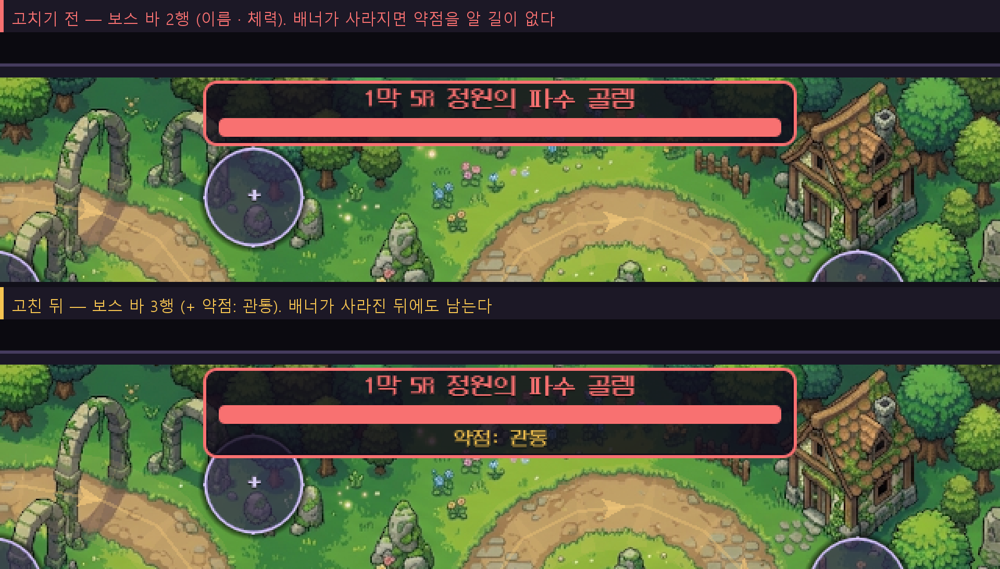
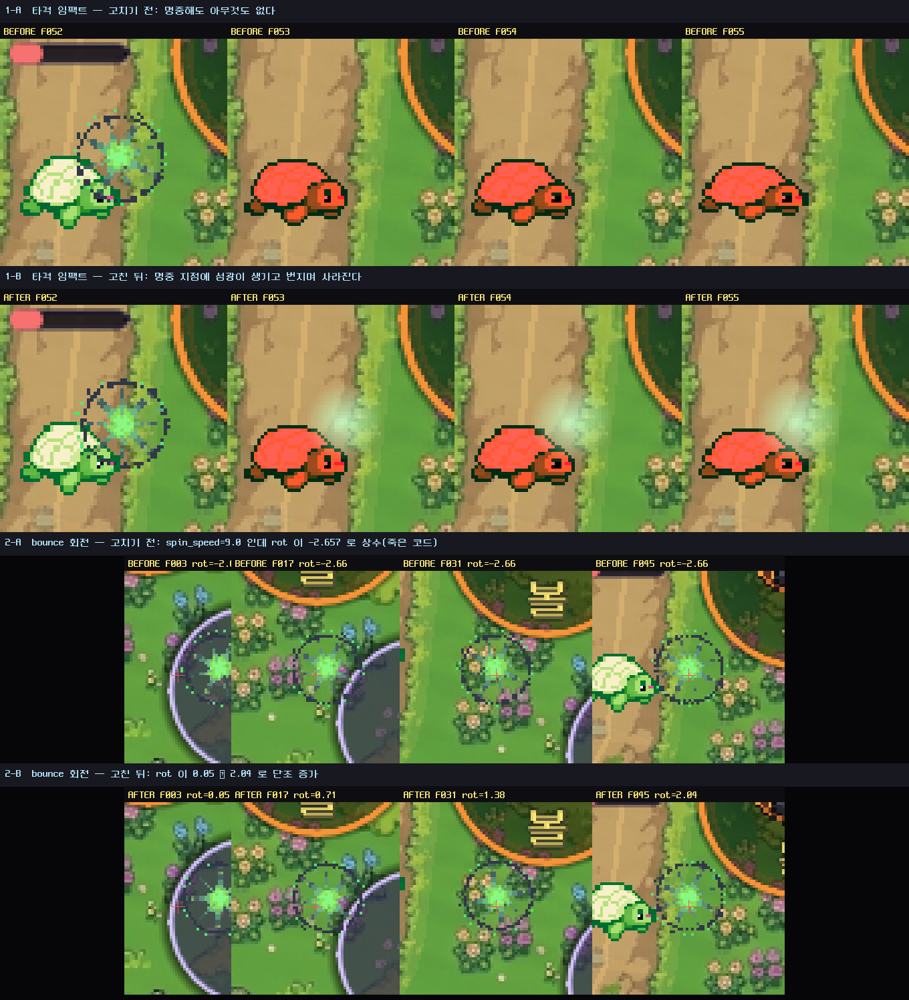

# 게임필 완성도 감사 — 『언어의 조각 : 말의 심연』

> 상용 모바일/PC 게임 완성도 기준으로 현재 빌드를 검토한 결과.
> **새 콘텐츠·기능 추가는 제안하지 않는다.** 이미 있는 로직이 화면·소리로 충분히 전달되지 않는 지점만 다룬다.
> 감사일 2026-09-19 · 대상 `godot/` (Godot 4.7.2, GL Compatibility)

---

## 0. 방법과 한계

### 0.1 방법

전부 **코드 정적 분석**이다. 실제 플레이 캡처가 아니다.

| 근거 종류 | 무엇을 확인했나 |
|---|---|
| 스테이징 구현부 | `Juice.gd`, `DefenseField.gd`, `EnemyUnit.gd`, `Projectile.gd`, `Meteor.gd`, `WordTower.gd`, `JamoBelt.gd`, `TowerDefenseMain.gd`, `WaveRewardModal.gd` |
| 오디오 | `SoundEngine.gd` 전량 (15개 효과음, 12-player 풀) |
| 호출 그래프 | `grep` 으로 모든 `Juice.*` / `SoundEngine.play_*` 호출 지점 역추적 |
| 트윈·이징 통계 | 프로젝트 전체 `tween_property` / `set_trans` / `set_ease` 집계 |
| 사장 코드 | 참조 0인 심볼 전수 |

### 0.2 한계 — 반드시 먼저 읽을 것

**최초 작성 시점에는 창을 띄운 육안 검증을 하지 못했다.** 2026-09-18부터 NVIDIA OpenGL 드라이버(`nvoglv64.dll`)가 창 생성 단계에서 죽어서 헤드리스만 동작했다. 원인은 프로젝트가 아니고(프로젝트 없는 Godot까지 죽는다), 재부팅 전에는 복구되지 않는다. 자세한 진단은 `godot/README.md` 의 "창이 안 뜰 때" 참고.

**→ 2026-09-19 재부팅 후 창이 정상적으로 뜨면서 육안 검증을 완료했다. 결과는 §6 에 정리했다.** `check_gpu.sh` 는 `pm_opengl3 / pm_d3d12 / pm_vulkan / project_opengl3 / headless` 전부 `[OK]` 로 돌아왔고, 진단(프로젝트 문제가 아니라 드라이버 문제)이 맞았음이 확인됐다.

육안 검증으로 **본문의 결론 대부분이 그대로 확정**됐고, 코드만 읽어서는 잡히지 않던 **신규 결함 1건**(모달 5종의 중앙 정렬 붕괴, §6.3)이 추가로 발견됐다. 또 본문에서 "의심"으로 적었던 2건(모달 비침, 버튼 글리프 깨짐)은 **실측 결과 내 착시**로 판명돼 §6.4 에 정정했다.

**타이밍 체감**(0.12초가 실제로 짧게 느껴지는지, 화면 흔들림 9.0이 과한지)은 여전히 미검증이다. 프레임 캡처는 "무엇이 몇 프레임에 일어나는가"는 알려주지만 "사람이 어떻게 느끼는가"는 알려주지 않는다. 아래 수치 제안은 실측 튜닝이 필요하다.

### 0.3 신선도 — 이 문서의 본문은 **작성 시점의 기록**이다 (2026-09-24 추가)

이 감사는 2026-09-18~19 에 쓰였고, 그 뒤로 **고침이 계속 들어왔다.** 그래서 본문에는 이미
고쳐진 결함이 **현재형으로** 남아 있다. 2026-09-24 에 전수 점검해서 다음을 고쳤다:

| 무엇 | 어떻게 낡았나 |
|---|---|
| §2.1 · §2.2 · §2.3 · §2.7 | **본문이 '고치기 전' 을 현재형으로** 적고 있었다 → 고침 표시 + 고친 방식·근거를 덧붙였다 |
| §2.9 · §2.10 · §2.12 | 본문엔 고침이 있었는데 **제목이 침묵**했다 → 제목에 상태 표식을 붙였다 |
| §2.14 | **결론이 거짓**이었다 — "툴팁은 화면이 아니다" 라고 미해결로 남겼는데, 잔량은 리롤 결정 화면에 이미 보였다. **채널 하나를 재고 '화면 전체' 를 판정**한 결론이었다(→ ⚪ 정정 + `DiceVisibilityProbe` §7) |
| **§1 · §3 · §4** (2026-09-24 2차 점검) | **가장 낡은 구역이었다.** §1 은 "무엇이 비어 있는가" 의 출발점이고 §3 은 항목별 판정표인데, **"없음" 17개가 이미 고쳐진 뒤**였다 — `투사체 명중 0`(§2.1) · `Trailing HP Bar 없음`(§2.3) · `사망 과정 없음`(§2.2) · `막 클리어 자동 3초 닫힘`(§2.7) · `단어 완성 무음`(§2.12) · `보상 카드→벨트 없음`(§2.6-a) · `팡파레 2회`(§2.8) · `사유 표시 없음`(§2.10-a/c) · `숙련 상승`(❌ 시스템 자체가 제거) 등. §4.2 의 "카운트다운 중복" 은 **§3 의 마지막 행이 이미 "✅ 해소" 라 적고 있는데도** 남아 있었다 — **한 문서 안에서 두 절이 서로 모순**된 사례다 |
| **§5.3 28** (2026-09-24 3차) | **"미참조" 를 "사장" 으로 읽었다.** `tools/build_theme.gd`·`tools/sync_test_scene.gd` 를 지우라고 했는데, 둘은 헤더에 실행법이 적힌 **수동 실행 코드 생성기**다 — 코드에서 참조되지 않는 것이 **정상**이다(후자는 `run_all.sh` 가 도는 테스트 씬을 만든다 — ⚠️ **2026-10-04 정정: 그 `sync_test_scene.gd` 는 *깨져* 있었다**(RC=0 + `✅ 완료` 를 찍으면서 `script=` 0줄 씬을 쓴다). 지금은 씬 모드 `tools/SyncTestScene.tscn` 이 그 일을 한다 → §5.3 28). 그대로 지웠다면 테마와 테스트 씬을 **재생성할 수단이 사라졌다** → 「§5.3 28 정정」 |
| **행 번호 인용** (2026-10-04 4차 점검) | `File.gd:NNN` 인용 **162개**를 기계 점검해 **드리프트 10곳**을 찾았다 — `EnemyUnit._die()` `:693`→`:739` · `DefenseField.gd:1204`→`:1359` · `TowerDefenseMain.gd:588`→`:659` · `Meteor.gd:68`→`:77` · `WordTower.gd:621,780`→`:644,847` · `JamoBelt.gd:21`→`:16` · `WordTower.gd:141`→`:220`(`setup_tower`). ⚠️ **어긋난 인용은 예외 없이 *빈 줄*·`return`·`continue` 를 가리켰다** — 그게 드리프트의 지문이다. 덤으로 **개수 주장 하나가 낡은 것**도 나왔다(`play_magic` 3건 → **4건**, §2.22-6 의 이동이 전파되지 않았다) |

⚠️ **점검 방법에서 배운 것 — "그 grep 을 다시 돌려 보는" 방식은 이 부류를 못 잡는다.**

- **§2.3 이 대표적이다.** 감사는 "`tween_property(..., "value", ...)` 가 0건이다" 라고 썼고,
  **그 문장은 지금도 참이다.** 그런데 HP 바는 **고쳐졌다** — 트윈이 아니라 **지수 감쇠**를 썼기
  때문이다(`Juice.approach()`). 즉 **감사의 근거 문장을 재검증해도 결론의 낡음은 못 잡는다.**
  (같은 함정이 §3 의 `Tween/Lerp/Easing` 행에도 있었다 → 그 자리에 경고를 남겼다.)
- **§2.7 은 양쪽이 다 침묵했다** — 제목에도 본문에도 표식이 없어서, 문서 안의 표식만 훑는
  자동 점검은 "변화 없음" 으로 지나간다. **코드를 읽고 원래 주장을 다시 재는 것 말고는 방법이 없다.**
- **§1 의 표는 셀 단위로 표식을 달았다.** 표는 "어느 셀이 아직 비었나" 를 한눈에 봐야 하는데,
  절 제목 표식만으로는 **표 안의 낡음을 못 막는다** — 표는 §1 에만 있는 구조라 규칙도 따로 필요했다.
- ⚠️ **행 번호는 심볼보다 빨리 낡는다**(2026-10-04). `File.gd:NNN` 162개를 기계로 훑어(가리킨 줄이 **빈 줄·`return`·`continue`·`}`** 면 의심) **10곳**이 어긋나 있었다. 그래서 인용에는 **심볼을 함께 적는다** — `:NNN` 만 적으면 다음 사람이 **빈 줄**을 만나고도 이유를 모른다. (이 프로젝트의 규칙 *"행 번호는 인용 전에 다시 열어 볼 것"* 의 자동화판이다.)
- ⚠️ **좌표만 고치려다 *주장*이 낡은 것을 만났다**(같은 점검). `play_magic` 행은 좌표가 어긋난 게 아니라 **개수가 3 → 4 로 늘어 있었는데** 아무도 몰랐다 — **같은 표의 이웃 행(`play_buff`)은 갱신됐고 이 행은 남았다.** 좌표를 고치는 김에 **그 줄이 주장하는 수를 다시 세라.**

### ⚠️ 이 점검 자체가 낸 오류 — 그리고 왜 그게 §2.14 와 같은 부류인가

위 32행을 정정하면서 **§3 의 `결과 화면`·`Victory`·`Game Over` 3행을 거꾸로 정정했다.**
`_on_game_over()` 본문만 grep 해서 "패널 등장 트윈이 없다" 고 썼는데, 연출은 **그 함수가 호출하는
`_show_modal()`(`TowerDefenseMain.gd:1036` — 2026-10-02 재측정, 당시 `:965`)** 안에 있었다 — `scale 0.92→1` · `alpha 0→1` 을
0.18초 `TRANS_BACK` 으로 잡고, 게임오버 경로도 `:1632`(당시 `:1499`)에서 이 함수를 탄다. **이미 있던 연출을
"없다" 고 적을 뻔했다.**

⚠️ **더 나쁜 것은 §5.2 10 이 처음부터 "BACK_OUT 은 이미 있음" 이라고 맞게 적고 있었다는 점이다.**
즉 §3 과 §5.2 는 **원래 모순 상태**였는데, 점검이 그 모순을 **해소하는 대신 반대편으로 키웠다.**
(§4.2 vs §3 에서 찾은 것과 **정확히 같은 종류의 모순**을, 같은 점검 안에서 재생산했다.)

**규칙 둘로 남긴다:**

1. **함수 하나를 재고 메커니즘 전체를 판정하지 마라.** 연출은 "이벤트 핸들러" 가 아니라
   **호출되는 공용 함수**에 있는 경우가 많다(`_show_modal` 이 그렇다 — 모달 6곳이 전부 이 함수를
   탄다). **호출 그래프를 따라가라.**
2. **점검자도 자기 규칙을 어긴다.** 이 오류는 §2.14(프로브가 툴팁 채널 하나만 재고 '화면 전체' 를
   판정)와 **같은 부류**이고, **같은 세션에서 두 번** 났다. 한 채널·한 함수에서 "없다" 를 주장할
   때는 **그 주장이 미치는 범위를 먼저 세라.**
3. **`grep` 0건은 "불필요" 의 증거가 아니다.** `--script` 로 사람이 직접 돌리는 도구
   (`extends SceneTree`)는 코드에서 참조되지 **않는 것이 정상**이다. "미참조" 와 "사장" 을 구분하라 —
   §5.3 28 이 그 둘을 같게 취급해 **살아 있는 도구 둘을 죽은 코드로 분류**했다.
   그리고 **그 전수조사 도구 자체도 한 번 틀렸다**(`class_name` 을 안 봐서 `ActClearModal`·`Meteor` 를
   미참조로 올렸다 — 둘은 `ActClearModal.new()` 처럼 **이름으로** 쓰인다).
   **도구의 출력도 가설이다.**
4. **"검증할 수 없다" 고 쓰기 전에, 검증할 수 없는 것이 *느낌* 인지 *메커니즘* 인지 나눠라.**
   §2.8 은 0.4초 여운을 *"시간축 변경이라 헤드리스로 검증할 수 없다"* 며 하루 동안 미해결로 묶어
   두었다. 틀렸다 — 잴 수 없는 것은 "0.4초가 적절한가" 이고, **패널이 실제로 0.4초 뒤에 뜨는가 ·
   그 0.4초가 배속을 따르는가**는 헤드리스로 잰다(§2.8 의 `GameOverProbe` §6~§8).

→ 그래서 제목 끝의 상태 표식(`✅`/`⏳`/`⚪`/`❌`)은 **본문보다 우선한다.** 본문을 인용하기 전에
제목을 보고, **행 번호를 인용하기 전에 그 줄을 다시 열어 볼 것.**

---

## 1. 이벤트 인벤토리

플레이어가 실제로 인지하는 사건을 **발생 빈도 × 게임플레이 중요도**로 분류했다. 연출 강도를 여기에 비례시켜야 한다.

> ### ⚠️ 이 인벤토리는 **작성 시점(2026-09-19 이전)의 스냅샷**이다 (2026-09-24 신선도 점검)
>
> §1 은 "무엇이 비어 있는가" 를 정하는 **출발점**이라 가장 많이 인용되는데, **가장 낡기 쉬운 절**이기도
> 하다. 2026-09-24 점검에서 아래 표들의 **"없음" 12개가 이미 고쳐진 뒤**였다 —
> `막 클리어 자동 3초 닫힘`(§2.7·§2.11) · `단어 완성 무음`(§2.12-a) · `타워 즉시 등장`(§2.9) ·
> `보상 카드 → 벨트 없음`(§2.6-a) · `적이 죽는 과정 없음`(§2.2) · `투사체 명중 0`(§2.1) ·
> `타일 누름 반응 없음`(§2.10-b) · `붉은 비네트`(§2.11-a — 실제로는 **단색 판**이었고, ✅ 2026-10-03 부터 **화면 100%**) 등.
>
> **표의 셀은 그 자리에서 정정 표시(`✅ 고침` / `❌ 철회`)를 달았다.** 상태 표식이 없는 셀은
> **아직 유효**하다는 뜻이다. 새 연출을 제안하기 전에 **그 셀이 아직 비어 있는지 코드로 확인**하라 —
> 이 절만 읽고 우선순위를 정하면 **이미 있는 것을 또 만들게 된다**.

### 클라이맥스 — 런당 1~12회

| 사건 | 빈도 | 현재 연출 |
|---|---|---|
| 승리 / 기지 함락 | 1회 | 정적 패널 + BACK_OUT 등장 + **전용음**(§2.8) + **0.4초 여운**(§2.8, ✅ 2026-09-24) |
| 막 클리어 | 3회 | 모달 — **닫아야 다음 막이 시작된다**(§2.7·§2.11). ⚠️ "자동 3초 닫힘" 은 **삭제**됐다(타이머가 `time_scale` 을 타 4x 에서 0.77초가 되고 정지 중엔 안 왔다) |
| 보스 등장 | 12회 | 흔들림+섬광+배너+확대+HP바 (**시각·청각 완비** — 소리 ✅ 2026-09-23) |
| 보스 처치 | 12회 | **✅ 고침 (2026-10-01 소리 · 2026-10-03 파편 색)** — 예전에는 일반 처치 연출을 **완전히 공유**했다(squash 0.07초 → fade 0.12초, §2.2). 이제 **보스 전용 처치음**(`play_boss_death`, 0.70초)이 있고 `coin` 을 **교체**하며, **파편 색도 보스 타입 색(빨강)으로 갈렸다**(§2.2 의 *적 종류 파편 색* 이 보스에 닿았다). 실제로 다른 것은 **소리 + 골드 8~12배 + 체력바가 사라지는 것 + 파편 색** 넷이다. ⚠️ **글자·폰트·상승 거리는 여전히 잡몹과 같다** · **→ §2.4 문제점 6 · §5.2 30** |
| 기지 피격 | 런당 5~15회 | 흔들림(한 방향 — §2.4-a) + 붉은 섬광(**화면 100%** — ✅ 2026-10-03, §2.11-a). ⚠️ **"비네트" 는 아니다** — 가장자리 처리가 없는 단색 판이다. **소리는 ✅ 2026-10-03 부터 전용 파형**(`play_base_hit` → `hit_base`, §2.23-8) |
| **단어 완성** | 5~15회 | 배너 + **전용음 `play_word_crafted`** (✅ 2026-09-23, §2.12-a) — 게임 정체성 이벤트 |
| 타워 건설 | 5~15회 | 마법진 페이드 + **본체 0.8→1.0 BACK_OUT 0.22초** + 완성음. ⚠️ "본체는 즉시 등장" 은 **틀렸다**(§2.9 정정). ⚠️ **2026-10-05 까지 마법진은 *색 사각형*, 타워 우상단 특성 배지는 *흰 사각형*** 으로 그려졌다 — `_draw()` 안 **첫 `load()`** 가 원인(**✅ 고침**, §2.25) |

### 중요한 행동 — 런당 30~60회

| 사건 | 현재 연출 |
|---|---|
| 웨이브 클리어 → 보상 드래프트 | 모달 완비 (양호) — ⚠️ **✅ 2026-10-06 정정**: 모달은 완비였지만 **한 번도 뜨지 않았다**(가드가 *항상* 거짓 — **§2.44**). 지금은 **뜬다** |
| 보상 카드 선택 → 벨트 반영 | **✅ 고침 (2026-09-23, §2.6-a)** — 카드가 벨트로 **날아간다**(`RewardFlightProbe` 실측: 이동 495.5→60.2 px) |
| 유물 구매 | 모달 + **전용음 `play_buff`**(✅ 2026-09-26, §2.22-6 — 이 파형의 주인은 여기 하나뿐이다). ⚠️ **화면 연출은 아직 모달뿐**이다(2026-10-03 확인) |
| 타일 구매 / 활자 교체 | 소리 + **비활성 사유 표시**(§2.10-a/c) + **같은 활자가 나오면 토스트** — **✅ 고침 (2026-09-26, §2.24-6)**. ⚠️ 소리는 성공에만 나고, 같은 활자에는 **문구만** 난다(모드는 일부러 유지) |
| 타워 재배치 (드래그) | 리프트만, 착지 연출 없음 — ✅ **실측 확인 (2026-10-03, `TowerRebuildProbe`)**: 재배치는 등장 팝(`scale 0.8→1.0`)도 **돌리지 않는다**(`[1.0, 1.0]`). 교체는 돈다(`0.800`) — §2.9 정정 |
| ~~슬롯 해금 / 숙련 상승~~ | **❌ 철회 (2026-09-23)** — `tower_mastery` 는 **제거**됐다(참조 0건). 없는 시스템의 표현을 논하던 행이다(§5.2 16) |
| 적 처치 | 골드 텍스트 + 파편 + **사망 연출**(squash 0.07초 → fade 0.12초, §2.2). ⚠️ "죽는 과정이 없음" 은 **틀렸다** |

### 일반 행동 — 분당 100회 이상

| 사건 | 현재 연출 |
|---|---|
| 기본 공격 발사 | 발사음만, 예비동작 없음 |
| **투사체 명중** | **✅ 고침 (2026-09-23, §2.1)** — `_spawn_impact()` (`Projectile.gd:158`). ⚠️ 감사 §1.1 의 "가장 흔한 이벤트에 0" 이라는 근거가 **소멸**했다 |
| 타일 클릭/선택 | **✅ 고침 (2026-09-23, §2.10-b)** — `pressed` 가 `hover` 와 **다른** 스타일박스(`JamoBelt.gd:1631`/`:1641`) |
| 버튼 호버/프레스 | 테마 스타일박스만 |

### 1.1 가장 중요한 구조적 발견

**연출 투자가 게임플레이 빈도와 역전되어 있다.**

```
유성(Meteor.gd, 92줄)          → 예고 원 → 낙하 + 궤적 → 충격파 링 → 잔광 0.5초
                                   발동 빈도: 특정 타워에만, 간격 2.2초

기본 공격(Projectile.gd, 115줄) → 명중 시 queue_free()      ← ⚠️ 2026-09-23 고침 (§2.1)
                                   발동 빈도: 분당 100회 이상, 런 전체의 주력
```

> ⚠️ **아래 결론의 근거였던 두 번째 줄은 더 이상 참이 아니다.** `_spawn_impact()`
> (`Projectile.gd:158`)가 붙어 명중에 연출이 생겼다(§2.1). 다만 **구조적 지적 자체는 아직 살아
> 있다** — 남은 것은 **예비동작(Anticipation)** 이다: 유성만 예고 원을 그리고, 기본 공격은 여전히
> 발사음만 낸다(§2.4 p4 ⏳). 즉 "이미 가진 기법을 엉뚱한 곳에만 쓴다" 는 **여전히 유효**하되,
> 대상이 `Impact` → `Anticipation` 으로 옮겨졌다.

`Meteor.gd` 는 이 프로젝트가 **할 줄 안다**는 증거다. 예고(anticipation) → 행동 → 충돌 → 여운의 4단계를 정확히 구현했다. 그런데 그 기법이 가장 드문 이벤트에만 적용되고, 가장 흔한 이벤트에는 0이다.

이건 "효과를 더 넣자"가 아니라 **"이미 가진 기법을 엉뚱한 곳에만 쓰고 있다"** 는 문제다.

**두 번째 구조적 발견 — 표와 화면 사이에 **판정**이 빠져 있다 (2026-09-26, §2.19) — **✅ 고침 (2026-09-26 임계·손목록 · 2026-10-01 `desc`)**. **

이 감사의 반복된 실패는 *"사실은 적혀 있는데 아무도 판정하지 않았다"* 였다(§2.4 p6: §1 표가
`일반 처치 연출을 공유` 라 적어 두었는데 §5.2 에 안 올라갔다). §2.19 는 그보다 **한 단계 앞**이다 —
**같은 사실이 두 곳에 *다르게* 적혀 있는데, 어느 쪽이 참인지 정하는 검사가 없다.**

```
상성이라는 하나의 수  →  예고 문구는 1.25 / 0.75 로 판정   (MonsterRoster.COUNTER_*)
                          피해 숫자는 1.35 / 0.72 로 판정   (EnemyUnit.WEAK_MULT / RESIST_MULT)
                          주석은 "같은 경계다" 라고 적는다   ← 거짓
                          그 수의 *뜻*을 적은 문장 4개는 화면에 안 간다 (ATTR_INFO.desc, 소비 0건)
```

`MonsterRoster.gd` 는 *"문구를 손으로 적어 두면 표를 고칠 때 조용히 어긋난다"* 는 교훈을
**주석에 적어 두고 타입 상성에는 적용**했지만(`type_counter_text`), **속성 상성에는 적용하지
않았고**(`ATTR_INFO.counter` 는 여전히 손), **임계에는 아예 적용하지 않았다**(두 벌이 따로 산다).
**교훈을 아는 것과 그 교훈을 모든 곳에 적용하는 것은 다른 일이다.**

✅ **2026-09-26 갱신 — 임계와 손 목록은 고쳤고, `desc` 는 남았다.** `EnemyUnit` 의 두 상수를
1.25/0.75 로 옮기고 `splitter` 문구의 누락(`3연속 바운스`)을 메웠다. `desc` 는 그때 **고치지
않았다** — 표 대 표가 아니라 **화면 배치**의 문제라(§2.19-3) 결정이 필요했기 때문이다.
⚠️ **이 발견의 진짜 교훈이 여기서 한 번 더 확인된다**: 세 조각 중 **둘은 "표를 고치는 일"** 이라
검사를 세우면 끝나지만, **셋째는 검사로 풀리지 않았다** — `AttrDescReachProbe` 는 2026-09-26 부터
*"아직 도달하지 않는다"* 를 계속 말할 뿐이었고, 그 문장을 **어디에 그릴지**는 감독이 정해야 했다.
**프로브를 세우는 것과 결정을 내리는 것은 다른 일이다.**
✅ **2026-10-01 — 셋째도 닫혔다.** 감독이 "남은것 모두 수행" 으로 위임했고, `attr_desc_text(act)`
를 스테이지 툴팁과 라운드 모달에 배선했다(§2.19-3 · §5.2 31 (B)). `AttrDescReachProbe` 는
**RC=1 → RC=0** 이 됐다. ⚠️ **그래도 교훈은 남는다** — 프로브는 *"도달하는가"* 만 재고,
*"어디에 그렸는가"* 는 여전히 사람이 정했다.

**세 번째 구조적 발견 — 채널이 **사건이 아니라 그 옆의 것**에 붙어 있다 (2026-09-26, §2.20 · §2.21) — **✅ 둘 다 고침 (2026-10-01, §5.2 32 · §5.2 33)**.**

§2.19 가 *"같은 수가 두 임계로 갈린다"* 였다면, §2.20·§2.21 은 **같은 이름이 두 사건을 덮고,
채널은 엉뚱한 쪽에 붙는다** 이다.

```
'치명타' 라는 말   →  진짜 치명타 : 확률로 굴려 ×2배      (WordTower, 계약 3곳)
                       피해 숫자  : dealt >= 60            (EnemyUnit._hit_kind)  ← 무관한 임계
                       → 33개 조합 중 31개에서 치명타가 안 보이고,
                         가시성은 정확히 "60 을 넘었는가" 와 동치 (예외 0건)

'방어도가 전부 먹은 타격'  →  시각 채널 : 붙었다 (색 #A6B8F2)
                              오디오 채널 : play_shield — 게임 코드 호출처 0건
```

> ⚠️ **위 그림은 2026-09-26 의 상태다 — 둘 다 2026-10-01 에 닫혔다.** §2.21 은 `dealt >= 60`
> 을 지우고 **진짜 치명타 플래그**로 갈았고(미표시 **31 → 0**), §2.20 은 `play_shield` 에
> **주인을 주고 파형까지 다시 썼다**(호출처 **0 → 1곳** · 0.16초 → 0.09초). 남은 것은
> §2.21 의 *예비동작*(§2.4 p4) **하나**다 — §2.20 의 *접두어 없음* 은 **미완이 아니라 규칙**이었다
> (2026-10-03 정정 · §2.20-8 참조).

두 결함의 공통 구조는 **"표현이 사건에 붙어 있지 않다"** 이다 — §2.21 은 채널이 *옆의 임계*에
붙었고, §2.20 은 채널이 *고아*가 됐다. 그리고 **두 번 다 코드가 스스로 그 사실을 주석에 적어
두었다**(`WordTower.gd:191` *"치명타는 매 발마다 굴리는 값인데 지금까지 화면 어디에도 없었다"* ·
`Juice.gd` *"아무도 이 종류를 돌려주지 않아 화면에 나온 적이 없었다(죽은 분기)"*).

⚠️ **적어 두는 것으로는 안 고쳐진다.** `Juice` 의 `shield` 죽은 분기는 그 주석이 달린 뒤 실제로
연결됐지만, **바로 그 옆의 `_` 분기 `if amount >= 60.0` 은 2026-10-01 까지 도달 불가**였다(§2.21-5, 그날 지웠다).
**같은 부류의 죽은 분기가 한쪽은 고쳐지고 한쪽은 남았다** — 그리고 남은 쪽은 *"큰 피해일수록
살짝 더 크게"* 라는 **거짓 주석**을 달고 있다.

**여덟 번째 구조적 발견 — 한 스트림만 보고 "아무 진단이 없다" 고 결론했다 (2026-10-01).**

주입 하나가 잘못된 들여쓰기를 만들어 `Juice.gd` 를 파스 오류로 만들었다. 프로브가 90초 동안
끝나지 않았고(rc=124), **표준출력에는 엔진 배너 한 줄뿐**이었다. 나는 그것을 *"Godot 이 아무
진단도 없이 멈춘다"* 고 적었다 — **거짓이었다.** 그 메시지는 **표준오류**에 있었고, 내가
`TimeoutExpired.stdout` 만 찍고 있었을 뿐이다.

```
STDOUT    73 자   Godot Engine v4.7.2.stable.official.ed1daf0bf - https://godotengine.org
STDERR 3,251 자   SCRIPT ERROR: Parse Error: Could not preload resource script
                  "res://scripts/ui/Juice.gd".
                  at: GDScript::reload (res://scripts/tower/EnemyUnit.gd:7)
                  … SCRIPT ERROR: Parse Error: Could not resolve class "Juice", …
```

⚠️ **이건 §2.14 와 정확히 같은 실수다** — *"채널 하나를 재고 화면 전체를 판정했다."* 그때는
툴팁을 재고 *"화면에 없다"* 고 했고, 이번에는 stdout 을 재고 *"아무 말도 없다"* 고 했다.
**둘 다 채널을 하나만 봤다.** 도구를 만들 때도 같은 규율이 필요하다 — `capture_output=True` 는
stdout·stderr 를 **따로** 담으므로, 실패 진단을 읽으려면 `stderr` 를 봐야 한다.

⚠️ 그리고 **오류 사슬의 첫 줄이 진짜 범인**이다 — `EnemyUnit.gd:7`(preload 지점)만 보면
엉뚱한 파일을 고치게 된다. 진짜 깨진 파일은 **첫 줄**의 `Juice.gd` 다.

⚠️ 그래서 **하네스는 `TimeoutExpired` 를 실패로 처리해야 한다.** 시간 초과를 '통과' 로 읽으면
파스 오류가 조용히 초록이 된다 — 이 프로젝트는 *"프로브가 죽으면 통과가 아니다(RC=124)"* 를
이미 알고 있었고, 이번에 **왜 그런지**(장면 스크립트가 로드에 실패하면 `quit()` 에 도달하지
못한다)와 **어디를 봐야 하는지**(stderr)를 채웠다.

**그리고 세 번째 발견의 변종 — 채널이 사건에 붙었는데 **다른 사건과 공유**되어 우선순위가 없다 (2026-09-26, §2.23).**

§2.20·§2.21 은 채널이 **엉뚱한 곳**에 붙은 경우였다. §2.23 은 **제자리에 붙었는데도** 실패한다:

```
기지 피격  →  시각 : 흔들림 7.0 + 섬광 (전용, 등급을 받았다)
               소리 : play_hit  ← 적 피격과 **같은 이름**
                      → 같은 파형 = 귀로 구별 불가
                      → 게다가 스로틀이 **이름별 50ms** 라
                        적 피격이 먼저 났으면 **나지 않는다**(실측)
```

⚠️ **이것이 앞의 셋과 다른 점은, 사건의 등급을 코드가 이미 적어 두었다는 것이다** —
`DefenseField._on_enemy_reached_base()` 옆의 주석 *"기지 피격은 가장 강한 타격감이 필요한
순간"*(`:1262`). 그 등급을 **시각만** 받았다. 즉 **문제는 배분이 아니라 *공유* 다** — 소리를
하나 더 만들 필요 없이, **이미 있는 소리를 나눠 쓰지 않게** 하는 것만으로 우선순위 역전은
사라진다(§2.23 (B)). ⚠️ **2026-10-03 에 (C) 가 그 선을 한 칸 넘었다** — *"공유하지 않게"*
(창 분리)에서 *"다르게"*(파형 분리)로 갔고, **그래서 소리를 하나 만들었다.** 아래 참조.

⚠️ 그리고 여기에 **감독의 원칙이 정면으로 걸린다** — `TowerDefenseMain.gd:618` 의
**`소음 금지`**. 그래서 §2.23 은 *"결함"* 이 아니라 **"결정 대기"** 로 분류했다.
**원칙이 적혀 있는 자리에서는 측정이 곧 판정이 아니다.**

✅ **2026-09-26 갱신 — 감독이 (B) 를 골라 *삼켜짐* 하나를 없앴다**(§2.23-7). ⚠️ **여기서
"설명이 계약이다" 가 한 번 꺾인다** — 감사가 적어 둔 처방(*"스로틀 면제"*)을 그대로 구현하면
**코드가 지키던 다른 계약**(창 안 중복 억제)이 깨진다. 처방의 *목적*(우선순위 역전 제거)은
지키고 *기구*(면제)는 바꿨다 — **계약은 문구가 아니라 목적에 걸려 있었다.**

✅ **2026-10-03 갱신 — 감독이 (C)·(D) 로 *귀 구별*까지 닫았다**(§2.23-8). ⚠️ **여기서
"새 효과를 만들지 않는다" 가 꺾인다** — `play_base_hit` 이 **전용 파형 `hit_base`** 를 얻어
**파형 키가 하나 늘었다**(별칭 3 → 2 · 고유 파형 18 → 19). (B) 를 고를 때 적어 둔
*"새 소리 0"* 을 **일부러 폐기한 것**이다. 근거는 우선순위가 아니라 **표현**이었다 —
소리 채널은 **이미** 있었고 결함은 *"그 소리가 일상적인 적 피격과 똑같이 들린다"* 였으므로,
**없던 효과를 더한 게 아니라 잘못 전달하던 표현을 고친 것**으로 판단했다.
⚠️ **판단의 무게는 감독에게 있다** — 되돌리기 쉬운 지점을 §2.23-8 에 적어 두었다.

**네 번째 구조적 발견 — 채널이 **별칭 뒤에 숨는다** (2026-09-26, §2.22).**

앞의 셋은 전부 **게임 코드**의 문제였다. 이번엔 **감사 자신의 셈**이 틀렸다 — 그리고 그 틀림이
위 셋과 **같은 모양**이다.

```
'고아 소리' 를 세는 방법  →  이름이 scripts/ 에 몇 번 나오는가   ← 텍스트 셈
                              별칭은 그 이름을 *남기지 않는다*  ← 구조

play_heal  →  이름으로는 0회          ← 그래서 '고아' 로 분류됐다
              play_buff 가 3곳에서 불린다 → play_heal() 한 줄   ← 실제로는 매일 울린다
                                                          (2026-09-26 재배치 후 **1곳**)
```

⚠️ **2026-09-26 갱신** — 감독이 §5.2 34 **(C) 재배치**를 골라 *저장*·*밀어내기* 가 다른 소리를
받았고(§2.22-6), `play_buff` 의 주인은 **유물 구매 1곳**만 남았다. 이 발견의 교훈
(*소리를 셀 때는 별칭 지도를 먼저 그려라*)은 **그대로 유효하다** — 셈이 아니라 **배치**가 틀렸던 것이다.

⚠️ **더 고약한 것은 §4.3 이 별칭의 존재를 이미 적어 두었다는 점이다** — 두 행이
`play_buff = play_heal` 이라고 **정확히** 적고, 그 옆에 사유로 *"`play_heal` 라이브 호출자
0건"* 이라고 적었다. **참인 근거로 틀린 결론을 내렸다**: 물어야 했던 것은 **별칭 자신의**
호출자다. 이 감사가 §2.19 에서 배운 것(*"교훈을 아는 것과 모든 곳에 적용하는 것은 다르다"*)이
**감사 자신의 문장에** 그대로 적용된다.

⚠️ **그래서 이 발견의 실용적 결론은 도구에 대한 것이다.** *"이름으로 세면 고아가 3개"* 라는
셈은 **이 저장소에서 원리적으로 부정확**하다. 소리를 셀 때는 **별칭 지도를 먼저 그리고**,
그 뒤에 **도달 가능성**을 세야 한다 — §2.22 의 프로브가 그 순서를 강제한다(§1 의 S1 이
별칭 지도를, S2 가 도달 가능성을 단언한다).

**다섯 번째 구조적 발견 — 규칙도 있고 기제도 있는데, 그 분기에서 **아무도 부르지 않는다** (2026-09-26, §2.24).**

앞의 넷은 전부 *"채널이 어딘가 잘못 붙었다"* 였다. §2.24 는 **채널이 아예 없고, 게다가 상태 기계도
그 분기에서 멈춘다** 이다.

```
유료 활자 교체 (10G)
  ├─ 성공 : 글자 바뀜 · swap_mode 풀림 · tile_combine
  └─ 같은 활자 (6~30%) :  return   ← 이 한 줄뿐
                            글자 그대로 · 소리 없음 · 문구 없음
                            ⚠️ swap_mode 가 **켜진 채 남는다**
```

⚠️ **이것이 앞의 넷과 다른 점은, 프로젝트가 이 상황을 이미 *예상하고 규칙을 적어 두었다*는
것이다** — *"조용히 아무 일도 안 일어나면 버튼이 고장 난 것처럼 보인다"* 가 **두 파일**
(`JamoBelt.gd:479` · `TowerDefenseMain.gd:1173`)에 적혀 있고, 그 규칙을 지키려고 채널도
**이미 만들어 두었다**(`_toast` 4줄 · 벨트 상태 라벨 14곳 · 비활성 사유).

**그런데 이 경로는 그 어디에도 안 걸린다.** 사유 채널은 *"막힌 상태"*(골드 부족·벨트 가득)를
위해 만들어졌고, 성공 채널은 *"일이 일어난 상태"* 를 위해 만들어졌는데 — **"주사위가 같은 값을
냈다"** 는 둘 중 어느 쪽도 아니다. 즉 **거절 분기(refusal branch)가 규칙의 사각지대**다.

**여섯 번째 구조적 발견 — 고침이 **그 고침의 프로브**를 깨뜨렸는데, 아무도 몰랐다 (2026-10-01).**

앞의 다섯은 전부 **게임 코드** 안의 결함이었다. 이번엔 **검증 도구**가 조용히 낡았다.

```
§2.23 이 `play_base_hit()` 을 새로 만들었다        → `play_*` 정의 19 → **20**
§2.23 이 `play_hit` 에 `throttle_key` 를 붙였다    → 카테고리 파서가 그 줄을 못 읽음 17 → **16**
§2.23 (C) 가 `play_base_hit` 에 전용 파형을 줬다   → 별칭 3 → **2** · 고유 파형 18 → **19** (2026-10-03)
§2.22 가 `play_buff` 의 본문을 바꿨다              → 별칭 지도 `play_buff→play_heal` 이 깨짐
                                        ↓
                          `tools/OrphanSoundProbe` 가 **빨개졌다**
                                        ↓
                     그런데 `run_all.sh` 에 **없었다** → **5일 동안 아무도 안 돌렸다**
```

⚠️ **핵심은 셋째 줄이다.** §2.22 는 *"`play_heal` 은 고아가 아니다"* 라는 **감사의 정정 자체를
게임 코드로 옮긴 작업**이었다. 그런데 그 작업이 `play_buff` 의 본문을 `play_magic()` 으로
바꿔 놓아서, `play_heal` 이 **다시 진짜 고아**가 되고 **유물 구매가 밀어내기와 같은 소리**가
됐다 — **정정이 정정을 취소한 것**이다. `OrphanSoundProbe` 의 `aliases ==` 단언이 **그걸 잡을
수 있었지만**, 프로브를 안 돌렸으므로 아무도 몰랐다.

⚠️ **이 감사의 반복되는 교훈이 여기서 한 번 더 나온다** — §2.19 의 *"교훈을 아는 것과 모든 곳에
적용하는 것은 다르다"*, §2.24 의 *"기제를 만든 것과 모든 분기에서 쓰는 것은 다르다"*.
여기서는 **"프로브를 만든 것과 고침 뒤에 돌리는 것은 다르다"** 다.
그리고 이 저장소에는 **판정형 프로브 31개가 `run_all.sh` 밖에 있다**(2026-10-01 전수 실측 — 예전에 적힌 24개·112초는 **낡은 수**였다: 실제 **31개·65초**, 빨강 **3개**) — 그래서 이 사건은
**한 번의 사고가 아니라 구조의 필연**이다.

→ ✅ **2026-10-03 해소** — 판정형 **39개 전부**를 `run_all.sh` 에 등록했다(감독 승인 · 스위트 43초 → 4분). 위 **31개·빨강 3개**는 **그때의 수**다.

⚠️ **2026-10-01 갱신 — 셋 다 고쳤다.** ① `play_buff()` 를 `play_heal()` 로 **복원**(§2.22-6 이
기록한 별칭), ② `OrphanSoundProbe` 의 기대값(정의 20 — 그 뒤 §5.2 30 (A) 의 `play_boss_death` 로 **21** · 고아 집합 · 별칭 지도)과 카테고리
파서(`^, (ui|sfx)_volume_db[,)]` — **끝을 `)` 로 못 박으면 인자가 하나 더 붙은 호출을 놓친다**)
를 갱신, ③ 두 프로브를 **RC=0** 으로 되돌렸다. ⚠️ **그리고 이 발견의 처방은 이미 백로그에
있는 항목이다** — *"판정형 프로브를 `run_all.sh` 에 등록"*. 이 사건이 그 항목의 **값을 측정했다.**

⚠️ **2026-10-01 밤 — 같은 부류를 전수 스윕이 *둘 더* 찾았다 (48개 씬 · 753초).** 위 처방이
아직 실행되지 않았으므로 그날 밤 다시 전수로 돌렸다. **판정형 30개가 `_OK`** 를 찍었고,
**진짜 회귀 둘**이 나왔다 — 그리고 둘 다 **이미 고쳐진 줄 알았던 것들**이다.

| 도구 | 증상 | 누가 깨뜨렸나 |
|---|---|---|
| `tools/OrbitBalanceProbe.gd` | **파스 오류 → rc=124 (멈춤 · stdout 무출력)** | **§2.21-7** — `EnemyUnit.take_damage()` 가 `is_crit` 를 얻었는데, 이 파일의 `class DummyEnemy extends EnemyUnit` 오버라이드가 **4개 인자 그대로**였다 → *"The function signature doesn't match the parent"* |
| `tools/BaseHitSignalProbe.gd` | rc=2 · `FAIL_SECTION S6` **×2** | **§5.2 30 (A)** 가 파형을 **18개**로 늘렸고(17 하드코딩), **§5.2 32 (C)** 가 `play_shield` 를 0.09초로 줄여 `hit` 의 순위를 **3 → 4** 로 밀었다 |

⚠️ **새로운 기제 — *오버라이드*는 부모의 인자 변화를 조용히 못 견딘다.** 앞의 여섯 발견은
*개수*나 *별칭*의 드리프트였는데, 이번엔 **타입 시스템이 막아 줄 것처럼 보이는 자리**가 뚫렸다.
GDScript 는 오버라이드 시그니처가 어긋나면 **파스 오류**를 내고, 파스 오류는 프로브를
**매단다**(rc=124 · stdout 무출력 · 진단은 **stderr**). 즉 *"조용한 실패"* 가 아니라
**"아무 일도 안 일어나는 실패"** 다 — 그리고 `run_all.sh` 에 없으니 아무도 안 돌렸다.

⚠️ **`BaseHitSignalProbe` 의 두 번째 실패는 성격이 다르다 — *계약의 모양*이 틀렸다.**
`rank <= 3` 은 **절대 순위**를 계약으로 삼았는데, 순위는 **다른 소리의 길이에 의존**한다.
`play_shield` 를 짧게 만든 것은 **의도된 고침**이었고(§5.2 32 (C)), **그 고침이 옳게 만든
결과가 프로브를 빨갛게 했다.** → 계약을 *"정확히 3번째"* 에서 **"하위 1/4"** 로 바꿨다.
`OrphanSoundProbe` 는 *개수*만 갱신하면 됐지만, 이쪽은 **단언의 형태 자체가 틀렸다.**

⚠️ **`run_all.sh` 밖에 있는 것의 진짜 비용이 여기서 측정됐다.** 등록되지 않은 도구는 고침의
*반대편*이 아니라 고침의 **그늘**에서 썩는다 — `OrbitBalanceProbe` 는 §2.21-7 이후 **궤도
균형을 한 번도 못 쟀고**(그 측정이 §2.12·§2.21 의 근거였다), 프로브를 돌리는 것은 **사람뿐**이다.
그리고 이 스윕 자체가 **753초** 걸렸다 — 위에 적힌 *"31개 · 65초"* 는 **창이 필요한 도구**
(`FrameStrip`·`Shot`·`TraitImpactProbe` — 각 120초 타임아웃)와 **플레이테스트**
(`DifficultyPlaytest` 115초 · `EconomyPlaytest` 70초)를 **뺀 수**였다.
⚠️ 헤드리스에서 rc=124/rc=1 인 것이 **전부 결함은 아니다** — `FrameStrip`·`Shot`·
`TraitImpactProbe`·`AttackProbe` 는 파일 헤더가 *"창 모드로 실행해야 한다(`--headless` 에서는
프레임 루프가 안 돈다)"* 라고 적어 둔 **캡처 도구**이고, `EconomyPlaytest` 의 rc=1 은
*"완주: 실패"* 라는 **플레이테스트 결과**다. **판정형과 도구를 구분해서 읽어라.**

⚠️ **교훈은 "규칙을 더 적자" 가 아니다.** 규칙은 이미 적혀 있고 도구도 있다 —
**빠진 것은 그 분기에서의 *호출 한 줄*이다.** 이 감사가 §2.19 에서 배운 것(*"교훈을 아는 것과
모든 곳에 적용하는 것은 다르다"*)이 여기서는 **"기제를 만든 것과 모든 분기에서 쓰는 것은
다르다"** 로 반복된다.

⚠️ **2026-09-26 갱신 — 고쳤다.** 그 *호출 한 줄*(`_toast`)이 들어갔고, 그 한 줄이 **상태 기계의
뜻까지 바꿨다**: 모드가 켜진 채 남는 것이 *"고장"* 에서 *"다시 눌러 보세요"* 가 되었다.
**새 소리 0 · 새 연출 0 · 새 기제 0**(§2.24-6). 이 발견의 교훈(*거절 분기를 따로 보라*)은
그대로 유효하다 — 고침은 **그 분기가 무엇을 말할지**를 정했을 뿐이다.

---

**일곱 번째 구조적 발견 — 검증 도구의 **헤더가 코드보다 강한 검사를 주장**할 수 있다 (2026-10-01).**

여섯 번째가 *"고침이 그 고침의 프로브를 깨뜨린다"* 였다면, 이번엔 **프로브가 스스로를 속인** 경우다.
판정형 프로브 **31개를 전부 돌려** 나온 빨강 셋 중 **하나가 거짓 빨강**이었다(`tools/BotClaimProbe`).

```
헤더: "표에 없는 주장은 **실패**로 친다 — 검증할 방법이 없는 주장을 문구에 남겨 두면
       이 도구가 조용히 공허해진다."
구현: `_claims_in()` 은 표에 **있는** 낱말만 돌려준다 → 표에 **없는** 주장은 **못 본다**
                                        ↓
        §2.16 2차 정정이 문구에 `타워 클릭 팝업`·`자동 저장` 을 **넣었는데 아무도 안 봤다**
                                        ↓
              프로브는 **다른 이유로** 빨개져 있었고(옛 심볼), **7일 동안** 아무도 안 돌렸다
```

⚠️ **이것은 §2.16 이 잡은 결함의 *거울상*이다.** §2.16 은 *"봇의 합격 문구가 검사하지 않은 것을
검사했다고 말한다"* 였고, 고침은 **그 문구를 지키는 프로브**를 만들었다. 그런데 그 프로브의
**헤더**가 **구현보다 강한 검사**를 주장했다 — 즉 *"설명이 계약"* 위반이 **게임 코드에서 검증 도구로
옮겨 갔을 뿐**이다.

⚠️ **일반화** — *설명이 계약*은 **플레이어가 보는 문구에만 적용되지 않는다.** 주석·헤더·툴팁·
프로브의 자기설명 **전부**가 계약이고, **계약을 선언한 쪽이 이행하지 않으면 그 선언이 거짓말**이다.
이 감사는 그 부류를 §2.4·§2.5·§2.11(감사 주장 자체)·§2.16(봇 문구)·§2.24(규칙 문장)에서 반복해
만났고, 이번엔 **프로브의 헤더**에서 만났다.

⚠️ **그리고 원인은 여섯 번째와 *똑같다*** — **당시 `run_all.sh` 에 없었다.** 31개 중 등록 **0개**.
여섯 번째 발견은 이 백로그 항목(*"판정형 프로브를 `run_all.sh` 에 등록"*)의 값을 **한 번** 측정했고,
이번이 **두 번째 측정**이다: **7일 · 거짓 빨강 1개**. ⚠️ **거짓 빨강은 거짓 초록만큼 위험하다** —
프로브를 안 믿게 만들고, 그러면 프로브가 있어도 없는 것과 같아진다.

→ ✅ **2026-10-03 해소** — 등록 **0개 → 39개**(판정형 전부). 이 발견의 처방이 **실행됐다.**

---

**아홉 번째 구조적 발견 — 고침의 *근거* 자체가 거짓일 수 있고, 그것이 가장 늦게 전파된다 (2026-10-01 밤).**

> ⚠️ **번호 주의** — 여덟 번째는 §1.1 의 **위쪽**(한 스트림만 보고 결론한 건)에 있다. 이 문서의
> 구조적 발견은 **번호 순서대로 배치돼 있지 않다**(8 → 4 → 5 → 6 → 7 → 9). 인용할 때는
> 번호가 아니라 **제목**으로 찾아라.

여섯 번째는 *"고침이 프로브를 깨뜨린다"*, 일곱 번째는 *"프로브가 스스로를 속인다"* 였다. 이번엔
**고침이 자기 근거를 잘못 적었다.** §2.20-7 의 (C) 는 *"길이만 줄이지 않고 **파형 종류**를 갈랐다
(사인 vs `hit` 의 사각파)"* 고 적었는데 — **고치기 전 판을 열어 보니 둘 다 `sin()` 이었다.**

```
(C) 의 실제 변경:  길이 0.16 → 0.09초 · 주파수 180→340Hz 상승 → 200→100Hz 하강
기록된 변경:       "파형 종류를 갈랐다"     ← 사실이 아님 (예전 판도 사인)
같이 적힌 말:      "`hit` 은 사각파"        ← 사실이 아님 (톱니파다)
```

⚠️ **거짓 근거는 재현이 불가능해서 오래 산다.** 길이·주파수는 지금 재면 되지만 *"무엇이
바뀌었는가"* 는 **고치기 전 판이 남아 있어야** 검증된다 — 이번에 잡은 것은 `main/` 워크트리에
남아 있던 사본 하나 때문이다. **고침을 적을 때는 되돌릴 수 있는 사본을 남겨라.**

⚠️ **전파는 또 제목에서 멈췄고, 이번엔 *더 깊이* 멈췄다** — 제목과 첫 ✅ 블록은 고쳐졌는데
**같은 절 안의 세 곳**(도입부의 *"남은 것은 길이 순서 하나"* · §2.20-4 의 *해석* 문단 ·
§2.20-6 의 *"이 고침이 답하지 않는 둘"*)이 **여전히 "길이 순서는 열려 있다"** 고 적고 있었다.
표 두 행(§5.2 32 · §6.8)과 **코드 주석 한 곳**(`EnemyUnit.gd:622`)도 같았다.

⚠️ **부수적으로 다섯이 더 나왔다:**
- **죽은 토큰을 가리키는 포인터** — §2.20 은 `SHIELD_SIGNAL_OPEN_ITEM` 을 *"§2.20-6 에 남겼다"*
  고 적었는데, 그 토큰은 **코드에도 그 절에도 없다**(프로브는 `SHIELD_SIGNAL_PROBE_OK` 만 찍는다).
  ⚠️ **2026-10-02 전수 스윕 — 이것은 하나가 아니라 다섯이었다.** `tools/` 어디에도 `_OPEN_ITEM`
  토큰은 **남아 있지 않다**(31개 프로브가 전부 `*_PROBE_OK` 를 찍는다 = **이제 단언한다**).
  그래서 문서가 *"설계 대기 항목이라 보고만 한다"* 고 적은 자리는 **감사의 진척을 *축소*
  보고**하는 자리다 — 보통의 낡음(**과대** 보고)과 **방향이 반대**라 눈에 덜 띈다. 다섯 중
  **넷은 라벨 없이 현재형**이었다(`§2.22` 도입부 · `§2.24` 도입부 · `§6.8` 두 행).
  ⚠️ **토큰 이름도 계약이다** — `grep -o '[A-Z][A-Z0-9_]\{6,\}'` 로 문서의 ALL_CAPS 를
  전부 뽑아 코드와 맞대라. **`BANNER OPEN ITEM` 처럼 *살아 있는* 것도 있다**(§2.5-a 는
  정말 감독 결정 대기라 `BannerLayoutProbe.gd:218` 이 그 토큰을 찍는다) — **단어가 아니라
  코드를 보고 판정하라.**
  ⚠️ **그리고 토큰을 안 적고 같은 주장만 하는 자리가 남는다** — `§5.2 36` 은 이름 없이
  *"설계 대기라 현재 상태를 단언"* 이라고만 적어 **토큰 grep 에 안 걸렸다**(그 행은 상태 칸이
  `✅ 완료` 인데 진단부가 *"아직 소원"* 이라, **가장 먼저 읽히는 칸과 정면으로 어긋났다**).
  **이름이 아니라 *주장* 을 grep 하라** — `설계 대기` · `현재 상태를 단언` · `보고만` ·
  `단언하지 않`. ⚠️ **이름과 주장은 서로의 사각지대다: 둘 다 훑어야 한다.**
- **측정하지 않은 측정값** — *"주입 K2(**61**)"* 는 어디에도 없었다. 재측정은 **58** 이다
  (상한 48 · ×4 였다면 64 → 실제로 빠져나간다 — **주장의 취지는 맞고 숫자가 틀렸다**).
- **같은 파일이 같은 파형을 두 이름으로 부른다** — `사각파`(`SoundEngine.gd:176`·`:273`) vs
  `톱니`(`:476`·`:522`). `fmod(t*f,1)*2-1` 은 **톱니파**다. 셋을 톱니로 맞췄다.
- **행 번호가 문장보다 빨리 썩는다** — §2.20-7 은 `play_shield` 를 `SoundEngine.gd:275` 로
  가리켰는데, **그 함수 위의 주석을 다시 쓰면서 `:281` 로 밀렸다**(고침이 자기 좌표를 옮겼다).
  2026-10-02 전수 재측정에서 같은 부류가 더 나왔다 — `소음 금지`(`:595` → **`:618`**) ·
  규칙 문장(`:1136` → **`:1173`**) · `_show_modal`(`:965` → **`:1036`**) ·
  `play_buff` 정의(`:376` → **`:429`**). **좌표로 가리키면 고침이 좌표를 옮긴다 — 심볼로 가리켜라.**
- **개수 주장은 *제목* 에도 산다** — §2.22-2 는 제목이 `별칭은 둘뿐이다` 이고 본문이 그걸
  증명했다: *"`play_*` **19개** 중 별칭 둘 → 고유 파형 **17개**(19 − 2)"*. **산술은 맞았고
  입력이 두 세대 낡았다** — 실측(2026-10-02)은 **정의 21 · 고유 파형 18 · 별칭 3** 이다
  (`play_base_hit` 2026-09-26 = 별칭 → 정의만 +1 · `play_boss_death` 2026-10-01 = 파형 +1).
  그 19/17 은 `§5.2 32`·`§5.2 35`·`§6.8`·`§2.12`·`§1.1` 까지 퍼져 있었고, **같은 파일이
  맞는 수(`18개 중 4번째`)도 함께 들고 있었다.** ⚠️ **개수는 *재측정 가능한* 주장인데도
  안 재졌다** — 근거(위의 아홉 번째)와 달리 **고치기 전 사본이 필요 없다.**
  ⚠️ 처방은 **심볼 규칙과 같다**: 수를 **한 곳에만** 두고(§2.22-2 앵커) 나머지는 그 절을
  가리키게 하라. 그리고 **`OrphanSoundProbe` 처럼 그 수를 코드가 단언하게 하라**
  (`defs == 21` · `waveforms == 18`) — 2026-10-01 밤 그 단언이 새 소리를 즉시 잡았다.
  ⚠️ **2026-10-03 — 그 수가 또 바뀌었다**(`waveforms` 18 → **19** · 별칭 3 → 2, §2.23 (C)).
  **한 세대도 안 가서 개수 주장이 다시 낡았다.** 처방이 옳았다는 증거가 바로 이것이다 —
  `OrphanSoundProbe` 가 즉시 빨개져 이번엔 **같은 날 안에** 잡혔다(§2.22-2 갱신 참조).

⚠️ **표 칸 안의 이스케이프 안 된 `|` 도 하나 나왔다** — `` `zcr=16 | shield=0.090s` `` 가 셀을
갈라 그 행만 **열이 하나 더** 생겼다(445 KB 중 **한 행**). 읽어서는 안 보이고 **세어야** 보인다.
**표 칸 안의 파이프는 `\|` 로 막고, 고친 뒤 파이프 수를 세라.**

⚠️ **아홉 개가 전부 같은 문장으로 요약된다** — *"설명이 계약이다"* 는 **플레이어 문구에만**
걸리지 않는다. 주석·헤더·표·프로브의 자기설명·**고침의 근거**까지 전부 계약이고,
**선언한 쪽이 이행하지 않으면 그 선언이 거짓말**이다. 일곱 번째가 그 일반화를 적었고,
아홉 번째는 **고침 기록 자신도 그 사정권 안에 있다**는 것을 보여 준다.

---

## 2. 사건별 6단계 흐름 분석

`입력 → Anticipation → 행동 → 충돌/변화 → 결과 → Recovery/정착`

> ### ⚠️ 절 제목의 상태 표식을 읽어라 (2026-09-24 신선도 점검)
>
> 각 `### 2.x` 제목 끝의 표식이 **그 절의 현재 상태**다 — `✅ 고침` · `⏳ 미해결` · `⚪ 정정` ·
> `❌ 철회`. 본문은 **진단 당시의 기록**이므로, `✅ 고침` 이 붙은 절의 본문은 **고치기 전 상태**를
> 적고 있다. 제목을 먼저 보고 본문을 읽어라.
>
> **이번 점검에서 제목에 상태 표식이 없던 절 7개**를 찾았다(§2.1 · §2.2 · §2.3 · §2.7 · §2.9 ·
> §2.10 · §2.12). 그중 **본문까지 낡아 '고치기 전' 상태를 현재형으로 적고 있던 것은 4개**다 —
> **§2.1 · §2.2 · §2.3 · §2.7**(나머지 3개는 본문에 이미 고침이 적혀 있었는데 제목만 침묵했다).
> 그중 **§2.3 은 특히 위험했다**: 감사의 문장("`tween_property(..., "value", ...)` 가 0건이다")이
> **지금도 문자 그대로 참**인데, 고침이 **트윈이 아니라 지수 감쇠**를 썼기 때문이다. 즉
> **"그 grep 을 다시 돌려 보는" 방식의 점검으로는 절대 못 잡는다** — 코드를 읽어야만 잡힌다.
>
> ⚠️ **§2.7 은 양쪽 다 침묵하는 낡음이었다** — 제목에도 본문에도 표식이 없어서, 코드를 읽지
> 않으면 **이미 고쳐진 것을 다시 고치려** 들게 된다. 실제로 이번 점검에서 그럴 뻔했다.
>
> ⚠️ **본문의 행 번호를 인용할 때는 다시 확인할 것.** §2.3 의 표는 인용한 여섯 줄 중 넷이
> 더 이상 그 자리에 없다(`:217`·`:283`·`DefenseField.gd:973`·`TowerDefenseMain.gd:492`).

### 2.1 기본 공격 + 명중 ★ 최우선 — **✅ 고침 (명중 연출·회전, 2026-09-23)** / 사장 필드 **✅ 제거 (2026-09-24, §5.3 28)**

> ⚠️ **2026-09-24 신선도 점검 — 문제점 1·2 는 이미 고쳐졌다**(§5.2 6·14). 남은 것은 문제점 3
> (`is_aoe`/`aoe_radius` 사장 필드)뿐이고 §5.3 28 로 넘겼다. 아래 표와 본문은 **진단 기록**이다.

| 단계 | 현재 | 판정 |
|---|---|---|
| 입력 | 없음 (자동) | — |
| Anticipation | **없음** — `attack_target()` 즉시 `_fire_projectile()` | 없음 |
| 행동 | 등속 직선 이동. `_process` 에서 매 프레임 위치 갱신 | 이징 없음 |
| 충돌/변화 | 거리 16px 이내 → `hit_target()`. **투사체는 연출 0으로 소멸** | **없음** |
| 결과 | 대상이 0.1초 붉은 플래시 + 데미지 숫자 | 양호 |
| Recovery | 없음 | — |

> ⚠️ **그 '데미지 숫자' 의 품질은 §2.21 에서 따로 판정했다 (2026-09-26).** 여기서 '양호' 는
> **숫자가 뜬다** 는 뜻이고, **숫자가 옳은 것을 말한다** 는 뜻이 아니다. 그 숫자가 *치명타* 를
> 알리는 방식(`dealt >= 60`)은 실제 치명타와 무관하고(**✅ 2026-10-01 고침 — §2.21-7**), 진짜 치명타 33개 조합 중 31개는
> **평범한 흰 숫자와 완전히 동일**하게 뜬다.

**문제점 3개** — ⚠️ 1·2 는 **고쳐졌다**(2026-09-23). 3 만 남았다.

1. ~~`Projectile.gd:112` — 피해를 준 뒤 곧바로 `queue_free()`. 파편·섬광·링이 전혀 없다. "맞았다"가 아니라 "표시가 사라졌다"로 읽힌다.~~
   → **✅ 고침 (§5.2 6).** `_spawn_impact()`(`Projectile.gd:158`)가 명중 지점에 섬광을 낸다 —
   모양은 **특성**이, 방향은 **날아온 방향**이 정하고, 색은 탄 색을 흰색 쪽으로 0.5 민다
   (초원 배경에 초록 섬광이 그대로 묻히는 것을 막으면서 화염탄은 주황, 관통탄은 하늘색으로 읽힌다).
2. ~~`Projectile.gd:88` 과 `:97` 이 서로 싸운다.~~ → **✅ 고침 (§5.2 14).** 이제
   `spin_speed != 0` 이면 회전 연출이 **우선**하고, 그 외에만 진행 방향을 향한다(`:121-125`).
   고친 자리에 그 이유가 주석으로 남아 있다.
   ```gdscript
   sprite.rotation += spin_speed * delta        # 88행
   ...
   sprite.rotation = dir.angle()                # 97행 — 매 프레임 덮어씀
   ```
   `_apply_trait_appearance()` 가 `bounce` 에 `spin_speed = 9.0` 을 주는데(`:85`), 위 두 줄 때문에 **회전이 완전히 무효**다. "3연속 바운스" 타워의 탄이 안 돈다.
3. `is_aoe` / `aoe_radius`(`:10-11`)는 **선언만 있고 참조가 0**이다. → **✅ 제거 (2026-09-24, §5.3 28).** 두 줄을 지웠다 — 살아 있는 호출자가 0건임을 `class_name`·경로·basename 세 축으로 확인한 뒤.

**개선안 — 단, 최소로**

여기는 분당 100회다. 큰 연출을 넣으면 화면이 쓰레기가 되고, 10분 뒤에는 재생 시간이 길어져 지루해진다. **정확히 하나만** 넣는다.

> 명중 지점에 **0.10~0.14초**짜리 작은 섬광 1개. 반지름은 투사체 크기에 비례(음절 길이 3이면 눈에 띄게). 파티클 시스템 금지, `ColorRect`/`draw` 1개.

`Meteor` 의 잔광 0.5초를 여기 복사하면 안 된다. 0.1초면 충분하고, 그게 "맞았다"만 전달한다.

난이도 **낮음** (약 10줄) · 효과 **높음** · 우선순위 **높음**

---

### 2.2 적 처치 ★ — **✅ 고침 (죽음 연출·소리 2026-09-23 · 파편 색 2026-10-03)**

> ⚠️ **2026-09-24 신선도 점검 — 문제점 1·2 는 이미 고쳐졌다**(§5.2 7 · §2.12). 남은 것은
> 문제점 3(파편 색 고정)뿐이다. 아래 표와 본문은 **진단 기록**이다.

| 단계 | 현재 | 판정 |
|---|---|---|
| 입력 | — | — |
| Anticipation | 없음 | — |
| 행동 | `take_damage()` → `is_dead = true; died.emit(); queue_free()` | **즉시 소멸** |
| 충돌/변화 | `_juice_enemy_death()` — `+N G` 상승 텍스트 + 파편 4~6개 | 양호 (단, 별개 사건) |
| 결과 | 골드 증가, `play_coin()` | 소리 중복 문제 |
| Recovery | 없음 | — |

**문제점** — ⚠️ 1·2 는 **고쳐졌다**(2026-09-23). 3 만 남았다.

1. ~~**적 자신의 죽음이 없다.** `EnemyUnit.gd:248-250` 에서 `is_dead = true` → 시그널 → `queue_free()`. 스쿼시·페이드·축소가 없어서 **프레임 1장 만에 사라진다.** 현재 파편은 "적이 부서졌다"가 아니라 "골드가 튀었다"로 읽힌다 — 두 사건이 시각적으로 구분되지 않는다.~~
   → **✅ 고침 (§5.2 7).** `EnemyUnit._die()`(`:739-779`)가 **스쿼시 0.07초**(`TRANS_QUAD`/`EASE_OUT`) +
   **페이드 0.12초**를 병렬로 돌린 뒤 노드를 지운다. 고친 자리에 실측 근거가 주석으로 남아 있다
   ("15fps 실측에서 hp 가 0 이 된 다음 프레임에 노드가 통째로 사라졌고, `sprite.scale` 은 사망 내내
   `(1.0, 1.0)` 고정"). ⚠️ **함께 처리해야 했던 것 셋** — (a) 섬광 트윈을 먼저 `kill()` 하지 않으면
   그 트윈이 매 프레임 `modulate` 를 `(1,1,1,1)` 로 되돌려 **페이드가 매 프레임 취소된다**.
   (b) `TextureRect` 는 기본 피벗이 `(0,0)` 이라 `pivot_offset` 을 잡아 주지 않으면 제자리에서
   납작해지는 게 아니라 **우하단으로 퍼지며 커진다**. (c) 보스는 `sprite.scale` 이
   `BOSS_SPRITE_SCALE` 이므로 `Vector2.ONE` 기준으로 잡으면 **죽는 순간 원래 크기로 줄어든다** —
   현재 배율을 기준으로 곱한다(`:721-724`).
2. ~~`play_coin()` 이 **처치마다** 울린다. 20마리가 몰려 죽으면 같은 소리 20번.~~
   → **✅ 고침 (§2.12).** `_play_synth_stream()` 에 스로틀 + 피치 지터가 들어갔다.
3. ~~파편 색이 전부 `Palette.TX_GOLD` 고정 — 적 종류와 무관.~~ → **✅ 고침 (2026-10-03).**
   `_juice_enemy_death()`(`:1202`)가 `MonsterRoster.has_type_color(enemy.enemy_type)` 로
   판단해 **적 종류의 색**을 쓴다(`:1230-1238`). ⚠️ `type_color()` 에는 **회색 폴백**이 있고
   그 회색은 *"진짜 회색"* 과 구별되지 않아서, `has_type_color()` 를 새로 두어 갈랐다.
   ⚠️ **새 표를 만들지 않았다** — 배지가 쓰는 **같은 `TYPE_INFO`** 를 읽는다.
   ⚠️ **`normal` 은 일부러 골드를 유지**한다(잔디 배경에서 회색 파편이 안 보인다).
   ⚠️ **부작용 하나가 *다른 절의 한계* 를 닫았다** — 이 규칙은 **보스에도** 적용되므로(보스의
   타입 색 = 빨강) 보스 처치 파편이 빨강이 됐다. §2.4 문제점 6 은 *"보스 처치의 시각 서명이
   잡몹과 같다"* 를 **남은 한계**로 적어 두었는데, 그 문장이 이제 **거짓**이다(§2.4 p6 참조).
   ⚠️ 그 한계를 못 박고 있던 `tools/BossDeathProbe` S3 이 **빨개졌고**, 단언을 한계의
   **부재 쪽으로** 다시 썼다 — **느슨하게 푼 게 아니다**(반증 주입 2회로 확인).

**개선안**

> 죽는 순간 **0.12초** 스쿼시(`scale.y` 1.0 → 0.6, `TRANS_BACK`/`EASE_OUT`) + 알파 페이드. 파편은 적 아이콘 계열 색으로. `play_coin()` 은 0.06초 스로틀.

적 처치의 파편과 골드 텍스트는 **유지**한다. 잘 만들어져 있다.

난이도 **낮음** (~15줄) · 효과 **높음** · 우선순위 **높음**
※ 사용자 지적 "몬스터는 죽지만 죽었다는 과정이 없음" 과 정확히 일치.

---

### 2.3 HP 바 (적 / 보스 / 기지) ★ 최우선 — **✅ 고침 (2026-09-23, 제안과 다른 방식)**

> ⚠️ **2026-09-24 신선도 점검 — 이 절은 이미 고쳐졌다. 그런데 감사의 문장은 지금도 문자 그대로는
> 참이다**: `tween_property(..., "value", ...)` 는 여전히 **0건**이다. 고침이 **트윈을 쓰지 않았기**
> 때문이다 — 그래서 "그 grep 을 다시 돌려 보는" 방식의 점검으로는 **이 절을 절대 못 잡는다.**
> 아래 표와 본문은 **진단 기록**이다.

**프로젝트 전체에서 `tween_property(..., "value", ...)` 가 0건이다.** — ⚠️ **지금도 0건이지만
"전부 즉시 대입" 은 아니다.** 고침은 **지수 감쇠**를 골랐다(`Juice.approach()`, `Juice.gd:178`).

| 위치 (**낡음 — 아래 '고침' 참고**) | 코드 |
|---|---|
| `EnemyUnit.gd:57` | `hp_bar.value = hp` |
| `EnemyUnit.gd:76` | `hp_bar.value = hp + shield` |
| `EnemyUnit.gd:217` | `hp_bar.value = hp + shield` |
| `EnemyUnit.gd:283` | `hp_bar.value = hp + shield` |
| `DefenseField.gd:973` | `bar.value = _boss_target.hp + _boss_target.shield` |
| `TowerDefenseMain.gd:492` | `base_hp_bar.value = float(breached)` |

**문제점** — ⚠️ **고쳐졌다**(2026-09-23).

~~HP 바가 **한 프레임에 목표치로 점프**한다. 플레이어는 "얼마나 깎였는지"를 볼 수 없다. 상용 게임이 예외 없이 트레일링 바(뒤따라오는 흰/노란 잔상)를 쓰는 이유가 이것이다 — 피해량을 **시간으로** 보여준다.~~

→ **✅ 고침.** 세 바 모두 `_process` 에서 `Juice.approach()` 를 지난다 — 적(`EnemyUnit.gd:514`) ·
보스(`DefenseField.gd:1041`) · 기지(`TowerDefenseMain.gd:639`). 직접 대입하던 자리들은 **지우고
주석으로 이유를 남겼다**(`EnemyUnit.gd:585-586` · `:772` · `TowerDefenseMain.gd:597-598`):

> 값 대입은 `_process` 의 `Juice.approach` 가 담당한다. 여기서 직접 대입하면 감쇠가 무의미해진다
> (한 프레임에 튀고, 그 값에서 다시 따라가기 시작한다).

특히 보스바는 이 게임에서 가장 강한 긴장감 도구인데, 즉시 점프라 "한 방에 얼마나 들어갔나"가
안 읽힌다 — 이제 보스바도 따라온다.

**개선안**

> 각 바에 **0.25초 지연 트레일** 1겹 추가. 앞바는 즉시, 뒷바는 트윈으로 따라온다.
> 적 HP바(작음, 다수)는 0.15초, 보스바는 0.35초, 기지바는 0.30초로 차등.

⚠️ **제안과 다르게 고쳤다 — '트레일 바 1겹 추가' 가 아니라 바 하나를 감쇠시켰다.**
`Juice.approach()` 의 주석이 이유를 적어 두었다:

1. **적 HP 바는 초당 수십 번 갱신된다.** 그때마다 트윈을 만들면 같은 프로퍼티에 트윈이 여러 개
   붙어 **서로 상쇄된다** — 주석에 "이 프로젝트에서 반복적으로 밟은 함정" 이라고 명시돼 있다.
2. **프레임 독립 지수 감쇠**라서 **4배속에서도 체감이 같다.** 트윈은 `Engine.time_scale` 을 타므로
   배속마다 따라붙는 속도가 달라진다(§2.11 의 "3초 → 0.77초" 사고와 같은 뿌리).

`rate = 16` 이면 약 **0.19초에 95% 도달**. 제안의 0.15/0.35/0.30초 **차등은 채택되지 않았다** —
지금은 세 바가 같은 `rate` 를 쓴다(차등을 둘지는 **감독 판단**).

난이도 **낮음** (~30줄, 공용 헬퍼 1개 + 6곳 교체) · 효과 **매우 높음** · 우선순위 **최상**
※ 사용자가 명시적으로 요청한 "Trailing Health Bar" 항목. 비용 대비 효과가 이 감사에서 가장 크다.

⚠️ **표의 행 번호는 낡았다** — 지금 실제 대입 지점은 `EnemyUnit.gd:172` · `:295` ·
`DefenseField.gd:1008` 이고, `:217` · `:283` · `DefenseField.gd:973` · `TowerDefenseMain.gd:492` 는
더 이상 그 자리에 없다. **행 번호를 인용할 때는 다시 확인할 것**(이 문서에서 반복되는 문제다).

---

### 2.4 보스 등장·처치 — **소리 ✅ 고침 / 중복 주장 ❌ 철회 (2026-09-23)** / **약점 가시성 ✅ · 처치 연출 ✅ 고침 (2026-10-01)**

| 단계 | 현재 | 판정 |
|---|---|---|
| 입력 | 라운드 5의 배수 | — |
| Anticipation | 없음 — 스폰과 동시에 연출 | 없음 |
| 행동 | `_juice_boss_entrance()` — **전용 등장음** + 흔들림 9.0/0.35 + 컨테이너 흔들림 6.0/0.3 + 붉은 섬광 + 배너 + 실루엣 1.9배 + 전용 HP바 | **시각·청각 완비** |
| 충돌/변화 | — | — |
| 결과 | 배너 1.6초 정지 후 페이드 — **약점의 유일한 등장 채널**(문제점 5) | ⚠️ 사라지면 끝 |
| Recovery | 없음 | — |

**문제점**

1. ~~**소리가 없다.**~~ → **✅ 고침.** `_juice_boss_entrance()` 에 `SoundEngine` 호출이 **0건**이었다. 시각 연출이 이 정도 규모인데 오디오가 비면 체감이 절반으로 깎인다. `play_wave_start()` 는 **매 웨이브** 울리는 전용음이라 재사용할 수 없다 — 보스 등장이 "다음 웨이브 시작" 과 똑같이 들려 **정보가 사라진다**(그 웨이브는 이미 5라운드 전에 시작됐다). 그래서 **보스 전용음** `play_boss_entrance()` 를 새로 만들었다.
2. ~~**`Juice.shake` 를 두 노드에 동시에 건다** (`:902-903`). 두 흔들림이 **서로 다른 위상**으로 진행된다.~~ → **✅ 고침 (2026-09-24, §2.4-a).** 실측으로 확인했고 **추측보다 나빴다** — 최악 프레임 **89°**, 평균 방향 일치도 **0.57**, 판정 15프레임 중 **2프레임은 정반대**. 원인은 `Juice.shake()` 가 **호출마다 자기만의 RNG 를 만드는 것**(`rng.randomize()`)이었다. `Juice.shake_together(specs, duration)` 를 신설해 **한 오프셋 열**을 모든 노드가 공유하게 했다.
3. ~~**보스가 2마리인 라운드면 연출이 2번 겹친다.**~~ → **❌ 철회. 이 주장은 추론이었고 틀렸다.** `tools/BossEntranceProbe.gd` 가 보스 라운드를 실제 경로로 열어 세어 봤다 — **보스 1마리, 등장 배너 1개**(1막 5R, 큐 8개 = 보스 1 + 잡몹 7). 코드도 일치한다: `_build_wave_monsters()` 는 보스 라운드에 `boss_entry()` 를 **한 번만** append 하고(`:862-864`), `_start_round()` 의 호출자는 둘뿐이며(`_process` 계획 전환 `:759`, `start_next_wave` `:799`) `start_next_wave()` 는 `is_wave_running` 으로 자기 중복을 막는다(`:780`). → **"라운드당 1회" 가드를 넣지 않는다.** 도달 불가능한 가드는 죽은 코드이고, 그건 디렉터 규칙("불필요한 것은 넣지 마라")에 어긋난다.
4. **예고(Anticipation)가 없다.** 보스가 이미 걸어오는 중에 연출이 터진다. "곧 온다"를 먼저 알려주면 연출의 무게가 달라진다. 다만 이건 게임 진행을 멈춰야 해서 비용이 크다 → 3순위. — **미해결**
5. **✅ 고침 (2026-10-01, §5.2 28 (A)) — 약점이 이제 전투 중에도 화면에 있다.** 위 1~4 는 전부 **등장 전** 이야기다.
   이건 **등장 후**다. `_show_boss_banner()` 의 머리말은 *"약점을 함께 알려줘서 '무엇으로
   때려야 하는지' 를 **즉시 전달한다**"* 고 약속하고, `MonsterRoster.gd:61` 은 보스에게
   **타입 배지를 달지 않는 이유**를 *"보스는 등장 배너가 약점까지 크게 알려 준다"* 로 적는다 —
   즉 **배너가 유일한 '등장 시점' 채널**이다. 그 배너는 트윈으로 떴다 사라진다.
   **고치기 전 측정** — `tools/BossWeaknessProbe.gd` (RC=0 · `BOSS_WEAKNESS_PROBE_OK`):

   | 재는 것 | 실측값 |
   |---|---|
   | 약점의 무게 (약점 vs 비약점 배율) | **1.50 vs 0.90 = 1.67배** |
   | 등장 전 예고 (`next_round_preview`) | ✓ `"…보스 · 약점 관통 \| …"` |
   | 그 부분이 잘리는가 | **아니다** — 접두 189px / 라벨 1162px (⚠️ §2.13-2 와 다른 상태다 — 아래) |
   | 등장 배너 | ✓ `["약점: 관통"]` 1건 |
   | 배너 수명 @1배속 | 게임시간 **2.15s** / 실시간 2.10s |
   | 배너 수명 @4배속 | 게임시간 2.22s / 실시간 **0.56s (게임시간의 25%)** |
   | **배너가 사라진 뒤 보이는 '약점' 문구** | **0건** (보스는 생존 중) |
   | 그동안 남는 것 | 보스 체력바 — 보임, 행 **2개**(이름+체력), 약점 언급 **없음** |
   | 비약점 타격의 피해 숫자 | **`normal`** — 표시 없음 |

   ⚠️ **결정적인 것은 마지막 줄이다.** 비약점 배율 `0.90` 이 내성 임계 `RESIST_MULT=0.72`
   보다 **위**라서 `_hit_kind()` 가 '내성' 을 붙이지 않는다 → **틀린 특성으로 때리면 피해
   숫자가 평범한 흰색**이다. 즉 **맞는 타워를 이미 가진 사람만** '약점' 라벨을 보고,
   나머지는 시행착오로도 알 수 없다. 배너를 놓치면(4배속에서 0.56초) 되돌릴 방법이 없다.

   **✅ 고침 (2026-10-01, §5.2 28 (A)) — 보스 체력바에 세 번째 행을 붙였다.**
   `_attach_boss_bar()` 가 `BossName` · `BossHp` 아래에 `BossWeak` 라벨을 하나 더 만든다.
   문구는 **등장 배너와 같은 출처**를 읽는다(`enemy.weakness_trait` +
   `MonsterRoster.BOSS_WEAKNESS_LABELS`) — 손으로 적으면 배너와 체력바가 다른 말을 하게
   된다(§2.18 의 드리프트 그대로). **새 정보를 만들지 않는다** — 이미 배너가 말하던 것을
   **오래 남기는** 것뿐이다.

   → **`tools/BossWeaknessProbe.gd`** 재측정 (RC=0 · **주입 3회 검출**):

   | 재는 것 | 고친 뒤 |
   |---|---|
   | 보스 체력바 행 수 | **3** (이름 · 체력 · **약점**) |
   | 배너가 사라진 뒤 '약점' 문구 | **1건** (`"약점: 관통"`, 보스 생존 중) |
   | 체력바 아래끝 vs 배너 위끝 | **60.0 vs 80.0 — 여유 20.0px** |
   | 비약점 타격의 피해 숫자 | **`normal`** — ⚠️ **여전히 표시 없음**(아래 잔여) |

   

   *위: 고치기 전 — 보스 체력바가 2행(이름·체력)이라 **배너가 사라지면 약점을 알 길이 없다**.
   아래: 고친 뒤 — 3행이 되어 배너가 사라진 뒤에도 `약점: 관통` 이 남는다. 두 장은 같은 보스 ·
   같은 진행도에서 찍었고 **배너가 완전히 사라진 뒤**의 프레임이다(그래서 차이는 행 수뿐이다).*

   ⚠️ **행이 늘어 `BOSS_BANNER_TOP` 을 54 → 80 으로 내렸다.** 54 였다면 체력바 아래끝(60.0)이
   배너 위끝을 **6px 침범**했다 — 프로브 §6 이 그 겹침을 숫자로 단언한다. 즉 이 상수는
   "배너 자리" 가 아니라 **"체력바와 배너 사이의 계약"** 이다.

   ⚠️ **잔여 하나 — 비약점 타격은 여전히 아무 표시가 없다.** 체력바가 약점을 상시로 알려 주므로
   *"무엇으로 때려야 하는지"* 는 이제 화면에 있지만, *"지금 내가 틀린 특성으로 때리고 있는지"*
   는 여전히 모른다(비약점 배율 `0.90` 이 임계 `RESIST_MULT=0.72` **위**라 '내성' 라벨이 안 붙는다).
   **이건 이 항목의 범위가 아니다** — 새 판정을 만드는 일이라 §2.19·§2.21 과 같은 부류다.

   **⚠️ 이 항목은 (A) 로 결정·구현됐다**(§5.2 28). 정보가 아예 없는 것이 아니었다 — 아래
   **네 채널**로 나왔고, "기억하게 하는 것" 이 의도된 설계일 수도 있었다. 결정 당시의 근거:

   | 채널 | 언제 | 상호작용 필요? |
   |---|---|---|
   | 상단 바 텔레그래프 라벨 | 웨이브 전 **상시** | 없음 |
   | `btn_stage` 툴팁 (`_refresh_stage_tooltip`) | 웨이브 전 | 호버 |
   | **라운드 정보 모달** (`TowerDefenseMain.gd:294`) | 웨이브 전 | 클릭 |
   | 보스 등장 배너 | **등장 순간** | 없음 (게임시간 2.15초) |
   | **보스 체력바 '약점' 행** ← 2026-10-01 신설 | **등장 후 상시** | 없음 |

   ⚠️ 앞의 **셋은 전부 `next_round_preview()` 한 함수**가 그리는 표면이다(`_update_next_round_preview`
   `:869` · `_refresh_stage_tooltip` `:871` · `_on_stage_btn_pressed` `:294`). §2.13-1·§2.14 의
   *"채널이 하나면 작성자도 하나"* 와 같은 구조인데 — **여기는 작성자가 하나라 문제가 없다.**
   즉 **웨이브 전에 세 번 반복되고, 등장 순간 한 번, 그리고 싸우는 동안에는 없었다.**
   ⚠️ `_update_next_round_preview` 의 주석(`TowerDefenseMain.gd:866`)은 *"예고가 화면에 나오는 곳은
   여기 하나뿐"* 이라 적는데, 그건 **상시 보이는 표면**만 센 것이다(모달·툴팁은 상호작용이 필요해
   빠졌다). 거짓은 아니지만 **범위가 좁다** — §2.14 와 같은 부류의 서술이다.

   **✅ 위에서 고쳤다 (2026-10-01).** 약점 채널이 넷에서 **다섯**이 됐고, 새로 생긴 다섯 번째만
   **등장 후 상시**다. ⚠️ **표현이 겹치는 구간이 하나 생겼다** — 배너가 떠 있는 게임시간 2.15초
   동안 보스 **이름과 약점이 각각 두 번**(체력바 + 배너) 화면에 있다. **일부러 두었다**:
   배너는 *"도착을 알리는 순간"*, 체력바는 *"읽는 상태"* 로 역할이 다르고, 결정적인 사실을
   **소개하는 순간에 반복하는 것**은 이 게임의 다른 배너들과 같은 방식이다. 지우려면 배너 쪽
   약점 줄을 빼면 되지만, 그러면 **도착 순간이 정보를 잃는다.**

   ⚠️ **§2.13-2 와 모순이 아니다 — 다른 상태다.** §2.13-2 는 *웨이브가 도는 중*(타이머가
   `다음 웨이브 15초` 로 넓어져 라벨이 1104px 로 좁아지는 순간)을 쟀고, 여기서는 *계획 중*
   (라벨 1162px)을 쟀다. 이 프로브는 예고가 **실제로 표시되는 상태**를 재야 하므로 계획 중을
   골랐다. 그래서 보스 예고(1154px)는 계획 중엔 **들어간다** — §2.13-2 의 잘림은 잡몹 로스터가
   긴 경우와 웨이브 중 좁은 상태의 문제**였다**(2026-10-03 A·D 로 해소 — 바는 이제 로스터만 쓴다).

6. **✅ 고침 (2026-10-01, §5.2 30 (A)) — 보스 처치가 이제 잡몹과 구별된다.** 위 1~5 는 전부 **등장**
   이야기다. 이건 **결과**다. 등장은 4종 이상의 연출(전용음 · 실루엣 1.9배 · 흔들림 2노드 ·
   붉은 섬광 · 배너 · 전용 HP바)을 받는데, 처치는 `_on_enemy_died()` → `_juice_enemy_death()`
   하나로 타입을 보지 않았다 — 그 두 함수 어디에도 보스 분기가 없었다.
   **이제 `_on_enemy_died()` 에 보스 분기가 있고, 보스는 전용 처치음(`play_boss_death`)을 낸다.**
   ⚠️ **아래 표는 고치기 전 측정이다** — 소리 행만 바뀌었고(보스 `["boss_death"]` / 잡몹
   `["coin"]`), 그때는 **시각 서명도 동일**했다. 그래서 프로브가 시각과 소리를 **따로** 단언한다.
   ✅ **2026-10-03 — §2.2 의 *적 종류 파편 색* 이 보스에도 닿아 시각 서명이 갈렸다**(보스 파편
   **빨강** = 보스 타입 색 / 잡몹 골드). *"시각 서명은 여전히 같다"* 는 이제 **거짓**이다.
   → **`tools/BossDeathProbe.gd`** 실측 (RC=0 · `BOSS_DEATH_PROBE_OK` · 주입 **5회** 검출):

   | 재는 것 | 실측값 |
   |---|---|
   | 보스 골드 (1·2·3막) | **8 / 10 / 12** vs 잡몹 **1** → **8~12배** |
   | 계약 문구 | `TowerDefenseMain.gd:297` = *"…**처치 시 대보상**"* (소스에서 읽어 확인) |
   | 등장이 받는 표현 | **4종** — 배너 1 · 체력바 1 · 실루엣 `(1.9, 1.9)` · `boss_entrance` 스트림 |
   | **처치 표현 서명 — 보스** | 고치기 전 `(0.96,0.77,0.32,0.9)` 골드 → **2026-10-03 부터 `(0.95,0.35,0.35,0.9)`** (보스 타입 색 = 빨강) |
   | **처치 표현 서명 — 잡몹** | `(0.96,0.77,0.32,0.9)` 골드 — **고치기 전에는 보스와 완전히 동일**했다 |
   | 처치 소리 — 보스 / 잡몹 | 고치기 전 `["coin"]` / `["coin"]` → **`["boss_death"]` / `["coin"]`** (2026-10-01) |
   | 골드 텍스트 | `+8 G` vs `+1 G` — **같은 폰트(15) · 같은 색 · 같은 상승 거리(26px) · 같은 시간(0.7초)** |
   | **실제로 다른 것** | ① 골드 숫자 8~12배 ② **보스 체력바가 사라진다** ③ **처치음**(2026-10-01) ④ **파편 색**(2026-10-03) |

   ⚠️ **마지막 줄을 빼면 과장이다.** "아무 표현도 없다" 가 아니다 — 체력바가 사라지는 것은
   **단서이고**, 골드 숫자는 실제로 크다. 문제는 **그 크기가 `+1 G` 와 구별되는 *모양* 을 갖지
   않는다**는 것이다. 보상의 **양**은 계약대로이고 **표현**만 1배다.

   ⚠️ **§1 인벤토리 표가 이 사실을 이미 적어 두었다**(`:116` — *"일반 처치 연출을 공유"*).
   그런데 그것이 **문제인지 아무도 판정하지 않았고**, §5.2·§6.8 어디에도 올라가지 않았다.
   **사실을 적는 것과 판정하는 것은 다른 일이다** — 이 감사의 반복된 실패(§2.7 이 제목·본문
   양쪽에서 침묵)와 같은 모양이다.

   ⚠️ **이 프로브는 '같다' 를 단언했다(RC=0).** 고침이 들어오면 §3 이 빨개지고, 그때 §3 의
   극성을 뒤집어 '고침 검증' 으로 다시 써야 한다(`tools/TelegraphTextWidth.gd` 와 같은 방식).
   **모의 고침 2종으로 그 경로를 미리 확인했었다** — 보스 전용음을 붙이면 **RC=1(§3 만)**,
   보스 전용 노드를 붙이면 **RC=1(§3 만)**. → **예고대로 됐고, §3 을 뒤집었다.**

   **✅ 고침 (2026-10-01, §5.2 30 (A)) — 소리만 바꿨다.** "효과를 많이 넣는 것이 목표가 아니다"
   라는 원칙과 **정면으로 만나는 자리**여서, 선택지 중 **가장 적게 더하는 것**을 골랐다.
   시각 노드를 하나 더 붙이는 대신(위 표의 `골드 텍스트` 행을 건드리지 않는다 — 피해 숫자 ·
   골드 · 이름표 · 체력바 · 배너가 이미 다섯 겹으로 쌓여 있고, **글자는 화면을 가리지만 소리는
   가리지 않는다**), 보스 전용 처치음 `play_boss_death()` 를 만들고 `coin` 을 **대체**했다.
   → §3 의 극성을 뒤집은 뒤 실측: 보스 `["boss_death"]` / 잡몹 `["coin"]`. 그때는 **시각 서명이
   여전히 동일**했으므로 프로브가 시각과 소리를 **따로** 단언한다. ✅ **2026-10-03 — §2.2 가
   파편 색을 갈랐고, 프로브의 시각 단언도 그에 맞춰 다시 썼다** — 공유 = 라벨·폰트·z ·
   다름 = 파편 색. **반증 주입 2회**(§2.2 되돌림 → 시각 단언 빨강 · 파편 z 를 보스만 다르게 →
   *"색 말고 다른 차이"* 단언 빨강 · 매 회차 `RESTORE` sha256 일치).
   ⚠️ **웨이브를 끝내는 보스는 조용하다**(`_death_clears_wave()`) — 그 순간 막 클리어 팡파르가
   같은 프레임에 울리고, 스로틀은 **이름별**이라 서로를 막지 않고 **그냥 합산된다**(§2.23 의
   *"덜 중요한 소리가 더 중요한 소리를 지운다"* 와 같은 자리). 실측 `guard wave=20 clears=true
   sounds=[]`.
   ⚠️ **`play_boss_death` 의 길이는 0.70초** — 등장음(0.75)의 **거울상**으로 만들었고, 그보다
   짧아야 한다(등장이 더 무겁다). `defeat` 0.80 · `final_victory` 0.95 보다도 짧다.
   ⚠️ **`OrphanSoundProbe` 가 이 고침에 빨개졌다**(정의 20→21 · 파형 17→18) — 프로브가
   *"파서가 깨진 것"* 과 *"정말 하나 늘었다"* 를 구분하고 있다는 증거다.

**보스 등장음 설계** (`SoundEngine.play_boss_entrance()`)

세트에서 **가장 길다**(0.75초 — 다음이 웨이브 시작 0.5초, 그다음 승리 0.4초). 음높이는 낮게 **유지**한다(110 → 82.41Hz 를 각각 0.35초씩). 세트의 다른 효과음은 전부 **즉시 어택**인데 이 소리만 어택이 0.1초라 '다가온다' 로 들린다 — 보스가 걸어오는 것과 맞는다.

실측 (`tools/BossEntranceProbe.gd`, 헤드리스, 2회 동일)

| | 보스 등장음 | 웨이브 시작음 |
|---|---|---|
| 길이 | **0.75초** | 0.50초 |
| 영교차율(피치 대리 지표) | **189/s** | 596/s |

**"세트에서 가장 낮다" 고 쓰지 않았다.** `play_hit()` 이 40Hz 까지 내려가므로 그 표현은 거짓이다 — 다만 0.12초 스침이라 '낮은 음' 으로 들리지 않는다. 재는 것은 **구별되어야 하는 그 소리 하나**(웨이브 시작음)이고, 그 비교는 3배 차이라 흔들리지 않는다.

주입 반증: 소리 호출 제거 → **RC=2**, 보스음을 짧고 높게(0.3초·440Hz) → **RC=2**(길이·피치 단언 둘 다 걸림).

난이도 (소리) **매우 낮음** (~30줄, 합성 포함) · 효과 **높음** · 우선순위 **최상** — **✅ 완료**
난이도 (중복 방지) **불필요** · 효과 **없음** (도달 불가) — **❌ 철회**

#### §2.4-a ✅ 고침 (2026-09-24) — 한 사건의 흔들림은 **한 방향**이어야 한다

**증상.** `DefenseField` 는 보스 등장과 기지 피격에서 **두 노드**를 흔든다.

```gdscript
Juice.shake(self, 9.0, 0.35)                  # 필드
Juice.shake(tower_slots_container, 6.0, 0.3)  # $TowerSlots — **self 의 자식**
```

`Juice.shake()` 는 호출마다 **자기만의 RNG** 를 만든다(`Juice.gd:27-28`). 그래서 두 노드가
**서로 무관한 방향**으로 흔들린다 — 한 사건인데 화면에서는 두 물체가 따로 떨리는 것으로 읽힌다.
**"충격" 이 아니라 "잡음"** 이다.

게다가 자식이라 오프셋이 **합성**된다: 자식의 화면상 변위 = 부모 변위 + 자기 변위.
방향이 다르면 합이 상쇄되거나 어긋나서, 의도한 '더 세게' 가 '더 흐트러지게' 가 된다.

**측정 — 감사 문서의 주장은 가설이었고, 재 보니 더 나빴다** (`tools/ShakeCoherenceProbe.gd`)

```
SHAKE_PROBE base_hit       frames=20 judged=9  opposed=3 agreement=0.259 worst_angle=81.6deg
SHAKE_PROBE boss_entrance  frames=25 judged=15 opposed=2 agreement=0.569 worst_angle=89.4deg
```

| | 값 | 의미 |
|---|---|---|
| 최악 프레임 각도 | **81.6° / 89.4°** | 사실상 **직각** — 두 벡터가 무관하다 |
| 평균 방향 일치도 | **0.26 / 0.57** | 한 충격이면 1.0 이다 |
| 정반대 프레임 | **3개 / 2개** | 두 물체가 **반대로** 움직였다 |

**고침.** 같은 오프셋 열에 각자의 **배율만** 곱한다 — 모든 노드의 변위가 **평행**해진다.
'약하게/강하게' 는 그대로 살고(6 < 9), 방향만 하나가 된다.

```gdscript
## ⚠️ RNG 가 **하나**인 것이 이 함수의 존재 이유다.
var unit := Vector2(rng.randf_range(-1.0, 1.0), rng.randf_range(-1.0, 1.0))
for j in range(live.size()):
    (tweens[j] as Tween).tween_property(
        entry["node"], "position", entry["base"] + unit * entry["intensity"] * decay, step_time)
```

**부수 정리 둘**
- **길이를 하나로 모았다** — 한 사건이 두 길이를 가질 이유가 없다(보스 0.35/0.3 → **0.35**,
  기지 피격 0.26/0.22 → **0.26**). 길이가 다르면 먼저 끝난 노드가 제자리로 돌아가 홀로 멈춘다.
- **WeakRef 되돌림을 `_restore_when_done()` 으로 추출**했다(두 함수가 같은 패턴을 쓰게 됐다).
  `shake()` 안에만 있던 죽은 지역변수 `t`(대입만 되고 읽히지 않음)도 지웠다.

**고친 뒤** — 같은 도구, 같은 조건

```
SHAKE_PROBE base_hit       frames=20 judged=13 opposed=0 agreement=1.000 worst_angle=0.0deg
SHAKE_PROBE boss_entrance  frames=25 judged=17 opposed=0 agreement=1.000 worst_angle=0.0deg
→ SHAKE_COHERENCE_PROBE_OK (RC=0)
```

**주입 반증 — 여섯이 각각 다른 단언에 걸린다**

| 주입 | RC | 걸린 단언 |
|---|---|---|
| I1 원래 결함 복원(`shake()` 두 번) | **3** | §1·§2·§3 (보스 경로) |
| I2 RNG 는 하나인데 **노드마다** 뽑는다 | **6** | §1·§2·§3 — **API 만 고치고 메커니즘은 그대로** |
| I3 노드를 하나만 흔든다 | **2** | §0 **비공허성**(자식이 안 흔들림) |
| I4 자식만 방향을 뒤집는다 | **6** | §1 정반대 + §3 최악 각도 |
| I5 흔들지 않는다 | **6** | §0 **비공허성**(아무것도 안 흔들림) |
| I6 기지 피격만 되돌린다 | **3** | §4 (진입점별로 잰다) |

> ⚠️ **I2 가 이 표의 이유다.** "함수를 만들었는가" 만 재면 I2 가 통과한다 — RNG 를 하나 만들었지만
> **노드마다 뽑았기** 때문이다. `unit` 을 스텝 루프 **안**에 두느냐 **밖**에 두느냐의 차이고,
> 화면에서는 원래 결함과 **똑같이** 보인다. §1·§2·§3 이 그것을 잡는다.
>
> ⚠️ **`worst_angle` 이 처음엔 거짓말을 했다.** `absf(dot)` 로 계산해서 **정반대(180°)가 0°** 로
> 나왔다 — 가장 나쁜 경우가 가장 좋은 것처럼 보였다. I4 를 §1 만 잡고 §3 은 통과시킨 것으로
> 발견했다. `acos(dot)` 그대로 써야 평행 0° · 직각 90° · 정반대 180° 가 된다.

**미검증.** 샘플은 **로컬 좌표** 오프셋이다. 자식의 **화면상** 변위(= 부모 + 자기)가 얼마인지는
재지 않았다 — 자식이 부모보다 크게 흔들리는 것이 의도인지는 **설계 판단**이라 단언하지 않는다.
`Meteor._impact()`(`:67`)는 여전히 **한 노드만** 흔든다(짝이 없으므로 위상 문제가 없다) — 그대로 둔다.
**육안 확인은 미실시**(헤드리스 수치만).

---

### 2.5 단어 완성 ★ — 이 게임의 정체성 이벤트 — **소리 ✅ 고침 (2026-09-23) · 배너 중심 ✅ 고침 (2026-09-24)**

| 단계 | 현재 | 판정 |
|---|---|---|
| 입력 | 타일 배치/교체 | — |
| Anticipation | 없음 | 없음 |
| 행동 | `render_belt()` → `parsed_slots()` 로 완성 판정 | — |
| 충돌/변화 | `_celebrate_new_words()` — 배너(scale BACK_OUT + 페이드) | ✅ 고침 (§2.5-a — 중심이 93.5px 밀려 있었다) |
| 결과 | 배너 표시 + `play_word_crafted()` | ✅ 고침 (§2.12 — 전에는 **무음**) |
| Recovery | 0.75초 후 페이드아웃 | 양호 |

**✅ 고침 (2026-09-23, §2.12) — 오디오가 엉뚱한 곳에 붙어 있었다**

`_celebrate_new_words()` 안에 `SoundEngine` 호출이 **없었고**, 정작 이름이 `play_word_crafted` 인 소리는 **여섯 곳**(모음 타일 구매 · 드래프트 구매 · 게임 로드 · 보상 카드 선택 · 도감/상점/타이틀)에서 울렸다. 이름이 곧 계약인데 계약이 지켜지지 않던 자리다 — 게임의 핵심 쾌감 지점이 무음이었다.

이제 제 사건에 붙었다. **호출처는 둘뿐**이고 그중 하나는 죽은 코드다
(실측: `grep -rn 'play_word_crafted' scripts/ tools/` → `JamoBelt.gd:1328` · `scripts/battle/CardSystem.gd:165` — ⚠️ 후자는 **제거된 폴더**의 옛 측정이다).

**부수 문제(겹침)는 ⚪ 철회 — 실측으로 거짓이었다.** 그 자리에서 **다른 결함**이 나왔다(§2.5-a).

난이도 **매우 낮음** · 효과 **높음** · 우선순위 **최상**

---

#### §2.5-a ✅ 고침 (2026-09-24) — 배너가 **화면 중앙이 아니었다** (그리고 겹침 주장은 철회)

**증상.** `_celebrate_new_words()` 의 문서 주석이 계약을 이렇게 적어 두었다:

> `## 새로 완성된 단어를 화면 중앙에 잠깐 띄워 보여준다.`

그런데 배치는 `PRESET_CENTER_TOP` 을 쓴 **뒤에** `position += Vector2(-180.0, 64.0)` 을 했다.
`PRESET_CENTER_TOP` 은 **이미** `offset_left = -size.x/2` 를 적용하므로, -180 을 또 더한 만큼 중심이 **왼쪽으로 밀린다.**

**측정** (`tools/BannerLayoutProbe.tscn`, 뷰포트 1280 → 중심 x=640)

| 대상 | 배너 중심 x | 화면 중앙과의 차 |
|---|---|---|
| 단어 완성 배너 — 단어 1개 | 546.5 | **93.5px 왼쪽** |
| 단어 완성 배너 — 단어 3개 | 460.0 | **180.0px 왼쪽** |
| 보스 배너 (비교 기준) | 640.0 | 0.0px |

⚠️ **왜 1개일 때와 3개일 때가 다른가**: preset 은 `custom_minimum_size`(360) 가 아니라 **그 시점의 글자 최소폭**으로 중앙을 잡는다(실측: 187 / 385). 그래서 폭이 글자 길이를 따라가고, 밀리는 양까지 단어마다 달라진다. **짧은 단어만 재면 이 결함의 절반만 보인다** — 그래서 프로브가 §5 에서 긴 단어를 따로 잰다.

**같은 파일의 주석도 거짓이었다.** `:1340` 은 "보스 배너와 같은 관례를 쓴다" 고 적었지만, 보스 배너(`DefenseField._show_boss_banner`)는 `position = Vector2(-160.0, 54.0)` — `=` 로 **앵커 기준 절대값**을 준다(`160 = size.x/2`). 그래서 보스 배너만 정확히 중앙이다. **두 배너의 관례가 서로 달랐던 것이 원인**이다.

**고침.** 폭 고정을 버리고 앵커로 중앙을 잡는다 — 글자 길이와 무관해진다.

```gdscript
# 전: preset(이미 중앙) + position += Vector2(-180.0, 64.0)
banner.set_anchors_and_offsets_preset(Control.PRESET_TOP_WIDE)
banner.position.y = 64.0
banner.pivot_offset = banner.size * 0.5
```

덤으로 **pivot** 도 고쳤다. 전에는 `custom_minimum_size * 0.5` = `(180, 0)` 이라 세로 pivot 이 **0** — BACK_OUT 팝이 가운데가 아니라 **위쪽 모서리**에서 자랐다(실측 `(180,0)` vs 중심 `(180,11)`). 주석이 "가운데가 아니라 좌상단에서 자란다" 며 요구한 것을 코드가 지키지 않고 있었다.

**주입 5회로 반증** — 각각 **다른 단언**에 걸린다.

| 주입 | 되돌린 것 | 걸린 단언 |
|---|---|---|
| I1 | `position += (-180, 64)` | §2 · §5 (가로 중앙) |
| I2 | `horizontal_alignment = LEFT` | §2b (글자 정렬) |
| I3 | `pivot_offset = Vector2.ZERO` | §6 (pivot) |
| I4 | `position.y = 140` | §4 (보스 배너 겹침) |
| I5 | `banner.visible = false` | §1 (비공허성) |

**⚠️ 철회 — 감사의 "두 배너가 겹친다" 는 거짓이었다.** 실측한 상단 띠는 이렇게 나뉘어 있다:

| 요소 | 화면 y |
|---|---|
| 상단 바 | 0~58 |
| **단어 완성 배너** | 64~86 |
| **보스 체력바** | 76~118 |
| **보스 배너** | 128~170 |

두 **배너**는 42px 떨어져 있어 겹치지 않는다. 감사가 인용한 `JamoBelt.gd:449` · `DefenseField.gd:867` 은 지금 코드와 다른 개정판의 행 번호다.

**⏳ 남은 것 — y 위치는 감독 결정 대기.** 위 표대로 **상단 띠에 자리가 없다**. 그래서 단어 배너는 지금 보스 **체력바**의 위 10px 를 덮는다(프로브가 `BANNER OPEN_ITEM` 으로 수치를 보고한다 — 보스 이름 글자의 위 ~3px 이 가려진다). 옮길 후보:

| 안 | y | 대가 |
|---|---|---|
| A (현행) | 64 | 보스 체력바 위 10px 를 덮는다(보스 라운드 한정) |
| B | 176 | 보스 UI 와 안 겹친다 — 대신 플레이 필드(도로) 상단 위에 뜬다 |
| C | ~426 | 필드 하단(`TelegraphBar` 바로 위) — 도로 끝·기지 근처 |
| D | ~349 | 문서 문구 "화면 중앙" 에 문자 그대로 맞춘다 — 도로 한가운데를 덮는다 |

⚠️ **육안 검증은 하지 않았다** — 헤드리스라 픽셀을 못 본다. 위 수치는 전부 `get_global_rect()` 실측이다. `horizontal_alignment` 는 사각형에 안 나타나므로 §2b 가 속성으로 따로 단언한다(폭이 화면 전체라 **사각형 중심은 정렬과 무관하게 항상 중앙**이다 — 이 사실을 모르면 프로브가 거짓 통과한다).

---

### 2.6 웨이브 클리어 → 보상 드래프트 — **✅ 고침 (2026-09-23)**

> ⚠️ **이 절은 모달의 *연출*만 다룬다.** 그 모달이 **게임에서 뜨는가** 는 아무도 안 쟀고, 실은 **한 번도 안 떴다** — 가드가 *항상* 거짓이었다. **2026-10-06 §2.44 로 닫혔다**(가드 제거 + 모달 동안 `process_mode` 정지).

`WaveRewardModal.gd` 는 이 프로젝트에서 **가장 잘 만든 UI**다. 등장 BACK_OUT, 카드 스태거, 희귀도별 색/문양/테두리 두께, 호버 리프트 + 그림자, `pressed` 스타일 분리까지 갖췄다.

| 단계 | 현재 | 판정 |
|---|---|---|
| Anticipation | 없음 (웨이브 종료 즉시) | — |
| 행동 | 모달 BACK_OUT 등장 | 양호 |
| 충돌/변화 | 카드 3장 스태거 | 양호 |
| 결과 | 카드 선택 → **활자가 카드에서 벨트 칸으로 날아간다** (0.28초) | **✅ 고침** |
| Recovery | 페이드아웃 | 양호 |

**문제점 → 처리**

1. ~~**`play_victory()` 가 웨이브마다 2번 울린다.**~~ → **✅ 고침 (§2.12).**
   `WaveRewardModal.gd:49` 의 호출을 지우고 `DefenseField._grant_round_reward` **한 곳만** 남겼다.
   웨이브당 2회 → 1회. 두 호출이 같은 프레임에 겹쳐 `+6 dB` 로 커지던 것도 함께 사라졌다.
2. ~~**획득감이 없다.**~~ → **✅ 고침 (§2.6-a).** 사용자가 지적한 "아이템은 얻지만 획득감을 못 느낌" 그 자체였다.
3. ~~**`_on_reroll_pressed()` 는 `play_tile_rotate()` 를 쓴다.**~~ → **✅ 고침 (§2.6-b, §5.2 19).**
   리롤(주사위)에 타일 회전음은 의미가 어긋난다 — **어긋나는 방식이 처음 생각보다 심했다**(아래).

#### §2.6-a ✅ 고침 (2026-09-23) — 보상 카드 → 벨트 획득 연출

**증상.** 카드를 고르면 `add_jamo()` 가 즉시 벨트를 다시 그려서 활자가 벨트에 **툭 나타난다.**
클릭과 결과 사이에 시각적 연결이 없어 "얻었다" 는 감각이 없다. **로직은 완전한데 표현만 없는** 사건이다.

**고침.** 글자 하나가 **카드 중심 → 그 활자가 들어갈 벨트 칸**까지 0.28초 동안 날아간다.
도착점이 그 칸이라 "어디로 들어갔는가" 도 정보가 된다.

| 파일 | 변경 |
|---|---|
| `WaveRewardModal.gd` | 콜백 계약이 `(활자)` → `(활자, 카드 중심 좌표)`. 건너뛰기는 `("", Vector2.ZERO)` |
| `TowerDefenseMain.gd` | `_fly_jamo_to_belt()` 신설(~30줄). 고스트는 `main` 의 자식 + `z_index=100` |
| `JamoBelt.gd` | `tile_node_at(index)` 공개 메서드 신설 — 도착점 조회 |

**설계 결정 넷 (되돌리면 깨진다)**

1. **`add_jamo()` 를 연출에 맞춰 늦추지 않는다.** 상태 변경을 연출에 미루면 그 사이에 벨트를 건드리는
   다른 경로(드래그·구매·회전·불러오기)와 어긋난다. **연출이 상태를 따라간다.**
2. **고스트를 `modal_layer` 에 넣지 않는다.** `_is_terminal_modal_open()` 이
   `modal_layer.get_child_count() > 0` 이라 **모든 모달**을 참으로 돌려준다 — 거기 넣으면
   연출이 사는 0.28초 동안 다음 모달이 막힌다. `main` 자식 + `z_index=100`.
3. **레이아웃은 다음 프레임에 확정된다.** `add_jamo()` 직후 타일의 rect 를 읽으면 `HFlowContainer`
   가 아직 배치를 안 해 **(0,0)** 이 나오고 연출이 화면 좌상단으로 날아간다. 한 프레임 기다린 **뒤**
   도착점을 조회한다. 노드를 미리 잡아 두지 않는 이유도 같다 — 기다리는 동안 다시 렌더되면 해제된다.
4. **가드는 두 절이고, 절마다 프로브가 따로 있다.** `char_str == ""`(활자 절) ·
   `from_global == Vector2.ZERO`(좌표 절). ⚠️ **결정적인 것은 좌표 절**이다 — 건너뛰기는
   활자도 좌표도 0 이라 **어느 한 절만으로도** 막히므로, 건너뛰기만 보면 활자 절을 지워도 통과한다.

**측정** (`tools/RewardFlightProbe.gd`, 헤드리스)

```
baseline belt=3 ghosts=0
picked   belt=4 ghosts=1                 # §1 고스트 생성 + 벨트 증가
start    ghost=(533,358) card=(530,357) dist=2.0   # §1 카드 중심에서 출발 (≤60)
move     tile_dist=495.5 -> 60.2          # §2 벨트 타일 쪽으로 이동 (< 절반)
freed    leaked=false ghosts=0            # §3 해제됨 (누수 없음)
skip     belt=4 ghosts=0                  # §4 건너뛰기는 안 날아간다
no_origin belt=5 ghosts=0                 # §5 1인자 호출(좌표 없음)도 안 날아간다
empty_char belt=5 ghosts=0                # §6 빈 활자는 좌표가 있어도 안 날아간다
→ REWARD_FLIGHT_PROBE_OK (RC=0)
```

**주입 반증 — 절마다 다른 절이 걸린다**

| 주입 | RC | 걸린 절 |
|---|---|---|
| (없음) ×2 | 0 | 재현성 — 같은 값 |
| 좌표 절 삭제 (`if char_str == "":`) | **1** | **§5 만** (`no_origin ghosts=1`) |
| 활자 절 삭제 (`if from_global == Vector2.ZERO:`) | **1** | **§6 만** (`empty_char ghosts=1`) |
| 가드 전체 (`if false:`) | **3** | §4 + §5 + §6 |

> ⚠️ **주입을 잘못 짜면 아무것도 반증하지 못한다.** 처음 시도한 주입은 **건너뛰기의 좌표만**
> `Vector2(100,100)` 으로 바꾸는 것이었는데 **RC=0 으로 통과**했다 — 활자 절이 대신 막아
> **동작이 완전히 같은 패치**였기 때문이다. 통과한 주입은 "가드가 살아 있다" 가 아니라
> **"그 주입이 아무것도 바꾸지 않았다"** 는 뜻일 수 있다.
>
> ⚠️ **절이 걸리는 순서를 알려면 절 사이를 비워야 한다.** 고스트는 0.28초 사는데,
> 앞 절이 (주입 때문에) 만든 고스트가 뒤 절의 측정 시점까지 살아 있으면 **뒤 절이 자기 절
> 때문인지 앞 절 잔재 때문인지 구별할 수 없다**(D1 에서 §6 이 엉뚱하게 같이 걸렸다).
> `_drain_ghosts()` 가 절 사이에서 고스트를 비운 뒤에야 위 표가 성립한다.

**남은 한계.** 청감·프레임 캡처로 확인한 것이 아니라 **좌표와 노드 생사**를 코드로 잰 것이다.
"0.28초가 사람에게 획득감으로 읽히는가" 는 사람이 봐야 한다.

#### §2.6-b ✅ 고침 (2026-09-23) — 리롤(주사위)에 제 소리

**증상.** `_on_reroll_pressed()` 가 `play_tile_rotate()` 를 썼다. 감사 원문은 "의미가 어긋난다" 로
적었지만, **어긋나는 방식이 더 나빴다 — 빈도가 정반대다.**

| 사건 | 빈도 | 근거 |
|---|---|---|
| 타일 회전 | **웨이브마다 수십 번** | `JamoBelt.gd:990,1737` — 드래그·회전마다 |
| 리롤 | **런 전체에 3~8번** | `reroll_dice` 는 **런 지속 자원** — 시작 3 · 막 클리어 +1 · 유물 +2, **웨이브마다 채워지지 않는다**(`TowerDefenseMain.gd:63,1044,1101,1266`) |

즉 **런에서 가장 드문 자원 소비 결정이 가장 흔한 미세 조작과 같은 소리**를 내고 있었다.
§2.8 의 "클라이맥스가 가장 조용했다" 와 **같은 부류의 배분 오류**이고, 이쪽은 소리가 아예 없는 게
아니라 **빌려 온 소리**라 눈에 덜 띈다.

**고침.** `SoundEngine.play_reroll()` 신설 — 주사위가 구르다 멈춘다.

| 구간 | 내용 |
|---|---|
| 0.00~0.185초 | 4연타 '딸깍' — 타격마다 잡음 + 톱니파, 음을 조금씩 낮춘다(1400→860Hz) |
| 0.20~0.30초 | 멈추는 '탁' — 저역 하강(520→180Hz) |

길이 **0.30초** — 회전음(0.08초)보다 길고 코인(0.20초)보다 길다. 자원을 쓴 대가의 크기다.
**새 에셋은 없다**(이 프로젝트의 모든 소리는 `SoundEngine` 이 절차 합성한다).

**설계 결정 둘 (되돌리면 깨진다)**

1. **다른 사건의 소리를 재사용하지 않는다.** §5.5 의 규칙 — 반복 이벤트의 소리를 빌려 쓰면
   **침묵보다 나쁜 거짓 신호**가 된다. 그래서 `play_coin`/`play_tile_click` 으로 '옮기지' 않고
   전용음을 만들었다. 그 결과 **길이 순서 = 강도 순서**가 유지된다(런승리 .95 > 함락 .80 >
   보스 .75 > 웨이브시작 .50 > **리롤 .30** > 코인 .20 > 회전 .08).
2. **잡음은 고정 시드 지역 RNG 로 만든다.** 전역 `randf()` 를 쓰면 첫 리롤 한 번이 전역 난수열을
   소비해, 시드를 다시 걸어 결정성을 얻는 난이도 게이트(`DifficultyPlaytest`)의 노력을 깬다.
   (`play_attack` 에 이미 전역 `randf()` 가 하나 있다 — 여기서 늘리지 않는다.)

**측정** (`tools/RerollSoundProbe.gd`, 헤드리스)

```
baseline    reroll=false rotate=false
reroll_pressed playing=1 cached=true dice=2
reroll_is_not_rotate rotate_cached=false rotate_playing=0
shape       reroll=0.300s zcr=4027 | rotate=0.080s zcr=1250
alias       reroll==rotate:false reroll==coin:false
zero_dice   cached=false playing=0 dice=0
→ REROLL_SOUND_PROBE_OK (RC=0)
```

**주입 반증 — 넷 다 걸리고, 걸리는 단언이 서로 다르다**

| 주입 | RC | 걸린 절 |
|---|---|---|
| 호출부를 `play_tile_rotate()` 로 되돌린다 | **5** | §1(`reroll` 미합성) + §2(`tile_rotate` 합성됨) + §6 |
| `play_reroll()` 을 회전음의 **별칭**으로 만든다 | **2** | **§2 만** — '이름이 다른 별칭' 은 여기서만 걸린다 |
| `remaining_dice <= 0` 가드 삭제 | **3** | §5 (`dice=-1`, 소리 남) |
| 리롤음을 회전음보다 **짧게**(0.05초) | **1** | **§6 만** — *방향* 단언 |

> ⚠️ 마지막 줄이 이번에도 교훈이다. §3 은 두 파형이 **"다르다"** 를 재는데, 0.05초로 줄인 파형도
> 여전히 달랐다 — **"다르다" 만으로는 통과한다.** 그래서 §6 에 **길이의 방향**(리롤 > 회전)을
> 따로 두었다. §2.10-b(타일 `pressed`)에서 얻은 "차이만으로는 부족하고 방향이 필요하다" 가
> 소리에서 그대로 재현됐다.
>
> ⚠️ **이름이 다르면 별칭을 못 잡는다.** `_play_synth_stream("reroll", <회전음 생성기>)` 는
> 키만 다르고 소리는 같다 — `has("reroll")` 는 참이 된다. 그래서 §4 에 **파형 바이트 동일성**
> (`_same_wave`)을 넣었다. §5.2 20 이 지적한 `play_buff() = play_heal()` 이 바로 이 부류다.

**남은 한계.** **청취 검증 수단이 없다**(캡처 도구 없음). 위 수치는 전부 **파형 데이터**에서 잰
것이고, "주사위처럼 들리는가" 는 사람이 들어야 한다. 그리고 §5.2 20 은 **실측으로 철회했다** —
`play_freeze` 는 살아 있는 호출자가 0건이다(아래 표 참조).

---

### 2.7 막 클리어 — 런당 3회뿐인 클라이맥스 — **✅ 고침 (2026-09-23, §2.11)**

> ⚠️ **2026-09-24 신선도 점검 — 이 절의 본문은 '고치기 전' 상태다.** 아래 표·문제점·개선안은
> **이미 전부 집행됐다.** 고침의 전문과 검증은 §2.11 에 있다(`scripts/ui/ActClearModal.gd` ·
> `tools/ActClearModalProbe.gd`). 표와 코드 블록은 **진단 기록**으로 남긴다.
> (이 절이 낡은 채로 남아 있어서, 코드를 안 읽고 이 절만 본 사람은 **이미 고쳐진 것을 다시
> 고치려 들게 된다.** 실제로 이번 점검에서 그럴 뻔했다 — 아래 '고침' 참고.)

| 단계 | 고치기 전 | 판정 |
|---|---|---|
| Anticipation | 없음 | — |
| 행동 | 모달 등장 (`_show_modal`, TRANS_BACK) | 양호 |
| 충돌/변화 | `reroll_dice += 1` | — |
| 결과 | **표시와 동시에** `_start_wave_automatically()` 호출 | **문제** |
| Recovery | 3초 후 자동 닫힘 | 문제 |

**문제점**

```
_show_modal(modal)          # "제 1막 완파 — 정원의 파수꾼" 표시
_start_wave_automatically() # ← 같은 프레임에 2막 웨이브 시작
```

플레이어가 "제 1막 완파"를 읽는 동안 **2막 몬스터가 이미 스폰되어 걸어오고 있다.** 런 전체에서 3번뿐인 클라이맥스인데 박수 칠 시간이 없다. 게다가 3초 뒤 모달이 자동으로 사라지므로 읽다가 놓친다.

**개선안**

> 모달이 떠 있는 동안 웨이브 시작을 보류한다. 닫을 때(자동이든 버튼이든) 시작.
> 3초 자동 닫힘은 유지해도 되지만, 그 3초 동안 게임이 멈춰야 의미가 있다.

난이도 **낮음** (~10줄) · 효과 **중간** · 우선순위 **중간**

#### ✅ 고침 (2026-09-23) — 웨이브 시작이 **모달 해제로 미뤄졌다** (§2.11)

`_on_act_cleared()` 는 이제 다음 막 웨이브를 **시작하지 않는다**(`TowerDefenseMain.gd:1079`).
시작은 모달이 닫히는 순간 `_on_act_clear_dismissed()` 가 맡는다(`:1068`).

⚠️ **개선안과 다르게 고쳤다 — 3초 타이머는 유지하지 않고 삭제했다.** 제안은 "3초 자동 닫힘은
유지해도 되지만 그 3초 동안 게임이 멈춰야 의미가 있다" 였는데, 그 3초는 `Engine.time_scale` 을
따라 **4배속에서 0.77초**로 줄고 **정지 중에는 아예 오지 않는다**(실측,
`tools/PauseAbilityProbe.gd`). 즉 "그 3초 동안 멈춘다" 를 만들려면 **시간축을 건드려야** 했고,
그건 이 프로젝트가 이미 한 번 사고를 낸 자리다(§2.8 여운 항목과 같은 종류의 위험). 대신
**닫기 버튼**을 붙여 플레이어가 읽는 만큼 열어 두게 했다 — 타이머를 손보는 것보다 "플레이어가
닫는다" 가 원래 요구에 더 가깝다.

⚠️ **순서가 계약이다.** `_on_act_clear_dismissed()` 는 참조를 **먼저 비우고** 시작한다. 비우기 전에
`_start_wave_automatically()` 를 부르면 그 안의 `_on_start_wave_pressed()` 가
`_act_clear_modal_open()` 을 참으로 보고 **자기 자신을 닫으려** 들고, `_close()` 는 `_closed` 로
막혀 되돌아오므로 **웨이브가 영영 시작되지 않는다**(모달이 스스로의 시작을 막는다).

검증은 `tools/ActClearModalProbe.gd` 가 **7개 계약**으로 지킨다 — 모달이 떠 있는데 웨이브가
시작되지 않는가 · 닫기 버튼이 있는가 · `_close()` 가 존재하는가 · **Space 경로가 모달을 우회하지
못하는가** · 두 번 닫아도 안전한가 · 불러오기가 모달을 물려받지 않는가.

⚠️ **이 판정에 `_is_terminal_modal_open()` 을 쓰면 안 된다** — 이름과 달리
`modal_layer.get_child_count() > 0` 이라 **모든 모달**(상점·보상 포함)을 참으로 돌려준다. 그래서
인스턴스를 직접 들고 있는 좁은 술어 `_act_clear_modal_open()`(`:1059`)을 따로 두었다.

#### ⚠️ 이 규칙은 **첫 실행 코치마크에 걸리지 않는다** — 2026-10-04 실측

§2.7 의 고침은 **막 클리어 모달**에 대해서만 "모달이 떠 있으면 웨이브를 시작하지 않는다" 를 세웠다
(`_on_start_wave_pressed()` 가 `_act_clear_modal_open()` 을 본다 — **일부러 좁은 술어**다). 그런데
**첫 실행 코치마크**(`_show_first_run_coachmark()`)는 **같은 `modal_layer` 에 붙으면서**(`:279`) 그
술어에 안 걸리고, `_ready()` 는 둘을 **이 순서로** 예약한다:

```gdscript
call_deferred("_show_first_run_coachmark")   # :197  ← 먼저
call_deferred("_start_wave_automatically")   # :201  ← 다음
```

**실측** — `tools/CoachmarkGateProbe.tscn`(2026-10-04 · **보고 전용** · sha `3f88da5132f4f191`).
시나리오가 **둘**이다 — **B = 손대지 않은 첫 실행**(세이브 삭제 → 씬 로드 → `_ready()` 의 deferral
둘만) · **A = 통제된 재현**(기준선 → 코치마크 → 시작 호출). ⚠️ **B 를 먼저 돌린다** — A 가 세이브를
지우고 게임을 시작해 버리므로, 순서를 바꾸면 B 가 **조용히 무의미**해진다.

```
COACHMARK_GATE_B (손대지 않은 첫 실행) 모달 1개 · wave_running=true (wave=1) · speed=1.0
COACHMARK_GATE_A (통제 재현) 모달 1개(코치마크 떠 있음) · 시작 전 wave_running=false
                             · _start_wave_automatically() 뒤 wave_running=true (wave=2)
```

즉 **첫 실행에서 코치마크가 뜬 채로 웨이브 1이 시작된다** — **손대지 않은 경로**에서 그대로 나온
값이다(B 가 결정적이고, A 는 같은 결론을 통제 조건에서 한 번 더 확인한다).
**주입 2회로 반증**했다:
- **I1** — `_ready()` 의 `call_deferred("_start_wave_automatically")`(`:201`)를 제거 → **B 가
  `wave_running=false (wave=0)` 로 뒤집혔다.** 측정이 **코드 경로에 민감**하다는 증거다.
- **I2** — `_show_first_run_coachmark()` 를 즉시 `return` → **`B 양성 대조 실패` · RC=1**
  (모달 0개). 양성 대조가 **실제로 잡는다**는 증거다.
복원은 **바이트 비교**로 확인했다 — `TowerDefenseMain.gd` sha `481548326205de97` · CRLF **1,662**
불변(⚠️ 이 파일은 CRLF 다 — 파이썬 텍스트 모드로 왕복하면 조용히 LF 가 된다).

⚠️ **결함인지는 감독 결정이다.** 선택지:
- **(A) 그대로 둔다** — 웨이브 1은 자명하고, 코치마크는 애초에 *"선택 가능한"* 것으로 설계됐다(주석
  `:196`). 배경에서 게임이 도는 편이 낫다는 판단도 성립한다.
- **(B) 막 클리어 모달과 **같은 문**으로 보낸다** — `_start_wave_automatically()` 에 코치마크 술어를
  더하고, 코치마크의 마지막 `시작하기` 가 시작을 맡는다. ⚠️ **§2.7 의 순서 계약을 그대로 따른다**
  (참조를 비우고 시작 — 아니면 모달이 스스로의 시작을 막는다).
- **(C) 코치마크 동안 정지**(`set_speed_scale(0.0)`) — ⚠️ **비추천**: §2.7 이 같은 이유로 타이머
  접근을 피했다(시간축 사고 이력).

⚠️ **바로 아래 `####` 실측이 이 셋을 좁힌다** — 코치마크는 **비차단**이고, 마지막 버튼의 이름은 **거짓**이다.

⚠️ **이 절은 "코드를 읽고 그렇게 될 것이라 적은 것" 을 "측정" 으로 바꾼 기록이다.** 둘은 다르다 —
그리고 이 프로브는 **판정하지 않는다**(양성 대조만 단언한다). 설계가 정해지면 그때 계약이 된다.

#### ⚠️ 그런데 코치마크는 **비차단**이고, 마지막 버튼의 이름이 **거짓**이다 — 2026-10-04 실측

위 선택지를 고르기 전에 **코치마크가 실제로 무엇을 막는지**를 재야 한다. 셋 다 측정했다.

| 물음 | 실측 | 근거 |
|---|---|---|
| 입력을 막는가 | **아니다** | `scenes/TowerDefenseMain.tscn` 의 `ModalLayer` 는 `mouse_filter = 2`(=`MOUSE_FILTER_IGNORE`). 패널·버튼은 자식이라 **자기 클릭만** 받는다 → 벨트·발판은 그대로 눌린다 |
| 화면을 가리는가 | **거의 아니다** | 딤 판이 없다. 패널은 `custom_minimum_size = (440, 0)` · `z_index = 60` · 대상 앵커 근처(없으면 중앙) |
| 웨이브가 도는가 | **그렇다** | 위 프로브 — `wave_running false → true` |

즉 플레이어는 **읽으면서 플레이할 수 있다.** 그래서 (B) 는 *"막혀서 못 하는 것을 푼다"* 가 아니라
**"지금 할 수 있는 것을 일부러 막는다"** 가 된다 — 첫 실행 난이도를 **내리는** 변경이다.

⚠️ **더 중요한 것 — 마지막 버튼의 이름이 거짓이다.** `_run_coachmark()` 의 마지막 단계 버튼은
`"시작하기"`(`:269`)인데, 그 핸들러(`:271-275`)는 `modal.queue_free()` + 다음 단계 호출뿐이다.
**`start_next_wave()` 를 부르지 않는다** — 웨이브는 코치마크가 뜨기 **전에**(`:201`) 이미 시작했다.
`시작하기` 를 눌러도 **아무것도 시작되지 않는다.**

⚠️ **같은 파일이 이미 그 규칙을 말하고 있다.** `_on_start_wave_pressed()` 의 주석(`:1305-1312`):

> 막 클리어 모달이 다음 막 시작의 **주인**이다. 여기서 그냥 시작해 버리면 모달의
> 약속("다음 막은 이 창을 닫으면 시작됩니다")이 **거짓**이 되고, 모달의 버튼은
> `is_wave_running` 가드에 걸려 **먹통**이 된다.

그리고 `_on_act_cleared()` 의 주석(`:1209-1215`)은 그 규칙이 생긴 **이유**를 적어 두었다 —
*"예전에는 이 자리에서 곧바로 시작해서, **축하 문구를 읽는 동안 적이 이미 걷고 있었고**"*.
**코치마크는 정확히 그 상태다.** 문구를 읽는 동안 적이 걷고 있고, 버튼은 시작하지 않는다.

⚠️ **바로 옆 파일은 반대로 해 두었다.** `ActClearModal.gd:43-45` 의 주석:

> 문구가 계약이다. '시작' 은 버튼에만 적고, 본문은 **닫아야 시작된다**는 것만 말한다.
> 예전 문구는 "제 N막 [..] 시작" 이었는데, 그때는 정말로 그 줄에서 시작했다.

그리고 그 버튼(`:50`)은 `▶ 제 N막 [..] 시작` → `_close()` 로 연결돼 있고, `_close()` 가
**실제로** 다음 막을 시작한다(`:55-68`). **같은 저장소 안에 정답 예제가 있다** — 코치마크만 그
관례 밖에 있다.

**UI 버튼 23개 전수 대조** — `Button.new()` 를 만나면 그 뒤의 `.text`(이름 = 계약)와
`.pressed.connect`(실제로 하는 일)를 나란히 뽑아 읽었다. **이름이 약속한 일을 핸들러가 하지 않는
버튼은 코치마크 하나뿐**이었고, 나머지 22개는 정직했다(`전환`→`cycle_targeting_mode()` ·
`처음부터 다시하기`→`start_new_game()` · `조합 추천`→`strategy_recommendations_requested` 등).
⚠️ **검사기의 거짓 양성 둘** — `JamoBelt.btn_rot.text = ""` 는 **의도**다(아이콘 배지 + 투명 클릭
영역 · 주석 `:1758-1763`), `_make_slot_button()` 은 `is_lock` 으로 갈리는 **팩토리**라 이중 연결이
아니다(같은 `btn` 변수에 `pressed.connect` 가 둘 보이는 것은 분기 때문이다).

**그래서 선택지가 좁혀진다:**
- **(A) 이름을 사실에 맞춘다** — `시작하기` → `알겠습니다`/`닫기`. **무료 · 밸런스 0**
  (§2.7(A) 와 같은 처방). ⚠️ 다만 *"웨이브 1이 이미 도는 중"* 이라는 사실은 그대로 남는다.
- **(B) 로직을 이름에 맞춘다** — 코치마크를 `_act_clear_modal_open()` 과 **같은 문**으로 보낸다
  (술어 확장 + 마지막 버튼이 시작). ⚠️ **첫 실행이 쉬워진다**(밸런스) → 게이트 측정 필요.
- **(C) 정지** — ⚠️ 비추천.

---

### 2.8 승리 / 기지 함락 — **소리 ✅ 고침 (2026-09-23)** / **여운 ✅ 고침 (2026-09-24)**

`_on_game_over()` 는 정적 `PanelContainer` 다. 제목 + 한 줄 + 랭킹 + 버튼. **등장 연출이 0**이다.

**문제점**

60라운드를 끝낸 순간, 혹은 기지가 함락된 순간에 **감정적 마침표가 없다.** 모달이 곧바로 나타나고, 그 뒤로는 아무 일도 일어나지 않는다.

특히 승리는 마지막 보스를 죽이는 순간과 정확히 겹친다. 보스 사망 → 골드 텍스트 → 즉시 정적 패널. **여운이 0프레임이다.**

사용자가 제시한 이상적 흐름:
> 보스의 마지막 공격 → 보스 사망 인지 → **짧은 여운** → Victory → 보상 표시

현재는 여운 단계가 통째로 빠져 있다.

**개선안**

> 1. 마지막 피해 → **0.4초 정지**(`Engine.time_scale` 또는 입력 차단) → 남은 적 정리 — **✅ 고침 (2026-09-24, 아래)**
> 2. 모달 등장에 `_show_modal` 의 BACK_OUT 적용 — **이미 되어 있다 (아래 정정)**
> 3. 승리/패배 색·소리 분기 — **✅ 고침 (소리) / 색 분기는 원래 있었다**
> 4. 전체 길이 **1.2초 이내** — 반복 플레이를 방해하지 않는 선 — **✅ 지켰다 (0.95초)**

#### ⚪ 정정 — 개선안 2번은 **이미 만족돼 있다**

"지금은 즉시 표시" 라고 적었는데, 현재 그 팝은 **`_play_modal_entrance()`** 가 한다 —
`TRANS_BACK / EASE_OUT` 으로 `scale 0.92→1.0` + `modulate:a 0→1` 을 **0.18초**에 걸어
팝인한다. ⚠️ **2026-10-04 좌표 정정** — 이 문장은 원래 `_show_modal()`(`TowerDefenseMain.gd:847`)을
가리켰는데, 그 뒤 **팝이 `_play_modal_entrance()` 로 분리**되며 **심볼도 좌표도 낡았다**
(`_show_modal` 은 이제 여운·정렬만 하고 팝을 **부르기만** 한다 — `:847` → `:1039`).
**주장 자체는 여전히 참이다**(2026-10-04 코드 확인: `TRANS_BACK/EASE_OUT` · 0.18초). 즉 **감사 당시부터 그랬는지, 그 뒤에 고쳐졌는지는 확인하지 못했지만** —
적어도 지금 코드에는 BACK_OUT 이 있다. 재보지 않고 "즉시 표시" 를 근거로 작업했다면
**이미 있는 것을 또 만드는** 헛수고가 됐을 것이다. (감사는 가설이다.)

#### ✅ 고침 (2026-09-23) — `tools/GameOverProbe.gd`

핵심 발견은 **무음 그 자체보다 배분**이었다. `_on_game_over()` 에 `SoundEngine` 호출이
**0건**인 동안, `play_victory()`(0.4초 4음 상행)는 `DefenseField._grant_round_reward()`
에서 **라운드가 끝날 때마다** — 런당 수십 번 — 울리고 있었다. 런당 1회뿐인 최상위 사건은
무음이고, 런당 수십 번인 사건이 클라이맥스음을 쓰고 있었다. §5.5 의 "연출이 잘못 배분되어
있다" 의 가장 선명한 사례다.

**`play_victory()` 를 승리에 재사용하지 않았다.** 보스 등장음에서 `play_wave_start()` 를
거부한 것과 **같은 판단**이다 — 그 소리는 이미 "또 한 라운드 끝났다" 를 뜻하고 있어서,
승리에 쓰면 런의 마지막 순간이 그와 구별되지 않는다. **침묵보다 나쁜 거짓 신호다.**

→ 전용 두 소리를 만들고 `_on_game_over()` **한 곳에서만** 쓴다:

| 소리 | 길이 | 방향 | 쓰이는 곳 |
|---|---|---|---|
| `play_final_victory()` | **0.95초** | 6음 **상행** (C5→G6) | 런 승리 |
| `play_defeat()` | **0.80초** | 4음 **하행** (G4→G3) | 기지 함락 |

`play_final_victory()` 는 기존 `play_victory()` 의 4음(C5-E5-G5-C6)을 **이어받아** 두 음 더
올린다 — 같은 음계라 "더 큰 승리" 로 들리지, 다른 곡으로 들리지 않는다. 마지막 음만 길게
남긴다(마침표에는 여운이 필요하다). `play_defeat()` 는 어택을 0.06초로 늦추고 한 옥타브
아래를 깔아 무게를 준다 — 이 게임에서 유일하게 **나쁜** 클라이맥스다.

**세트 길이 순서가 곧 강도 순서다** (연출 예산 규칙):
런 승리 0.95 > 함락 0.80 > 보스 등장 0.75 > 웨이브 시작 0.50 > 기존 승리 0.40

**⚠️ 가드 하나를 함께 넣었다 — 이게 없으면 새 소리가 무의미해진다.**
3막의 마지막 웨이브는 `_grant_round_reward(true)` 에서 곧바로 `game_over.emit(true)` 로 간다.
그래서 그 자리에서 `play_victory()` 를 계속 울리면 **런 승리음과 같은 순간에 겹친다**
(이름이 달라 스로틀도 못 막는다 — 그냥 합산된다. `SfxStackProbe` 가 잰 그 현상이다).
→ `if not (is_act_final and current_act >= MAX_ACTS):` 로 3막에서만 건너뛴다.
1·2막 클리어는 기존 승리음을 **그대로 쓴다**(그건 진짜 '막 클리어' 다).

실측 (`tools/GameOverProbe.gd`, 헤드리스, 2회 동일)

| 절 | 재는 것 | 값 |
|---|---|---|
| §0 | 기준선 | `final=false defeat=false victory=false` |
| §1 | 함락 (실제 신호) | `defeat playing=1 cached=true` |
| §2 | 승리 (실제 신호) | `final_victory playing=1`, `victory_playing=0` |
| §3 | **3막 가드** | `victory_playing=0 final_playing=1` |
| §4 | 1막 클리어 (양방향) | `victory_playing=1 final_playing=0` |
| §5 | 강도 순서 | `final=0.95s` / `defeat=0.80s` / `victory=0.40s` · 영교차 `1878 / 580 / 1495` |

**주입 반증 4회** — 각각 *다른* 단언이 잡는다:

| 주입 | RC | 잡은 단언 |
|---|---|---|
| 게임오버 소리 제거 | **7** | §1·§2·§3·§5 (`cached=false`, 길이 `-1.00s`) |
| **3막 가드 제거** | **1** | **§3** — `victory_playing=1` 이고 `final_playing=1` (두 소리 겹침) |
| 가드를 과하게 넓힘 (`not is_act_final`) | **2** | §4 (1·2막 승리음 사망) · §5 (`victory` 미합성) |
| 런 승리음을 0.3초로 | **1** | §5 (런 승리음이 기존 승리음보다 **짧다**) |

2행이 이 고침의 존재 이유다. 3행이 "가드를 너무 넓히는" 고침을, 4행이 "순서를 뒤집는"
고침을 막는다. §4(양방향)가 없으면 3행을 잡을 수 없다.

난이도 (소리) **낮음** (~60줄, 합성 포함) · 효과 **높음** — **✅ 완료 (2026-09-23)**
난이도 (여운 0.4초) **중간** · 효과 **높음** — **✅ 고침 (2026-09-24)**
※ 사용자 지적 "승리는 되지만 감정적인 마침표가 없음" 과 일치.

#### ✅ 고침 (2026-09-24) — 0.4초 여운

**⚠️ 먼저 정정 — 이 절은 "헤드리스로 검증할 수 없다" 고 적었는데, 그건 틀렸다.**
검증할 수 없는 것은 **"0.4초가 사람에게 적절한가"** 이고, **메커니즘**(패널이 실제로 0.4초 뒤에
등장하는가 · 그 0.4초가 배속을 따르지 않는가)은 헤드리스로 충분히 잰다. "재지 못한다" 와
"느낌을 잴 수 없다" 를 구분하지 않은 것이 이 절의 오류였다 — 그리고 그 구분 실패가 이 항목을
**2026-09-23 부터 하루 동안 미해결로 묶어 두었다.**

**설계 — 세 가지를 고르고, 안 고른 것의 이유를 적는다.**

| 결정 | 고른 것 | 안 고른 것과 이유 |
|---|---|---|
| 패널을 언제 만드나 | **즉시 트리에 넣고 투명하게** 둔다 | 나중에 만들면 ① 그 0.4초 동안 노드가 트리 밖에 떠 **고아 노드**가 되고 ② `_is_terminal_modal_open()` 이 거짓이 되어 **보상 드래프트가 결과 화면 위에 겹쳐** 뜬다(함락 직후 남은 적이 정리되면 `wave_cleared` 가 온다) |
| 시간축 | 대기·등장 **둘 다 실시간** | `Engine.time_scale = 0` 으로 멈추는 건 **안 씀** — 트윈까지 얼어 죽어가는 적·보스 사망 연출이 정지한다. 여운이 아니라 정지 화면이 된다. 등장까지 실시간인 이유는 아래 §8 |
| 배속 | `ignore_time_scale = true` | 기본값은 `Engine.time_scale` 을 따른다 — **4배속에서 0.4초가 100ms**, 정지 중에는 **영원히 오지 않는다**(§6.8 에서 3초→766ms 로 겪은 그 함정) |

⚠️ **대기와 등장을 두 트윈으로 나눴다.** 한 트윈에서 `tween_interval` 뒤에 `set_parallel(true)` 를
부르면 뒤따르는 프로퍼티가 interval 과 **평행**해져 여운이 통째로 사라진다 — §6 의 `hold_mid` 가
정확히 그 고침을 잡는다.

⚠️ **`_show_modal()` 에 `delay` 인자를 더했다.** 게임오버 경로만 `delay = GAME_OVER_HOLD_SEC` 로
부르고, 나머지 다섯 모달은 지금까지처럼 즉시 등장한다(그쪽 체감을 건드리지 않았다).

**⚠️ 같은 자리에서 발견한 기존 결함 — `[Space]` 가 런이 끝난 뒤에도 웨이브를 올렸다.**
`ModalLayer` 는 `MOUSE_FILTER_IGNORE` 라 **키를 막지 않는다.** 그래서 게임오버 모달이 떠 있는
동안에도 `[Space]` → `_on_start_wave_pressed()` → `start_next_wave()` 가 `current_wave` 를
**조용히** 올리고 있었다. 화면에는 아무 일도 없는 것처럼 보이지만, '처음부터 다시하기' 를 누르면
`_run_recorded` 만 풀리고 **웨이브 번호는 올라간 채로 남는다.** 여운이 이 창을 0.4초 넓히므로
함께 막았다(`if _run_recorded: return`). `DifficultyPlaytest` 는 `game_over` 에서 즉시 `quit()`
하므로 영향이 없다(확인함).

실측 (`tools/GameOverProbe` §6~§8, 헤드리스)

| 절 | 재는 것 | 값 |
|---|---|---|
| §6 | 신호 직후 | `count=0→1 alpha=0.00 terminal=true` — **트리에는 즉시, 화면에는 아직** |
| §6 | t=0.20 | `alpha=0.00` — 여운의 절반 시점에 아직 투명 |
| §6 | t=0.70 | `alpha=1.00` — 0.4 대기 + 0.18 팝 완료 |
| §7 | 4배속 t=0.25 | `alpha=0.00` — **배속이 여운을 줄이지 못한다** |
| §7 | 4배속 t=0.70 | `alpha=1.00` |
| §8 | 정지 t=0.70 | `alpha=1.00` — `time_scale=0` 에서도 패널은 나타난다 |

**반증 주입 4회** — 각각 *다른* 단언이 잡는다:

| 주입 | RC | 잡은 단언 |
|---|---|---|
| 여운 제거(`_show_modal(modal)`) | **4** | §6 `hold_immediate`(alpha 0.38) **와** §6 `hold_mid`(alpha 1.00) |
| 대기가 배속을 따름(기본 타이머) | **2** | §7 `hold_speed4x` (t=0.25 에 이미 alpha 1.07) **와** §8 |
| 등장 트윈만 배속을 따름 | **1** | §8 `hold_paused` (정지 중 alpha 0.00 — 패널이 영영 안 뜬다) |
| 모달을 0.4초 뒤에 **만든다** | **5** | §6 `count` (0→0) · `terminal=false` · §6·§7 의 alpha |

3행이 "정지 중에 패널이 안 뜨는" 고침을 막는다. 이건 `[P]` 로 정지한 채 여운이 시작될 때
**실제로 일어날 수 있는 일**이라, 그냥 두면 소프트락이 된다 — 그래서 등장 트윈도 실시간으로 묶었다.

**남긴 것** — "0.4초" 라는 **숫자**는 여전히 감독 판단이다. 이 고침은 그 숫자를 상수
`GAME_OVER_HOLD_SEC` 한 곳에 모아 **바꿀 수 있게** 만들었을 뿐이고, 적절성은 주장하지 않는다.
**육안 검증은 하지 않았다**(헤드리스).

⚠️ **함락 쪽은 그 0.4초 동안 필드가 계속 돈다.** 기지 HP 는 이미 0 이라 `maxi(0, …)` 로 고정되고
`_run_recorded` 가 중복 모달을 막는다 — 기존 동작 그대로다. 다만 적이 더 걸어오는 것이 보인다.

---

### 2.9 타워 건설 / 등장 — **⚪ 정정 (2026-09-23)** / 재건설 전용음(**재배치 한정** — 2026-10-03) ⏳ 감독 판단

| 단계 | 현재 | 판정 |
|---|---|---|
| Anticipation | 없음 | 없음 |
| 행동 | `setup_tower(show_magic_circle)` → 마법진 0.8초 페이드 | 부분 |
| 충돌/변화 | **타워 본체(아이콘/링/소켓)는 즉시 표시** | 문제 |
| 결과 | — | — |
| Recovery | 마법진 알파 페이드아웃 | 양호 |

**문제점**

마법진만 페이드하고 정작 타워는 한 프레임에 나타난다. 순서가 뒤바뀌었다 — 마법진이 "소환 중"을 표현하는데 소환 대상이 먼저 도착해 있다. 게다가 `setup_tower()` 전체에 `SoundEngine` 호출이 **0건**이라 건설음도 없다.

**개선안**

> 아이콘 `scale` 0.4 → 1.0 (`TRANS_BACK`/`EASE_OUT`, 0.22초) + 건설음 1개. 마법진과 같은 타이밍에 끝나게.

난이도 **낮음** (~12줄) · 효과 **중간** · 우선순위 **중간**

#### ⚪ 정정 (2026-09-23) — 두 주장 모두 지금은 절반만 맞다

1. **`scale 0.4 → 1.0` 은 틀렸다.** 등장 트윈은 **이미 있다** — `DefenseField.gd:1446-1449` 이
   `tower.scale = Vector2(0.8, 0.8)` 에서 `Vector2.ONE` 으로 **0.22초 BACK_OUT** 을 돌린다
   (`set_ignore_time_scale(true)` — 정지 중에도 연출이 얼지 않게). 없는 것은 0.4 가 아니라
   **'마법진과의 타이밍 정렬'** 이다.
2. **`setup_tower()` 에 소리가 0건인 것은 맞지만, '건설음이 없다' 는 이제 절반만 맞다.**
   §2.12 고침으로 **단어가 완성되는 순간**에는 완성음이 울린다(`JamoBelt._celebrate_new_words`) —
   그리고 새 단어가 서면 곧 타워가 세워지므로, **최초 건설에는 이미 소리가 붙어 있다.**
   소리가 없는 것은 **같은 단어를 재배치·교체해 타워가 다시 세워질 때**다.
   ⚠️ 그런데 그 재건설도 **0.8→1.0 팝을 다시 재생**한다(트윈이 매번 새로 걸린다) —
   즉 지금은 **"소리 없는 재건설"** 이다. 여기에 소리를 붙이려면 §5.5 의 규칙을 먼저 통과해야
   한다: `play_word_crafted` 는 **단어 완성 전용**이라 재사용하면 "또 새 단어를 만들었다" 는
   거짓 신호가 된다. → **전용음이 필요하고, 그건 '재건설' 이 플레이어에게 정보인지에 달렸다.**
   **감독 판단 사항으로 남긴다**(§5.2 13번은 이 형태로 좁혀졌다).

> ⚠️ **정정 (2026-10-03, 코드 확인)** — 위 *"그 재건설도 0.8→1.0 팝을 다시 재생한다"* 는
> **재배치에는 해당하지 않는다.** 팝은 `DefenseField.gd:1445` 의 가드
> `if previous_words.get(i, "") != item["syllable"]:` **안에** 있다 — 그 슬롯의 **음절이 바뀐
> 경우에만** 돈다. `move_tower()` 는 `reparent` 뒤 `refresh_tower_synergies()` →
> `update_towers_from_parsed_list()` 를 부르지만 **음절은 그대로**이므로 팝이 나지 않는다.
> 즉 **재배치 = 팝도 소리도 없음**(§1 의 *"리프트만, 착지 연출 없음"* 과 일치),
> **교체 = 음절이 바뀌므로 팝은 난다**(새 단어가 서면 완성음도 함께).
> ✅ **2026-10-03 실측 완료** — `tools/TowerRebuildProbe` 가 이 경로를 잰다. 결과는 예측 그대로다:
> **A1 최초 건설 `scale=0.800`(팝 돎) · A2 같은 음절 `1.000`(안 돎) · A3 교체 `0.800`(돎) ·
> A4 재배치 `[1.0, 1.0]`(안 돎 — 동기·deferred 둘 다)**.
> ⚠️ **A1·A3 은 양성 대조다** — 이게 없으면 *"팝이 안 돌았다"* 는 **팝을 못 보는 프로브도 하는 말**이 된다.
> 반증 주입 2회: 가드 제거(`if true:`) → **RC=3**(A2·A4 가 잡는다) · 팝 제거(`Vector2.ONE`) → **RC=2**(A1·A3 가 잡는다).
> ⚠️ 프로브가 재는 것은 **scale 하나**다. *"소리도 없다"* 는 여전히 `move_tower` 의 호출 그래프에
> `SoundEngine` 호출이 없다는 **정적 사실**(grep)이다 — 소리 측정은 풀 계수라는 다른 기구가 필요하다.
> (없는 것과 안 재는 것을 구분하라 — §1.1 의 *"없다" 의 범위* 규칙.)

---

### 2.10 타일 조작 (클릭 / 선택 / 회전 / 드래그) — **✅ 고침 (§2.10-a·b·c, 2026-09-23)** / 재배치 애니메이션 ⏳

**잘 된 부분 — 유지**

- `button_down` 으로 즉시 선택 (`:559`). 엔진 드래그 판정 10px에 클릭이 삼켜지는 문제를 정확히 우회했다.
- `_refresh_tile_selection()` 이 트리 재생성 없이 스타일만 갱신 (`:652-666`). 좋은 최적화다.
- 회전 배지/버튼의 클릭 영역 축소 이력(`:600`)도 합리적.

**문제점**

1. ~~**누름 반응이 없다.**~~ → **✅ 고침 (§2.10-b).** `pressed` 스타일박스에 `hover_style` 을 **그대로** 넣어 누른 순간과 호버가 시각적으로 **완전히 동일**했다. 사용자가 지적한 "버튼은 작동하지만 눌렀다는 반응이 없음" 그 자체다.
2. **재배치에 인과가 없다.** `render_belt()` (`:399-405`)가 타일 전체를 `remove_child` + `queue_free` 하고 `_build_tile()` 로 재생성한다. 30장이면 클릭마다 노드 30개를 다시 만든다. 애니메이션이 없으니 순서를 바꿔도 글자가 툭 바뀐다 — "옮겼다"가 아니라 "다시 그려졌다"로 읽힌다.
3. 회전도 `render_belt()` 를 부른다(`:617-621`). 회전하는 과정이 안 보이고 결과만 바뀐다.

**개선안**

> (1) `pressed` 스타일을 별도로 — `bg` 를 어둡게(`BG_INSET` 계열) + 테두리 1px 축소. 1줄.
> (2) 재배치는 비용이 크다(구조 개편 필요) → 3순위.

난이도 (pressed) **매우 낮음** · 효과 **낮음** · 우선순위 **낮음**
난이도 (재배치 애니메이션) **높음** · 효과 **중간** · 우선순위 **낮음**

#### §2.10-a ✅ 고침 (2026-09-23) — 비활성 버튼이 **사유를 말한다** (§5.2 18)

**증상.** 자음/모음 구매 버튼은 **서로 다른 두 이유**로 막힌다 — '골드 부족' 과 '벨트 가득'.
그런데 `disabled` 는 bool 하나라 **이유가 사라진다.** 플레이어에게는 둘 다 그냥 회색 버튼이고,
'얼마가 모자란지' 도 '왜 안 담기는지' 도 알 수 없다.

```gdscript
# 고치기 전 — 판정과 함께 계산된 이유가 **그 줄에서 버려진다**
var disabled := current_gold < price or jamo_list.size() >= 30
```

**고침.** 판정과 사유를 **한 곳에서** 만든다 — 사유가 곧 판정이 되게 해서 둘이 어긋날 수 없게 했다.

```gdscript
func _button_state(price: int, empty_belt_blocks: bool) -> Dictionary:
	var reason := ""
	if current_gold < price:
		reason = "⚠️ 골드가 부족합니다 (필요 %dG · 보유 %dG)" % [price, current_gold]
	elif empty_belt_blocks and jamo_list.is_empty():
		reason = "⚠️ 벨트에 타일이 없습니다"
	elif not empty_belt_blocks and jamo_list.size() >= MAX_BELT_TILES:
		reason = "⚠️ 벨트가 가득 찼습니다 (%d/%d장)" % [jamo_list.size(), MAX_BELT_TILES]
	return {"disabled": reason != "", "reason": reason}
```

**왜 버튼 글자가 아니라 툴팁인가.** 벨트 헤더는 폭이 빠듯해 넘치면 **조용히 잘린다**
(`tools/BeltTextWidth.tscn` — 미리보기 라벨이 `clip_text`). 툴팁은 레이아웃을 건드리지 않는다.
이 벨트는 이미 툴팁을 쓰고 있었으므로(구매 버튼의 시세 안내) 새 채널도 아니다.

**덤으로 잡은 것 — 용량 `30` 이 세 곳에 흩어져 있었다.**

| 위치 | 쓰임 |
|---|---|
| `JamoBelt._update_buy_buttons()` | 비활성 **판정** |
| `JamoBelt.add_jamo()` | 실제 **삽입** |
| `TowerDefenseMain._on_tile_purchase_requested()` | 구매 **게이트** |

한 곳만 고치면 **버튼이 거짓말을 한다**(눌리는데 안 담기거나, 담기는데 안 눌린다).
`JamoBelt.MAX_BELT_TILES` 하나로 모았다. (`JamoBelt.gd:16` 주석은 이미 "벨트가 꽉 차면(30장)"
이라고 적고 있었다 — **규칙은 문서에만 있고 코드에는 없었다.**)

**측정** (`tools/BeltBlockReasonProbe.gd`, 헤드리스, 2회 동일)

```
baseline gold=30 belt=3 capacity=30
ok_state  buy_disabled=false remove_disabled=false swap_disabled=false
gold0     buy_disabled=true  → "⚠️ 골드가 부족합니다 (필요 10G · 보유 0G)"
full      belt=30 buy_disabled=true → "⚠️ 벨트가 가득 찼습니다 (30/30장)"
empty     remove_disabled=true → "⚠️ 벨트에 타일이 없습니다"
capacity  fill=30 add_over=30 · buy_gate=30 -> 30
→ BELT_BLOCK_PROBE_OK (RC=0)
```

**주입 반증 — 넷이 각각 다른 단언에 걸린다**

| 주입 | RC | 걸린 단언 |
|---|---|---|
| (없음) ×2 | 0 | 재현성 — 같은 값 |
| 사유 미부착 | **11** | §1·§2·§3 사유 + **§4 일관성**(8) |
| 두 이유 뭉갬 (가득→골드) | **2** | §2 `contains("가득")` + `not contains("골드가 부족")` |
| 판정·사유 분리 (거짓말) | **9** | **§4 일관성**(8) + §1 `disabled` |
| 용량 상수 무시 | **1** | §5 삽입 상한만 |

> ⚠️ **일관성만 재면 '틀린 사유' 를 못 잡는다.** '두 이유 뭉갬' 주입은 §4 를 **통과**했다 —
> 눌리지도 않는데 "골드가 부족" 이라고 하면 **거짓말이 아니라 틀린 사유**이고, 그건 일관성
> 검사가 원리적으로 못 본다. 그래서 §4(판정↔사유)와 §1~§3(사유↔**실제 상태**)가 둘 다 필요하다.
>
> ⚠️ **§5 의 `buy_gate` 는 상수 무시를 못 잡는다** — 게이트가 상수를 쓰므로 삽입이 31장을
> 허용해도 게이트는 여전히 막는다(31 ≥ 30). 그 경우 `add_over` 만 31 이 되어 **RC=1** 이다.
> 즉 이 두 단언은 서로를 대신하지 못한다.

**남은 한계.** 재는 것은 **'버튼이 무슨 말을 하는가'** 이지 **'플레이어가 그 말을 보는가'** 가
아니다 — ~~**툴팁이 마우스 호버에서 실제로 뜨는지는 헤드리스로 확인할 수 없다.**~~ 사람이 봐야 한다. ~~미검증~~ → ✅ **정정(2026-10-05, §2.36)** — `TooltipReachProbe` 가 호버를 재현해 **26/27종 도달**을 실측했다.
버튼 **글자**는 한 자도 안 바꿨으므로 헤더 폭은 변하지 않았다(`BeltTextWidth` 재실행 불필요).

#### §2.10-c ✅ 고침 (2026-09-23) — 상점도 **사유를 말한다** (§5.2 18 의 잔여분)

**증상 — §2.10-a 와 같은 결함이 상점에 그대로 남아 있었다.**

```gdscript
btn_refresh.disabled = current_gold < 10                                    # 이유 없음 + 리터럴
btn_buy_relic.disabled = r["sold"] or (current_gold < r["cost"])            # 두 이유가 bool 하나로
```

유물 버튼은 `sold` 를 **글자로** 말하지만("보유 중") **왜 눌리지 않는지는 말하지 않는다.**
리롤(갱신) 버튼은 이유를 **전혀** 말하지 않는다. 그리고 리롤 가격 `10` 은 **네 곳**에 흩어져
있었다 — 비활성 판정 · 차감 · `refresh_bought.emit()` · **씬 문구**(`"🔄 갱신 10G"`).

**고침 — 벨트와 **같은 규칙**을 쓴다(사유가 곧 판정이다).**

```gdscript
const REFRESH_PRICE := 10

func _relic_button_state(r: Dictionary) -> Dictionary:
	var reason := ""
	if r["sold"]:
		reason = "이미 보유한 유물입니다"
	elif current_gold < r["cost"]:
		reason = "⚠️ 골드가 부족합니다 (필요 %dG · 보유 %dG)" % [r["cost"], current_gold]
	return {"disabled": reason != "", "reason": reason}
```

**⚠️ 순서가 규칙이다 — `sold` 를 먼저 본다.** 이미 산 유물은 골드가 모자라도 사유가 '보유' 다.
살 수 없는 이유 중 플레이어가 **바꿀 수 있는 것은 골드뿐**이고, '보유' 는 바꿀 수 없는 상태다.
바꿀 수 없는 것부터 말하면 플레이어는 할 일이 없다고 읽는다. (주입 I8 이 이 순서를 뒤집어
`이미 산 유물인데 '골드 부족'` 이라고 말하게 했고, RC=1 로 걸렸다.)

**넣지 않은 것 — '진열할 유물이 없다' 사유.** 재고가 비려면 유물 27종을 **전부** 사야 하고
그 값은 **920G** 다(2026-09-23 실측: 27종, 25~40G, 합 920G). 도달하지 않는 상태에 분기를 두면
코드만 늘어난다. 도달 가능해지면 그때 `relic_stock.is_empty()` 분기를 추가할 것 —
그 자리는 `_refresh_button_state()` 주석에 적어 두었다.

**측정** (`tools/ShopReasonProbe.gd`, 헤드리스)

```
SHOP_PROBE refresh_price=10
SHOP_PROBE baseline refresh disabled=true reason=⚠️ 골드가 부족합니다 (필요 10G · 보유 0G)
SHOP_PROBE invariant mismatches=0
SHOP_PROBE sold reason='이미 보유한 유물입니다'
SHOP_PROBE refresh after press gold=5 emitted=[10]
SHOP_PROBE forced-press at gold=9 -> gold=9 emitted=[]
SHOP_PROBE scene refresh text=text = "🔄 갱신"
SHOP_PROBE reason format belt='⚠️ 골드가 부족합니다 (필요 %dG · 보유 %dG)' shop='…(동일)'
→ SHOP_REASON_PROBE_OK (RC=0)
```

**주입 반증 — 아홉이 각각 다른 단언에 걸린다**

| 주입 | RC | 걸린 단언 |
|---|---|---|
| I1 사유를 bool 하나로 되돌린다 | **6** | §1 사유↔판정 + §2 사유↔실제상태 |
| I2 차감만 `9` 로 | **1** | §4 차감 |
| I3 emit 만 `9` 로 | **1** | §4 emit |
| I4 임계만 `9` 로 | **2** | **§4b 강제 누름** |
| I5 씬 문구에 가격 복원 | **1** | §4 씬 출처 |
| I6 리롤 사유 삭제 | **2** | §0 기준선 + §1 |
| I7 사유를 버튼 **글자**로 | **8** | §5 + §0 + §1 + §2 |
| I8 `sold` 순서 뒤집기 | **1** | §3 순서 |
| I9 상점 문구만 변경 | **1** | §6 두 화면 불일치 |

> ⚠️ **첫 판은 I4 를 놓쳤다.** `_on_refresh_pressed()` 의 `if current_gold < 9: return` 가드가
> **두 번째 방어선**인데, 프로브가 `disabled` 를 존중해서 그 줄을 지나가지 않았다.
> **`disabled` 는 클릭을 막을 뿐이고 `pressed.emit()` 은 통과한다** — 그래서 §4b 는
> 골드 `REFRESH_PRICE-1` 에서 **강제로 눌러** 골드가 새지 않는지 잰다(그 주입이 `-1` G 를 만들었다).
> 정상 경로로는 **원리적으로 보이지 않는** 결함이다.

> ⚠️ **`queue_free()` 는 지연된다.** `_update_ui()` 는 옛 카드를 지우고 새로 만드는데, 같은
> 프레임에 세면 **옛 버튼이 아직 자식으로 남아** "카드가 22개다" 같은 헛수가 나온다(첫 실행 RC=7).
> 상태를 바꾼 뒤 **한 프레임 기다려야** 한다.

**두 화면의 문구가 갈라지는 위험 — 추출 대신 **가드**를 걸었다.**
`"⚠️ 골드가 부족합니다 (필요 %dG · 보유 %dG)"` 는 이제 `JamoBelt` 와 `ShopModal` **두 곳**에 있다.
감사가 "서식의 단일 출처를 정한 뒤 손댈 것" 이라 적어 둔 그 숙제다. 공용 모듈(`NumText.gd` 방식)로
뽑는 것이 구조적으로는 맞지만, **이번엔 뽑지 않고 §6 으로 묶었다** — 두 파일에서 각각 문구를
추출해 **서로 같은지**만 본다. 기대 문구를 프로브에 적으면 사본이 **셋**이 되므로 적지 않았다.
그래서 이 검사는 문구를 **양쪽 다** 바꾸면 안 깨지고 **한쪽만** 바꿀 때만 깨진다(I9, RC=1).
공용 모듈로 승격할지는 **감독 결정 사항**이다.

**남은 한계.** §2.10-a 와 같다 — 재는 것은 '버튼이 무슨 말을 하는가' 이지 **'플레이어가 그 말을
보는가'** 가 아니다. ~~**툴팁이 호버에서 실제로 뜨는지는 헤드리스로 확인할 수 없다.**~~ 사람이 봐야 한다. ~~미검증~~ → ✅ **정정(2026-10-05, §2.36)** — `TooltipReachProbe` 가 호버를 재현해 **26/27종 도달**을 실측했다.
갱신 버튼 **글자**는 이제 코드가 쓴다(`"🔄 갱신 %dG"`) — 씬에는 가격이 없다.

#### §2.10-b ✅ 고침 (2026-09-23) — 누른 순간이 호버와 **구별된다** (§5.2 17)

**증상.** 디렉터 지적: *"버튼은 작동하지만 눌렀다는 반응이 없음"*. 원인은 한 줄이었다 —

```gdscript
btn_tile.add_theme_stylebox_override("hover",   hover_style)
btn_tile.add_theme_stylebox_override("pressed", hover_style)   # ← **같은 객체**
```

`pressed` 에 호버 스타일을 그대로 넘겨서, **마우스를 누르고 있는 동안 화면이 호버와
완전히 동일**했다. 스타일박스를 하나 더 만들지 않은 게 아니라, **만들 필요조차 없다고
착각한** 형태다(두 줄이 같은 변수를 쓴다).

**고침 — 방향은 테마의 관례를 따랐다.** 이 프로젝트의 `Button` 은
`normal(0.102) → hover(0.141) → pressed(0.055)` 로 **호버에서 밝아졌다가 누르면 어두워진다**.
그래서 타일도 같은 축으로 간다.

| 상태 | 배경 | 테두리 |
|---|---|---|
| 평소 | `bg_color` | `border_color` 2px |
| 호버 | `lightened(0.12)` | `lightened(0.30)` 2px |
| **누름** | **`darkened(0.28)`** | `border_color` 2px |

호버와 **두 축**(밝기 방향 + 테두리)이 달라져 헷갈리지 않는다. 선택 상태
(`lightened(0.18)` + 금색 3px)와도 겹치지 않는다.

**같은 결함이 슬롯 버튼(고정/힌트)에도 있었다.** 여기서 한 번 더 걸렸다 — 비활성일 때
배경이 **투명**이라 `darkened()` 로는 **아무 변화가 없다.** 그래서 테마의 `GhostButton`
처럼 **함몰색(`BG_INSET`)으로 채운다**(GhostButton 도 normal 투명 → pressed `BG_VOID` 계열이다).

**의도적으로 제외한 것 — 회전 배지.** 여기는 `pressed` 가 비어 있는 게 **맞다**:
(1) 회전은 누르는 즉시 글자가 바뀌어 **결과 자체가 피드백**이고,
(2) 26x26 은 **투명 클릭 영역**이라 눌림 상자를 그리면 타일 모서리에 상자가 뜬다 —
배지를 34px→26px 로 줄인 이유와 정면으로 충돌한다. 코드에 그 이유를 주석으로 못박았다.

**측정** (`tools/TilePressProbe.gd`, 헤드리스, 2회 동일 — 상대 휘도)

```
타일        normal=0.130  hover=0.234  pressed=0.094   (호버에서 밝아지고 누르면 어두워진다)
슬롯×6      normal=0.000  hover=0.000  pressed=0.051   hover_a=0.00 press_a=1.00
            (비활성 슬롯은 배경이 투명 — 호버는 **테두리**로 말하고, 눌림은 **채운다**)
rotate_badge pressed=비어 있음 (의도적 배제)
→ TILE_PRESS_PROBE_OK (RC=0)
```

**주입 반증 — 넷이 각각 다른 단언에 걸린다**

| 주입 | RC | 관측 | 걸린 단언 |
|---|---|---|---|
| (없음) ×2 | 0 | — | 재현성 |
| **원래 결함 복원** (`pressed`=`hover`) | **3** | `pressed=0.234`(=hover) | §1 + 방향 2 |
| 방향 뒤집기 (누름이 더 밝게) | **2** | `pressed=0.478` | §4 방향 + 타일 방향 |
| 슬롯 눌림을 투명하게 | **6** | `press_a=0.00` | §4 알파 분기(슬롯 6개) |
| 호버 무효화 (`hover`=`normal`) | **2** | `hover=0.130` | §2 + 타일 호버 방향 |

> ⚠️ **프로브가 채널을 고정하면 멀쩡한 위젯이 실패한다.** 첫 판은 `pressed.bg_color` 만
> 비교했는데, 슬롯 버튼은 비활성일 때 배경이 **투명**해서 호버 신호를 **테두리**로 낸다
> (`LINE_NORMAL` → `TX_GOLD`). 그래서 배경 휘도가 `0.000 → 0.000` 이 되어 **정상 동작하는
> 버튼 6개가 전부 실패**했다(RC=12). 같은 상태 변화를 위젯마다 **다른 축**으로 표현하므로,
> 단언은 "어떤 축에서든 다르다" 여야 한다. (방향 단언만 채널을 의식해 분기한다.)
>
> ⚠️ **§1~§3 만으로는 부족하다.** 셋 다 "다르다" 만 재므로 *"호버를 어둡게, 누름을 밝게"
> 뒤집은* 고침이 통과한다 — 눌림은 생기지만 **호버 감각이 반대로** 되어 더 나빠진다.
> 방향(§4)이 있어야 한다.

**남은 한계.** 재는 것은 **색과 테두리**다. "사람이 눌렸다고 느끼는가" 는 사람이 봐야 한다.
버튼 **크기·글자는 안 바꿨으므로** 벨트 헤더 레이아웃은 변하지 않았다.

---

### 2.11 기지 피격 + 저체력 경고 ★ (버그) — **✅ 고침 (2026-09-23)**

피격 연출 자체는 양호하다 — 흔들림 7.0/0.26 + 붉은 섬광. "가장 강한 타격감이 필요한 순간"이라는 주석대로다.

> ⚪ **정정 (2026-09-24, §2.11-a).** 여기 적힌 "붉은 **비네트**" 는 **틀렸다**. 실측하면
> 섬광은 가장자리가 어두워지는 비네트가 아니라 **단색 판**이었다.
> ✅ **2026-10-03 — 감독이 (B) 를 골라 코드를 넓혔다.** 그전에는 **필드(화면의 48.3%)만**
> 덮었는데(`tools/FlashProbe.tscn`), 이제 **화면 100%** 를 덮는다. ⚠️ 원인은 `Juice.flash`
> 의 계약이 아니라 **호출자**였다 — `Juice.flash(self, …)` 로 **필드를** 넘기고 있었다
> (`_flash_screen_node()` 가 화면 크기 노드를 찾아 올라간다). ⚠️ **비네트는 여전히 아니다** —
> (C) 는 하지 않았다(가장자리 그라데이션 없음).

**`_update_low_hp_warning()` 에 트윈 누수 버그가 있었다** (`TowerDefenseMain.gd:659`).

```gdscript
if ratio <= 0.3 and ratio > 0.0:
    if hp_box.has_meta("_low_hp_pulsing"):
        return
    hp_box.set_meta("_low_hp_pulsing", true)
    var tw := hp_box.create_tween().set_loops()   # 무한 루프 트윈 생성
    ...
else:
    hp_box.remove_meta("_low_hp_pulsing")
    hp_box.modulate = Color.WHITE                  # ← tween 을 죽이지 않는다
```

**두 가지 문제**

1. **`else` 가 트윈을 죽이지 않는다.** `set_loops()` 트윈은 `kill()` 하기 전까지 영원히 돈다. 메타와 `modulate` 만 리셋하므로, 위험 구간에서 나온 뒤에도 트윈이 계속 `modulate` 를 덮어쓴다 → **체력이 회복됐는데도 계속 맥동한다.**
2. **재진입 시 트윈이 누적된다.** 메타를 지웠으니 다시 위험 구간에 들어가면 `set_loops()` 트윈을 **또 만든다.** 두 번째 트윈이 첫 번째와 다른 위상으로 돌면서 맥동이 불규칙해진다.

**위험 구간을 나가는 경로가 넷이라 실재하는 버그였다.**

| 경로 | 위치 | 무엇을 하는가 |
|---|---|---|
| 회복의 향로 | `DefenseField.gd:1179` | 웨이브 종료 시 기지 HP +2 |
| 방어+회복 인접 | `DefenseField.gd:1184` | +1 |
| 철옹성 룬 | `TowerDefenseMain.gd:1014` | 최대 HP +10, 현재 HP +10 |
| 불러오기 | `TowerDefenseMain.gd:359` | 세이브의 '뚫린 횟수'를 50 기준으로 환산 |

**고침** — 트윈 핸들을 멤버(`_low_hp_tween`)로 보관하고, 경고 해제 시 `kill()`. 메타 가드는 `is_valid()` 가드로 대체했다(메타는 노드에 붙어 재진입 때마다 새 트윈을 만들었다).

**실측** (`tools/LowHpWarningProbe.gd`, 헤드리스, 2회 동일)

| 단언 | 고침 전 | 고침 후 |
|---|---|---|
| §0 기준선 | 트윈 0 · span 0.000 | 트윈 0 · span 0.000 |
| §1 위험 구간 진입 | 트윈 생성 · span 0.249 | 트윈 생성 · span 0.249 |
| §2 회복 | **트윈 생존** · span 0.235 | 트윈 사망 · span 0.000 |
| §3 재진입 | **트윈 2개** | 트윈 1개 |
| §3b 머무는 동안 신호 5회 | 트윈 2개 | 트윈 1개 |
| §4 전멸(ratio 0) | **`modulate`=(1.34, 0.75, 0.75)** — 붉은 맥동 중간값에 붙잡힘 | (1.0, 1.0, 1.0) |

**주입으로 반증했다** — `kill()` 제거 → RC=5(5개 단언 실패), 재진입 가드 제거 → RC=2.

**§3b 는 그 주입을 보고 나서 추가했다.** 가드 제거 주입은 §3 까지만으로는 통과했다 — 재진입은 가드가 없어도 트윈을 하나만 만든다. 누적은 **머무는 동안** 일어나고, 그게 실전에서 가장 흔한 경로다(기지가 위험할 때 적이 새어 나갈 때마다 신호가 온다). 단언을 안 늘렸으면 두 번째 주입이 조용히 통과했을 것이다.

**§4 가 덤으로 드러낸 것** — 전멸(ratio 0) 상태에서 기지 표시가 흰색이 아니라 **붉은 맥동 중간값에 붙잡혀** 있었다. 게임오버 화면 뒤에서 기지가 계속 붉게 흔들리고 있었다는 뜻이다. §4 는 원래 "ratio 0 은 위험 구간이 아니다" 라는 경계만 보려던 것인데, 누수 때문에 그 경계가 실제로는 깨져 있었다.

**프로브 설계에서 배운 것** — 누수 판정을 `modulate` 의 시간축 측정으로 하면 **거짓 통과**가 난다. 트윈이 둘 이상이면 같은 속성을 번갈아 밀어 합성값이 되고, 0.5초 동안 값이 붙박이인 것처럼 보인다(실측: `lo=0.7500 hi=0.7526` 인데 바로 다음 창은 `0.2444`). 그래서 판정은 **트윈의 생사**(`is_valid()`)로 하고, 시간축 측정은 트윈이 하나뿐인 구간에서만 쓴다. 같은 이유로 **'메타가 있는가' 로 재면 안 된다** — 메타는 `else` 에서 지워지므로 누수 상태에서도 깨끗해 보인다. **상태 플래그가 아니라 트윈의 생사를 재야 한다.**

난이도 **매우 낮음** (~7줄) · 효과 **중간** · 우선순위 **높음** (버그) — **✅ 완료**

---

#### §2.11-a ✅ 완료 (2026-09-24) — 붉은 섬광이 **두 곳에 복사**돼 있었다 (§5.2 15 의 나머지)

**증상.** 같은 8줄이 `DefenseField` 두 곳에 **복사**돼 있었고 숫자만 달랐다.

| 진입점 | 위치 | 세기 | 오르는 시간 | 사라지는 시간 |
|---|---|---|---|---|
| 보스 등장 | `:918-926` | 0.22 | 0.12 | 0.5 |
| 기지 피격 | `:1149-1157` | 0.18 | 0.08 | 0.28 |

복사본이 둘이면 한쪽만 고쳐도 다른 쪽이 옛 모양으로 남는다 — 이 프로젝트가 §2.4-a(흔들림)와 §2.10-c(사유 문구)에서 이미 두 번 밟은 함정이다.

**고침.** `Juice.flash(parent, color, peak, fade_in, fade_out)` 로 **모양을 한 곳에** 모으고, 호출부는 숫자만 남긴다.

```gdscript
# 모양(부모를 꽉 채움 · 마우스 무시 · 끝나면 소멸)은 `Juice.flash` 가 단일 소유한다.
Juice.flash(self, Palette.HP_DANGER, 0.22, 0.12, 0.5)   # 보스 등장 — 크고 길게
Juice.flash(self, Palette.HP_DANGER, 0.18, 0.08, 0.28)  # 기지 피격 — 짧게
```

시작 alpha 는 인자와 무관하게 **0 으로 강제**한다 — 트윈은 '지금 값 → 목표' 로 가므로, 호출자가 alpha 1 짜리 색을 넘기면 섬광이 완전히 불투명한 채로 시작해 버린다.

**검증** (`tools/FlashProbe.tscn`) — 순수 리팩터라 **고치기 전후 수치가 같아야** 한다.

```
전: peak 0.1776 / life 0.351s / 21f   →  후: peak 0.1780 / life 0.349s / 21f   (기지 피격)
전: peak 0.2159 / life 0.618s / 37f   →  후: peak 0.2141 / life 0.617s / 37f   (보스 등장)
```

주입 6회로 반증 — **I6 은 보스 쪽 숫자만 틀리게** 해서 프로브가 **두 진입점을 다 재는지** 확인한다(한쪽만 재는 프로브는 이걸 통과시킨다).

| 주입 | 되돌린 것 | 걸린 단언 |
|---|---|---|
| I1 | 기지 피격 세기 0.18→0.5 | §2 (기지) |
| I2 | 기지 피격 사라짐 0.28→1.5 | §3 (기지) |
| I3 | `mouse_filter` → `STOP` | §5 (양쪽) |
| I4 | `queue_free` 콜백 제거 | §3·§4 (안 사라지면 수명도 틀린 것이라 당연히 함께 걸린다) |
| I5 | 섬광을 아예 안 만듦 | §1 (비공허성) |
| I6 | **보스** 세기 0.22→0.18 | §2 (보스) |

**✅ 2026-10-03 고침 — 이 섬광은 이제 진짜로 "화면 전체" 다.** 이 문서와 코드 주석이 *"전체 화면"* 이라 적고 있었지만 **실측은 달랐다**:

| | 고치기 전 (실측) | 고친 뒤 (실측) | 주석의 주장 |
|---|---|---|---|
| 범위 | 필드 `[28,74] 1224×364` = **화면의 48.3%** | **`[0,0] 1280×720` = 100.0%** | "전체 화면" ✅ |
| 모양 | 가장자리 처리가 없는 **단색 판** | (그대로) **단색 판** | "비네트" ❌ |

⚠️ **"설명이 계약이다" 가 여기서도 작동했다** — 틀린 쪽은 **코드**였고(주석이 옳았다),
그래서 문구를 낮추는 (A) 대신 **코드를 넓히는 (B)** 를 감독이 골랐다. ⚠️ 원인은
`Juice.flash` 의 계약(*"부모가 곧 화면"*)이 아니라 **호출자가 필드를 넘긴 것**이었다 —
계약은 옳았고 **배선이 틀렸다**. `_flash_screen_node()` 가 화면 크기 노드를 찾아 올라간다.

⚠️ **(C) 비네트는 하지 않았다** — 가장자리 그라데이션은 **새 효과**다. ⚠️ 그리고
`tools/FlashProbe` 가 이제 **비율을 단언한다**(`COVER_MIN = 0.95`) — 전에는
`FLASH OPEN_ITEM` 으로 **보고만** 해서 *"프로브가 죽어도 초록"* 이었다.

---

### 2.12 오디오 시스템 ★ 최우선 — **✅ 고침 (a·b, 2026-09-23)** / (c) 대부분 철회 · (d) BGM ⏳

`SoundEngine.gd` 는 12-player 풀 + 절차 합성 8-bit **19종**(고유 파형 기준 — `_play_synth_stream` 이름 수. `play_buff`/`play_freeze` 는 별칭이라 새 파형이 아니다 — §2.22-2. ⚠️ **`play_base_hit` 은 2026-10-03 부터 별칭이 아니다** — 자기 파형 `hit_base` 를 갖는다). 설정 저장/복원, 볼륨 카테고리 분리(UI/SFX)까지 갖춘 **잘 만든 엔진**이다. 그런데 두 가지가 빠졌다.

#### (a) 스로틀·디덥이 없다

```gdscript
func _get_player() -> AudioStreamPlayer:
    for p in _players:
        if not p.playing:
            return p
    return _players[0]        # ← 12개 전부 사용 중이면 0번을 재사용
```

`play_hit()` 은 0.12초, `play_coin()` 은 0.2초짜리다. 20마리가 한 프레임에 죽으면 `play_coin()` 이 20번 불리고, 12개를 다 채운 뒤 `_players[0]` 이 **매번 재시작**된다. 결과는 **덜그럭거리는 스터터** 하나 — 카운트다운 연출이 아니라 소음이다.

`play_hit()` 은 더 심하다. 연사 타워(간격 0.3초) × 3발 × 다수 타워면 초당 수십 회다.

#### (b) 피치 변화가 없다

**프로젝트 전체에서 `pitch_scale` 사용이 0건이다.** 모든 타격음이 비트 단위로 동일하다 → 기관총 소리.

**개선안**

> `_play_synth_stream()` 에 두 줄 추가:
> 1. **이름별 최소 간격**(hit/coin 0.05초) — 그 안의 중복 호출은 무시
> 2. **피치 지터** ±4% (`pitch_scale = randf_range(0.96, 1.04)`)
>
> 이 두 줄이 이 감사에서 **비용 대비 효과가 가장 큰 오디오 개선**이다.

#### ✅ 고침 (2026-09-23) — `tools/SfxStackProbe.gd`

위 개선안 그대로 두 줄을 `_play_synth_stream()` 에 넣었다. 값은 **추론이 아니라 실측**으로 정했다.

**잠금 창 50ms 의 근거** — 이 게임에서 가장 빠른 *정상* 반복은 연사 타워의 공격음이고,
그 최악 간격이 **≈0.119초**다:

| 인자 | 값 |
|---|---|
| `TRAIT_INTERVAL["rapid"]` | 0.3 |
| 길이 2 보정 `INTERVAL_MULT_BY_LENGTH[2]` | 0.70 |
| 모양 `speed_pct_to_interval(4)` | 0.9615 |
| 유물 `speed_pct_to_interval(18)` | 0.8475 |
| `speed_pct_to_interval(20)` | 0.8333 |
| **곱** | **≈0.119초** |

50ms 잠금은 여기에 **2.4배 여유**를 남긴다 — 즉 정상 반복은 절대 죽지 않는다.
(덤: `_play_attack_sound()` 는 공격당 **1회**(`WordTower.gd:596`, 발리 루프 613 앞)라
3연발이 소리를 3배로 만들지 않는다. 이것도 확인했다.)

**측정 (전/후)** — 적 5마리 기준:

| 절 | 재는 것 | 전 | 후 |
|---|---|---|---|
| §1 | 한 프레임에 `play_hit()` 5번 | `playing=5` (**+14.0 dB**) | **`playing=1`** |
| §2 | **실제 경로** `Meteor._impact()` | `enemies=5 playing=5` | **`enemies=5 playing=1`** |
| §3 | 80ms 간격 정상 반복 | `playing=2` | **`playing=2`** (유지) |
| §4 | 다른 소리끼리 | `hit=1 attack=1` | **`hit=1 attack=1`** (유지) |
| §5 | 피치 지터 | (없음) | **`lo=0.9644 hi=0.9801`** |

§2 가 핵심이다 — 추론이 아니라 **게임 안의 실재 경로**를 돌린 것이다.
`Meteor._impact()`(`Meteor.gd:55-68`)가 폭발 반경의 모든 적을 순회하며
`enemy.take_damage(damage * mult, true, mult)` 를 부르고, 두 번째 인자가 소리 켬이다.
적 5마리 = 한 프레임에 `play_hit()` 5번. (`Projectile` 의 광역은 `false` 라 해당 없다.)

**주입 반증 3회** — 각각 *다른* 단언이 잡는다:

| 주입 | RC | 잡은 단언 |
|---|---|---|
| 스로틀 조건 제거 (`< SFX_MIN_INTERVAL_MSEC` → `< -1`) | **2** | §1·§2 — 겹침이 되살아남 (`playing=5`) |
| 창을 과하게 넓힘 (50 → **500**) | **6** | §3(정상 반복 사망) · §4 · §5 |
| 피치 지터 제거 (`randf_range(...)` → `1.0`) | **1** | **§5 만** — §1~§4 는 전부 통과 |

2행이 "너무 넓은 고침"을, 3행이 "절반만 한 고침"을 막는다.
특히 3행의 RC=1 이 중요하다: **§5 가 없으면 계약의 절반(피치)이 무방비**다.
처음엔 §5 없이 돌렸고, 그 상태로는 지터를 지워도 통과했다 — 그래서 §5 를 추가했다.

**청감은 여전히 미검증** — 이 도구는 "몇 개 플레이어가 동시에 울렸는가" 와
`pitch_scale` **숫자**를 잰다. "+14 dB 가 시끄럽게 들렸다", "지터가 기관총을 풀었다" 는
사람이 들어야 안다. 그건 여기서 주장하지 않는다.

#### (c) 별칭으로 뭉개진 소리 — **⚠️ 실측으로 대부분 철회 (2026-09-23)**

```gdscript
func play_buff() -> void: play_heal()
func play_freeze() -> void: play_magic()
```

"버프와 회복이, 빙결과 마법이 같은 소리다" 는 **코드상 사실이지만 라이브에서는 성립하지 않는다.**
호출처를 전부 세어 보면:

| 함수 | 라이브 호출처 | 판정 |
|---|---|---|
| `play_freeze` | **0건** — 유일한 호출자였던 `scripts/battle/BattleManager.gd:143` 은 **폴더째 제거됐다**(2026-10-03 확인: `godot/scripts/` 에 `battle/` 없음) | 충돌할 상대가 없다 |
| `play_heal` | **0건** — `BattleManager.gd:141`(**제거된 폴더**) · `legacy/scripts/Main.gd:98`(legacy) | heal 파형은 실제로 **'버프' 로만** 들린다 |
| `play_buff` | ~~3건~~ → **1건** (2026-09-26 재배치) — 유물 구매 | ⚠️ 정정: *저장 완료*·*밀어내기* 는 '긍정 신호' 가 아니었다(§2.22-6) |
| `play_magic` | **4건** — `Meteor.gd:77` · `WordTower.gd:644,847` · `TowerDefenseMain.gd:1162`(밀어내기 — §2.22-6 이 옮겨 온 자리) | 정상 (⚠️ 밀어내기가 원소 공격음과 **이름을 공유**한다 → 50 ms 스로틀이 삼킬 수 있다, §2.23 과 같은 부류) |

즉 **`play_buff` 와 `play_heal` 은 라이브에서 겹치지 않는다**(heal 쪽 호출자가 없다).
`play_freeze` 는 들리는 곳이 아예 없다. → **분리할 대상이 없고, 새 소리를 만들면 효과만 늘어난다**
(감독 원칙: 효과를 많이 넣는 것이 목표가 아니다). 감사 §5.2 20 **철회**.
⚠️ **이 철회는 2026-09-26 에 한 번 더 정정됐다(§2.22)** — *"heal 쪽 호출자가 없다"* 는 **`play_heal` 이라는 이름**을 센 것이고, 별칭 `play_buff` 는 **3곳에서 불렸다**. 재배치(C) 뒤에는 **1곳**(유물 구매)이다. 즉 §5.2 20 의 *"분리할 대상이 없다"* 는 **결론만 살아남고 근거가 틀렸다** — 분리할 대상은 없었지만 **배치가 틀려 있었다.**
⚠️ 다만 **죽은 코드가 계속 감사 항목을 만들어 내는 것**은 사실이다 — `scripts/battle/` 제거(§4.3)가
이 부류의 근본 해결이다.

⚠️ **이 표는 손으로 고른 4개만 셌다 (2026-09-26, §2.20-5).** 19개(당시 — 2026-10-02 기준 **21개**) `play_*` 를 **기계적으로
전수 스캔**하면 게임 코드에서 호출처가 0건인 소리가 **3개**다 — `play_shield` · `play_heal` ·
`play_freeze`. 위 표는 그중 **둘만** 적었다. `play_shield` 가 빠진 이유는 명확하다 —
**그건 별칭이 아니다**(자기 파형을 갖는다). 그래서 *"별칭인가?"* 라는 이 절의 질문에 걸리지
않았고, 그 질문은 *"호출처가 있는가?"* 를 **함께 묻지 않는다.** 측정 도구는
`tools/ShieldSignalProbe.gd` §3(소스를 재귀 스캔한다 — 런타임으로 세면 프로브 자신이 호출처가 된다).

#### (d) BGM 부재

프로젝트 전체에 음악이 **없다.** **18종** 전부 효과음이다(리롤음 신설 후 — 이전 표기 "15종" 은 이미 한 개 어긋나 있었다: **당시** 별칭을 빼면 16종이었고, **2026-10-02 기준 18종**이다 — §2.22-2). 무음 배경은 완성도를 크게 깎지만, 새 에셋이 필요하므로 "적은 비용" 항목은 아니다 → 3순위.

난이도 (스로틀+피치) **낮음** (~10줄) · 효과 **높음** · 우선순위 **최상** — **✅ 완료 (2026-09-23)**

**남은 것**: (c) 별칭 분리와 (d) BGM 은 손대지 않았다. (c) 는 *다른 사건이 같은 소리*라는
정보 손실이라 여전히 유효한 지적이고, (d) 는 새 에셋이 필요해 "적은 비용" 항목이 아니다.

> ⚠️ **(위는 2026-09-23 의 기록 — (c) 는 2026-09-26 에 §2.22 (C) 로 *배치*가 고쳐졌다.)**
> 별칭을 **끊지는 않았지만**(`play_buff`→`play_heal` 유지), 그 세 호출처 중 회복과 무관한
> 둘(*저장*·*밀어내기*)이 다른 음원으로 옮겨졌다(§2.22-6). 즉 *"다른 사건이 같은 소리"* 라는
> 지적의 **대상이 하나 줄었다** — 남은 것은 `play_magic` 공유(§5.2 34 「잔여」)와 (d) BGM 뿐이다.

---

### 2.13 카운트다운 중복 — **✅ 고침 (2026-09-23)** / 잘림도 **✅ (§2.13-2, 2026-10-03)**

#### §2.13-1 ✅ 고침 — 같은 숫자가 두 문구로 두 번 보였다

**증상.** `_process()` 가 **같은 값**을 두 라벨에 썼다. 두 라벨의 분기는 **네 상태가 완전히 동일**하다.

| 상단 바 `SpawnTimerLabel` | 텔레그래프 바 `TelegraphTimer` |
|---|---|
| `다음 젠: 대기 중` | `대기 중` |
| `배치 준비 %d초` | `배치 %d초` |
| `마지막 라운드` | `마지막 라운드` |
| `다음 젠: %d초` | `다음 웨이브 %d초` |

둘 다 `ROUND_INTERVAL - round_timer` 에 `ceili` 를 쓴다 — **같은 숫자, 다른 문구.**
실측으로 둘이 동시에 보였다: `TelegraphTimer = "다음 웨이브 15초"` · `SpawnTimerLabel = "다음 젠: 15초"`.
**문구가 다르면 플레이어는 서로 다른 타이머로 읽는다.** 정보가 두 배가 아니라 혼란이 두 배다.

**고침 — 텔레그래프 바가 카운트다운과 예고를 둘 다 소유한다.**
"무엇이 오는가"(`telegraph_label`)와 "언제 오는가"(`telegraph_timer`)는 **붙어 있어야 한 문장**으로
읽힌다. 상단 바는 상태 스트립(`적 N` · `🪙 N G` · 8개 버튼)이라 숫자 하나가 거기 있으면
**내용과 분리**된다.

| 파일 | 변경 |
|---|---|
| `scenes/TowerDefenseMain.tscn` | `SpawnTimerLabel` 노드 삭제 · `NextRoundLabel` 노드 삭제 |
| `scenes/tower/AutoPlayTDTest.tscn` | 같음 (복제 씬도 함께 — 남겨 두면 기본 문구가 정적으로 남는다) |
| `scripts/ui/TowerDefenseMain.gd` | `@onready` 2개 · `_process` 의 중복 블록(10줄) · `_update_next_round_preview` 의 죽은 대입 제거 |

**덤으로 잡은 죽은 표시.** `NextRoundLabel` 은 씬에서 **`visible = false`** 인데 코드는 계속
갱신하고 있었다 — **코드는 보여준다고 믿는데 화면에는 없는** 상태다. 예고는 이미
`telegraph_label` 에 나오고 있었으므로 그 노드를 지웠다.
(툴팁 `btn_stage.tooltip_text` 는 **다른 채널**이라 중복이 아니다 — 마우스를 올려야 보인다.)

**측정** (`tools/CountdownDedupProbe.gd`, 헤드리스)

```
idle      countdown=0 preview=1        # 대기 중엔 셀 것이 없다
live      countdown=1                  # 웨이브 중 — 정확히 하나
planning  countdown=1                  # 다른 분기, 따로 잰다
live      preview=1                    # 예고도 하나
hidden    preview=[] countdown=[]      # 숨은 죽은 표시 없음
→ COUNTDOWN_DEDUP_PROBE_OK (RC=0)
```

**주입 반증 — 셋 다 걸리고, 걸리는 절이 서로 다르다**

| 주입 | RC | 걸린 절 |
|---|---|---|
| 다른 보이는 라벨에 같은 카운트다운을 되살린다 | **3** | §0(idle) + §1 + §2 |
| 카운트다운을 통째로 없앤다 | **3** | §1 의 *비공허성* 단언 + §2 |
| 숨은 라벨에 예고를 다시 쓴다 | **1** | **§4 만** |

> ⚠️ **고치기 전에 먼저 쟀다** — 프로브를 현재 코드에 대고 돌려 **RC=3 으로 실패**하는 것을
> 확인한 뒤 고쳤다(§1·§2 중복 2개 + §4 죽은 표시). 순서를 뒤집으면 "이 프로브가 실패할 수
> 있는가" 를 증명하지 못한다.
>
> ⚠️ **표식이 문구의 구조에서 와야 한다.** 첫 판은 `text.contains("초")` 였는데
> `WaveLabel = "제 1막 [초원의 문자]"` 가 **"초" 를 포함**해 멀쩡한 라벨이 카운트다운으로
> 세어졌다(첫 실행 RC=4, 거짓 양성 1개). 네 분기 중 초를 세는 둘은 **둘 다 "초" 로 끝나므로**
> `ends_with("초")` 로 바꿔야 했다.
>
> ⚠️ **노드 경로가 아니라 보이는 문구를 센다.** 경로로 재면 "노드는 지웠는데 다른 라벨에 같은
> 값을 쓰는" 고침이 통과한다. 이 결함의 본질은 노드가 아니라 **화면에 보이는 문구**다.
> `is_visible_in_tree()` 를 쓴다 — `visible` 만 보면 부모가 숨은 경우를 놓친다.

#### §2.13-2 ✅ 고침 (2026-10-03) — **그 바의 다른 라벨은 거의 전부 잘리고 있었다** ★ 신규

중복을 정리하려고 텔레그래프 바를 재다가 찾았다. `TelegraphLabel` 은 `clip_text = true` 라
넘치면 **예외도 경고도 없이 잘린다.**

| 측정 | 값 |
|---|---|
| 예고 라벨 폭 (웨이브 중 — 타이머가 최장일 때 라벨이 가장 좁다) | **1104 px** |
| 도달 가능한 문구 60개(3막 × 20R) 중 라벨에 들어가는 것 | **0 / 60** |
| 최단 문구 | 1154 px (**50 px 초과**) |
| 최장 문구 (2막 10R) | **1777 px** (**673 px 초과**) |
| 바 높이 / 폰트 | 34 px / 13 — **두 줄로 접히지도 않는다** |

**가장 짧은 예고조차 안 들어간다.** 잘리는 부위가 문제다 —
`next_round_preview()` 는 `"다음 N막 NR: <로스터> | <상성>"` 이다.

| 부위 | 폭 | 라벨(1104 px) 안에? |
|---|---|---|
| 헤더 + 로스터 | 436 px | ✅ **여유 668 px** |
| 상성 (`중갑→관통·유성 (연사·선회에 약함) … 재생→저격·관통·유성`) | **1322 px** | ❌ **혼자서도 넘침** |

→ 잘리는 것은 **상성 목록의 뒷부분**이다.
⚠️ **2026-10-03 재측정 — "앞 4개 정도는 보인다" 는 더 이상 참이 아니다.** 4개를 넣으면
**1122 px (18 px 초과)** 이고 **3개까지** 들어간다(896 px · 여유 208 px). 문구가 자라서
(§2.19-3 · §5.2 31 이 상성 항목을 늘렸다) 경계가 한 칸 밀렸다. **18 px 차이라 "한 개 더" 는
손잡이로 쓸 수 없다** — 다음 항목을 넣는 순간 다시 넘친다.
그리고 상성은 **막마다 고정인 참조표**(`counters_text(next_act)`)다 — 웨이브마다 바뀌지 않는데
매 프레임 갱신되는 카운트다운 바에 실려 있다. **참조표가 상태 바에 들어앉은 형태**다.

**측정된 선택지 (2026-10-03 · `tools/TelegraphOptionMeasure.tscn`)**

60개 전수에 대해 '무엇을 빼면 몇 px 이 되는가' 를 실제로 재었다. **손으로 만든 최악값이 아니다.**

| 안 | 내용 | 맞는 수 | 최장 | 여유 |
|---|---|---|---|---|
| **V0** | 현재 (전부) | **0 / 60** | 1777 px | −673 px |
| **V1** | 로스터만 (= 위 A·D 안) | **60 / 60** | 475 px | **+629 px** |
| **V2** | 상성 괄호 `(…에 약함)` 제거 | 20 / 60 | 1387 px | −283 px |
| **V3** | 상성 **앞 3개** | **60 / 60** | 896 px | +208 px |
| **V4** | 상성 앞 4개 | **59 / 60** | 1122 px | −18 px |
| **V5** | 상성만 (로스터 제거) | 16 / 60 | 1582 px | −478 px |
| **V6** | **되는 만큼** (로스터 고정 + 상성 그리디) | **60 / 60** | 1104 px | 0 px |

⚠️ **V2 가 보여 주는 것**: 괄호를 다 지워도 **20/60** 밖에 안 된다(1387 px). 꼬리표가 문제가
아니라 **항목 수**가 문제다. ⚠️ **V5 가 보여 주는 것**: 상성만 남기면 **더 나빠진다**(1582 px) —
잘라야 할 것은 상성이고, 남길 것은 로스터다.
✅ **V6** 이 "정보를 최대한 남기면서 60/60 을 보장" 하는 유일한 안이다 — 로스터는 항상 남고,
상성은 **들어가는 만큼만** 붙는다(2막 11R 에서 3개). ⚠️ 다만 **여유가 0 px** 이라 폰트 반올림에
취약하다 — 실제로 넣을 때는 `limit - 8 px` 정도의 **안전 여백**을 두고 자를 것.
⚠️ V6 은 뒤쪽 상성 항목을 버리므로 **후반 막에서 정보 손실이 크다**(3막은 항목이 7개).
그 손실을 감수할지, 아니면 A·D 처럼 바에서 상성을 **아예 빼고** 툴팁에만 둘지는 설계 판단이다.

**측정 도구**: `tools/TelegraphTextWidth.tscn` (현재 상태) · `tools/TelegraphOptionMeasure.tscn` (선택지별).
⚠️ 라벨 폭은 **타이머 폭에 따라 변한다** — 같은 HBox 안에서 타이머가 넓어지면 라벨이 좁아진다.
"대기 중"(46 px)에서만 재면 **1162 px** 로 재어져 3개가 들어가는 것처럼 보인다(거짓 통과).
웨이브 중(타이머 104 px)에는 **1104 px** 이고 **0개**가 들어간다.
⚠️ `timer.text` 를 직접 대입해도 안 된다 — `_process()` 가 매 프레임 덮어쓴다(실측).
`is_wave_running = true` + `round_timer = 0` 으로 **상태를 만들어야** 한다.

**선택지 (어느 정보를 화면에 남길지는 설계 판단 → 감독 결정)**

| 안 | 내용 | 근거 수치 | 비용 |
|---|---|---|---|
| **A** | 바에는 **로스터만** 두고 상성은 툴팁으로 | 로스터 436 px → **668 px 여유** | 문구 조립 1곳 |
| **B** | 두 줄로 접기 (바 높이 34 → ~56) | 상성 1237 px 은 **한 줄로도 안 들어간다** → 3줄 필요 | 레이아웃 + 필드 높이 −22 px |
| **C** | 상성을 **현재 벨트의 단어에 해당하는 것만** | 미측정 (구현 필요) | 중간 — 가장 유용하지만 코드량 |
| **D** | 상성 참조표를 **툴팁/도감으로 옮기고** 바는 "무엇이 오는가"만 | A 와 같은 수치 | 문구 + 문서 |

> ⚠️ **A·D 는 정보를 지우지 않는다** — 전체 문구는 이미 `btn_stage.tooltip_text`
> (`_update_next_round_preview()`)에 들어 있다. 바에서 빼면 **중복이 하나 줄어드는** 셈이다.
> 반대로 **B** 는 필드 높이를 22 px 먹는다(플레이 영역이 좁아진다).
> **C** 는 "지금 세운 단어에 무엇이 약한가" 를 말해 주므로 가장 쓸모 있지만, 이 감사의
> 원칙("효과를 많이 넣는 것이 목표가 아니다")에서는 **A/D 가 먼저**다.

✅ **2026-10-03 — 감독이 A·D 계열(= 측정 V1)을 골라 실행했다.** `next_round_preview(compact)`
가 바에는 **로스터만** 넘기고(`counters = ""`), 전체 문구는 **두 표면**(`btn_stage.tooltip_text`
· 라운드 정보 모달)에 그대로 남는다 — **정보 손실 0**(두 소비자 모두 확인). 실측
**바 문구 0/60 잘림 · 최장 475 px · 여유 629 px** — `tools/TelegraphTextWidth` 가 이제
`label.text`(바가 실제로 쓰는 문구)를 재고 **`over == 0` 을 단언**한다(전에는 전체 문구를
재서 거짓 빨강이 될 뻔했다). ⚠️ **B·C 는 안 했다** — B 는 필드 높이를 22 px 먹고,
C 는 코드량이 크다.

---

### 2.14 남은 주사위가 **툴팁에서** 사라졌다 — **✅ 고침 (2026-09-24)** / ⚪ "화면에 없었다" 는 정정

§2.13-1(카운트다운이 두 라벨에 중복)을 정리하고 나서 **같은 부류를 한 번 더 찾아보았다.**
"한 채널을 두 곳에서 쓴다" 를 코드에서 세어 보니 `btn_stage.tooltip_text` 가 걸렸다.

#### 증상 — 두 함수가 같은 툴팁을 각자 통째로 대입한다

```gdscript
_update_next_round_preview()   # 웨이브가 시작/끝날 때마다 · 런 시작에도
    btn_stage.tooltip_text = "다음 라운드 적 예고\n%s" % preview

_update_dice_display()         # 리롤했을 때만
    btn_stage.tooltip_text = "%s\n\n남은 주사위: %d개 (웨이브 보상 새로고침)" % [preview, reroll_dice]
```

나중에 부르는 쪽이 이긴다. 그리고 `_update_next_round_preview()` 는 `wave_status_changed`
(웨이브가 시작/끝날 때마다)에서, **그리고 `_ready` 경로(`:165`)에서도** 불린다 —
즉 주사위 줄은 **웨이브가 시작될 때마다 사라졌다.**

#### 측정 (`tools/DiceVisibilityProbe.tscn`) — 고치기 전

| 상태 | 실제 주사위 | 툴팁의 수 | 머리말 |
|---|---|---|---|
| `run_start` (런 시작) | 3 | **없음** | 있음 |
| `after_wave_start` (웨이브 시작) | 3 | **없음** | 있음 |
| `after_reroll` (리롤) | 2 | 2 | **없음** |
| `after_wave_change` (웨이브 상태 변경) | 2 | **없음** | 있음 |
| **coverage** | | **1/4** | 모양이 갈림 |

두 가지가 한꺼번에 드러났다:

1. **런 시작에도 안 보인다.** 한 개도 안 쓴 상태 — 잔량이 가장 중요한 순간이다.
   `_update_next_round_preview()` 가 `_ready` 경로에서 먼저 불려 툴팁을 예고만으로 채운다.
2. **머리말이 상태에 따라 갈린다.** `after_reroll` 만 `_update_dice_display()` 가 쓴 모양이라
   머리말(`다음 라운드 적 예고`)이 없다. 같은 채널이 두 모양을 갖는다.

⚠️ 그리고 이건 **바로 옆 주석이 스스로 경고한 실패 모드**다 — `_update_next_round_preview()` 위에
`"코드는 보여준다고 믿는데 화면에는 없었다"` 라고 적혀 있다(§5.2 21 의 `NextRoundLabel` 건).
그 문장을 쓴 자리에서 같은 일이 다시 일어나고 있었다.

#### 왜 이 자원이 중요한가

주사위는 **런 지속 자원**이다 — 시작 3 · 막 클리어 +1 · 유물 +2, **웨이브마다 안 채워진다.**
§2.6-b 가 리롤 **전용음**을 만들 수 있었던 근거가 정확히 그 희소성이었다("가장 드문 결정이
가장 흔한 조작과 같은 소리를 내고 있었다"). 그런데 그 결정을 내리는 데 필요한 **잔량**을
볼 수 있는 곳이 툴팁 하나뿐이었고, 그마저 4개 상태 중 1개에서만 보였다.

#### 고침 — 채널마다 작성자를 하나로

```gdscript
## `btn_stage` 툴팁의 **유일한 작성자**.
func _refresh_stage_tooltip(preview: String) -> void:
	if btn_stage == null:
		return
	btn_stage.tooltip_text = "다음 라운드 적 예고\n%s\n\n남은 주사위: %d개 (웨이브 보상 새로고침)" \
		% [preview, reroll_dice]
```

- `_update_next_round_preview()` 는 이제 이 함수를 부르기만 한다(자기 몫인 `telegraph_label` 은 그대로 소유).
- `_update_dice_display()` 는 **삭제**했다 — 하던 일이 툴팁 조립뿐이었고, 그 조립이 위 함수로 갔다.
  `_on_wave_reward_dice_changed()` 가 직접 부른다.
- ⚠️ **`telegraph_label` 은 넘기지 않았다.** 넘기면 "무엇이 화면에 보이는가" 의 소유자가 둘이 되어
  같은 결함이 재발한다. 이 함수는 **툴팁만** 만진다.

#### 고친 뒤

```
run_start          dice=3 · 머리말 있음
after_wave_start   dice=3 · 머리말 있음
after_reroll       dice=2 · 머리말 있음
after_wave_change  dice=2 · 머리말 있음
→ coverage 4/4 · header_off=[] · DICE_VISIBILITY_PROBE_OK (RC=0)
```

#### 주입 6회 — 걸리는 절이 전부 다르다

| 주입 | 내용 | RC | 걸린 단언 |
|---|---|---|---|
| I1 | 원래 결함 복원(작성자 둘) | 4 | §2·§3·§3b *수 없음* + §1b *모양* |
| I2 | 조립기에서 주사위 줄만 삭제 | 4 | §2·§3·§4·§3b *수 없음* (coverage 0/4) |
| I3 | 낡은 수(항상 3) | 2 | **§5 값 불일치**만 (리롤 뒤) |
| I4 | 툴팁을 비움 | 12 | **§1 비공허성** 2종 |
| I5 | 머리말이 상태에 따라 갈림 | 1 | **§1b 모양**만 |
| I6 | 예고 삭제(주사위만 남김) | 4 | **§1 예고**만 (coverage 4/4) |

⚠️ **I1 과 I2 는 걸리는 절이 다르다** — I1 은 §1b(모양)까지 걸리지만 I2 는 안 걸린다.
그래서 §1b 가 따로 필요하다: "작성자가 둘" 과 "작성자가 하나인데 내용이 빠짐" 은 **다른 결함**이다.

#### 이번에 새로 배운 것 둘 (도구 쪽)

1. ⚠️ **프로브의 파서가 거짓 실패를 냈다.** 툴팁 문구는 `"남은 주사위: 2개"` 인데 표식 바로 뒤의
   `":"` 에서 끊어 **수를 못 읽고 '없음' 으로 보고**했다(첫 실행에서 §4 가 거짓 실패).
   §2.13-1 이 `contains("초")` 로 **거짓 양성**을 낸 것과 같은 부류다 —
   **표식은 문구의 구조에서 와야 하고, 파서는 그 구조를 따라가야 한다.**
2. ⚠️ **주입의 조건은 상태마다 실제로 달라지는 값이어야 한다.** I5 첫 판은 조건을
   `defense_field.is_wave_running` 으로 잡았는데 **RC=0 으로 아무것도 못 잡았다** — 네 상태에서
   그 값이 전부 같았기 때문이다. 게다가 `reset_combat_state()` 는 툴팁을 다시 쓰지 않으므로
   `run_start` 의 툴팁은 **직전에 쓰인 값**을 그대로 들고 있다. 조건을 `reroll_dice`(3·3·2·2)로
   바꾸자 §1b 만 걸렸다.

#### ⚪ 정정 (2026-09-24) — "툴팁은 화면이 아니다" 는 **틀린 결론**이었다

이 절은 한동안 이렇게 적혀 있었다:

> ⚠️ **잔량을 보여주는 곳이 툴팁 하나뿐이다.** 툴팁은 '화면' 이 아니다 — 마우스를 올려야 보인다.
> 즉 플레이어는 리롤할 생각을 이미 한 뒤에야 잔량을 알 수 있다.

**거짓이다.** 잔량은 **리롤을 결정하는 바로 그 화면**에 이미 있다:

| 채널 | 어디 | 언제 보이는가 | 실측 (2026-09-24) |
|---|---|---|---|
| `WaveRewardModal` 의 `DiceLabel` | `RerollRow` — **리롤 버튼과 같은 줄** | 모달이 떠 있는 동안 **항상** | `is_visible_in_tree()=true` · `"남은 주사위 2개"` |
| `btn_stage` 툴팁 | 상단 바 스테이지 버튼 | 마우스를 올릴 때 | `coverage 4/4` (고침 후) |

- 씬(`WaveRewardModal.tscn:81`)에 `visible` 키가 **아예 없다** → 숨겨지지 않는다.
- 모달이 열릴 때마다 `update_dice_ui()`(모달 `:52`)가 잔량을 갱신하고, 0개면 버튼이
  `주사위 소진` + `disabled` 로 바뀐다.
- 주사위를 **소비하는 곳은 이 모달 하나뿐**이다(`TowerDefenseMain.gd:_on_wave_reward_dice_changed`).
  즉 플레이어는 **결정하는 그 순간** 화면에서 잔량을 본다.

#### 왜 이 결론이 틀렸나 — 채널 하나를 재고 '화면 전체' 를 판정했다

`DiceVisibilityProbe` 는 **툴팁만** 재는 도구였고, 그 §6 이 "보여주는 곳이 툴팁 하나뿐" 이라고
**보고**했다. 측정 자체는 정확했다 — 틀린 것은 그 측정을 **'화면' 이라는 더 넓은 주장으로
일반화한 결론**이다.

§2.3·§2.7 에서 잡은 것과 **같은 부류**다: **낡는 것은 근거가 아니라 결론**이다. §2.3 은 근거
문장이 지금도 참인데 결론이 낡았고, 여기서는 근거(툴팁 실측)가 참인데 **주장의 범위**가 넓어져
틀렸다. ⚠️ **한 채널을 측정한 결과로 "화면에 없다" 고 말하면 안 된다.**

→ 도구를 고쳤다. **§7 이 모달 채널을 직접 재고**(존재·가시성·값), §6 의 `OPEN_ITEM` 은 그 채널이
**정말 없을 때만** 찍힌다(지금은 `RESOLVED`). 주입 3회로 반증:

| 주입 | 내용 | RC | 걸린 단언 |
|---|---|---|---|
| I7 | `dice_label.visible = false` | 1 | §7 **가시성** |
| I8 | 모달이 낡은 수(`% 3`)를 표시 | 1 | §7 **값 불일치** |
| I9 | 씬에서 `DiceLabel` 노드 제거 | 1 | §7 **전제 붕괴** — 공짜 통과 방지 |

#### 남긴 것

⚠️ **툴팁 채널은 여전히 '미리보기' 다** — 모달 바깥에서는 마우스를 올려야 보인다. 다만 **결정
지점에 화면 채널이 있으므로** 이 항목은 더 이상 "플레이어가 잔량을 모른다" 는 **결함이 아니다.**
상단 바에 상시 표시를 *추가*할지는 여전히 설계 판단이지만, 이제는 **결함이 아니라 개선 제안**
이므로 §5.3 으로 내린다(§2.5-a 에서 본 것처럼 상단 띠는 이미 꽉 차 있다: 0~58 / 64~86 /
76~118 / 128~170).

---

### 2.15 조작 안내 툴팁이 거짓말한다 — **✅ 고침 (2026-09-24)** / 3x 추가 여부만 ⏳

§2.14 를 정리하고 **같은 부류를 한 번 더** 찾았다. §2.14 는 "한 채널을 두 곳에서 쓴다" 였고,
이번엔 **"설명이 계약이다" 를 안내 문구에 적용**했다. 등급·유물 설명은 이미
`tests/test_wave_balance.gd` 가 전용 테스트 넷으로 잠그고 있어서, **아무도 안 지키는
조작 안내 툴팁**으로 갔다.

#### 증상 — 조작을 배우는 통로가 거짓이다 (⚠️ *"유일한"* 은 정정 — 아래 2026-10-04)

⚠️ **정정 (2026-10-04) — *"튜토리얼이 없다"* 는 거짓이다.** 첫 실행에 **3단계 코치마크**가 뜬다 —
`TowerDefenseMain._show_first_run_coachmark()`(`:205`): 활자 모으기 → 단어가 곧 타워 → 기지
지키기 · `건너뛰기`/`다음` 버튼 · 대상 UI 에 앵커. grep 이 0건이었던 건 **단어가 달라서**다 —
코드는 `튜토리얼` 이 아니라 `coachmark`/`온보딩` 이라 부른다.
**근거(0건)는 참인데 결론이 거짓**인 §2.3 과 **같은 부류**라, **grep 재실행으로는 안 잡힌다.**
⚠️ **그래도 코치마크는 회전·각도·배속 키를 가르치지 않는다** — 그 셋에 한해 툴팁이 유일한
통로이고, **아래 결함(회전 예시가 180도를 90도라 적었다)은 그대로 유효하다.**

```gdscript
# JamoBelt.gd:1731  (회전 배지)
btn_rot.tooltip_text = "90도 회전 (예: ㅏ → ㅗ, ㄱ → ㄴ)"

# TowerDefenseMain.gd:150  (배속 버튼)
btn_speed.tooltip_text = "단축키: [1] / [2] / [3] / [4] / [P] 일시정지"
```

#### 회전 예시 — **맵이 맞고 예시가 틀렸다**

`HangulEngine.ROTATABLE_TILES`(`:36-40`)는 `"ㅏ": "ㅜ"` 다. 회전 버튼 한 번은 `rotate()` 한 번
(`JamoBelt.gd:1753`)이므로 `ㅗ` 는 **세 번** 눌러야 나온다(ㅏ→ㅜ→ㅓ→ㅗ). 즉 예시가 90도가
아니라 **180도**다.

어느 쪽이 틀렸는지는 **양방향으로 재서** 정했다 — 라벨이 맵과 같은 말을 하면 맵이 맞다:

| 근거 | 값 | 맵과 일치? |
|---|---|---|
| `ROTATABLE_TILES["ㅏ"]` | `ㅜ` (4순환) | — |
| `JamoBelt.gd:1654` 등급 라벨 | `초희귀 (4변환 만능)` | ✅ |
| `JamoBelt.gd:1655` 등급 라벨 | `희귀 (2변환)` | ✅ |
| `WaveRewardModal.gd:171-172` | `4변환 만능 활자` / `2변환 활자` | ✅ |
| 회전 툴팁 예시 | `ㅏ → ㅗ` | ❌ |

라벨 **세 곳**이 전부 맵과 같은 말을 한다 → **맵이 맞고 예시가 틀렸다.** 그래서 예시만 고쳤다
(`ㅏ → ㅜ`). `ㄱ → ㄴ` 은 2순환이라 한 번이 맞다.

#### 배속 키 목록 — **✅ 고침 (문구 축소)**

배속은 **셋**이다(1x·2x·4x). `_on_speed_pressed()`(`:1170-1179`)도 3단(1→2→4→1),
`set_speed_scale()` 의 라벨 분기(`:1184-1191`)도 3개다. 그런데 툴팁은 키를 **넷** 나열했다:

```gdscript
KEY_3, KEY_4:
    set_speed_scale(4.0)      # TowerDefenseMain.gd:307-308
```

`[3]` 과 `[4]` 는 **같은 일**을 한다. 고칠 방향이 둘이었다 — (A) 문구를 `[1]/[2]/[4]` 로 줄인다,
(B) 3x 를 추가한다. **감독 결정으로 (A) 를 골랐다**(2026-09-24).

⚠️ **키 바인딩(`KEY_3, KEY_4:`)은 남겼다.** `[3]` 을 누르면 여전히 4x 가 된다 — **목록에 없는
키가 동작하는 것은 거짓이 아니다.** 반대로 목록에서 빼는 것만으로 "속도가 네 단계" 라는 **잘못된
인상**이 사라진다. 바인딩을 지우면 익숙한 사람의 손이 헛돌 뿐 얻는 것이 없다.
(3x 를 실제로 추가하는 (B) 는 **새 기능**이라 여전히 감독 판단이다 — 원칙상 "효과를 많이 넣는 것이
목표가 아니다".)

프로브는 이제 **§4 가 `OPEN_ITEM` 을 내지 않는다** — 나열한 키 3개가 서로 다른 결과(1x·2x·4x)를
내기 때문이다(`speed_keys listed=3 distinct_outcomes=3`).

#### 측정 (`tools/TooltipTruthProbe.tscn`)

| 절 | 재는 것 | 고치기 전 | 고친 뒤 |
|---|---|---|---|
| §1 | 회전 예시의 **각 쌍**이 `rotate()` 한 번의 결과인가 | ❌ `ㅏ → ㅗ` (실제 `ㅜ`) | ✅ |
| §1b | 비공허성 — `A → B` 쌍을 1개 이상 읽었는가 | ✅ 2쌍 | ✅ |
| §1c | **각도 주장이 모든 회전 타일에 맞는가** (순환 길이에서 유도) | ❌ `"90도 회전"` 인데 `ㄱ↔ㄴ` 은 180도 | ✅ 각도 주장 0개 |
| §2 | 등급 라벨의 **변환 수** == 실제 순환 길이 | ✅ (라벨이 맞다) | ✅ |
| §3 | 툴팁에 적힌 **단축키가 실제로 먹는가** | ✅ | ✅ |
| §4 | 보고 — 나열한 배속 키가 서로 다른 일을 하는가 | `[3]`≡`[4]` → **OPEN_ITEM** | ✅ 해소(3키 → 3결과) |
| §5 | 보고 — 시뮬레이션하지 않은 키 | 없음(배속 툴팁은 전부 시뮬레이션 가능) | 같음 |

⚠️ **§2 가 §1 의 판정 근거를 독립적으로 뒷받침한다.** "예시가 틀렸다" 고 말하려면 "맵은 맞다" 를
따로 보여야 한다 — 그래서 등급 라벨과 순환 길이를 대조하는 절을 넣었다. 없으면 예시를 고치는
것이 옳은지 알 수 없다(맵을 고치는 선택지가 열려 있다).

#### §1c — 각도 주장을 **문구에서 읽어** 순환 길이로 판정한다 (2026-09-24 추가)

§1 은 예시 쌍이 한 번의 결과인지만 잰다. 그래서 `"90도 회전"` 이라는 **각도 주장**은 §1 을
통과했다 — `ㅏ → ㅜ` 는 실제로 90도니까. 문제는 그 각도가 **다른 타일에서는 거짓**이라는 것이다.

각도는 **순환 길이에서 유도**된다 — 4순환은 한 번에 90도, 2순환은 180도. 그래서 계약은 이렇게
쓸 수 있다: **문구에 각도를 적으려면 모든 회전 타일의 순환 길이가 같아야 한다.**

```
cycles = { _cycle_len(t) for t in HangulEngine.ROTATABLE_TILES }   # 실측 {2, 4}
if cycles.size() > 1:  →  각도 주장이 **있으면 실패**
else:                  →  주장한 각도 == 360/cycle 이어야 함
```

⚠️ **이 절의 함정은 '공짜 통과' 다.** 각도 주장이 0개면 루프가 한 번도 안 돈다 — 그래서
`cycles.size() > 1` 인 경우 **`claims == 0` 을 직접 단언**한다. 그 단언이 없으면 이 절은
"아무것도 안 재는 절" 이 되고, 다음 사람이 `"90도"` 를 다시 넣어도 통과한다.
**되돌려서 확인했다** — 옛 문구를 주입하면 `FAIL_SECTION S1c` · RC=1, 되돌리면 RC=0.

⚠️ 검사 대상 문구는 **회전 배지 + 타일 툴팁 전부**다(각도 주장이 숨을 수 있는 두 곳).

#### 프로브 설계에서 두 번 걸린 것

1. ⚠️ **첫 실행에서 `jamo_list` 대입으로 런이 통째로 죽었다.** `jamo_list` 는 `Array[String]`
   인데 타입 없는 리터럴을 넣어 `Invalid assignment of property or key 'jamo_list' ... on a base
   object of type 'PanelContainer (JamoBelt)'` → RC=124(timeout). **프로브가 죽으면 '통과' 가
   아니라 '아무것도 안 쟀다'** 다.
2. ⚠️ **§3 이 상수 키 목록을 돌리고 있었다.** 그러면 문구가 바뀌어도 옛 목록을 계속 눌러
   **검사가 조용히 공허해진다** — '적혀 있는데 안 먹는 키' 를 영원히 못 잡는다. 그래서
   **문구에서 `[X]` 를 읽어** 그 키를 누른다. 주입 **J4** 가 이 차이만 잡는다(상수 목록이면 통과).
3. ⚠️ **같은 파일에 `Edit` 를 병렬로 보내 `_section = "S1"` 이 사라졌다.** 성공 메시지는 정상이었고
   `S2` 만 남았다(하네스가 `FAIL_SECTION S1` 을 못 찾아 J1·J6·J7 을 'MISSED' 로 보고해 발견).
   **같은 파일은 반드시 순차로, 끝나면 grep 으로 재확인.**

#### 주입 7회 — 걸리는 절이 전부 다르다

| 주입 | 내용 | RC | 걸린 단언 |
|---|---|---|---|
| P | **고치기 전 파일**로 되돌림 | 2 | §1 예시 |
| J1 | 예시를 옛 거짓 문구(`ㅏ → ㅗ`)로 복원 | 2 | §1 예시 |
| J2 | 초희귀 라벨을 `5변환` 으로 (실제 4순환) | 1 | **§2** |
| J3 | 나열된 `[2]` 배선 해제(`KEY_2`→`KEY_9`) | 1 | §3 |
| J4 | 툴팁에 **배선 없는** 키 `[9]` 추가 | 1 | §3 — **문구에서 읽은 키만 잡힌다** |
| J5 | 나열된 `[4]` 배선 해제(`KEY_3, KEY_4`→`KEY_3`) | 1 | §3 |
| J6 | 예시를 **회전 불가** 타일로(`ㄷ → ㄷ`) | 2 | §1 — 회전 가능성 |
| J7 | 회전 툴팁을 통째로 삭제 | 1 | §1 — 비공허성(쌍 0개) |

**7/7 검출 · 잔여 0 · `[A]` 앵커 게이트 전부 count=1.**
⚠️ **`[P]` 가 가장 강한 증거다** — 주입이 아니라 **실제 결함이 있던 파일**로 되돌려 실패시켰다.
(`pre_edit/` 는 고치기 **전** 스냅샷, `restore()` 는 고친 **뒤** 스냅샷을 쓴다.)

#### 도구 쪽 장치 — 기계가 읽는 실패 표식

`check()` 가 실패할 때 `TOOLTIP_PROBE FAIL_SECTION S1|S2|S3` 를 찍는다. 하네스가 한국어 문구를
파싱하지 않고도 "이 주입이 어느 절을 때렸는가" 를 확인할 수 있다 — **§2.13-1 의 파서 함정을
반복하지 않기 위한 장치**다.

#### 남긴 것

- ⏳ **3x 를 실제로 추가할지** — 문구를 `[1]/[2]/[4]` 로 줄여 **거짓 인상은 없앴지만**, "3배속이
  있었으면 좋겠다" 는 별개 판단이다. **새 기능**이라 원칙상 감독 결정이고, 프로브 §4 가 수치를
  보고한다.
- ✅ **`"90도 회전"` 문구는 고쳤다** — 각도 주장 자체를 뺐다(두 곳: 회전 배지 툴팁 + 타일 툴팁).
  ⚠️ 이 절의 초판은 "고치면 두 곳" 이라 적고 **미뤘는데**, 다시 보니 그 두 곳은 **같은 사실을 두 번
  말하는 것**이었고 각도를 빼면 **양쪽 다 정보 손실이 없다**(예시가 이미 한 번의 결과를 보여 준다).
  미룰 이유가 없었다 — "고치면 두 곳" 은 비용이 아니라 **같은 결함이 두 곳에 있다**는 뜻이었다.
  프로브는 보고만 한다(`OPEN_ITEM`).
- ⚠️ **`main/godot/` 에 낡은 사본이 있다** — `main/godot/scripts/ui/JamoBelt.gd:207`(8.7 KB,
  2026-09-20)에 같은 거짓 예시가 `ㅏ ➔ ㅗ` 로 들어 있다. **살아 있는 트리가 아니라**(`godot/` 는
  91 KB) 손대지 않았다. 정리 여부는 감독 판단.

---

### 2.16 봇의 성공 문구가 **검증하지 않은 것을 검증했다고 말한다** — **✅ 고침 (2026-09-24)** · ⚠️ **프로브 드리프트 (2026-10-01)**

§2.15 를 하다가 "조작 안내를 지키는 테스트가 있나" 를 찾다가 나왔다. `단축키` 로 grep 하면
**테스트 하나가 걸린다** — 그래서 §2.15 의 전제("아무도 안 지킨다")를 확인하러 갔다.

#### 증상 — 그 문자열이 곧 스위트의 **합격 도장**이다

```gdscript
# scripts/test/AutoPlayTowerDefense.gd:151
print("🎉 [ALL TESTS PASSED] 도감, 조합 없는 단어 큰 텍스트, 단축키, 세이브/로드 완벽 검증 성공!")
```

```bash
# tests/run_all.sh:16
RESULT_RE='passed|HP [0-9]+/[0-9]+|기지 [0-9]+/[0-9]+|SKIPPED|ALL TESTS PASSED'
```

이 문자열이 `RESULT_RE` 에 걸려 **이 테스트의 통과 판정**이 된다. 즉 **문구가 계약인데 그 문구가
거짓**이다 — 그리고 이 프로젝트에서 거짓 초록은 이미 한 번 사고를 냈다(§2.13-1 의
`contains("초")` 거짓 양성, §5.2 21 의 "코드는 보여준다고 믿는데 화면에는 없었다").

#### 실측 — 파일에 그 검사가 없다

`AutoPlayTowerDefense.gd` 는 182줄이고, `assert()` 는 13개다. 파일 전체에서:

```bash
grep -n "InputEventKey\|_unhandled_input\|keycode\|tooltip\|font_size" scripts/test/AutoPlayTowerDefense.gd
# → 0건
```

문구가 나열한 네 가지를 실제 검사와 대조하면:

| 문구가 주장 | 실제 검사 | 판정 |
|---|---|---|
| 도감 | `SaveManager.discover_word` / `is_word_discovered` (`:68-70`) | ✅ 맞다 |
| 세이브/로드 | `save_game_state()` → 상태 변조 → `_on_load_pressed()` (`:131-147`) | ✅ 맞다 |
| **단축키** | **없다** — 키 입력을 만드는 코드가 파일에 0건 | ❌ **거짓** |
| **조합 없는 단어 큰 텍스트** | **없다** — 폰트·문구 검사 0건 | ❌ **거짓** |

#### 같은 파일에 색까지 거짓인 문구가 하나 더 있다

```gdscript
# :62-65
assert(HangulEngine.get_rarity("ㅏ") == "super_rare" ...)      # 등급 **이름**만 잰다
print(" -> 🎨 3단계 배경색 등급 시스템 검증: 초희귀(황금 앰버), 희귀(딥 바이올렛), 일반(다크 슬레이트) 확인 완료!")
```

`HangulEngine.get_rarity_bg_color()`(`:70-71`)는 **등급과 무관하게 한 색**을 돌려준다:

```gdscript
static func get_rarity_bg_color(_char_str: String) -> Color:
    return Color(0.14, 0.12, 0.20, 0.95)
```

`HangulEngine.gd:69-86` 의 주석이 그 변경을 스스로 기록하고 있다("등급을 알 수 있는 시각 채널이
사라진 것"). 즉 **이름 붙인 세 색은 지금 존재하지 않는다.** 검사는 등급 *이름*만 재는데 문구는
*배경색*을 확인했다고 말한다.

(같은 부류가 더 있다: `:47` "상점에서 자모 구매 시뮬레이션" 은 `belt.add_jamo()` 를 부를 뿐
골드 차감 경로를 안 탄다 · `:76` "주사위 1개 소모 후 3개 보상 후보 재추첨 확인" 은
`reroll_dice -= 1` 산술만 한다.)

#### 고침 — **문구를 사실에 맞추고, 그 계약을 프로브로 지킨다**

감독 결정으로 **(A) 문구를 사실에 맞추는 쪽**을 골랐다(2026-09-24). (B) 는 §2.15 의
`TooltipTruthProbe` 가 이미 하는 일을 봇에 **중복**으로 넣는 것이고, 그 프로브를 `run_all.sh` 에
등록할지는 **별개의 테스트 구성 결정**이기 때문이다.

```gdscript
# 고치기 전
print("🎉 [ALL TESTS PASSED] 도감, 조합 없는 단어 큰 텍스트, 단축키, 세이브/로드 완벽 검증 성공!")
# 고친 뒤 — **이 파일에 assert 가 있는 것만** 남겼다
print("🎉 [ALL TESTS PASSED] 도감, 단어 조합, 유물, 세이브/로드 검증 성공!")
```

뺀 둘은 정확히 **검사가 0건이던 주장**이다(`단축키` · `조합 없는 단어 큰 텍스트`). `완벽` 도 뺐다 —
검사하지 않은 것을 검사했다고 말하지 않기 위해서다. `유물` 은 **넣었다**: `:52-58` 에
`apply_relic_effect` + `has_relic` assert 가 실제로 있다.

⚠️ **`ALL TESTS PASSED` 토큰은 그대로다** — 지우면 `RESULT_RE` 가 안 걸려 러너가 이 테스트를
'결과 줄 없음' 으로 실패 처리한다(`run_all.sh` 의 `run()`). 실측으로 확인했다: 고친 문구로 스위트를
돌려 **RC=0**, 러너가 여전히 이 테스트를 통과로 센다.

`get_rarity_bg_color()` 색 주장(`:65`)도 함께 정정했다 — 이제 **등급 이름만** 확인한다고 말한다.

#### ⚠️ 문구에서 `단축키` 를 빼면 **공백이 보이지 않게 된다**

이것이 (A) 의 유일한 위험이다. 거짓 문구는 **눈에 띄는 거짓말**이지만, 문구를 지우면 **검사가
없다는 사실 자체가 사라진다.** 그래서 봇 파일에 주석으로 남겼다 — "키 입력·툴팁은 이 스위트가
검사하지 않는다. 그쪽은 `tools/TooltipTruthProbe` 와 `tools/TooltipAuthorProbe` 가 맡는다."

#### 새 도구 — `tools/BotClaimProbe.tscn` (합격 문구의 주장을 **센다**)

이 결함의 교훈은 "**주장하는 문구를 만나면 그 주장을 세라**" 였다. 그래서 세는 일을 자동화했다.

- **§0** 봇 파일에서 `ALL TESTS PASSED` 를 가진 줄을 찾는다(없으면 실패 — 러너가 실패 처리한다).
- **§1** 문구의 **모든 주장**을 표(`CLAIM_MECHANISMS`)로 메커니즘에 묶고, 파일에서 **주석을 걷어낸
  뒤** 그 메커니즘이 실제로 있는지 본다. 주석에만 있는 것은 검사가 아니다.
- **§2** 보고 — 매칭된 메커니즘.
- **§3** 보고 — `검증` 을 주장하는 다른 로그 줄들(단언하지 않는다).

⚠️ **표에 없는 주장은 실패로 친다** — 검증할 방법이 없는 주장을 문구에 남기면 도구가 조용히
공허해진다. 문구에 새 주장을 쓰려면 **메커니즘을 함께 적어야** 한다.

**반증** — 옛 문구를 주입하면:

```
BOT_CLAIM verified=4 unverifiable=2 ["단축키", "큰 텍스트"]
BOT_CLAIM FAIL_SECTION S1   (×2)
RC=2
```

즉 **감사가 손으로 찾은 그 두 개를 도구가 독립적으로 다시 찾아낸다.**

⚠️ **범위는 합격 문구 한 줄이다.** 중간 단계의 `print` 들도 과장이 있을 수 있지만 단언하지 않는다 —
낱말만 보고 판정하면 `"배경색은 등급과 무관하게 한 색"` 같은 **정정 문장**까지 뒤집어 읽기 때문이다.
그 줄들은 §3 이 보고만 한다.

#### ✅ 잔여 고침 (2026-09-24, 2차) — 파일 **머리말**도 계약이다

합격 문구를 고친 뒤에도 `:2` 머리말은 그대로였다:

```gdscript
# 고치기 전 (:2)
# 타워 디펜스 전체 기능(조합 없는 단어 큰 텍스트, 도감, 타워 클릭 팝업, 자동 저장, 세이브/로드) 자동 검증 봇
```

주장 5개 중 **3개에 단언이 없었다**:

| 머리말 주장 | 고치기 전 실제 검사 | 조치 |
|---|---|---|
| 조합 없는 단어 | `parsed[0]["syllable"] == "불"` (Step 1) | ✅ 이미 있었다 |
| **큰 텍스트** | **0건** — 폰트 크기 검사가 파일에 없다 | ⚪ **문구에서 뺐다** |
| 도감 | `discover_word` / `is_word_discovered` (Step 2) | ✅ 이미 있었다 |
| **타워 클릭 팝업** | **0건** — `tower_clicked.emit()` 만 하고 스펙을 print. 게다가 `if active_towers.size() > 0:` 로 감싸여 **타워가 없으면 아무것도 재지 않고 통과**했다 | ✅ **검사를 넣었다** |
| **자동 저장** | **0건** — `save_game_state()` 를 직접 부르고 print. 그건 '자동' 저장이 아니다 | ✅ **검사를 넣었다** |
| 세이브/로드 | Step 9 의 복원 assert | ✅ 이미 있었다 |

**넣은 검사 둘 — 둘 다 '주장을 세는' 형태다.**

1. **타워 클릭 팝업** — 신호를 쏘는 것과 팝업이 뜨는 것은 **다른 사건**이다. 이제
   `modal_layer.get_node_or_null("TowerInfoModal")` 로 **팝업 노드의 존재와 가시성**을 단언하고,
   `if` 를 없애 **검사할 타워가 없으면 실패**하게 했다(비공허성 — "검사 대상이 없는 것은 통과가 아니다").
2. **자동 저장** — '자동' 의 정의를 지켰다: `delete_save_file()` 로 **지우고**,
   `tower_positions_changed.emit()`(= `_ready()` 에서 `save_game_state` 에 연결된 훅)만 쏜 뒤
   `has_save_file()` 이 참인지 본다. **명시적 저장 호출이 한 번도 없다.** 지우는 단계가 없으면
   이 절은 아무것도 증명하지 못한다(파일이 이미 있으면 그냥 통과한다).

합격 문구도 함께 넓혔다 — 이제 주장할 자격이 생겼기 때문이다:

```gdscript
print("🎉 [ALL TESTS PASSED] 도감, 단어 조합, 유물, 타워 클릭 팝업, 자동 저장, 세이브/로드 검증 성공!")
```

⚠️ **주석에서 행 번호를 걷어냈다.** 예전 주석은 `도감 = :68·:70` 처럼 **행 번호로** 근거를
가리켰는데, 위에 한 줄만 끼워 넣어도 전부 낡는다 — 이 문서가 §2.16 에서 스스로 지적한 함정이다.
이제 **절 이름**(Step 2 · Step 4 · Step 8)으로 가리킨다. 이름은 안 움직인다.

⚠️ **`BotClaimProbe` 의 `CLAIM_MECHANISMS` 표는 머리말을 보지 않는다.** 그 프로브의 범위는
합격 문구 한 줄이라, 머리말이 다시 넓어져도 잡지 못한다. 머리말을 고치려면 **손으로** 대조해야 한다
— 이번 2차 정정이 정확히 그렇게 했다.

> ⚠️ **2026-10-01 정정 — 여기 있던 문장은 이 정정 *자신*과 모순이었다.**
> 원래는 *"표에 `타워 클릭 팝업`·`자동 저장` 을 **넣지 않았다**: 넣으면 프로브가 그 두 주장을
> '검증 가능' 으로 세는데, 그 검사는 **합격 문구에 없으므로** 프로브가 보는 범위 밖이기 때문이다"*
> 라고 적혀 있었다. 그런데 **같은 정정의 몇 줄 위**에서 합격 문구를
> `… 유물, 타워 클릭 팝업, 자동 저장, 세이브/로드 …` 로 **넓혔다.** 즉 그 순간부터 두 주장은
> **합격 문구 안에** 있었고, 근거(*"합격 문구에 없으므로"*)는 **같은 편집 안에서 이미 거짓**이 됐다.
> → 표에 **둘 다 넣었다**(아래 「프로브 드리프트」). ⚠️ **한 번의 정정의 두 반쪽이 서로 모순될 수
> 있다** — 이 감사가 §2.4·§2.5·§2.11 에서 반복해 밟은 부류의 **문서판**이다.

#### ⚠️ 2026-10-01 — 이 프로브가 **두 번** 낡아 있었다 (RC=1)

판정형 프로브 **31개**를 전수로 돌려 보니(2026-10-01, **65초**) 빨강 **셋**이 나왔다. 둘은 **의도된
빨강**이었다 — `AttrDescReachProbe`(§5.2 31 (B) `desc` 배선 대기) · `TraitCounterTruthProbe`(§5.2 29).
⚠️ **둘 다 같은 날 닫혔다** — 이제 둘 다 `RC=0` 이다(§2.18 · §2.19-3).
**셋째가 이 프로브였고, 그건 거짓 빨강이었다.**

| # | 무엇이 낡았나 | 누가 깨뜨렸나 | 증상 |
|---|---|---|---|
| ① | `"세이브"` 의 메커니즘 목록 | **§2.16 2차 정정 자신** — 명시적 `save_game_state()` 호출을 **일부러 지우고** 자동 저장 경로로 바꿨다 | 실제 검사는 `assert(SaveManager.has_save_file…` 인데 표는 옛 심볼만 물었다 → **거짓 빨강** |
| ② | 헤더의 *"표에 없는 주장은 실패로 친다"* | **아무도** — 규칙만 적혀 있고 **구현이 없었다** | `_claims_in()` 이 표에 **있는** 낱말만 돌려주므로 새 주장은 **조용히 통과** |

⚠️ **① 은 봇이 거짓말을 한 게 아니다.** Step 8 은 세이브 파일을 **지운 뒤** `tower_positions_changed`
를 쏘아 `assert(SaveManager.has_save_file(), …)` 로 **자동 저장을 실제로 잰다.** 문구는 **참**이고,
프로브가 **옛 경로**를 물고 있었다. `save_game_state` 는 이제 **주석에만** 남아 있고, 이 프로브는
**주석을 걷어낸 코드**를 보므로 정의상 잡히지 않는다.

⚠️ **② 가 더 무겁다.** 이 프로브의 **존재 이유**가 *"문구에 검사 없는 주장을 넣지 못하게 하는 것"*
인데, 표에 **없는** 주장은 **못 본다.** 실측: 2차 정정이 `타워 클릭 팝업`·`자동 저장` 을 문구에
**넣었는데 이 프로브는 그 둘을 한 번도 세지 않았다.** 걸린 것은 우연히 표에 있던 `세이브` 하나뿐이다.

⚠️ **헤더가 코드보다 강한 검사를 주장하면 그 헤더는 거짓말이다.** §2.16 이 봇 문구에서 잡은 것과
**같은 부류**가, 그 문구를 지키려고 만든 **프로브 자신의 헤더**에 있었다.

##### 고침

| 위치 | 고친 것 |
|---|---|
| `"세이브"` 행 | `assert(SaveManager.has_save_file` **단언 형태**를 요구한다 — `has_save_file` 만 넣으면 Step 8 의 *전제*(`not …`)에도 그 심볼이 있어 **단언을 지워도 통과**한다 |
| 표 | `타워 클릭 팝업`(→ `TowerInfoModal`) · `자동 저장`(→ `tower_positions_changed`) **행 신설** |
| 헤더 문장 | *"표에 없는 주장은 실패로 친다"* 를 **구현된 규칙**으로 다시 썼다 — *"합격 문구를 `,`·`/` 로 나눈 **구절마다** 표에 있는 낱말을 하나라도 포함해야 한다"* |
| **§1b 신설** | `_claim_phrases()` 로 문구를 구절로 나눠, 표에 없는 구절이 있으면 **실패**. ⚠️ **비공허성 단언** 포함 — 구절을 하나도 못 읽으면 실패(안 그러면 공짜 통과) |

##### 반증 — 주입 8회 (하네스 `inj_botclaim.py` · 매 회차 `RESTORE` md5 일치)

| 주입 | 되돌린 것 | 걸린 절 |
|---|---|---|
| **P1** | 봇의 `assert(SaveManager.has_save_file…` 삭제 | **§1** |
| **P2** | `"세이브"` 를 낡은 목록으로 되돌림(① 재현) | **§1** |
| **P3** | 문구에 표에 없는 새 주장(`사운드`) 추가 | **§1b** |
| **P4** | 표에서 `타워 클릭 팝업` 행 삭제 | **§1b** |
| **P5** | 문구에 `단축키` 재추가(메커니즘 0건) | **§1** |
| **P6** | `_claim_phrases()` 가 빈 배열 반환(§1b 공허화) | **§1b** |
| **P7** | 합격 토큰 삭제 | **§0** |
| **P8** | `자동 저장` 구절을 표에 없는 말로 교체 | **§1b** |

`caught = 8/8` · `covered = [S0, S1, S1b]` · **`missing: []`** — 세 절 전부.
⚠️ **P6 이 §1b 의 비공허성 단언을 검증한다** — 그 단언이 없으면 빈 구절 목록이 **공짜 통과**다.

⚠️ **이것이 §1.1 여섯 번째 발견의 *세 번째* 사례다.** 그리고 **당시 `run_all.sh` 미등록**이라는
같은 원인을 공유했다 — 이 프로브가 **7일 동안 빨간 채로** 아무도 몰랐다(2026-09-24 → 10-01).
(✅ 2026-10-03 부터 등록 — 판정형 39개 전부.)

#### 반증 주입 2회 — 새 단언이 실제로 잡는다

| 주입 | 봇 출력 |
|---|---|
| `DefenseField.gd` 의 `tower_clicked → tower_info_requested` 연결을 `pass` 로 | `Assertion failed: 타워를 클릭했는데 TowerInfoModal 이 뜨지 않았다` |
| `TowerDefenseMain.gd` 의 `tower_positions_changed.connect(save_game_state)` 를 `pass` 로 | `Assertion failed: 타워 배치가 바뀌었는데 자동 저장이 일어나지 않았다` |

#### ⚠️ 이 주입이 **또 하나**를 드러냈다 — 단언이 실패해도 합격 도장은 찍힌다

두 주입 모두 봇의 **종료 코드가 0** 이었고, 마지막 줄에 `🎉 [ALL TESTS PASSED] …` 가 **그대로** 나왔다:

```
SCRIPT ERROR: Assertion failed: 타워를 클릭했는데 TowerInfoModal 이 뜨지 않았다
🎉 [ALL TESTS PASSED] 도감, 단어 조합, 유물, 타워 클릭 팝업, 자동 저장, 세이브/로드 검증 성공!
```

이유는 Godot 의 `assert()` 가 실패해도 **스크립트를 중단시키지 않기** 때문이다(그 줄에서 `run_step`
만 빠져나오고 다음 `_process` 가 다음 Step 을 돈다). 그래서 Step 18 은 언제나 실행되고, 토큰은
**아무것도 검사하지 않은 채** 찍힌다.

**거짓 초록이 스위트까지 새지는 않는다** — `run_all.sh` 의 `run()` 이 출력에서
`SCRIPT ERROR|Parse Error` 를 grep 해 실패로 돌린다(이번 주입도 그 경로로 잡혔다). 하지만
**토큰 자체는 여전히 거짓**이다 — 봇의 원본 출력만 보는 사람은 "ALL TESTS PASSED" 와 에러를
**함께** 본다. §2.16 의 원래 증상("합격 도장이 거짓말한다")이 **다른 경로로 남아 있는 것**이다.

고치려면 `assert()` 를 실패 카운터를 세는 헬퍼로 바꿔야 한다(봇 전체 ~15곳). 테스트 하네스
리팩터라 **감독 판단으로 남긴다** — 러너가 이미 잡고 있으므로 위험도는 낮다.

#### ⚠️ 그리고 봇은 **이전 실행의 세이브를 불러오고 시작한다**

주입 실험 중 원본 출력 첫 줄에서 나왔다:

```
📂 [SaveManager] Game successfully loaded! (Act 1, Wave 2, Gold 47, Dice 2)
```

`TowerDefenseMain` 은 시작할 때 세이브가 있으면 **이어하기**로 들어간다(게임 기능이다).
테스트 경로(`user://tower_defense_save_test.json`)는 `SaveManager._is_test_run()` 이 지켜 주므로
플레이어의 실제 세이브는 안전하지만, **봇의 시작 상태가 이전 실행이 남긴 파일에 달려 있다** —
즉 첫 실행과 두 번째 실행이 같은 것을 재지 않는다. §5.2 27(봇 결정성)과 같은 부류다.
지금은 단언들이 그 차이에 영향받지 않아 통과하지만, **"왜 어제는 됐는데 오늘은 안 되나"** 의
씨앗이 여기 있다. 고치려면 봇 Step 0 에서 테스트 세이브를 지워야 하고, 그건 봇이 재는 대상이
달라지는 결정이라 **감독 판단으로 남긴다**.

---

### 2.17 상단 바 툴팁에 **작성자가 둘** — 씬에 적어 둔 문구가 플레이어에게 안 간다 — **✅ 고침 (2026-09-24)**

#### 증상

`TowerDefenseMain._ready()` 가 상단 바 버튼 **여섯 개**의 툴팁을 대입한다(⚠️ **2026-10-06: `BtnStartWave` 삭제로 이제 **다섯** — §2.27**). 그런데 그중
**다섯 개**는 씬(`scenes/TowerDefenseMain.tscn` · `scenes/tower/AutoPlayTDTest.tscn`)에도
`tooltip_text` 가 적혀 있었다. 씬 값은 **인스턴스화 시점**에 들어오고 `_ready()` 는 **트리에 들어갈 때**
돌기 때문에, 씬에 적은 문구는 아무에게도 보이지 않고 버려진다. 파일에는 그대로 남아 있으므로
다음 사람이 그 줄을 고치고 "왜 안 바뀌지" 를 겪는다.

이 프로젝트가 만나는 **세 번째 '채널 하나에 작성자 둘'** 이다:

| # | 사건 | 두 작성자 | 감사 |
|---|---|---|---|
| 1 | 카운트다운 라벨 | 상단 바 `SpawnTimerLabel` + 텔레그래프 바 `TelegraphTimer` | §2.13-1 |
| 2 | `btn_stage.tooltip_text` | `_update_next_round_preview()` + `_update_dice_display()` | §2.14 |
| 3 | 상단 바 툴팁 5개 | `.tscn` 의 `tooltip_text` + `_ready()` 의 대입 | **§2.17** |

#### 실측 — 버려진 문구의 내용

`tools/TooltipAuthorProbe.tscn` 이 **`add_child` 전후를 비교**한다(씬 값 vs `_ready()` 이후).
파일 텍스트를 파싱하지 않는다 — 그건 메커니즘이 아니다.

| 버튼 | 씬에 적혀 있던 문구 (**버려짐**) | 실제로 플레이어가 보는 문구 |
|---|---|---|
| `BtnSave` | `현재 진행 상황을 저장합니다 [Ctrl+S]` | `단축키: [Ctrl + S] 또는 [S]` |
| `BtnLoad` | `저장된 게임을 불러옵니다 [L]` | `단축키: [L]` |
| `BtnSpeed` | `게임 속도를 조절합니다 [1][2][3]` | `단축키: [1] / [2] / [3] / [4] / [P] 일시정지` |
| `BtnLexicon` | `지금까지 발견한 단어 도감을 엽니다 [TAB]` | `단축키: [TAB] 또는 [D]` |
| `BtnMute` | `소리를 켜고 끕니다 [M]` | `단축키: [M]` |

고치기 전 프로브: `scene_tooltips=10 live_tooltips=40` → **`FAIL_SECTION S1` · RC=1**(다섯 개가
버려진다). 고친 뒤: `scene_tooltips=5 live_tooltips=40` → **RC=0**.

#### 이 결함이 **낡은 씬을 가리고 있었다**

⚠️ 버려진 문구가 전부 손해는 아니었다. `BtnSpeed` 의 씬 문구는 `[1][2][3]` 인데 실제 배속은
**3단(1x·2x·4x)** 이다 — 즉 **씬 쪽이 낡았다**(4x 가 추가될 때 코드만 고쳤다). **덮어쓰기가 그
낡음을 가려 준 것이다.** 반대로 나머지 넷은 **씬 쪽이 더 나았다** — 씬 문구는 *무엇을 하는
버튼인지*를 말하고, 남은 코드 문구는 *키만* 말한다. `BtnMute` 에 마우스를 올리면 `단축키: [M]` 만
보이고 **소리를 끄는 버튼이라는 말은 어디에도 없다**(버튼이 아이콘이라면 더 나쁘다).

✅ **고침 (2026-09-24)** — 남은 문구에 *기능 설명*을 되살렸다. 여섯 전부
`무엇을 하는 버튼인가 — 단축키` 형태가 됐다(`TowerDefenseMain.gd:164-173`):

| 버튼 | 고치기 전 | 고친 뒤 |
|---|---|---|
| `BtnStartWave` | `단축키: [SPACE]` | `다음 웨이브를 시작합니다 — 단축키: [SPACE]` |
| `BtnSave` | `단축키: [Ctrl + S] 또는 [S]` | `현재 진행 상황을 저장합니다 — 단축키: [Ctrl + S] 또는 [S]` |
| `BtnLoad` | `단축키: [L]` | `저장된 게임을 불러옵니다 — 단축키: [L]` |
| `BtnSpeed` | `단축키: [1] / [2] / [3] / [4] / [P] 일시정지` | `게임 속도를 조절합니다 — 단축키: [1] / [2] / [4] / [P] 일시정지` |
| `BtnLexicon` | `단축키: [TAB] 또는 [D]` | `지금까지 발견한 단어 도감을 엽니다 — 단축키: [TAB] 또는 [D]` |
| `BtnMute` | `단축키: [M]` | `소리를 켜고 끕니다 — 단축키: [M]` |

⚠️ **`BtnStartWave` 는 이 표에서 예외다** — 씬에도 코드에도 **설명이 없었던** 유일한 버튼이라
"버려진 문구를 되살린" 것이 아니라 **새로 쓴 것**이다. 그런데 그냥 두면 여섯 중 하나만
"단축키만 말하는" 버튼으로 남아 규칙이 갈라진다. **되살리기와 신규가 섞였다는 사실을 여기 적어
둔다** — 감독이 다르게 판단하면 이 한 줄만 되돌리면 된다.

⚠️ **✅ 2026-10-06 정정** — `BtnStartWave` 는 **삭제됐다**(§2.27 · 두 씬에서 노드 제거 · 코드 대입 7곳 제거). 그 버튼의 툴팁이 `[SPACE]` 안내의 **유일한 운반체**였으므로 안내는 **막 클리어 모달 본문**으로 옮겼다(Space 가 실제로 일하는 유일한 순간). ⇒ 이 표의 버튼은 이제 **다섯**이고, `TooltipAuthorProbe` 도 목록에서 그 경로를 **뺐다**(여섯 → 다섯).

`BtnSpeed` 는 §2.15 의 `[3]`≡`[4]` 결정(문구 축소)을 **함께 반영**했다 — 목록에서 `[3]` 을 뺐고
바인딩은 남겼다(그 근거는 §2.15).

**이 계약을 지키는 절이 생겼다** — `tools/TooltipAuthorProbe.gd` **§1c**: `[X]` 토큰과 안내용
꼬리표를 걷어낸 나머지가 비면 **"단축키만 말하는 툴팁"** 으로 실패한다. §1b 는 "비어 있지 않은가"
만 재서 `단축키: [M]` 을 통과시켰다 — 이 절이 그 구멍을 막는다. 되돌려서 확인했다
(`btn_mute` 를 옛 문구로 주입 → `FAIL_SECTION S1c` · RC=1).

⚠️ 버려진 옛 문구는 **위 표에 남겨 뒀다**(씬에서 지웠지만 감사에서는 잃지 않았다).

#### 고침

두 씬에서 **중복된 다섯 줄을 삭제**했다(노드 블록 단위로 매칭, `assert set(removed) == TARGETS`).
남긴 다섯(`BtnReset` · `BtnLore` · `BtnSettings` · `BtnRelicShop` · `BtnAbility`)은 **씬이 유일
작성자**다 — 이 버튼들은 씬을 고치면 그대로 플레이어에게 간다. 코드 쪽에는 "이 여섯 줄이 상단 바
툴팁의 **유일한 작성자**" 라는 주석 블록을 넣어 다음 사람이 씬에 다시 적지 않게 했다. ⚠️ **✅ 2026-10-06 정정** — `BtnStartWave` 삭제로 그 주석은 **"이 다섯 줄"** 로 바뀌었고, 코드가 대입하는 툴팁도 **여섯 → 다섯**이다(§2.27).

⚠️ `BtnAbility`(밀어내기)는 **오해였다** — 씬이 유일 작성자이고 문구도 정확하다. 이걸 확인하다가
이 결함을 찾았을 뿐이다. ⚠️ 봇 씬(`AutoPlayTDTest.tscn`)에는 `BtnAbility` 노드가 **아예 없다** —
두 씬 비교는 **양쪽에 다 있는 노드**만 해야 한다(없는 노드를 불일치로 세면 거짓 실패다).

#### 프로브 설계에서 잡은 것 — **절을 만들고 태그를 안 만들었다**

주입 하네스가 **K3(코드의 `btn_mute` 대입 삭제)를 `MISSED`** 로 보고했다. 프로브는 제대로
실패했지만(rc=1, 합격 토큰 없음) **`FAIL_SECTION S1`** 로 찍혀 §1 과 **구별되지 않았다** —
§1b 절에 `_section = "S1b"` 가 없었다. 하네스가 없었으면 "§1b 가 지킨다" 고 잘못 적을 뻔했다.

**절을 만들면 태그도 만들라.** 주석의 절 목록과 태그 목록이 어긋나면 그 절은 없는 것과 같다.

#### 반증 (주입 5회 — 걸리는 절이 전부 다름)

| 주입 | 무엇을 망가뜨렸나 | 기대 절 | 결과 |
|---|---|---|---|
| P | 고치기 **전** 파일 복원 (진짜 결함) | `S1` | **CAUGHT** rc=1 |
| K1 | 본편 씬이 `BtnSave` 의 옛 문구를 다시 선언 | `S1` | **CAUGHT** rc=2 |
| K2 | **대조군** — 두 씬이 코드와 **같은** 문구를 선언 | (통과해야 함) | **CONTROL OK** rc=0 |
| K3 | 코드의 `btn_mute` 대입 삭제 | `S1b` | **CAUGHT** rc=1 |
| K4 | 봇 씬의 `BtnReset` 문구를 `" X"` 만큼 다르게 | `S3` | **CAUGHT** rc=1 |
| K5 | 봇 씬에서 `BtnReset` 툴팁만 삭제(노드는 남김) | `S3` | **CAUGHT** rc=1 |

**5/5 검출 · 잔여 0**(세 파일의 MD5 가 고친 뒤 스냅샷과 바이트 동일).
⚠️ **K2 가 필요하다** — "씬에 툴팁이 있으면 실패" 하는 반쪽 프로브라면 **정당한 씬 툴팁까지**
막는다. 대조군이 그걸 막는다.

**육안 확인은 미실시** — 헤드리스는 툴팁이 **뜨는지**를 볼 수 없다. 이 프로브는 "어느 문자열이
이겼는가" 만 잰다.

---

### 2.18 특성 툴팁의 상성이 **손으로 적혀 있다** — 그중 하나는 거짓이다 — **✅ (C) 고침 (2026-10-01, §5.2 29 (C))**

**프로젝트가 이미 이 함정을 배웠는데, 한 곳에만 적용했다.**

`MonsterRoster.type_counter_text()` 의 주석은 이렇게 적는다:

> ## 표(TYPE_MULTIPLIERS)에서 바로 뽑는다 — **문구를 손으로 적어 두면 표를 고칠 때
> ## 조용히 어긋나고**, 그게 바로 이 정보가 화면에 없었던 이유다.

그래서 **타입**(중갑·군집·질풍)의 상성 문구는 표에서 유도된다. 그런데 **특성**(관통·폭발·연사…)의
상성은 `TraitStyle.DESCRIPTIONS` 에 **아직 손으로** 적혀 있다 — 11개 중 **4개만** 괄호 주장을
달고 있고 나머지 **7개는 침묵**한다. 그리고 손으로 적은 것 중 하나는 **틀렸다.**

⚠️ **고치기 전 판** — `tools/TraitCounterTruthProbe.gd` 실측 (**RC=2** — 그때는 두 절이 실패했다 · 고침은 아래 ✅ (C)):

| 특성 | 괄호 주장 | 표의 강점 | 표의 약점 |
|---|---|---|---|
| pierce | 1 | 중갑(1.60) · 재생(1.25) | — |
| splash | 1 | 군집(1.50) · 분열(1.45) | — |
| **rapid** | **1** | **없음** | **중갑(0.65) · 재생(0.70)** |
| sniper | 1 | 재생(1.40) | 군집(0.75) · 분열(0.75) |
| control | **0** | **질풍(1.50)** | 질주(0.50) |
| damage_over_time | 0 | 없음 | 재생(0.55) |
| chain | 0 | **군집(1.50) · 분열(1.30)** | — |
| bounce | 0 | **군집(1.50) · 분열(1.30)** | — |
| orbit | 0 | **군집(1.50)** | 중갑(0.75) |
| meteor | 0 | **중갑(1.25) · 군집(1.50) · 재생(1.30) · 분열(1.35)** | — |
| balanced | 0 | 없음 | — |

**① 거짓 주장 1건 — `rapid`(연사).** 문구는 *"연사: 매우 빠른 속도로 탄환을 쉼 없이 난사합니다.
**(민첩/고속형에 효과적)**"* 라고 약속한다. 그런데 표에서 `rapid` 는 **어디에도 강점이 없다** —
`fast`(질풍) 에 대한 배율은 `TYPE_MULTIPLIERS["fast"] = {"control": 1.5}` 뿐이라 **1.00(중립)** 이고,
오히려 **중갑 0.65 · 재생 0.70 두 약점**만 있다. 즉 **이 툴팁은 없는 상성을 광고한다.**
⚠️ 이 문구는 `TowerInfoModal.gd:89·181·201` 이 그대로 읽어 화면에 띄운다 — **플레이어가 보는 문장**이다.

**② 어휘 위반 3건 — 배지에 없는 말을 쓴다.** 실제 배지 라벨은 8개다:
`질풍 · 중갑 · 군집 · 보스 · 재생 · 분열 · 결계 · 질주`.
그런데 문구는 `방어형`(pierce) · `민첩` · `고속형`(rapid) 이라고 쓴다. **화면 어디에도 없는 말**이라
플레이어는 배지의 `질풍` 과 툴팁의 `민첩/고속형` 을 **머릿속에서 번역**해야 한다.

**③ 침묵 5건 — 가장 강한 특성이 아무 말도 안 한다.** 표에 강점이 있는데 문구가 침묵하는 특성이
**5개**다. 그중 **`meteor`(유성)이 가장 심하다** — 강점이 **넷**(중갑 1.25 · 군집 1.50 · 재생 1.30 ·
분열 1.35)인데 문구는 *"하늘에서 거대한 유성이 떨어져 넓은 범위를 강력하게 불태웁니다"* 뿐이다.
`control`(둔화)도 **질풍 1.50** 인데 문구는 둔화 효과만 말하고 **피해 배율은 말하지 않는다.**

**반증 주입 4회 — 전부 다른 절에 걸렸다**

| # | 주입 | 걸린 절 | 관찰 |
|---|---|---|---|
| I1 | `balanced` 에 "(중갑형에 효과적)" 를 심음 | **§1 + §3** | `lies 1→2` (`rapid`·`balanced`) · `bad_claims 0→1` |
| I2 | `armored.pierce` 1.6 → 1.0 | **§1 만** | `bad_claims=1` · `lies` 불변 |
| I3 | `swarm` 라벨 "군집" → "떼" | **§2 만** | `bad_words 3→4` (`splash:"군집형"` 추가) |
| I4 | **모든** 괄호 주장 삭제 | **§4 만** | `all_claims 4→0` |
| I5 | `sniper` 주장에 "/군집형" 추가 | **§1 + §5** | `bad_claims=1` · §5 가 *"같은 범주에 대해 반대로 말한다"* |

⚠️ **I4 가 §4 의 존재 이유다.** 주장을 전부 지우면 §1·§2·§3 이 **공짜로 통과**하고, §4 만이
*"아무것도 재지 않았다"* 를 잡는다 — **RC 가 2 → 1 로 내려간다**(진짜 고침이 아니라 검사의 실종).
비공허성 단언이 없으면 **검사를 지워도 아무도 모른다**(§2.16 과 같은 부류).

⚠️ **I5 는 §1 과 §5 를 동시에 켠다 — §5 는 §1 과 독립일 수 없다.** 둘 다 표에서 나오기 때문이다.
§5 의 값어치는 **다른 프레이밍**이다: §1 은 "표에 근거가 없다" 고 말하고, §5 는 *"같은 범주에 대해
화면 두 곳이 반대로 말한다"* 고 **플레이어가 읽는 두 문자열을 지목**한다. 그래서 §5 를 지우지 않고
남기되 **독립 검사로 세지 않는다.**

### §5 의 결과는 **0건** 이다 — 그리고 그게 진단을 날카롭게 한다

유도 문구가 '약함' 이라 말하는 목록은 `{중갑: [연사, 선회], 군집: [저격]}` 뿐이고,
**손으로 적은 주장과 정면으로 충돌하는 것은 하나도 없다.** 왜냐하면 `rapid` 의 주장
`민첩/고속형` 은 **중갑에 대한 말이 아니기** 때문이다.

→ 즉 이 결함은 *"실제 적에 대해 틀린 말"* 이 **아니다**. `rapid` 는 **게임에 존재하지 않는 범주**
(`민첩`·`고속` — 배지 라벨 8개 어디에도 없다. 속도 계열은 `질풍`·`질주` 뿐이다)에 대한 상성을
광고하고 있다. 그리고 그 속도 계열 적들에 대해 `rapid` 가 받는 배율은 **전부 1.00(중립)** 이다 —
`질풍` 을 잡는 특성은 `control`(1.5)이고, `rapid` 는 오히려 `중갑 0.65`·`재생 0.70` 로 **깎인다.**

⚠️ **이 절의 첫 판은 틀렸다 — 측정한 것보다 많이 주장했다.** "그 특성이 어딘가에서 약하고
어딘가에서 효과적이라 주장하면 모순" 이라고 셌는데, 그러면 `sniper`(재생에 강함 · 군집에 약함)
같은 **정상적인 경우**가 모순 2건으로 찍혔다(첫 실행 `RC=3`). 두 말은 **다른 적**에 대한 것이라
모순이 아니다. **같은 범주**에 대해서만 대조하도록 고쳤고, 그 뒤 결과가 0건이다.
이 프로젝트가 반복해 밟은 실패(§2.4·§2.5·§2.11)를 내가 또 밟았다 — 다만 **재측정이 잡았다.**

⚠️ **여기서는 고치지 않았다 — 감독 판단.** 문구를 어떻게 바꿀지는 *"플레이어에게 얼마나 알려줄
것인가"* 라는 **설계 결정**이다(§5.2 29 선택지). 다만 **거짓 문장을 남겨 두는 것은 설계가 아니라
결함**이라는 게 이 프로젝트의 규칙("설명이 계약이다", §2.15 선례)이다.

✅ **2026-10-01 — (C) 로 고쳤다**(§2.18 · §5.2 29 (C)). 감독이 "남은것 모두 수행" 으로
위임했고, **상성 문구를 표에서 유도**하게 했다 — `MonsterRoster.trait_counter_text()` 가
`TYPE_MULTIPLIERS`·`ATTR_MULTIPLIERS` 를 훑어 강점·약점을 만들고, `trait_full_desc()` 가
행동 설명과 합친다. `TraitStyle.DESCRIPTIONS` 의 **손으로 적은 상성 4줄을 삭제**했다
(`pierce`·`splash`·`rapid`·`sniper`) — **드리프트가 원리적으로 불가능해졌다.** 실측
`tools/TraitCounterTruthProbe` **RC=0**(`leftover_claims=0` · `bad_words=0` · `asymmetric=0`) ·
**주입 J1·J2·J4·J5 검출**. ⚠️ **J3·J6 은 일부러 안 잡는다** — 프로브가 **검사 대상과 같은
표에서 유도**하기 때문이고, 그게 (C) 의 목적 자체다(상수를 하드코딩하면 §2.21 K2 의 *"내가
적어 넣은 수를 잰다"* 가 된다). 그 사실을 프로브 헤더에 명시했다.

#### 같은 부류 한 건 더 (2026-09-26) — **보스 주기도 문구에 손으로 적혀 있다**

`TowerDefenseMain.gd:297` 의 **라운드 정보 모달**은 `5라운드마다 보스 등장 · 처치 시 대보상`
이라고 적는다. 그런데 보스 주기는 상수다 — `DefenseField.BOSS_ROUND_INTERVAL = 5`(`:48`)이고,
**같은 파일**의 `:725` 는 그 상수를 쓴다(`if wave % DefenseField.BOSS_ROUND_INTERVAL == 0`).
손으로 적은 사본은 **네 곳**이다:

| 위치 | 종류 | 값 |
|---|---|---|
| `TowerDefenseMain.gd:297` | **플레이어가 본다** (라운드 정보 모달) | `5라운드마다` |
| `TowerDefenseMain.gd:221` | **플레이어가 본다** (첫 실행 코치마크 3/3) | `5라운드마다` |
| `MonsterRoster.gd:141` | 주석 (약점 순환 설명) | `5라운드마다` |
| `SoundEngine.gd:410` | 주석 (보스음 설계 근거) | `5라운드 전에` |

⚠️ **지금은 참이다** — 상수와 값이 같으므로 오늘 플레이어가 보는 문구는 틀리지 않았다.
그래서 **§2.18 본문(거짓 문장)과 등급이 다르다: 이건 잠재 드리프트이고 결함이 아니다.**
`BOSS_ROUND_INTERVAL` 을 4로 바꾸는 순간 **네 곳이 조용히 거짓**이 되는데, 그때 어긋난 곳을
가리키는 검사가 없다. 고치는 비용은 **한 줄**(포맷 인자에 상수를 넣는다)이고 플레이어가 보는
문구는 **오늘 그대로**다. §5.2 29 를 **C** 로 갈 경우 같은 스윕에서 처리하는 것이 자연스럽다.

⚠️ **§2.18 의 본문과 혼동하지 말 것.** 본문은 *"문구가 지금 거짓"*(고쳐야 할 결함)이고,
이 항목은 *"문구가 곧 거짓이 될 수 있는데 아무도 안 알려준다"*(유지보수)다. 앞의 것을
고치면서 뒤의 것을 **같은 이유로** 함께 처리하는 것이 요점이다.

---

### 2.19 상성 판정이 **두 개의 다른 임계**로 갈린다 — 그 수를 설명하는 문장은 화면에 없다 — **✅ 고침 (2026-09-26 (A) 임계 · 2026-10-01 (B) `desc` 배선, §5.2 31)**

**한 줄 요약.** 상성은 **하나의 수**(`EnemyUnit.damage_multiplier_for`)인데, **예고 문구**와
**피해 숫자**가 그 수를 **서로 다른 임계**로 판정한다. 그리고 그 수가 *무슨 뜻인지*를 적어 둔
문장 네 개는 **화면 어디에도 도달하지 않는다.**

**셋 중 둘은 2026-09-26 에 고쳤다** — 임계를 하나로 맞추고(§2.19-1), 손으로 적은 목록의 누락을
메웠다(§2.19-2). **셋째(`desc` 배선)는 2026-10-01 에 (B) 로 닫혔다** — 감독이 "남은것 모두
수행" 으로 위임했고, `ATTR_INFO.desc` 가 **스테이지 버튼 툴팁 + 라운드 정보 모달** 두 곳으로
도달한다(움직이는 배지에는 **붙이지 않았다** — 10px 표적에 호버를 요구하는 것은 신뢰할 수 없는
UX 다). `AttrDescReachProbe` **RC=1 → 0**(`unreached=[]` · `modal unreached=[]`), **주입 I1~I5 검출**.
그래서 프로브가 **둘로 갈라져** 있다(§2.19-4) — 이제 **둘 다 초록**이다:

| 프로브 | 재는 것 | 현재 |
|---|---|---|
| `tools/CounterThresholdProbe.gd` | 임계 정렬 · 손 목록 = 표 | **RC=0** (등록 후보) |
| `tools/AttrDescReachProbe.gd` | `desc` 가 플레이어에게 도달하는가 | **RC=0 ✅ (2026-10-01, (B) 실행)** |

#### §2.19-1 두 임계 — 주석은 "같은 경계" 라 적는데 실측은 다르다 → **✅ 고침 (§5.2 31 (A), 2026-09-26)**

⚠️ **아래는 고치기 전의 기록이다.** `MonsterRoster.gd` 의 주석은 2026-09-26 까지 **거짓**이었다:

> ## 이 배율을 넘으면 '약점', 이 아래면 '내성' 으로 말한다.
> ## **EnemyUnit 의 WEAK_MULT / RESIST_MULT 와 같은 경계다.**

| 판정 | 위치 | 약함 | 내성 |
|---|---|---|---|
| **예고 문구** | `MonsterRoster.COUNTER_WEAK_MULT` / `COUNTER_RESIST_MULT` (`:87-88`) | **1.25** | **0.75** |
| **피해 숫자** | `EnemyUnit.WEAK_MULT` / `RESIST_MULT` (`:74-75`) | ~~1.35~~ → **1.25** | ~~0.72~~ → **0.75** |

✅ **고침** — `EnemyUnit` 의 두 상수를 **1.25 / 0.75** 로 옮겼다(§5.2 31 의 **(A)**). 방향은
실측이 정했다: 아래 "두 고침의 비대칭" 표에서 **숫자를 예고에 맞추는 쪽(I6b)** 만이
**문구 주장까지 초록**이 된다. 두 파일이 각자 상수를 갖는 구조는 그대로다(추출하지 않는다 —
§2.16 규칙) — 대신 `CounterThresholdProbe` 의 **S1 이 두 값이 같은지**를 단언한다.
⚠️ `_hit_kind` 는 **표시 전용**이라(아래 grep 근거) **밸런스는 변하지 않았다.**

그 사이에 **틈**이 생긴다. 표 22쌍을 전수 훑어 **8쌍**이 그 틈에 있었다(나머지 14쌍은 일치) —
✅ **고침 뒤 실측은 `band scanned=22 weak=[] resist=[]` 로 0쌍이다**:

| # | 축 | 항목 | 배율 | 예고 | 피해 숫자 |
|---|---|---|---|---|---|
| 1 | 타입 | `armored × meteor` | 1.25 | 약함 | **없음** |
| 2 | 속성 | `regen × pierce` | 1.25 | 약함 | **없음** |
| 3 | 속성 | `regen × meteor` | 1.30 | 약함 | **없음** |
| 4 | 속성 | `splitter × chain` | 1.30 | 약함 | **없음** |
| 5 | 속성 | `splitter × bounce` | 1.30 | 약함 | **없음** |
| 6 | 타입 | `armored × orbit` | 0.75 | (…에 약함) | **없음** |
| 7 | 타입 | `swarm × sniper` | 0.75 | (…에 약함) | **없음** |
| 8 | 속성 | `splitter × sniper` | 0.75 | (…에 약함) | **없음** |

⚠️ **플레이어가 보는 결과.** 예고는 "중갑→관통·유성" 이라 적어 주는데 유성(1.25)으로 때리면
피해 숫자가 **평범한 흰색**이다 → *"예고가 거짓말한다"* 로 배운다. 반대 방향도 있다 —
`armored × orbit`(0.75)은 예고가 **"궤도에 약함"** 이라 경고하는데 숫자는 아무 표시가 없다.
`tools/BossWeaknessProbe` 가 §7 에서 이미 *"비약점 타격은 평범한 흰 숫자"* 라 적었지만,
그때는 **보스 축만** 봤기 때문에 **임계가 두 벌이라는 것**은 드러나지 않았다.

⚠️ **`_hit_kind` 의 결과는 표시 전용이다** — `_damage_kind` → `_show_damage_number(dealt, Color.WHITE, kind)`
→ `Juice.damage_style(amount, kind)` 가 쓰는 것은 `prefix`·`size`·`color` 뿐이고, 피해량·HP·골드
어디에도 흐르지 않는다(전수 grep). **즉 임계를 맞추는 비용은 순수하게 '표시' 쪽이다** —
밸런스가 흔들리지 않는다. 이 사실이 §5.2 31 의 선택지를 좁힌다.

#### §2.19-2 손으로 적은 속성 상성 목록이 표와 어긋난다 → **✅ 고침 (§5.2 31 (A), 2026-09-26)**

`ATTR_INFO.counter` 는 **손으로 적혀 있다**(§2.18 과 같은 부류 — 타입은 표에서 유도하는데
속성만 손이다). 표와 맞대면 **한 줄이 항목을 빠뜨린다**:

| 속성 | 표의 약점(≥1.25) | 손으로 적은 문구 | 차이 |
|---|---|---|---|
| regen | 저격 1.40 · 관통 1.25 · 유성 1.30 | `저격·관통·유성` | 일치 |
| splitter | 폭발 1.45 · **3연속 바운스 1.30** · 연쇄 1.30 · 유성 1.35 | ~~`폭발·연쇄·유성`~~ → **`폭발·연쇄·유성·3연속 바운스`** | ~~**`3연속 바운스` 누락**~~ → ✅ |
| swift | 없음 | `둔화 외 아무거나` (산문 — 목록이 아니다) | — |
| warded | (`ATTR_MULTIPLIERS` 에 **없다** — `warded:특성` 접두사로 처리) | `다른 특성` (산문) | — |

그리고 **문구가 상성이라 주장한 것 셋**(`regen×관통` · `regen×유성` · `splitter×연쇄`)은
§2.19-1 의 틈에 걸려 **피해 숫자가 확인해 주지 않는다.**

⚠️ **`·` 로 이어진 것만 목록이다.** 첫 판은 모든 문구를 `·` 로 쪼개 특성 이름표와 맞댔는데,
`swift` 의 `둔화 외 아무거나` 가 "표에도 이름표에도 없는 말" 로 찍혀 **정상 문구를 실패로**
만들었다(§2.13-1 의 `contains("초")` 와 같은 부류). 지금은 **산문이면 집합 비교를 건너뛴다.**

#### §2.19-3 `ATTR_INFO.desc` 네 문장이 화면에 도달하지 않는다 — **✅ (B) 고침 (2026-10-01, §5.2 31 (B))**

네 속성에 **설명 문장**이 있다 — 재생 *"스스로 체력을 회복합니다. 지속 피해와 연사는 효과가
낮습니다."* · 분열 *"죽을 때 둘로 갈라집니다…"* · 결계 *"한 가지 특성을 거의 막아냅니다."* ·
질주 *"감속에 걸리지 않습니다. 둔화 타워가 무의미합니다."*

`ATTR_INFO` 소비처를 **전수 grep** 하면 `label`(`:185`) · `color`(`:192`) · `counter`(`:245`) 만
읽히고 **`desc` 를 읽는 코드는 0건**이다. 프로브는 코드를 읽는 대신 **살아 있는 트리를 뒤져**
네 문장을 찾는다 — `hits=[]` **네 번**(보이는 라벨 0 · 툴팁 0). 즉 플레이어는 배지의 **이름**과
예고의 **상성 목록**은 보지만 **그게 무슨 뜻인지는 못 본다.**

⚠️ **재생이 특히 나쁘다.** 재생은 **조용히** 체력을 되돌리므로(체력바 색만 바뀐다) 플레이어는
*"내 타워가 약한가?"* 로 오해하기 쉽다. 문장은 그 오해를 정확히 막도록 쓰여 있는데 **닿지 않는다.**
`docs/design/04` 의 `CounterThresholdProbe` 가 아니라 **`ATTR_INFO` 를 읽는 UI 가 없다**는 것이
핵심이고, 이건 §2.18 과 달리 **문구가 틀린 게 아니라 문구가 안 보이는** 문제다.

#### §2.19-4 프로브 — **둘로 갈랐다** (2026-09-26)

원래 `tools/CounterThresholdProbe.gd` **하나**가 §2.19 의 세 조각을 전부 쟀다(기준선 RC=8).
고침 뒤에는 **극성이 둘로 갈렸으므로 파일도 갈랐다** — 한 파일에 "고침 수호"(초록)와
"결정 대기"(빨강)를 섞으면 **초록 쪽이 등록 불가**가 되기 때문이다(등록은 `_OK` 를 찍는
판정형 프로브만 — 감독 결정 사항).

| 프로브 | 절 | 재는 것 | 현재 |
|---|---|---|---|
| **`CounterThresholdProbe`** | S1 | 두 임계 쌍이 같은가 | **RC=0** |
| | S2 | 틈 밴드를 **전수 열거** (22쌍) | `scanned=22 weak=[] resist=[]` |
| | S3 | 타입 축을 **실제 함수 경로**로 대조 (11쌍) | `scanned=11 mismatch=[]` |
| | S4 | 손으로 적은 문구 vs 표 (집합 + 실제 배율) | `omitted=[] unknown=[] mismatch=[]` |
| | S6 | 비공허성 (훑은 쌍 · 목록 문구 수) | 통과 |
| **`AttrDescReachProbe`** | S5 | 살아 있는 트리에서 `desc` 를 찾는다 | **RC=0** ✅ (2026-10-01, (B) 실행) |

⚠️ **S1·S2·S3 은 하나의 결함을 세 각도에서 본 것이다** — 셋 다 "두 임계가 다르다" 에서 나온다.
따라서 **세 개의 독립 결함으로 세면 안 된다**(주입 I1 하나가 S1~S4 를 동시에 건드린다).
⚠️ **S2 는 S1 의 부분집합이다** — `cw == hw` 면 밴드가 **정의상 비어 있다**. S2 의 값은 판정이
아니라 **어느 항목이 걸렸는지 이름을 대는 진단**이다(그래서 표를 지우지 않는다).

⚠️ **`AttrDescReachProbe` 는 '배선되었는가' 만 잰다 — '호버가 되는가' 는 못 잰다.**
`_find_text` 는 `tooltip_text` **문자열**을 볼 뿐이고 헤드리스에는 마우스가 없다. 배지는
`MOUSE_FILTER_IGNORE` 라서, 문자열만 넣고 필터를 안 풀면 **프로브는 초록인데 플레이어는
아무것도 못 본다.** 고칠 때 사람이 따로 확인해야 하는 지점이다.

⚠️ **프로브가 스스로 밟은 함정 — 어휘가 다른 두 판정을 맞대면 항상 '다르다' 가 된다.**
첫 판의 `_preview_verdict()` 는 `"preview_weak"` 를 돌려주고 `_shown()` 은 `"weak"` 를
돌려줬다. 그래서 S3 이 **일치하는 8건까지 어긋남으로 찍어 RC=11** 을 냈다(실제는 3건).
**같은 대상을 재는 두 함수는 같은 어휘를 써야 한다** — §2.18 의 "같은 범주에 대해서만 대조" 와
같은 실패를 반대 방향에서 밟았다.

#### §2.19-5 주입 — **고침 뒤 11회 재실측** (2026-09-26)

⚠️ **고치기 전의 6회는 아래에 그대로 남겼다** — 지금 재는 것은 **고침을 지키는가**다.

| 주입 | 어디를 | RC | 걸린 절 |
|---|---|---|---|
| (없음) | — | **0** | — |
| I1 | `EnemyUnit.WEAK_MULT` → 1.35 | 4 | S1·S2·S3·S4 |
| I2 | `EnemyUnit.RESIST_MULT` → 0.72 | 3 | S1·S2·S3 |
| I3 | `COUNTER_WEAK_MULT` → 1.10 | 1 | S1 |
| I4 | `COUNTER_RESIST_MULT` → 0.60 | 2 | S1·S3 |
| I5 | 분열 문구에서 `3연속 바운스` 제거 | 1 | S4 |
| I6 | 재생 문구에 **없는 말** 추가 | 1 | S4 |
| I7 | 재생 표에 `bounce` 1.3 추가 | 1 | S4 |
| I8 | `_hit_kind` 가 항상 `"normal"` | 2 | S3·S4 |
| I9 | `ATTR_MULTIPLIERS` 비우기 | 3 | S6 |
| I10 | `TYPE_MULTIPLIERS` 비우기 | 2 | S6 |
| I11 | `_preview_verdict` 가 항상 `"none"` | 1 | S3 |

**11/11 전부 걸렸고, 살아남은 주입은 0건이다.** 덮인 절은 S1·S2·S3·S4·S6 (S5 는 이제
`AttrDescReachProbe` 에 있다). 매 주기 **바이트 복원 `mismatches=0`** — 원본 대비 md5 일치.
⚠️ **I3 이 S2 를 안 건드린 것은 정상이다** — `cw=1.10 < hw=1.25` 인데 밴드 `[1.10, 1.25)` 에
걸리는 표 값이 없다(1.25 는 `< 1.25` 가 아니다). S2 가 S1 의 부분집합이라는 위 근거가 여기서도 보인다.

**고치기 전의 6회 (기록)**: (없음) RC=**8** · I6(`MonsterRoster` 임계 → 1.35/0.72) RC=3
[S1·S2·S3] · **I6b(`EnemyUnit` 임계 → 1.25/0.75) RC=2** [S1·S2·S3·**S4(문구 주장)**] ·
I7(분열 문구에 `3연속 바운스` 추가) RC=7 [S4(누락)] · I8(표 상향 — 시뮬레이션 전용) RC=7
[S4(문구 주장)] · I9(배지 툴팁) RC=7 [S5] · **I6b+I7+I8+I9 → RC=0 [전부]**.
**I6b 가 실제로 채택된 고침이다**(§2.19-1). I8 은 밸런스를 건드리는 시뮬레이션이라 실제
고침으로 쓰면 안 되고, *"문구를 참으로 만들면 초록이 되는가"* 만 확인하는 용도였다.

#### ⚠️ 두 고침의 **비대칭** — 어느 쪽이 싼가 (실측)

| | I6 (예고를 숫자에 맞춤) | **I6b (숫자를 예고에 맞춤)** |
|---|---|---|
| 바꾸는 상수 | `MonsterRoster` 2개 | `EnemyUnit` 2개 |
| S1·S2·S3 | 초록 | 초록 |
| **S4 의 문구 주장** | **빨강 유지**(3건) | **초록** |
| 부작용 | 예고가 **조용해진다**(`armored` 의 유성·선회가 둘 다 사라진다) | 피해 숫자가 **더 자주** '약점/내성' 을 말한다 |
| 추가 작업 | 표 재조정 **또는** 문구 축소가 따라온다 | **없음** |

**비대칭의 원인은 명확하다** — 손으로 적은 문구(`ATTR_INFO.counter`)와 예고(`type_counter_text`)는
**둘 다 1.25/0.75 로 쓰여 있고**, **피해 숫자만 1.35/0.72 로 혼자 떨어져 있다.** 즉 셋 중
**둘이 한 편이고 하나가 어긋난** 상태이므로, 소수파를 옮기는 쪽이 싸다.

✅ **2026-09-26 — 감독이 "알아서 진행" 을 주어 I6b 방향으로 고쳤다** (§5.2 31 의 **(A)**).
`WEAK_MULT` 는 **밸런스가 아니라 표시**라(§2.19-1 의 grep 근거) 비용이 표시 쪽에만 있고,
**문구 주장까지 초록**이 되는 유일한 방향이었다.

✅ **2026-10-01 — 남아 있던 `desc` 배선도 닫혔다**(§5.2 31 (B) · §2.19-3). 그때는 그것이
*"움직이는 적의 배지에 마우스를 올리게 할 것인가"* 라는 **화면 배치 결정**이라 감독 판단으로
남겼는데, 감독이 *"남은것 모두 수행"* 으로 위임하면서 **배지를 거치지 않는 두 출구**로 보냈다 —
상단 툴팁(`TowerDefenseMain.gd:312`)과 라운드 모달(`:922`)이 **같은 함수**를 쓴다
(`DefenseField.next_round_attr_desc()` → `MonsterRoster.attr_desc_text()`, `MonsterRoster.gd:44`
가 *"유일한 소비처"* 라 적는다). `tools/AttrDescReachProbe` **RC=1 → 0**(`4/4 hits=[]` → 4/4 도달).
⚠️ **움직이는 배지의 툴팁은 두 번 거절**했다 — 마우스를 올리게 하는 것은 배치 결정이었다.

> ⚠️ 위 문단의 *"남은 것은 `desc` 배선"* 은 **(B) 이전의 기록**이다.

---

### 2.20 "방어도가 전부 먹은 타격" — 시각 채널은 붙었고, 그 사건의 소리는 고아다 — **✅ 고침 (2026-10-01, §5.2 32 (B) · (C))**

**한 줄 요약.** 게임은 *"방어도가 이 타격을 전부 삼켜 HP 가 한 대도 안 깎였다"* 를 **판정하고**
(`_damage_kind` → `"shield"`), 그 사건에 **시각 채널**을 줬다(색). 그리고 **그 사건을 위해 쓰인
소리가 있다** — `SoundEngine.play_shield()`. 그런데 **게임 코드에서 호출처가 0건**이었고,
**그냥 연결하면 `hit` 위에 겹쳐** 막은 타격이 전투에서 **가장 큰 소리**가 된다(주입으로 실측).

✅ **2026-10-01 — 감독 선택 (B) *교체* 로 고쳤다**(§2.20-6). 막은 타격은 이제 `hit` **대신**
`shield` 를 낸다 — **새 소리 0 · 새 효과 0**(`play_shield` 는 이미 있던 파형이다).

✅ **2026-10-01 — 남아 있던 *길이 순서* 도 (C) 로 닫혔다.** `play_shield` 의 파형을
**0.16초 · 180→340Hz 상승**에서 **0.09초 · 200→100Hz 하강**으로 다시 썼다 — 이제 `hit`(0.120초)
보다 **짧고 낮다**. ⚠️ **길이만 줄이지 않고 주파수 *방향*까지 뒤집었다**(상승 → 하강) —
안 그러면 §2.23 의 *"귀로 구별되지 않는다"* 를 되풀이한다. 실측
`ShieldSignalProbe` **RC=0**(`hit=0.120s zcr=16 | shield=0.090s zcr=18`), **주입 K1·K2 검출**.
⚠️ **밝기 상한을 한 번 조였다** — 상한이 `hit × 4`(=64)였다면 주입 K2(방향 되돌림)의 밝기가
**64 아래라 빠져나간다** → `hit × 3`(=48)으로 조였다. **재측정(2026-10-01 밤)**: K2 의 zcr 은
**58**(상한 48 · ×4 였다면 64) → 실제로 빠져나간다. ⚠️ 그 전 기록은 이 값을 **61** 로 적었는데
**58 이 맞다** — **주입이 천장을 정한다.** ~~잔여: 접두어 없음(색뿐)~~ → **규칙이다**(§2.20-8 정정).

> ⚠️ **정정 (2026-10-01 밤).** 여기 원래 *"길이만 줄이지 않고 **파형 종류**를 갈랐다(사인 vs
> `hit` 의 사각파)"* 고 적혀 있었다. **둘 다 사실이 아니었다** — 고치기 전 판도 `sin()` 이었고
> (`main/` 워크트리에 남아 있던 판으로 확인), `hit` 은 사각파가 아니라 **톱니파**
> (`fmod(t*f,1)*2-1`)다. 실제로 갈린 것은 **주파수 방향**이고, 그 결과가 밝기 **108 → 18** 이다.
> 파형 *종류* 차이(사인 vs 톱니)는 **원래부터** 있었다. `SoundEngine.gd` 의 두 곳
> (`:176` 리롤 · `:273` 이 함수)도 같은 날 **사각파 → 톱니파** 로 맞췄다.
실측 `blocked_hit_plays=["shield"]` · `unblocked_hit_plays=["hit"]` · 겹침 **0**.
> ⚠️ **(위 (C) 이전의 기록)** 그때는 **남은 것이 길이 순서 하나**였다 — `shield`(0.16s)는
> `hit`(0.12s)보다 **길어서**, '길이=강도' 로 읽으면 막은 타격이 더 세게 들렸다. 파형을 다시 쓰는
> **(C)** 가 그 시점의 선택지였고, **2026-10-01 에 실행됐다**(§2.20-7).

`tools/ShieldSignalProbe.gd` — **고침 후 RC=0**(`SHIELD_SIGNAL_PROBE_OK` · 이제 고침을 지킨다) ·
**주입 6회(K1~K6) · S1~S4 를 덮는다**. 고침 전 기록(주입 3회 · 당시 토큰
`SHIELD_SIGNAL_OPEN_ITEM` — ⚠️ **그 토큰은 이제 코드에 없다**)은 §2.20 의 「주입 3회」 표에 남겼다.

#### §2.20-1 사건은 실재하고, 프로젝트가 스스로 "오해를 부른다" 고 적었다

`EnemyUnit.gd:608-615` 의 주석이 이 사건의 존재 이유를 적는다:

> ## 방어도가 이 타격을 **전부** 먹었으면 HP 는 한 대도 안 깎였다. 그런데 지금까지는
> ## 그 타격도 흰 숫자로 '30' 이라고 떴다 — 실제로 HP 30 을 깎은 타격과 **완전히
> ## 똑같이** 보였다. 플레이어는 자기 타워가 잘 하고 있다고 읽는다.
> ## 'armored' 적은 방어도가 base_hp 의 0.8배, HP 가 1.5배다 — 바 전체(base 2.3)의
> ## 약 35% 가 방어도다. **그래서 이 오해가 드문 일이 아니다.**

실측이 그 주석을 확인한다 — 1막 1라운드 중갑: `shield=16.8 hp=31.5 bar=48.3` →
**`shield_share=0.348`**(0.8/2.3 = 0.3478).

**판정 6케이스**(실제 `take_damage()` 를 태우고 **화면에 만들어진 라벨의 색**을 읽는다):

| 입력 | 결과 | 맞는가 |
|---|---|---|
| 방어도 30 · 피해 12 (전부 흡수) | `shield` 색 | ✅ |
| 방어도 30 · 피해 30 (**정확히 소진**) | `shield` 색 | ✅ 경계 포함 |
| 방어도 30 · 피해 45 (부분 흡수) | 평범한 색 | ✅ HP 가 실제로 깎였다 |
| 방어도 0 · 피해 12 | 평범한 색 | ✅ |
| 방어도 30 · 피해 0 | **숫자 없음** | ✅ |
| 방어도 30 · 피해 12 · **약점 1.5배** | `shield` 색 | ✅ 주석의 계약(*"약점이 정답이어도 전부 먹혔으면 shield"*) |

⚠️ **빈도 — 중갑 1마리당 `floor(방어도 / 한 대 피해)` 대.** 첫 판은 `ceil` 로 세어 2대라고
보고했는데 **틀렸다** — 마지막 한 대는 부분 흡수라 `shield` 가 아니다(i번째 타격이 `shield` 일
조건은 `S-(i-1)·dmg ≥ dmg` ⇔ `i ≤ S/dmg`). 실측 **1대**(1음절 10.0피해 · 2음절 11.9 · 3음절 13.8
전부 1대). 라운드당 중갑 1마리 × 12라운드 × 3막 = **런당 약 36회** — 드물지도 흔하지도 않다.

#### §2.20-2 시각 채널 — 색 하나뿐이다

| 종류 | 색 | 크기 | 접두어 |
|---|---|---|---|
| `normal` | `(0.95, 0.95, 0.98)` | 18 | `""` |
| **`shield`** | **`#A6B8F2` (0.651, 0.722, 0.949)** | **17** | **`""`** |
| `weak` | 노랑 | 20 | **`"약점 "`** |
| `resist` | 회청 | 15 | **`"내성 "`** |

색 거리 **0.558** · 크기 차 **−1 px** · 접두어 **없음**. 즉 **약점·내성은 단어를 갖는데
`shield` 만 색뿐이고, 크기는 오히려 평범한 숫자보다 1px 작다**(큰 피해 22px 와 비교하면 5px 작다).

#### §2.20-3 오디오 채널 — 소리가 있고, 쓰이지 않는다

| | 길이 | 파형 | zcr |
|---|---|---|---|
| `play_hit` | **0.12 s** | 160 → **40 Hz 하강** (충격) | 16 |
| **`play_shield`** | **0.16 s** | 180 → **340 Hz 상승** | **108** |

**두 가지 방법으로 호출처 0건을 확인했다:**

- **정적** — `res://scripts` 를 재귀 스캔해 `play_shield` 를 찾는다 → `play_shield_calls=0`.
  (런타임 호출로 세면 **이 프로브 자신이 호출처**가 되므로 소스를 읽어야 한다.)
- **런타임** — 게임의 기본 경로(`show_hit_sound = true`)로 한 대 때리고, 실제로 재생이
  **허용된** 소리 이름을 읽는다 → **`blocked_hit_plays=["hit"]`**.
  즉 막은 타격은 **이미 `hit` 을 내고** `shield` 는 나지 않는다.

같은 스캔으로 **게임 코드 안의 고아 소리 전체**를 세면 **3개**다:
`["play_shield", "play_heal", "play_freeze"]` — 19개 중(당시 — 2026-10-02 기준 **21개**).

> ⚠️ **정정 (2026-09-26, §2.22) — 이 셈은 *텍스트* 셈이고, 목록이 틀렸다.**
> `play_heal` 은 **고아가 아니다.** `play_buff()` 의 본문이 `play_heal()` 한 줄이고
> (`SoundEngine.gd:429` — 2026-10-02 재측정, 당시 `:376`), **`play_buff` 는 3곳에서 불린다**(`ShopModal.gd:279` ·
> `TowerDefenseMain.gd:368` · `:1122`). 이름으로 스캔하면 **별칭이 남기지 않는 이름**이라
> 0건으로 보인다. 별칭을 따라가면 실제 고아는 **2개**(`play_shield`·`play_freeze`)이고,
> 그중 **고유 파형을 가진 것은 `play_shield` 하나**다(`play_freeze` 는 `play_magic` 의 껍데기).
> 즉 **아래 §2.20-4 의 결론은 살아남고, 이 목록만 틀렸다** — 상세는 §2.22.
> **2026-09-26 갱신**: 그 3곳은 재배치됐다(§2.22-6) — 지금 `play_buff` 의 주인은 **1곳**(유물 구매)이다.
>
> ✅ **2026-10-01 갱신**: `play_shield` 도 **주인을 얻었다**(§2.20-6). 게임 코드 안의 고아는 이제
> **텍스트 고아는 별칭 둘뿐**(`play_freeze`·`play_heal`)이고, 그중 **고유 파형을 가진 것은 0개**다(⚠️ **실제** 고아는 **하나** — `play_heal` 은 별칭 `play_buff` 를 통해 울린다) —
> `play_freeze` 는 `play_magic` 의 껍데기이고 `play_heal` 은 `play_buff` 를 통해 울린다.
> 실측 `effective_orphans=["play_freeze"]` · `effective_orphans_with_waveform=[]`.

#### §2.20-4 그냥 연결하면 안 된다 — **겹친다** (주입으로 측정)

`SoundEngine` 의 스로틀은 **이름별**이다(`_last_played_msec[stream_name]` — 주석: *"소리마다
독립이다 — 서로 다른 소리는 서로를 막지 않는다"*). 그래서 `hit` 과 `shield` 는 **서로를 막지
않고**, 플레이어 풀이 12개라 **다른 플레이어에서 동시에** 난다.

**주입 J1** 이 그것을 측정했다 — `_damage_kind` 의 `shield` 분기에 `play_shield()` 를 넣으면:

```
blocked_hit_plays=["hit", "shield"]      ← 둘이 같이 난다
static play_shield_calls=1 ["res://scripts/tower/EnemyUnit.gd"]
→ RC=3 (§3 만)
```

⚠️ **그리고 `shield`(0.16s)는 `hit`(0.12s)보다 길었다.** *(⚠️ **고치기 전 값** — §2.20-7 에서
0.09초로 다시 썼다.)* 이 프로젝트의 불변식은
**"길이 순서 = 강도 순서"** 다 — 그 규칙으로 읽으면 **아무 일도 안 일어난 타격이 맞은 타격보다
세게** 들린다. 즉 고아인 채로 두는 것도, 그냥 연결하는 것도 답이 아니다.

⚠️ **이 문단은 측정이 아니라 해석이다.** "길이 순서 = 강도 순서" 를 이 자리에 적용하는 것이
옳은지는 **감독 판단**이다(막혔다는 것도 *정보* 이므로 길어도 된다고 볼 수 있다). 측정된 것은
**길이·높낮이·겹침** 셋뿐이다.

✅ **2026-10-01 갱신 — 겹침도 길이 순서도 닫혔다.** (B) *교체* 가 이 문단의 측정된 결함
(**겹침**)을 겨냥했고, 같은 날 **(C)** 가 `shield` 를 **0.09초**로 다시 써서
`shield`(0.09s) < `hit`(0.12s) 가 됐다(§2.20-7). 그래서 이 문단의 *해석* 부분은 이제 **참이
됐다** — 두 프로브가 그 사실을 **단언**한다(`ShieldSignalProbe` S4 · `OrphanSoundProbe` S5).
> ⚠️ **위 문단의 `shield`(0.16s) 는 (C) 이전의 값이다.** (B) 만 있던 시점에는 정확했다.

#### §2.20-5 ⚠️ §2.12(c) 의 표는 **손으로 고른 4개만** 셌다

§2.12(c) 는 *"별칭으로 뭉개진 소리"* 를 물었고 `play_freeze`·`play_heal`·`play_buff`·`play_magic`
**네 개를 손으로 골라** 호출처를 셌다. 그 표는 `play_freeze`·`play_heal` 이 0건임을 정확히 적었다.

그런데 **기계적으로 19개(당시) 전부**를 물으면 **`play_shield` 가 추가로 나온다.** §2.12(c) 가 놓친
이유는 명확하다 — **`play_shield` 는 별칭이 아니다**(자기 파형을 갖는다). 그래서 그 절의 틀에
걸리지 않았고, *"별칭인가?"* 라는 질문은 *"호출처가 있는가?"* 를 **함께 묻지 않는다.**

**질문을 좁히면 답도 좁아진다.** §2.4 p6 의 교훈(*"사실을 적는 것과 판정하는 것은 다르다"*)보다
**한 단계 앞**이다 — 거기서는 사실이 적혀 있었고, 여기서는 **질문이 없었다.**

#### 주입 3회 — 걸리는 절이 전부 다르다

**고침 전 주입 3회** (J1 은 **겹침을 논증이 아니라 측정으로** 보인다 — `["hit", "shield"]`):

| 주입 | 되돌린 것 | RC | 걸린 절 |
|---|---|---|---|
| **J1** | `play_shield` 를 **그냥 연결**(`hit` 위에 겹침) | **3** | §3 (정적 1건 + 런타임 2건) |
| **J2** | `shield` 길이 0.16 → **0.08 s**(`hit` 보다 짧게) | **1** | §4 (길이 순서) |
| **J3** | `shield` 색을 평범한 숫자와 **같게** | **3** | §1 (2건) + §2 (색 거리) |
| (없음) | — | **0** | — |

**고침 뒤 주입 6회 — 두 프로브를 함께 태운다** (`tools/inj_shield.py`, 매 회차 `RESTORE mismatches=0`):

| 주입 | 되돌린 것 | Shield RC · 절 | Orphan RC · 절 |
|---|---|---|---|
| **K1** | 막은 타격을 `play_hit()` 으로 (**고침 되돌림**) | **4** · S3 | **3** · S2 |
| **K2** | 막은 타격이 **둘 다** 낸다(`hit`+`shield` = 겹침) | **3** · S3 | 0 |
| **K3** | `_damage_kind` 의 경계를 `>=` → `>` | **5** · S1+S3 | 0 |
| **K4** | `shield` 길이 0.16 → **0.08 s** | **1** · S4 | **1** · S5 |
| **K5** | `shield` 색을 평범한 숫자와 **같게** | **1** · S2 | 0 |
| **K6** | 스캐너가 **주석을 안 뺀다**(`_code_part` 제거) | **1** · S3 | 0 |

⚠️ **K6 이 §2.20-6 의 함정을 반증한다** — 고침과 함께 단 *설명*(`play_shield` 를 쓴다 …)이
**호출로 세어져** `play_shield_calls=2` 가 된다(실제 1건). 그래서 S3 은 `>= 1` 이 아니라
**정확히 1** 을 단언한다 — `>= 1` 이면 K6 이 **살아남는다**.
⚠️ **K1 은 두 프로브를 동시에 빨갛게 만든다** — 소리를 되돌리면 `play_shield` 가 **다시 고아**가
되므로 `OrphanSoundProbe` S2(고아 집합)도 함께 걸린다. **고침 하나가 두 곳의 계약을 바꾼다.**
⚠️ **K4 는 길이 순서를 뒤집는 유일한 주입**이고, 두 프로브가 **각자** 그걸 잡는다
(`ShieldSignalProbe` S4 · `OrphanSoundProbe` S5) — 같은 사실을 두 각도에서 지킨다.

#### 감독이 (B) 를 골랐다 — 2026-10-01

**선택지**: **(A)** 연결하지 않는다 — 색이 이미 프로젝트의 결정이고, `play_freeze`/`play_heal`
과 같은 등급이다(§5.2 20 선례: *"새 소리를 만들면 효과만 늘어난다"*).
**(B)** **교체**한다 — 막은 타격에는 `hit` 대신 `shield` 만 낸다(겹침이 사라지고, 새 소리를
만들지 않는다. ⚠️ '맞았다' 는 접촉 정보는 사라진다). **(C)** `play_shield` 를 **짧고 낮게 다시
써서** 연결한다(길이 순서를 지키면서 연결). **(D)** 아무것도 안 한다 = A.

⚠️ **감독 판단** — *"효과를 많이 넣는 것이 목표가 아니다"* 와 만나는 자리이고, §5.2 30(보스
처치음)과 **같은 결정 가족**이다. 다만 **소리 자체는 이미 존재**하므로 "새 효과를 만드는가" 의
답은 선택지에 따라 다르다 — (A)·(D) 는 *아니오*, (B)·(C) 는 *이미 있는 것의 배분*이다.

#### §2.20-6 고쳤다 — 감독 선택 **(B) 교체** (2026-10-01)

감독의 *"알아서 진행"* 에 따라 **측정된 결함(겹침)만** 겨냥하는 (B) 를 골랐다.
**얹는 것이 아니라 바꾸는 것**이다 — 그래야 겹치지 않는다.

```gdscript
func take_damage(...) -> float:
	...
	var kind := _damage_kind(absorbed, amount, dealt, mult)
	if show_hit_sound:
		if kind == "shield":
			SoundEngine.play_shield()      # ← 막은 타격은 자기 소리를 낸다
		else:
			SoundEngine.play_hit()
```

⚠️ **소리 호출을 `kind` 판정 뒤로 옮겼다** — 원래는 `dealt` 를 계산하기 **전에** `play_hit()` 이
있었다. 분기하려면 `kind` 가 먼저 필요하다. 순수 계산이라 순서를 옮겨도 부작용이 없다.

| 재는 것 | 고침 전 | 고침 후 |
|---|---|---|
| 막은 타격이 내는 소리 | `hit` | **`shield`** |
| 막히지 않은 타격이 내는 소리 | `hit` | `hit` (그대로) |
| 겹침 (같은 프레임) | `["hit","shield"]` (주입 J1) | **없음** |
| `play_shield` 호출처 | **0건** | **1곳**(`EnemyUnit.gd`) |
| 고유 파형을 가진 고아 | **1개**(`play_shield`) | **0개** |
| 새 소리 | — | **0** (`_cached_streams` 그대로) |

**⚠️ 이 (B) 고침이 답한 것 / 답하지 않은 것**
1. ~~**길이 순서** — `shield`(0.16s) > `hit`(0.12s)~~ → **✅ 같은 날 (C) 로 닫혔다**(§2.20-7):
   `shield` **0.09초** < `hit` **0.12초**. *"길이=강도"* 로 읽어도 이제 **막은 타격이 더 약하다.**
   두 프로브가 그 사실을 **단언**한다(`ShieldSignalProbe` S4 · `OrphanSoundProbe` S5).
2. ~~**접두어 없음**~~ → **✅ 미완이 아니라 규칙이었다 (2026-10-03 정정, §2.20-8)** —
   `Juice.damage_style` 독스트링이 *"두 종류(약점/내성)만 이름과 색을 갖는다"* 고 **선언**한다
   (**접두어 = 관계, 색·크기 = 사건**). `shield` 는 *"이 타격이 방어도에 먹혔다"* 는 **사건**이라
   단어가 없는 것이 맞고, `ShieldSignalProbe` S2 가 `prefix == ""` 를 **단언**한다. **(B)·(C) 뒤 잔여 0.**

⚠️ **'맞았다' 는 접촉 정보가 사라진다** — 이것이 (B) 의 값이다. 다만 **무음은 아니다**(소리
자체는 나고, 이제 그 사건 전용이다). (A)·(D) 를 고르면 그 정보가 남고 겹침도 남는다.

⚠️ ~~인수 스위트는 이 프로브를 돌리지 않는다(`run_all.sh` 미등록)~~ → **✅ 2026-10-03 부터 등록**. (§1.1 의 여섯 번째 발견 참조.)

#### §2.20-7 고쳤다 — 감독 선택 **(C)** 파형 재작성 (2026-10-01)

(B) 는 **겹침**만 없앴고 **길이 순서**는 남겼다 — `shield`(0.16초) > `hit`(0.12초) 라
*"길이=강도"* 로 읽으면 **아무 일도 안 일어난 타격이 맞은 타격보다 세게** 들렸다(§2.20-4 의
*해석* 부분). 감독이 *"남은것 모두 수행"* 으로 위임했고, (C) 가 그 해석을 **참으로** 만든다.

`SoundEngine.gd:281`(주석 블록을 다시 쓰면서 `:275` → `:281`) 의 `play_shield()` 를 **0.16초 · 180→340Hz 상승**에서
**0.09초 · 200→100Hz 하강**으로 다시 썼다. 이제 `hit`(0.120초)보다 **짧고 낮다.**

| 재는 것 | (C) 이전 | (C) 이후 |
|---|---|---|
| 길이 | 0.160초 (**`hit` 보다 길다**) | **0.090초** (짧다) |
| 주파수 | 180→340Hz **상승** | 200→100Hz **하강** |
| 파형 *종류* | **사인** | **사인** (⚠️ **안 바뀌었다**) |
| 밝기 (`_zcr`) | **108** | **18** |

⚠️ **파형 종류는 바뀌지 않았다.** 고치기 전 판도 `sin()` 이었다(`main/` 워크트리에 남아 있던
판으로 확인). 갈린 것은 **주파수 *방향*** 이고, 그 결과가 밝기 **108 → 18** 이다. 파형 종류 차이
(사인 vs `hit` 의 **톱니파**)는 **원래부터** 있었다 — §2.20-2 의 *"파형 종류를 갈랐다"* 는 서술은
**그때 틀렸고, 같은 날 정정했다**(위 ✅ 블록의 정정 상자).

⚠️ **길이만 줄이지 않고 밝기도 함께 못 박았다.** S4 는 길이 비교와 **별개로**
`_zcr(shield) < _zcr(hit) × 3` 을 단언한다 — 상한 **48**.

| 주입 | 되돌린 것 | `shield` zcr | S4 |
|---|---|---|---|
| (없음) | — | **18** | 통과 |
| **K1** | 길이 0.09 → 0.16 | 32 | **빨강**(길이) |
| **K2** | 방향 200/100 → 180/340 | **58** | **빨강**(밝기) |

⚠️ **주입이 천장을 정한다** — 상한을 `hit × 4`(=64)로 두면 **K2(58)가 통과**해 버린다.
48 로 조여야 걸린다. **통과하는 주입은 천장이 아니다.**

⚠️ **K4 가 이 고침의 유일한 반대편이다** — `shield` 길이를 다시 0.08초로 되돌리는 주입이고,
`ShieldSignalProbe` S4 와 `OrphanSoundProbe` S5 가 **각자** 그걸 잡는다(위 「주입 6회」 표).

| 프로브 | 결과 (2026-10-01 밤 재측정) |
|---|---|
| `tools/ShieldSignalProbe.gd` | **RC=0** · `SHIELD_SIGNAL_PROBE_OK` · `wave hit=0.120s zcr=16 \| shield=0.090s zcr=18` |
| `tools/OrphanSoundProbe.gd` | **RC=0** (`play_shield` 는 더 이상 고아가 아니다) |

✅ **잔여 0 (2026-10-03 정정)** — 종전에 *"여전히 남은 것 하나: 접두어 없음(색뿐)"* 이라 적었는데,
`shield` 가 색뿐인 것은 **미완이 아니라 규칙**이다. `Juice.damage_style` 독스트링이 *"두 종류
(약점/내성)만 이름과 색을 갖는다"* 고 **선언**하고(**접두어 = 관계, 색·크기 = 사건**), `shield` 는
*"이 타격이 방어도에 먹혔다"* 는 **사건**이므로 단어가 없는 것이 맞다. `ShieldSignalProbe` S2 가
`prefix == ""` 를 **단언**한다(색 거리 0.558 · 크기 −1px 은 그대로 사실이다).
⚠️ **이 항목은 감독 결정 대기가 아니었다** — 감사가 *"별개 결정"* 이라 적어 둔 것이 잘못이다.

---

### 2.21 '치명타' 라는 말이 **두 사건**을 가리킨다 — 확률은 보이는데 사건은 안 보인다 — **✅ (A) 고침 (2026-10-01, §5.2 33 (A) · §2.21-7) · §2.21-6 도 ✅ 닫힘 (2026-10-01)**

**한 줄 요약.** 게임에 **진짜 치명타**가 있다 — 유물·시너지로 오르는 확률이 매 발 굴려지고,
터지면 피해가 2배가 된다. 상점과 툴팁이 그것을 **세 곳에서 계약으로 약속**한다. 그런데 피해
숫자의 `"crit"` 종류를 정하는 것은 **`dealt >= 60` 이라는 피해량 임계**다 — **치명타가 났는지와
무관하다.** 실측: 특성 11 × 음절 3 = **33개 조합 중 31개에서 진짜 치명타가 평범한 흰 숫자와
완전히 동일**하고, **가시성은 정확히 "60 을 넘었는가" 와 동치**다(예외 0건).

> ✅ **2026-10-01 고침 — (A) 를 실행했다(§2.21-7).** 위 문단은 *고치기 전* 측정이다.
> 고친 뒤 `invisible 31 → 0` (33개 조합 **전부** 구별) · 주입 **13회** · 열 절이 전부 덮인다.
> `tools/CritSignalProbe.gd` **RC=0** · `CRIT_SIGNAL_PROBE_OK`(이제 **극성이 뒤집혀** 있다 —
> 옛 판은 *고치기 전* 상태를 단언했고, 그 판의 K2/K3/K8 이 이제는 빨강이다).

⚠️ **고치기 전 판** — `tools/CritSignalProbe.gd` 는 그때 **기준선 RC=0**(설계 대기 항목이라
현재 상태를 단언하고 `CRIT_SIGNAL_OPEN_ITEM` 으로 보고한다) · **주입 4회 · 걸리는 절이 전부 다르다**.
⚠️ 위 한 줄은 **고치기 전 판**의 기록이다(그 판의 K1~K4 는 §2.21-7 의 K1~K13 으로 대체됐다).

#### §2.21-1 진짜 치명타는 실재하고, 계약이 세 곳에 적혀 있다

| 어디 | 문구 |
|---|---|
| `WordTower.gd:195` (타워 툴팁) | `치명타 %.0f%% (피해 2배)` |
| `TowerInfoModal.gd:76` (정보창) | `💥 치명타 %.0f%%` |
| `ShopModal.gd:75` (상점 유물) | `타워 공격 시 25% 확률로 2배 치명타` |

기구도 한 곳에 모여 있다 — `WordTower.attack_target()` 의
`if randf() < total_crit_chance(): damage *= CRIT_DAMAGE_MULT` **한 줄뿐**이다(전수 스캔으로
`crit_roll_sites = ["WordTower.gd x1"]`). 확률의 출처는 유물 `relic_crit_lens`(+0.25) · 시너지
`자음 고리`(+0.2) · `crit_chance`, 배수는 `CRIT_DAMAGE_MULT = 2.0` 이고, 그 상수의 주석이
*"상점 설명이 이 숫자를 말한다"* 라고 **계약을 명시**한다.

⚠️ **코드가 스스로 "이게 안 보였다" 고 적어 두었다** — `WordTower.gd:191`:
> `# 치명타는 매 발마다 굴리는 값인데 지금까지 화면 어디에도 없었다.`
> `# 유물(수정 렌즈·사거리 룬)로 올린 값이 보이지 않으면 산 보람을 알 수 없다.`

그래서 **확률**을 툴팁에 넣었다. **사건은 여전히 화면에 없다** — 이것이 이 절의 요지다.

#### §2.21-2 그런데 숫자의 `"crit"` 은 **60 피해**다

`EnemyUnit._hit_kind()` 는 상성도 아니면 이렇게 떨어진다 — **(아래는 고치기 전 코드다.
고친 뒤는 §2.21-7)**:

```gdscript
## 둘 다 아니면 기존 규칙(60 이상 = 치명타)으로 떨어진다.
func _hit_kind(dealt: float, mult: float) -> String:
	if mult >= WEAK_MULT:  return "weak"
	if mult <= RESIST_MULT: return "resist"
	return "crit" if dealt >= 60.0 else "normal"
```

주석이 스스로 *"60 이상 = 치명타"* 라 적는다. 그리고 `Juice.damage_style` 의 `"crit"` 은
**금색 26px** 를 준다. 실측 경계:

```
CRIT_SIGNAL threshold under=normal at=crit | small=normal huge=crit
   → 59.9 = normal / 60.0 = crit / 200.0 = crit
```

즉 **200 피해를 낸 비치명타도 `"crit"`** 이고, **20 피해를 낸 치명타도 `"normal"`** 이다.
`WordTower` 는 `damage *= 2.0` 을 하고 끝내며 그 사실을 아래로 내려보내지 않는다 —
`take_damage()` 는 **이미 곱해진 `amount`** 만 받는다.

#### §2.21-3 측정 — 33개 중 **31개**에서 치명타가 안 보인다

특성 11종 × 음절 1~3 의 타워 단독 피해(`BASE_DAMAGE_BY_LENGTH × 1.25 × 특성 배율`)를 만들어
`_hit_kind(d)` 와 `_hit_kind(d × CRIT_DAMAGE_MULT)` 를 맞댔다:

```
CRIT_SIGNAL relic_free max_per_hit=35.75 (sniper 3음절) threshold=60
CRIT_SIGNAL crit_visibility total=33 invisible=31 visible=2
   samples=["balanced 1음절 10.00→20.00 둘 다 normal",
            "balanced 2음절 11.88→23.75 둘 다 normal",
            "balanced 3음절 13.75→27.50 둘 다 normal"]
CRIT_SIGNAL equivalence visible_without_crossing=0 invisible_but_crossing=0
```

⚠️ **`visible_without_crossing=0` · `invisible_but_crossing=0`** — 이 두 수가 이 절의 핵심이다.
**가시성은 정확히 "60 을 넘었는가" 와 동치**이고, "치명타였는가" 와는 무관하다. 구별되는 2건
(sniper 2·3음절)도 **치명타여서** 보이는 게 아니라 **60 을 넘어서** 보인다.

그리고 **유물·시너지 없이는 임계에 아예 닿지 못한다** — 최대가 **35.75**(sniper 3음절)다.
반대로 **×2 만으로는 넘는다**(35.75 × 2 = 71.5 ≥ 60). 그래서 유물 `선봉의 깃털`(첫 발 ×2)을
사면 **첫 발 한 대가 치명타와 똑같은 금색 26px** 로 뜬다 — 치명타가 아닌데도.

#### §2.21-4 양방향으로 어긋난다

| 실제로 일어난 일 | 화면 | 맞는가 |
|---|---|---|
| 1음절 균형 타워가 **치명타**(10.0 → 20.0) | 평범한 흰 숫자 `20` | ❌ **사건이 안 보인다** |
| sniper 3음절이 **치명타**(35.75 → 71.5) | 금색 26px | ✅ (우연히 60을 넘어서) |
| **치명타가 아닌** 200 피해 | 금색 26px | ❌ **없는 사건을 보여준다** |
| `선봉의 깃털` **첫 발**(35.75 → 71.5) | 금색 26px | ❌ 치명타와 구별 불가 |

⚠️ **약한 타워일수록 치명타가 안 보인다.** 유물 `예리한 렌즈`(35 G, *"25% 확률로 2배 치명타"*)를
사도 **1음절 타워에서는 화면이 전혀 달라지지 않는다** — 20 이 60 에 못 닿기 때문이다.

#### §2.21-5 곁다리 — `Juice` 의 `_` 분기 60 검사는 **죽은 코드**다 — **✅ 고침 (2026-10-01, §2.21-7)**

```gdscript
		_:
			# 큰 피해일수록 살짝 더 크게
			var size := 18
			if amount >= 60.0:
				size = 22
```

유일한 게임 코드 호출자가 `_show_damage_number(dealt, …, kind)` 이고(전수 스캔: `damage_style`
호출처는 `EnemyUnit.gd:738` **한 곳**), `kind == "normal"` 이면 `_hit_kind` 가 이미 `dealt < 60`
을 보장한다 → **이 분기는 도달 불가**다. 실측:

```
CRIT_SIGNAL dead_branch max_normal=59.5 | size@60=22 size@59=18
```

⚠️ **§2.20 의 `shield` 죽은 분기와 정확히 같은 부류다** — 그쪽은 *"색과 크기가 여기 정의돼
있었지만 아무도 이 종류를 돌려주지 않아 화면에 나온 적이 없었다"* 며 **발견돼 고쳐졌고**,
이쪽은 **남았다.** `_show_damage_number` 의 `pop := 1.25 if style["size"] >= 22` 도 같은 이유로
사실상 **치명타 전용**이다(22 는 죽었으므로 26 만 남는다) — 주석은 *"큰 숫자일수록 더 크게"* 라
적혀 있지만 실제 조건은 "치명타일 때" 다.

> ✅ **2026-10-01 고침.** `_` 분기의 60 검사를 **지웠고**(크기는 18 고정), 22px 자리는
> `big`(60 임계)이 **자기 이름과 자기 색**을 얻어 대신한다. `pop` 조건(`size >= 22`)은
> 이제 `big`(26)·`crit`(28) 둘 다에 걸린다 — *"큰 숫자일수록 더 크게"* 가 **참이 됐다**(§2.21-7).

#### §2.21-6 ✅ 고침 (2026-10-01) — **특성 둘도 이제 치명타를 낸다**

> ✅ **2026-10-01 고침 — 감독이 "남은것 모두 수행" 으로 위임했다.** 아래 본문은 *고치기 전* 측정이다.
>
> **굴림을 한 곳으로 모았다.** `WordTower.roll_crit()` 이 유일한 굴림이고, `crit_damage()` 가
> 배수를 적용한다 — **세 경로(조준·유성·선회)가 같은 문을 지난다.** 유성은 `attack_target()` 의
> **분기 앞**에서 굴리고(한 발이므로 굴림도 한 번 — 광역에 맞은 적들이 **함께** 2배),
> 선회는 `TowerOrbit._hit()` 이 **타워에게** 굴림을 물어본다(오브가 스스로 `randf()` 를 부르면
> 굴리는 곳이 둘이 되어 *"작성자가 하나인가"* 단언이 무의미해진다).
>
> ⚠️ **이것은 밸런스 변경이 아니다.** 25%·2배의 **기대** 배수는 `1 + 0.25 × (2−1) = 1.25` 로
> **굴림 횟수와 무관**하다 — 유성·선회만 이 1.25 배를 못 받고 있었다. 본문의 *"선회는 초당 다수
> 타격이라 확률이 과해질 수 있다"* 는 **분산**에 대한 우려인데, 선회는 원래 지속 피해라 분산이
> 낮은 쪽이 오히려 특성에 맞는다.
>
> ⚠️ **화면 비용**: §2.21 (A) 가 치명타를 보이게 만들었으므로 선회의 다중 타격에서 보라 숫자가
> 잦아진다. 받아들였다 — 그 숫자들은 **이미 매 타격마다 뜨고 있었고**, 바뀌는 것은 25%의
> **색·크기**뿐이다. 그리고 유물을 산 플레이어가 *"내 선회는 왜 한 번도 안 터지지"* 를
> 관찰할 수 있게 된 것이 (A) 의 목적이다.
>
> 실측 `tools/CritSignalProbe` **RC=0** — `crit_roll_sites {WordTower.gd: 1} total=1` ·
> `wiring is_crit={Meteor.gd: 5, TowerOrbit.gd: 3, ...}` · `roll_caller 조준/유성/선회 x1`.
> **주입 4회 전부 검출**(K14 유성 호출 → S8+S9 · K15 `Meteor.take_damage` → S8 ·
> K16 선회 굴림 제거 → S8+S9 · K17 `crit_damage` 무력화 → **S2**).
> ⚠️ **K17 은 처음엔 빠져나갈 뻔했다** — 프로브가 `CRIT_DAMAGE_MULT` **상수만** 읽고 있었기
> 때문이다(§2.21 의 K2 와 **같은 함정**). `crit_damage(10.0, true)` 를 **직접 불러** 두 배가
> 되는지 묻는 검사를 추가한 뒤 잡혔다.

⚠️ **아래는 고치기 전 기록이다.**

감독이 (A) 를 고른 뒤, 구현하려고 `take_damage` 호출처를 전수로 훑다가 나왔다. 치명타를 굴리는
곳은 `WordTower.attack_target()` 의 `if randf() < total_crit_chance()` **한 줄뿐**인데,
**두 특성이 그 줄에 도달하지 않는다**:

| 특성 | 경로 | 굴리나 |
|---|---|---|
| `meteor` | `attack_target` 이 **첫 줄에서** `_cast_meteor()` 로 빠진다(`:582-584`). 피해는 `damage_per_attack() * damage_multiplier`(`:778`) | ❌ |
| `orbit` | `WordTower.gd:85` *"선회 타워에는 조준이 없다"* → `attack_target` 을 안 탄다. 피해는 `TowerOrbit.gd:158` 의 `tower.orbit_damage() * mult` 이고, `orbit_damage()`(`:426`)는 `damage_per_attack() * damage_multiplier` **뿐**이다 | ❌ |
| 나머지 11 | `attack_target` → `_fire_projectile` | ✅ |

⚠️ **그래서 유물 `예리한 렌즈`(35 G)의 계약이 두 특성에서 거짓이다** — 상점은
*"타워 공격 시 25% 확률로 2배 치명타"* 라고 약속하는데(`ShopModal.gd:75`), 유성·선회 타워에서는
**확률이 영원히 발화하지 않는다.** `자음 고리` 시너지(+0.2)도 같다.

⚠️ **이 발견이 (A) 의 모양을 바꾼다.** (A) 는 치명타를 **보이게** 만드는데, 보이게 되면
플레이어는 *"내 유성 타워는 왜 한 번도 안 터지지"* 를 **관찰할 수 있게 된다.** 즉 (A) 는 이 구멍을
**드러내는** 변경이고, 구멍을 같이 막지 않으면 **새 표현이 새 의문을 만든다.**

⚠️ **아직 재지 않은 것 — 이 둘이 *의도적으로* 빠졌는지.** `meteor` 는 광역기라 '한 발 한 발
굴린다' 와 안 맞을 수 있고, `orbit` 는 초당 다수 타격이라 확률이 과해질 수 있다. — 이 문단은
**고치기 전**의 서술이다. **✅ 2026-10-01 에 닫혔다**(§2.21-6): 굴림을 `WordTower.roll_crit()`
한 곳으로 모아 **세 경로(조준·유성·선회)가 같은 문을 지난다.** ⚠️ **밸런스 변경이 아니다** —
25%·2배의 **기대** 배수는 `1 + 0.25 × (2 − 1) = 1.25` 로 **굴림 횟수와 무관**하고, 유성·선회만
그 1.25 배를 못 받고 있었다. `orbit` 의 걱정(*"초당 다수 타격이라 확률이 과해진다"*)은
**분산**의 문제인데, 선회는 애초에 저분산 지속피해라 **분산이 낮은 쪽이 특성에 맞는다.**

#### 주입 4회 — 걸리는 절이 전부 다르다 (⚠️ **고치기 전 판** — 고친 뒤 13회는 §2.21-7)

| 주입 | 되돌린 것 | RC | 걸린 절 |
|---|---|---|---|
| **K1** | `"crit" if dealt >= 60.0 else "normal"` → `"normal"` | **4** | §1(2건) + §3 + §4 (`max_normal=400.0`) |
| **K2** | `CRIT_DAMAGE_MULT := 2.0` → `1.0` | **2** | §2(2건) |
| **K3** | `crit` 접두어 `""` → `"치명타 "` | **2** | §5(2건) |
| **K4** | 임계 `60.0` → `200.0` | **3** | §1 + §3 + §4 (`max_normal=199.5`) |
| (없음) | — | **0** | — |

⚠️ **K2 가 첫 판에서 안 잡혔다**(RC=0). 프로브가 `d * 2.0` 을 **하드코딩**해서, 재는 대상이
상수가 아니라 **내가 적어 넣은 수**였기 때문이다. `WordTower.CRIT_DAMAGE_MULT` 를 읽도록
고친 뒤 잡혔다 — 같은 이유로 `Juice` 의 임계도 선언하지 않고 **S0 에서 훑어 찾는다**(측정 60.0).

#### 감독이 (A) 를 골랐다 — 구현은 §2.21-7 (아래는 **고르기 전** 기록)

**선택지**: **(A)** 치명타에 **전용 시각 채널**을 준다 — `WordTower` 가 치명타 여부를
`take_damage()` 로 내려보내고 `Juice` 에 치명타 전용 색/크기를 둔다(⚠️ **60 임계와 겹치면 두
신호가 같은 금색이 된다** → 임계 쪽을 정리해야 한다. §2.19 와 만나는 자리). **(B)** 이름만
정직하게 — `"crit"` 을 `"big"` 으로 바꾸고 주석·문구를 정리한다(치명타는 여전히 안 보이지만
거짓말은 사라진다. 0줄에 가깝다). **(C)** **접두어**로만 알린다 — `prefix: "치명타 "`
(K3 이 그 경로를 이미 검증했다. ⚠️ 20% 확률이면 다섯 발에 한 번 숫자가 길어져 시끄러울 수 있다).
**(D)** 아무것도 안 한다.

⚠️ **감독 판단** — *"효과를 많이 넣는 것이 목표가 아니다"* 와 만나는 자리다. 다만 (B) 는
**효과를 하나도 안 늘리면서** 이 절의 거짓말(주석 *"60 이상 = 치명타"* · 죽은 분기)을 지운다.
(A) 만이 **계약을 실제로 이행**한다.

---

#### §2.21-7 ✅ 고침 (2026-10-01) — `is_crit` 가 `WordTower` → `Projectile` → `take_damage` 로 내려온다

감독이 **(A)** 를 골랐다(§5.2 33). 그 안에서 **두 가지는 내가 정했다** — 근거는 아래.

**결정 1 — 상성이 치명타를 이긴다.** `_hit_kind` 의 우선순위는
**방어도 > 약점 > 내성 > 치명타 > 큰 한 방 > 보통** 이다. 상성(`weak`/`resist`)은
*"다음에 무엇을 놓을까"* 를 정하는 **결정 신호**고, 치명타는 굴림이 낸 **사건**이다.
사건이 결정 신호를 가리면 플레이어는 상성표를 영영 배우지 못한다. 숫자 자체는 정직하다 —
`dealt` 에 두 배수가 모두 들어 있으므로 `약점 60` 은 실제로 60 이다.

**결정 2 — 접두어 없이 색·크기로만.** `Juice.damage_style` 의 자체 규칙이
*"접두어 = 관계 전용, 색·크기 = 사건"* 이다(`약점`/`내성` 만 단어를 갖는다). (C) 안(접두어
`"치명타 "`)은 20~45% 의 타격마다 숫자를 길게 만들어 *"소음 금지"* 와 만난다.

**무엇을 바꿨나**

| 파일 | 바뀐 것 |
|---|---|
| `WordTower.gd` | `var is_crit := randf() < total_crit_chance()` 로 **굴림 결과를 보관**하고 `_fire_projectile(…, is_crit)` 두 곳에 넘긴다. 유성 조기 반환에 §2.21-6 의 구멍을 주석으로 표시(고치지는 않는다 — 밸런스 결정) |
| `Projectile.gd` | `is_crit` 필드 + `setup(…, p_is_crit)` + `take_damage(damage, true, damage_mult, false, is_crit)`. **스플래쉬에는 넘기지 않는다** — 그건 이 탄의 명중이 아니라 2차 피해다 |
| `EnemyUnit.gd` | `take_damage`/`_damage_kind`/`_hit_kind` 에 `is_crit` 추가(기본 `false` — 굴림 개념이 없는 호출은 그대로). 매직 넘버 60 → `BIG_HIT_THRESHOLD` |
| `Juice.gd` | 옛 `"crit"`(금색 26) → **`"big"`**, 진짜 `"crit"` 신설 = **`Palette.MANA_INK` 28px**. `_` 분기의 죽은 60 검사 삭제 |
| `test_wave_balance.gd` | 색 구분 검사에 `big` 추가 — **7종 7색** |
| `FrameStrip.gd` | `hitcrit=1` 추가 — 치명타 숫자를 **눈으로** 확인하는 유일한 경로(굴림에 맡기면 운이 된다) |

**실측 (고침 뒤 · `tools/CritSignalProbe` RC=0)**

```
CRIT_SIGNAL plain_size measured_threshold=-1.0 | size@0=18 size@9999=18
CRIT_SIGNAL kinds under=normal at=big huge=big | tiny_crit=crit weak_crit=weak resist_crit=resist weak_plain=weak
CRIT_SIGNAL crit_visibility total=33 invisible=0 visible=33 | samples=[]
CRIT_SIGNAL colors crit=(0.6549,0.5451,0.9804) size=28 | big=(1.0,0.85,0.35) size=26 | normal=(0.95,0.95,0.98) size=18
CRIT_SIGNAL labels crit=(0.6549,0.5451,0.9804)/28 plain=(0.95,0.95,0.98)/18 big=(1.0,0.85,0.35)/26 weak_crit=(1.0,0.87,0.4)/20
CRIT_SIGNAL kind_colors n=7 distinct=7 collisions=[]
CRIT_SIGNAL wiring is_crit={ "EnemyUnit.gd": 8, "Projectile.gd": 5, "WordTower.gd": 7 }
```

**고침의 크기 — `invisible 31 → 0`.** 고치기 전에는 33개 조합 중 **31개**에서 진짜 치명타가
평범한 흰 숫자와 **완전히 동일**했다. 지금은 **33개 전부** 구별된다(`tiny_crit=crit` — 1 피해짜리
치명타도 보인다). 그리고 `big`(금색)과 `crit`(보라)이 **다른 색**이므로 §2.19 가 경고한
*"60 임계와 겹치면 같은 금색이 된다"* 가 일어나지 않는다.

**화면 실측** — 라벨 *속성*만이 아니라 **실제로 그려진 픽셀**을 쟀다(`FrameStrip hitcrit=0/1`,
같은 26 피해). 숫자 글리프는 `x 451~481 · y 287~307` 에 뜨고 색은
`normal=(210,208,217)` vs `crit=(148,123,218)` 이다. 둘 다 배경에 **같은 비율(≈0.88)** 로 섞인
알파값이라(`MANA_INK (167,139,250) × 0.88`) **차이는 알파가 아니라 색 자체**다.
⚠️ 숫자는 적 **이름표의 왼쪽**에 뜬다 — 이름표를 크롭해 놓고 *"숫자가 이름표에 가려진다"* 고
판단했던 것은 **내 착오**였다. 다시 잴 때는 `hitcrit=0/1` 두 프레임의 **연결 성분 diff** 를
쓰는 게 빠르다(색 매칭은 체력바·꽃에 걸려 오탐한다).

⚠️ **"효과를 많이 넣지 않는다" 와의 관계** — 새 색 하나 · 새 크기 하나 · 새 기제 0.
`crit` 은 28px, `big` 은 26px 로 **크기 차이는 부차적**이고 색이 주 채널이다. 늘어난 정보는
**정확히 하나** — *"이 타격이 굴림을 통과했는가"*.

**주입 13회 — 열 절이 전부 다른 주입에 걸린다**

| 주입 | 되돌린 것 | RC | 걸린 절 |
|---|---|---|---|
| K1 | `if is_crit: return "crit"` 삭제 | 5 | §1·§3·§6 |
| K2 | `crit` 색 → `big` 과 같은 금색 | 3 | §5·§7 |
| K3 | `big` 임계 제거 | 2 | §1·§6 |
| K4 | 상성을 치명타 **뒤로** 옮긴다 | 3 | §1·§6 |
| K5 | `Projectile` 이 `is_crit` 을 안 넘긴다 | 1 | §8 |
| K6 | `WordTower` 가 안 넘긴다 | 1 | §8 |
| K7 | `crit` 에 접두어 | 2 | §5·§6 |
| K8 | `big` → `crit` (이름 재통합) | 2 | §1·§6 |
| K9 | 죽은 60 임계 부활 | 3 | §0·§4 |
| K10 | `take_damage` 가 안 넘긴다 | 2 | §6·§8 |
| K11 | 임계를 20 으로 낮춘다 | 3 | §1·§2·§6 |
| K12 | 유물 계약 문구 삭제 | 1 | §9 |
| K13 | 굴림 사이트 복제 | 1 | §9 |

⚠️ **K13 이 프로브 자신의 결함을 찾았다.** S9 는 `rolls.size() == 1` 로 *"굴림은 한 곳"* 을
재고 있었는데, `_scan_source` 가 **파일 이름으로 키를 잡으므로** `size()` 는 **파일 수**지
굴림 횟수가 아니다 — 한 파일 안에서 굴림을 **복제해도 1** 이다(첫 판 RC=0). 값(횟수)을 합하도록
고쳤다. `BotClaimProbe` 가 §2.16 에서 밟은 *"개수 vs 키"* 와 **같은 부류**이고, 그 프로브도
**같은 이유로** 한 번 거짓 빨강이었다.

⚠️ **K9 의 첫 판이 rc=124 로 죽었고, 그게 별개의 발견이었다** — §1.1 의 여덟 번째 발견.

✅ **2026-10-01 — 남아 있던 유성·선회 구멍도 닫혔다**(§2.21-6 · §5.2 33). (A) 가 **드러낸**
구멍을 **메웠다**: 굴림을 `WordTower.attack_target()` 의 **분기 앞으로** 옮기고(`roll_crit()` 한
곳), `TowerOrbit.gd:163` 도 같은 문을 지나게 했다 → **세 경로(조준·유성·선회)가 같은 굴림**이다.
⚠️ **밸런스는 안 바뀐다** — 기대 배수 `1.25`(= 0.25×2 + 0.75×1)는 **굴림 횟수와 무관**하고,
유성은 한 발에 **한 번만** 굴린다(광역에 맞은 적들이 함께 2배).
프로브 S8 의 **극성이 뒤집혔다**(옛 판은 `Meteor.gd`·`TowerOrbit.gd` 의 `is_crit` 개수 **0** 을
단언했다) — `tools/CritSignalProbe` **RC=0** · `CRIT_SIGNAL CLOSED §2.21-6`.

> ⚠️ 위 문단의 *"감독 결정으로 남긴다"* 는 **(A) 직후의 기록**이다.

### 2.22 소리의 '고아' 를 **텍스트로 세면 틀린다** — 별칭을 따라가면 셋 중 하나만 남는다 — **✅ 고침 (§5.2 34 (C) 재배치, 2026-09-26)**

**한 줄 요약.** §2.20 은 게임 코드의 고아 소리를 **3개**(`play_shield`·`play_heal`·`play_freeze`)로
셌다. 그 셈은 **이름이 등장하는 횟수**를 센 것이고, 이 엔진에는 **별칭(alias)** 이 있다 —
`play_buff()` 의 본문은 `play_heal()` 한 줄이다. 그리고 **`play_buff` 는 3곳에서 불린다.**
즉 **`play_heal` 은 매일 울리고 있었다.** 별칭을 따라가면 실제 고아는 **2개**이고, 그중
**고유 파형을 가진 것은 `play_shield` 하나** — 즉 §2.20 의 결론은 **살아남고, 목록만 틀렸다.**

⚠️ **그리고 그 3곳은 2026-09-26 에 재배치됐다** — 감독이 §5.2 34 **(C)** 를 골라 *저장* 은
`play_tile_click` 으로, *밀어내기* 는 `play_magic` 으로 옮겼다(유물 구매는 `play_buff` 유지).
그래서 지금 `play_buff` 의 주인은 **1곳**이다 — 아래 §2.22-4 와 §2.22-6 참조.

`tools/OrphanSoundProbe.gd` — **RC=0**(`ORPHAN_SOUND_PROBE_OK` · **이제 *단언*한다** —
⚠️ 옛 토큰 `ORPHAN_SOUND_OPEN_ITEM` 은 **코드에서 사라졌다**) · **주입 8회 · 여섯 절이 전부 다른 주입에 걸린다**.

#### §2.22-1 §2.20 의 셈은 **질문이 좁았다** — 이번엔 *대상* 이 아니라 *이름* 을 물었다

§2.20-5 는 스스로 이렇게 적었다:

> **질문을 좁히면 답도 좁아진다.** §2.4 p6 의 교훈(*"사실을 적는 것과 판정하는 것은 다르다"*)
> 보다 **한 단계 앞**이다 — 거기서는 사실이 적혀 있었고, 여기서는 **질문이 없었다.**

그 문장이 **한 단계 더 아래에서 재현됐다.** §2.20 은 *"게임 코드 안의 고아 소리 전체"* 를
세겠다고 적고 **이름으로 스캔**했다 — 그런데 이 저장소는 **`scripts/` 전체에서 그 이름이
안 나오면 고아**로 판정하는 방식이었고, **별칭은 그 이름을 남기지 않는다.**

⚠️ 그리고 **§4.3 은 별칭의 존재를 이미 알고 있었다** — 두 행이 `play_buff = play_heal`,
`play_freeze = play_magic` 이라고 **정확히 적고 있다.** 문제는 그 옆의 사유다:

> `SoundEngine.play_buff()` | `= play_heal()` | **⚪ 철회 (2026-09-23)** — **`play_heal` 라이브
> 호출자 0건**이라 겹치지 않는다.

*"`play_heal` 의 호출자가 0건"* 은 **참**이다. 그러나 그건 **별칭의 대상을 물은 것**이고,
물어야 했던 것은 **별칭 자체의 호출자**다. `play_buff` 는 **3곳**에서 불린다.
**참인 근거로 틀린 결론을 내린 자리**이고, §2.3(`tween_property(…,"value")` 0건은 여전히
참인데 HP 바는 고쳐졌다)과 **같은 병**이다.

#### §2.22-2 별칭은 **셋**이다 (전수 — 2026-09-26 에는 둘이었다)

`SoundEngine.gd` 의 `play_*` **21개** 중, 본문이 **한 줄 위임**인 것은 정확히 **둘**이다:

| 별칭 | 위임 대상 | 그 대상의 고유 파형 |
|---|---|---|
| `play_buff()` (`:444` — 2026-10-03 실측; 10-02 는 `:429` · 당시 `:376`) | `play_heal()` | ✅ 있음 — 0.30s, E5→A5→C6→E6 **상행 아르페지오** |
| `play_freeze()` (`:447` — 2026-10-03 실측; 10-02 는 `:432` · 당시 `:379`) | `play_magic()` | ✅ 있음 — 0.22s (**`play_magic` 자신의** 파형) |

> ⚠️ **2026-10-03 — §2.23 (C) 가 `play_base_hit` 을 1줄 → 15줄로 늘려, 그 아래 함수들의 줄
> 번호를 전부 `+14` 밀었다**(위 표가 그래서 갱신됐다). **줄 번호는 고침이 자기 좌표를
> 옮긴다** — 인용 전에 다시 열어 보고, 가능하면 **심볼로 가리켜라.**

그래서 `play_*` 정의 **21개** 중 **고유 파형은 19개**다(21 − 2). 나머지 **19개**는 본문이
`_play_synth_stream(...)` 로 시작한다.

> ⚠️ **2026-10-03 — `play_base_hit` 이 별칭에서 *정의*로 승격했다.** 2026-09-26 에는
> `play_hit("hit_base")` 위임(= 별칭, 파형 +0)이었는데, §2.23 (C) 가 **전용 파형
> `hit_base`** 를 주면서 별칭 목록에서 **빠졌다**. 그래서 별칭 **3 → 2** · 고유 파형 **18 → 19**.
> ⚠️ **이 승격이 곧 *'새 소리 1개'* 다** — (B) 의 *"새 소리 0"* 과 정면으로 바뀐 지점이다.
>
> ⚠️ **2026-10-02 재측정 — 이 절의 "19개 / 17개" 는 두 세대 낡았다.** 그 뒤 소리 둘이 들어왔다:
> `play_base_hit`(§2.23-7, 2026-09-26 · **별칭** → 정의 +1 · 파형 +0) 과
> `play_boss_death`(§5.2 30 (A), 2026-10-01 · **고유 파형** → 정의 +1 · 파형 +1).
> ⚠️ 그 뒤 §2.23 (C) 가 `play_base_hit` 을 정의로 승격했다(위 문단). 지금은
> **정의 21 · 고유 파형 19 · 별칭 2** 다. `tools/OrphanSoundProbe` 의
> `defs == 21` · `waveforms == 19` 단언이 이 값을 지킨다 — 2026-10-01 밤 전수 스윕에서
> 그 단언이 **제 일을 했다**(새 소리를 넣자 S1 이 즉시 빨개져 *"파서가 못 읽는 것"* 과
> *"정말 늘어난 것"* 을 갈랐다). ⚠️ **소리를 더하거나 지우면 여기와 `OrphanSoundProbe` 를 함께 고쳐라.**
> ⚠️ 그리고 §2.23 (C) 처럼 **별칭↔정의를 오가도** 이 값들이 바뀐다 — **개수 단언은 낡는다.**

#### §2.22-3 세 단계로 세면 답이 달라진다

| 셈 | 결과 | 무엇을 재는가 |
|---|---|---|
| 정의된 `play_*` | **21** | 함수 개수 (2026-10-02 재측정) |
| 고유 파형 | **19** | 21 − 별칭 2 (**2026-10-03** — §2.23 (C) 가 `play_base_hit` 을 별칭에서 정의로 승격) |
| **텍스트** 고아 | **3** | `play_freeze`·`play_heal`·`play_shield` ← **§2.20 이 센 것** |
| **실제** 고아 | **2** | `play_freeze`·`play_shield` |
| 실제 고아 **이면서 고유 파형이 있는 것** | **1** | **`play_shield`** |

⚠️ **`play_freeze` 는 "빠진 소리" 가 아니다** — 자기 파형이 없고 `play_magic` 을 부른다.
`play_magic` 은 **살아 있다**(`Meteor.gd:77` · `WordTower.gd:644` · `:847` · `TowerDefenseMain.gd:1162`). 그러므로
`play_freeze` 는 *"연결되지 않은 소리"* 가 아니라 **아무도 안 부르는 얇은 껍데기**다.

⚠️ **스캔 범위를 밝힌다** — 이 셈은 **`res://scripts` 안에서** 이다. `legacy/` 에는 호출이 있다
(`legacy/scripts/Main.gd:98` 의 `SoundEngine.play_heal()`). `legacy/` 는 빌드에 없으므로
**도달 가능**으로 세지 않았다. 범위를 안 밝히면 *"0건"* 이 다시 거짓말이 된다.

#### §2.22-4 `play_heal` 은 **다른 이름으로** 쓰이고 있었다 — 3곳

| 호출처 | 사건 | 회복인가 | **고침 후** |
|---|---|---|---|
| `ShopModal.gd:279` `_on_buy_relic_pressed` | 유물 구매 | ❌ | **`play_buff` 유지** |
| `TowerDefenseMain.gd:368` `_on_save_pressed` | **저장** | ❌ | **`play_tile_click`** |
| `TowerDefenseMain.gd:1122` 밀어내기 | 능력 사용 | ❌ | **`play_magic`** |

**E5→A5→C6→E6 상행 아르페지오** — 이 게임에서 **유일하게 "좋은 일" 을 뜻하는 파형**이
*"저장했습니다"* 와 *"밀어냈습니다"* 에 붙어 있다. 이름(`play_buff`)은 중립적이지만
**파형은 회복용으로 쓰였다.** 즉 이것은 **무음도 중복도 아니고 배분 문제**다 —
§2.6-b(리롤 전용음)와 **같은 가족**이고, 같은 교훈을 다시 말한다:
**이름이 아니라 파형과 사건을 맞춰 봐야 한다.**

#### §2.22-5 회복 사건에는 **이미 `victory` 가 난다** (겹침)

`play_heal` 이 *"회복의 순간"* 에 쓰이지 않는 것은 사실이다. 실제로 회복이 일어나는
함수(`DefenseField._grant_round_reward`, 회복 지점 **3곳**)를 그대로 태워 재면:

```
ORPHAN_SOUND owners heal_sites=3
ORPHAN_SOUND runtime heal=+2 plays=["victory"]
```

⚠️ **그 함수가 같은 자리에서 승리음을 낸다**(`:1206`). 그러므로 *"고아 소리를 회복에
연결하자"* 는 선택지는 **성립하지 않는다** — 그 소리는 **이미 나가고 있고**(§2.22-4),
회복 순간에 얹으면 §2.20 J1 과 **똑같은 겹침**이 된다(`hit`+`shield` → `victory`+`buff`).
남는 질문은 *"회복 순간에 `buff` 를 **더** 얹을 것인가"* 뿐이다.

⚠️ **측정 환경에 의존한다.** `SoundEngine` 은 `user://sound_config.json` 을 읽고, 이 프로젝트의
그 파일은 **`muted: true`** 다. `muted` 면 `_play_synth_stream()` 이 **즉시 return** 해서
`_last_played_msec` 이 비고 **이 절이 통째로 공허해진다** — 첫 판이 정확히 그렇게 RC=2 였다
(`FAIL_SECTION S3 :: SoundEngine 이 소리를 등록하지 않는다`). 그래서 프로브는 **첫 줄에서
`SoundEngine.muted = false`** 를 대입한다(필드 직접 대입이라 `_save_config()` 를 지나지 않으므로
**설정 파일은 안전하다** — 인수 스위트 후에도 `muted: true` 그대로임을 확인했다).

#### 주입 8회 — **여섯 절이 전부 다른 주입에 걸린다**

| 주입 | 되돌린 것 | RC | 걸린 절 |
|---|---|---|---|
| **L1** | `play_heal` 을 **회복 순간에 그냥 연결**(감독 선택지의 실제 시나리오) | **2** | §2 + §4 |
| **L2** | **별칭을 끊는다**(`play_buff` → `play_victory`) | **3** | §1 + §2(3건) |
| **L3** | 철옹성 룬 `+ 10` → `+ 20` (회복 지점 패턴 어긋남) | **1** | §3 |
| **L4** | 향로 유물을 **인식 못 하게** 한다 | **1** | §4 |
| **L5** | **승리음을 끈다**(회복 순간이 조용해진다) | **1** | §4 |
| **L6** | `play_heal` 0.30 → **0.50 s**(`victory` 0.40 보다 길게) | **1** | §5 |
| **L7** | 상점의 회복 약속 문구를 바꾼다 | **1** | §6 |
| **L8** | `play_shield` 에 **주인을 준다**(§5.2 32 (B) 의 시나리오) | **3** | §2 |
| (없음) | — | **0** | — |

⚠️ **L2 가 §1 을 잡는 유일한 주입**이고, **L8 이 §2 의 '실제 고아' 판정을 뒤집는 유일한
주입**이다. 둘 다 **"별칭/도달 가능성" 을 실제로 재고 있는가** 를 묻는다 — 만약 S2 가
텍스트 셈만 했다면 L8 은 **아무 절도 못 건드렸을 것**이다.

#### 정정한 곳 (다섯)

| 위치 | 정정 전 | 정정 후 |
|---|---|---|
| §2.20 §2.20-3 | *"게임 코드 안의 고아 소리 전체를 세면 **3개**"* | **텍스트** 고아 3개 — 그중 `play_heal` 은 `play_buff` 를 통해 **울리고 있다** |
| §4.3 `play_buff` 행 | 사유: *"`play_heal` 라이브 호출자 0건"* | 사유가 **대상을** 물었다 — **`play_buff` 자체가 3곳에서 불린다** |
| §4.3 `play_freeze` 행 | *"(호출자는 죽은 `scripts/battle/`)"* | **`scripts/battle/` 은 삭제됐다** — 호출자가 **살아 있는 곳에도 없다** |
| §1.1 | (없음) | **네 번째 구조적 발견** — 채널이 **별칭 뒤에 숨는다** |
| §6.8 | (없음) | 회복 사건에 소리를 줄 것인가 — **✅ 결정·고침 (§2.22-6)** |

#### §2.22-6 고쳤다 — 감독 선택 **(C) 재배치** (2026-09-26)

**선택지**: **(A)** 아무것도 안 한다 — 소리는 이미 나고 있고(`play_buff`), 회복 순간의
`victory` 는 *"라운드가 끝났다"* 는 정보를 이미 준다. **(B)** 회복 순간에 `buff` 를 **얹는다** —
⚠️ `victory`(0.40s) + `buff`(0.30s) 가 **같은 프레임에** 나므로 §2.20 J1 과 같은 겹침이고,
이름이 달라 스로틀도 못 막는다. **(C)** **배분을 바로잡는다** — `play_buff` 의 세 호출처 중
회복과 무관한 것(*저장*·*밀어내기*)에 다른 소리를 주고, 회복 계열에만 남긴다
(⚠️ 이건 **새 소리가 필요 없다** — 기존 소리를 **재배치**하는 것이라 §5.2 20 의 선례에 맞다).
**(D)** `play_freeze` 껍데기를 지운다(0줄에 가깝고 **효과는 안 늘어난다**).

⚠️ **감독 판단** — (A)·(D) 는 *"효과를 안 늘린다"*, (B) 는 *"효과를 늘린다"*,
(C) 는 **재배치**다. 다만 이 절의 측정이 **§5.2 32 (B)(`play_shield` 교체)의 전제를 바꾼다** —
*"고아 소리를 쓰자"* 는 말이 성립하는 고아는 이제 **`play_shield` 하나뿐**이다.

**감독이 (C) 를 골랐다.** 새 소리 0 — 기존 소리를 옮길 뿐이다.

| 호출처 | 사건 | 새 소리 | 왜 |
|---|---|---|---|
| `ShopModal.gd:279` | 유물 구매 | **`play_buff` 유지** | 이름이 사건과 맞는다 — 유물은 **지속되는 강화**다. 이제 이 소리의 **유일한 주인**이다 |
| `TowerDefenseMain.gd:368` | 저장 | **`play_tile_click`** | 저장은 **UI 동작**이라 게임 세계의 사건이 아니다. 이 프로젝트의 UI 클릭음은 이미 상점 닫기(`ShopModal.gd:283`)·타이틀 버튼·모달이 쓰는 **한 가지 소리**다 |
⚠️ **2026-10-01 정정 — `play_buff` 의 본문이 어느 시점에 `play_magic()` 으로 바뀌어 있었다.**
이 재배치의 **전제**는 *"`play_heal` 은 고아가 아니다"* 였는데, 본문이 바뀌면 `play_heal` 이
**다시 진짜 고아**가 되고 **유물 구매가 밀어내기와 같은 소리**(둘 다 내려가는 스윕)가 된다 —
**정정이 취소된다.** 감사 §4.3 · `OrphanSoundProbe.EXPECTED_ALIASES` · 이 절의 표가 **셋 다
`play_heal` 을 기대**하므로 `play_heal()` 로 **복원**했다. ⚠️ **복원하지 않으면 §2.22 의 결론이
거짓이 된다.** (경위·교훈은 §1.1 여섯 번째 발견.)

| `TowerDefenseMain.gd:1122` | 밀어내기 | **`play_magic`** | **값을 치르는 개입**(자모 1장 영구 소모)이지 '좋은 일이 있었다' 가 아니다. **내려가는 스윕**(700→250Hz)이라 '밀려난다' 와 방향이 맞고, 보상 계열(상행 아르페지오)과 귀로 갈린다 |

⚠️ **음원 카테고리도 사건 종류와 맞췄다** — 저장은 UI 사건이라 `ui_volume_db` 음원,
밀어내기는 전투 사건이라 `sfx_volume_db` 음원이다. 볼륨 슬라이더가 둘을 따로 두는 이유가
바로 이것이고, 프로브 **S7** 이 이 대응을 **함수 단위로** 잰다.

⚠️ **잔여 — 사라진 결함이 아니라 줄어든 결함이다.** `play_magic` 은 원소 타워 공격음
(`WordTower.gd:621`)과 **이름을 공유**하므로 50 ms **이름별** 스로틀이 밀어내기음을 삼킬 수
있다 — §2.23 과 **같은 부류**다. 밀어내기는 웨이브당 1회뿐이라 노출은 제한적이지만 0 은 아니다.
✅ **§2.23 은 2026-09-26 에 *스로틀 키 분리*로 고쳤다(§2.23-7) — 같은 처방이 여기에도 그대로
쓸 수 있다**(파형 공유는 유지, 창만 분리).
⚠️ 그리고 밀어내기는 **설계된 시각 연출이 없다**(`push_back_enemies` 는 `enemy.progress` 만
옮긴다 — 적이 순간이동하듯 뒤로 점프한다). 즉 **소리가 사건의 거의 유일한 피드백**이라,
UI 클릭음(0.05초)으로는 등급이 맞지 않아 `play_magic` 을 골랐다.

**실측** — `tools/OrphanSoundProbe.gd` **RC=0** · **주입 7회(I1~I7) · S1·S2·S7 이 걸린다**:

| 주입 | 되돌린 것 | RC | 걸린 절 |
|---|---|---|---|
| **I1** | 저장을 `play_buff` 로 되돌린다 | **4** | S2 + S7 |
| **I2** | 밀어내기를 `play_buff` 로 되돌린다 | **4** | S2 + S7 |
| **I3** | 저장 → `play_magic` (사건/음원 종류 불일치) | **2** | S7 |
| **I4** | 밀어내기 → `play_tile_click` (종류 불일치) | **2** | S7 |
| **I5** | 유물 구매 → `play_coin` (보상 파형의 주인 소멸) | **5** | S2 + S7 |
| **I6** | 상점에 `play_buff` 를 한 번 더 | **1** | S2 |
| **I7** | 별칭을 `play_buff` → `play_magic` 으로 | **3** | S1 + S2 |

⚠️ **I3·I4 가 S7 을 혼자 잡는 유일한 주입**이고, **I6 이 S2 만 잡는 유일한 주입**이다.
S3~S6 은 고침 전부터 있던 절이라 원래의 주입 8회(L1~L8)가 계속 덮는다.
⚠️ ~~인수 스위트는 이 배치를 **지키지 않는다** — `run_all.sh` 에 `OrphanSoundProbe` 가 없다~~ → **✅ 2026-10-03 부터 등록**(§5.3 참조).

---

### 2.23 기지 피격이 **적 피격과 같은 소리**였다 — 그리고 그 소리는 **삼켜질 수 있었다** — **✅ 고침 (2026-09-26 (B) 삼켜짐 · 2026-10-03 (C)·(D) 귀 구별)**

**한 줄 요약.** `_on_enemy_reached_base()` 는 **바로 다음 줄 주석에서** *"기지 피격은 가장
강한 타격감이 필요한 순간"* 이라 적고, 그 요구를 **시각만** 받는다(흔들림 7.0 + 붉은 섬광).
소리는 `SoundEngine.play_hit()` — **적이 맞을 때와 같은 이름**이었다. 이름이 같으므로
**같은 파형이 나고, 귀로 구별할 수 없다.** ⚠️ 더 나빴던 것은 스로틀이 **이름별 50 ms** 라는 점이다 —
적 피격이 먼저 났다면 기지 피격음은 **나지 않았다**(실측: 재생 수가 늘지 않았다).

✅ **2026-09-26 — 감독이 (B) 를 골라 *삼켜짐 하나*를 없앴다**(§2.23-7). `play_base_hit()` 이
생겼고, **파형은 `hit` 그대로 두고 스로틀 창만 `hit_base` 로 나눴다** — 새 소리 0 · 새 효과 0.

✅ **2026-10-03 — 감독이 (C)·(D) 를 골라 *귀 구별*까지 닫았다.** `play_base_hit()` 이
**전용 파형 `hit_base`**(하강 90 → 28 Hz · **0.30 s**)를 갖는다. ⚠️ **이것은 (B) 가 일부러
피했던 *'새 소리'* 이고, (B) 의 증거(*"파형 캐시는 `hit` 하나뿐"*)를 일부러 폐기한 것이다.**
근거는 *"로직은 있는데 표현이 부족한 사건"* — 소리 채널은 **이미** 있었고, 결함은 *"그 소리가
일상적인 적 피격과 똑같이 들린다"* 였다. **없던 효과를 더한 게 아니라 잘못 전달하던 표현을
고친 것**이다. ⚠️ 대가는 **파형 키가 둘이 된 것**(새 소리 1개)이다.
✅ **호출부 주석도 고쳤다 (2026-10-06, §2.42)** — `DefenseField.gd:1261-1268` 이 이제 전용 파형(`hit_base` · 90→28 Hz · 0.30초)을 말한다. 그전에는 *"같은 파형"* · *"귀로는 여전히 구별되지 않는다"* 라고 적혀 있었는데(반대말이었다), **감독이 동결을 해제**해 고쳤다.

⚠️ **되돌리기 쉬운 지점 둘** — `SoundEngine.play_base_hit` 안의 `var duration = 0.30`(사다리)
과 `_play_synth_stream("hit_base", …)` 의 스트림 이름(귀 구별)이다.

`tools/BaseHitSignalProbe.gd` — **RC=0**(`BASE_HIT_PROBE_OK` · 이제 고침을 지킨다) ·
**주입 11회 · 일곱 절이 전부 다른 주입에 걸린다**(N1~N11). 고침 전 기록(주입 8회)은 §2.23-7 에 남겼다 — ⚠️ 그 판의 토큰
`BASE_HIT_OPEN_ITEM` 은 **이제 코드에 없다**(§1.1 의 *죽은 토큰* 부류 · 두 번째 사례).

⚠️ **2026-10-01 밤 — 이 프로브가 그날 하루 동안 *빨강*이었다.** §5.2 30 (A) 가 파형을
18개로 늘렸고(17 하드코딩), §5.2 32 (C) 가 `play_shield` 를 0.09초로 줄여 `hit` 의 순위를
3 → 4 로 밀었다. **둘 다 옳은 고침이었고, 이 프로브만 아무도 안 돌렸다**(§1.1 여섯 번째 발견).
지금은 S6 의 계약을 *"정확히 3번째"* 에서 **"하위 1/4"** 로 바꿔 다시 초록이다.

⚠️ **2026-10-03 — (C) 가 이 프로브의 계약을 뒤집었고, 프로브도 함께 뒤집었다.**
(B) 를 지키던 단언 **넷**이 *"새 소리 0"* 을 못 박고 있었다 —
`cache == ["hit"]` · `not has("hit_base")` · `durations.size() == 18` · `not durations.has("play_base_hit")`.
(C) 는 **정확히 그 넷을 깨는 변경**이므로, 넷을 **반대 방향으로** 다시 썼다
(`cache == ["hit_base"]` · `durations.size() == 19` · `has("play_base_hit")` + 적 피격보다 길다).
⚠️ **키가 다르다 ≠ 소리가 다르다** — 생성기를 복사해 넣으면 키만 다르고 귀에는 같다.
그래서 **바이트 비교**(`_same_wave`)를 새로 넣었다(`RerollSoundProbe` 의 별칭 검출과 같은 기법).

**반증 확인 (주입 2회 · 매 회차 `RESTORE` sha256 일치)**:

| 주입 | 되돌린 것 | RC | 걸린 단언 |
|---|---|---|---|
| **(C)-I1** | `play_base_hit` 을 `play_hit("hit_base")` 위임으로 | **7** | S3 ×3 (캐시·길이·순서) + S6 ×4 |
| **(C)-I2** | `hit_base` 에 **적 피격과 똑같은 생성기**를 | **5** | S3 `waveform_same=true` + 길이 2 + S6 2 |

⚠️ **I1 만으로는 `not _same_wave` 가 안 걸린다** — 위임 형태에서는 `hit_base` 가 아예 캐시되지
않아 비교가 **단락**되기 때문이다. I2 가 그 구멍을 직접 닫는다(관측 `waveform_same=true`).

#### §2.23-1 코드가 스스로 이 사건의 등급을 적어 두었다

```gdscript
func _on_enemy_reached_base(enemy: EnemyUnit, dmg: int) -> void:
	base_hp = maxi(0, base_hp - dmg)
	base_hp_changed.emit(base_hp, max_base_hp)
	SoundEngine.play_base_hit()                 # ← 전용 파형 `hit_base` (창 분리 §2.23-7 · 파형 분리 2026-10-03 (C))
	# 기지 피격은 가장 강한 타격감이 필요한 순간 → 화면 흔들림 + 붉은 플래시
	_juice_base_hit()
```

**시각은 그 등급을 받았다** — `Juice.shake_together` 두 노드(7.0 / 5.0, 0.26초) + `Juice.flash`
(0.18, 0.08/0.28). 이 함수가 **소리를 내지 않는다**는 것이 실측으로 확인된다
(`_juice_base_hit` 안의 `SoundEngine` 호출 **0건**) — 즉 **시각 채널과 소리 채널이 서로 다른
함수에 있고, 소리 쪽은 등급을 받지 못했다.**

#### §2.23-2 같은 이름 = 같은 파형 = 귀로 구별 불가 — **2026-10-03 에 갈랐다**

⚠️ **좌표는 심볼로 읽어라** — 줄 번호는 이 절의 고침이 *자기 좌표를 옮긴다*(아래 (C) 가
`play_buff`/`play_freeze` 를 **+14줄** 밀었다). 괄호 안은 2026-10-03 실측이다.

| 사건 | 소리(진입점) | 파형 키 | **스로틀 창** | 위치 |
|---|---|---|---|---|
| 적이 맞았다 | `play_hit` | `hit` (0.12s) | `hit` | `EnemyUnit.take_damage()` (`play_hit()` `:629`) |
| **기지가 맞았다** | **`play_base_hit`** | **`hit_base`** (0.30s) | **`hit_base`** | `DefenseField._on_enemy_reached_base()` (`:1252` · 소리 `:1261`) |

`_play_synth_stream(stream_name, …)` 는 `_cached_streams[stream_name]` 을 재사용하므로
**파형 키가 같으면 파형도 같다.** 두 사건의 극성은 정반대인데(하나는 내가 잘 하고 있다,
하나는 런이 끝나가고 있다) **소리는 완전히 동일했다.**

⚠️ **2026-09-26 고침(§2.23-7)은 `hit` 을 둘로 쪼개지 않았다** — 쪼갠 것은 **스로틀 창**이다.
그래서 그때는 *"귀로 구별 불가"* 가 **여전히 참**이었고, 사라진 것은 **삼켜짐 하나**였다(§2.23-3).

✅ **2026-10-03 (C) 가 파형 키를 갈랐다** — `play_base_hit` 이 자기 스트림 `hit_base` 를 쓴다.
이제 두 사건은 **이름도 창도 파형도 다르다.** ⚠️ 위 문장 *"파형 키가 같으면 파형도 같다"* 가
이 고침의 **이유**다 — (C) 는 그 등식을 끊은 것이다. 두 파형이 실제로 다른지는
`BaseHitSignalProbe` S3 이 **바이트 비교**(`_same_wave`)로 잰다 — **키만 다르고 소리가 같으면
빨개진다**(주입 (C)-I2 로 확인 · `waveform_same=true`).

⚠️ `show_hit_sound` 는 **살아 있는 코드에서 `false` 로 설정되는 곳이 없다** — 기본값 `true`
하나뿐이다(프로브의 오버라이드 제외). 그러므로 적 피격음은 **항상** 난다.

#### §2.23-3 ⚠️ 우선순위 역전 — **덜 중요한 소리가 더 중요한 소리를 지운다** (실측)

`SoundEngine` 의 스로틀은 **이름별**이다(`_last_played_msec[stream_name]`, 50 ms).
같은 이름을 50 ms 안에 두 번 요청하면 **두 번째는 나지 않는다.**

```
BASE_HIT collision before=8 after_enemy_hit=9 after_base_hit=9      ← 고침 전 (§2.23 원문)
        → 적 피격이 소리를 냈고(+1), 이어진 **기지 피격은 소리를 내지 않았다**(+0)

BASE_HIT collision before=8 after_enemy_hit=9 after_base_hit=10     ← 고침 후 (§2.23-7)
        → 기지 피격이 **자기 창**으로 나가 적 피격에 삼켜지지 않는다(+1)
```

**양성 대조**가 이 절의 생명이다 — *"수가 안 늘었다"* 가 *"이 환경에서는 수가 아예 안 변한다"*
때문일 수 있으므로, **다른 이름은 같은 프레임에 늘어나는지**를 함께 잰다:

```
BASE_HIT collision … (양성 대조: coin 은 +1)   ← 수가 살아 있음을 먼저 증명
BASE_HIT base_hit_solo_plays=["hit"]           ← 적 피격이 없으면 정상적으로 난다
```

⚠️ **풀 포화도 함께 막았다.** 12개 플레이어가 전부 재생 중이면 `_get_player()` 가
`_players[0]` 을 돌려주고 다시 `play()` 해도 수가 안 늘어 **거짓 통과**가 된다 →
`before <= _players.size() - 3` 을 단언한다.

⚠️ **이 삼켜짐은 드문 일이 아니다.** 스로틀은 `hit` 을 **초당 20회로 제한**한다(1/50 ms).
그런데 **한 프레임에 여러 번 요청되는 경로가 실재한다** — §2.12 가 유성 하나가 폭발 반경의
**모든 적**을 때리는 것을 측정했고(그래서 스로틀 자체가 생겼다), 적이 무더기로 새는 순간은
정확히 전투가 가장 빽빽한 순간이다. **그 프레임에 기지 피격이 겹치면 소리는 나지 않는다.**

같은 프레임에 **3마리가 도착**하는 경우도 실측했다 — `three_arrivals before=9 after=10`
→ **소리 1회.** 이것 자체는 옳다(하나의 사건 덩어리에 하나의 소리). 문제는 **적 피격**이
같은 이름을 쓰는 것이다.

#### §2.23-4 이 자리의 채널 전수

| 사건 | 시각 | 소리 | 비고 |
|---|---|---|---|
| **기지 피격** | 흔들림 7.0 + 섬광 0.18 | `hit` (0.12s) | ⚠️ **적 피격과 동일** |
| **저체력 경고** (여유 ≤30%) | 라벨 **맥동**(`set_loops`) | **없음** | `_update_low_hp_warning` 안 `SoundEngine` **0건** |
| 적 수 과부하 경고 | 라벨 `적 n / 50 ⚠` + 붉은색 | **없음** | `_on_enemy_count_changed` |
| 런 종료 | 패배 문구 | `defeat` (0.80s) | |

즉 **위험 구간에만 경고를 낸다**는 규칙이 **두 곳에 적용**됐고, **둘 다 시각 전용**이다.

#### §2.23-5 사다리 — 런을 끝낼 수 있는 사건이 **가장 짧은 소리**를 썼다 — **2026-10-03 에 올렸다**

**19개** 길이를 정렬하면 `[0.05, 0.08, **0.09**, 0.12, **0.12**, 0.18, 0.20, 0.22, 0.25, 0.28,
0.30, **0.30**, 0.30, 0.40, 0.50, **0.70**, 0.75, 0.80, 0.95]` 이다.
(굵은 `0.09` = `play_shield` · 굵은 `0.12` = `play_hit` · 굵은 `0.30` = **`hit_base`** ·
굵은 `0.70` = `play_boss_death`.)
⚠️ **고치기 전에는 17개**였다 — `play_shield` 가 0.16 이었고 `play_boss_death` 가 없었다.
`play_shield` 를 0.09 로 줄인 §5.2 32 (C) 는 **이 사다리에서 `hit` 을 한 칸 내렸고**, 그게
그 고침의 의도다(*실패한 타격이 성공한 타격보다 짧아야 한다*).

`hit` 은 **0.12 s** 로 **4번째로 짧다**(`attack` 과 공동). ⚠️ **그런데 기지 피격은 이제
`hit` 이 아니다** — 2026-10-03 (C)·(D) 로 `hit_base` **0.30 s** 가 되어 **11번째**로 올라갔다.
`hit` 은 **적 피격 전용**이 되었고, 적 피격이 짧은 것은 **의도**다.

⚠️ **남은 것 — 사다리 위쪽은 여전히 비어 있다.** `hit_base` 0.30 s 와 런 종료음 `defeat`
0.80 s 사이가 **2.7배**(고침 전 `hit` 기준으로는 6.7배)이고, 그 사이에 **기지가 위험하다는
중간 단계 소리는 없다**(가장 가까운 것이 `play_wave_start` 0.50 s). ⚠️ 그건 **새 효과**에
가까우므로 *"효과를 많이 넣는 것이 목표가 아니다"* 와 만난다 — **감독 판단으로 남긴다.**

#### §2.23-6 코드가 원칙을 적어 두었다 — 결함인지 아닌지는 **감독 결정**이었다 (→ ② 만 고침)

`TowerDefenseMain.gd:618` 의 주석:

> 그런데 화면에는 '적 12' 만 있어서, **기지 HP 가 가득한 채로 갑자기 지는** 이유를 알
> 방법이 없었다. 평소에는 숫자만 두고(**소음 금지**), 위험 구간에 들어서야 분모와 경고를
> 함께 낸다 — 분모가 보이는 순간 "이 숫자가 어디까지 가면 안 되는지" 가 규칙으로 읽힌다.

**`소음 금지` 라는 말이 코드에 적혀 있다.** 그러므로 *"기지 피격에 소리를 주자"* 는
**새 효과**에 가깝고, *"효과를 많이 넣는 것이 목표가 아니다"* 와 만난다.

⚠️ **그래서 이 절은 '결함' 이라 단정하지 않는다.** 확실한 것은 셋뿐이다 —
① **지금은 귀로 구별할 수 없다**, ② **삼켜질 수 있다**, ③ **코드가 이 순간을 "가장 강한
타격감" 이라 적어 두었다.** 고칠지는 감독이 정한다.

✅ **2026-09-26 — 감독이 ② 만 고치기로 했다**(§2.23-7). ⚠️ **① 은 별개 결정으로 남았고,
③ 도 그대로다** — 사다리(§2.23-5)는 손대지 않았으므로 *"가장 강한 타격감이 필요한 순간"*
은 **여전히 시각만 받는다.** 즉 이 절의 셋 중 **하나만** 닫혔다.

✅ **2026-10-03 — ① 도 닫혔다**(§2.23-8 · (C)·(D)). ⚠️ **③ 은 여전히 열려 있다** —
*"가장 강한 타격감"* 을 **문자 그대로** 주지는 않았다(0.30s 는 `defeat` 0.80s 아래다).
⚠️ 그리고 **위 문단의 *"소리를 주자 = 새 효과"* 판단은 (C) 로 한 번 뒤집혔다** — 감독은
*"이미 있는 소리를 다르게 만드는 것"* 을 **표현의 문제**로 보았다. **판단의 무게는 감독에게
있고, 되돌리기 지점은 §2.23-8 에 있다.**

⚠️ **계약도 확인했다** — `기지 피격` 이라는 말은 코드 **주석 세 곳**에 나오지만
**플레이어에게 나가는 문자열에는 없다**(`player_text=[]`). 즉 **깨진 계약이 아니라
없는 표현**이다. §2.20·§2.21 과 달리 **약속이 없으므로** 등급이 한 단계 낮다.

#### §2.23-7 고침 — **스로틀 면제가 아니라 스로틀 키 분리** (2026-09-26, §5.2 35 (B)) — ⚠️ **이 절의 수치는 그 시점 기록이다 · (C)·(D) 는 §2.23-8**

감독이 **(B) 삼켜짐만 고친다** 를 골랐다. 그런데 **감사가 적어 둔 (B) 의 문구
(*"스로틀 면제로"*) 를 그대로 구현하면 안 된다** — 면제하면 같은 프레임에 3마리가
도착할 때 소리가 **3회** 울려 `20*log10(3)` = **+9.5 dB** 가 되고, 소리의 세기를
*"그 순간 몇 마리가 도착했는가"* 가 정하게 된다. **그건 스로틀이 애초에 막으려던 것**이다
(§2.12 유성 → 스로틀이 생긴 이유).

그래서 **스로틀 키와 파형 키를 분리**했다 — 목표 둘(삼켜짐 제거 · 창 안 중복 억제)을
**동시에** 만족하는 유일한 형태다.

```gdscript
func _play_synth_stream(stream_name: String, generator_func: Callable, category_db: float = 0.0,
		throttle_key: String = "") -> void:
	...
	var key := throttle_key if throttle_key != "" else stream_name   # ← 창만 나뉜다
	...
func play_hit(throttle_key: String = "hit") -> void:
	_play_synth_stream("hit", ..., throttle_key)
func play_base_hit() -> void:
	play_hit("hit_base")        # 파형 키는 여전히 "hit" — 새 소리 0
```

| 재는 것 | 고침 전 | 고침 후 | 뜻 |
|---|---|---|---|
| 기지 피격 진입점 | `play_hit` | `play_base_hit` | 두 사건이 **다른 함수** |
| 기지 피격 단독 재생 키 | `hit` | `hit_base` | 자기 창을 갖는다 |
| `_cached_streams` | `["hit"]` | `["hit"]` | **새 소리 0** — 파형은 하나 |
| 충돌 프레임 (적 피격 → 기지 피격) | `9 → 9` (+0) | `9 → 10` (+1) | **삼켜짐이 사라졌다** |
| 같은 프레임 3마리 도착 | `→ 1회` | `→ 1회` | **중복 억제는 그대로** |

**주입 11회 — 일곱 절이 전부 다른 주입에 걸린다** (`tools/inj_basehit.py`, 매 회차 `RESTORE mismatches=0`):

| 주입 | 되돌린 것 | RC | 걸린 절 |
|---|---|---|---|
| **N1** | 기지 피격을 `play_hit()` 으로 (고침 되돌림) | **4** | S1 + S3 + S4 |
| **N2** | 적 피격을 `play_base_hit()` 으로 (반대편) | **3** | S1 + S4 |
| N3 | `play_base_hit` 이 자기 파형을 갖는다 | 2 | S6 |
| N4 | 진짜 별도 파형(`hit_base`)을 만든다 | 2 | S3 |
| N5 | 스로틀 키를 무시한다(`key := stream_name`) | 2 | S3 + S4 |
| N6 | 스로틀을 없앤다(`SFX_MIN_INTERVAL_MSEC := 0`) | 1 | S5 |
| N7 | `_juice_base_hit`(시각 전용)에 소리를 넣는다 | 4 | S2 + S3 + S4 + S5 |
| N8 | 저체력 경고(시각 전용)에 소리를 넣는다 | 6 | S2 + S3 + S4 + S5 |
| N9 | 런 종료음을 0.80s → 0.10s | 2 | S6 |
| **N10** | `소음 금지` 원칙을 지운다 | 1 | S7 |
| **N11** | 플레이어 문구에 `기지 피격` 을 만든다 | 1 | S7 |

⚠️ **N1 과 N2 는 같은 고침의 양쪽 끝**이다 — 한쪽만 되돌려도 S1 이 빨개진다
(`not base_calls.has("play_hit") and not hit_calls.has("play_base_hit")`).
⚠️ **N3·N4 는 *"새 소리를 만들지 않았다"* 를 반증하는 주입**이다 — S3 이
`_cached_streams == ["hit"]` 과 `not has("hit_base")` 를 함께 단언하므로 둘 다 걸린다.
⚠️ **N6 이 S5 를 잡는 유일한 주입**이라, S5 가 *"스로틀을 면제했는가"* 가 아니라
**"창 안 중복을 여전히 막는가"** 를 재고 있음이 증명된다.
⚠️ **N7·N8 은 시각 전용 함수의 무음 계약**(S2)을 잰다 — 여기에 소리를 넣으면
S3·S4·S5 도 함께 빨개진다(그 소리가 재생 수를 오염시킨다).

**✅ 2026-10-03 — (C)·(D) 가 이 둘을 닫았다**
1. ~~귀로는 여전히 구별되지 않는다~~ → **`hit_base` 전용 파형**으로 갈랐다(위 (C)).
2. ~~`hit` 은 18개 중 4번째로 짧다~~ → 기지 피격은 이제 `hit_base` **0.30 s · 19개 중 11번째**다(위 (D)).
   ⚠️ **`hit` 자체는 여전히 4번째로 짧다** — 그러나 그건 이제 **적 피격 전용**이고 의도된 값이다.

⚠️ **체감 변화 (고침 1 + 고침 2)**
* 고침 1 (B) — 충돌 프레임이 **소리 2개**를 낸다(전에는 1개). 그때는 같은 파형이라
  `20*log10(2)` = **+6 dB** 로 읽을 수 있었다.
* 고침 2 (C) — 기지 피격이 **다른 소리**가 됐다. ⚠️ 그래서 위 **+6 dB 는 더 이상 정확한 근사가
  아니다** — 두 소리의 *정체*가 달라졌으므로 **합산 dB 로 읽으면 안 된다**(지각적 변화는
  *"더 크다"* 가 아니라 *"다르게 들린다"* 이다).
* 고침 2 (D) — 기지 피격이 **2.5배 길어졌다**(0.12 → 0.30 s). 사다리에서 **4번째 → 11번째**.

⚠️ **되돌리기** — (C) 는 `_play_synth_stream` 의 스트림 이름 한 곳, (D) 는 `var duration` 한 줄이다.

⚠️ ~~인수 스위트는 이 프로브를 돌리지 않는다(`run_all.sh` 미등록)~~ → **✅ 2026-10-03 부터 등록**.
고침의 방어선은 `tools/BaseHitSignalProbe.gd` 다.

#### 주입 8회 — **고치기 전 판** · 일곱 절이 전부 다른 주입에 걸린다

> ⚠️ **이 블록은 *고치기 전* 기록이다.** 고친 뒤의 판은 위의 **주입 11회**(N1~N11)이고,
> 이 표의 **M1~M8** 은 `play_base_hit()` 이 생기기 **전** 코드에 돌린 것이다. 그래서
> **M1 은 "기지 피격에 다른 이름을 준다"** — 고침이 들어간 지금 이 주입은 **이미 실행된
> 상태**라 되돌리기가 아니라 *적용*이 된다. 아래 선택지 A~D 도 **결정 당시의 것**이다.

| 주입 | 되돌린 것 | RC | 걸린 절 |
|---|---|---|---|
| **M1** | 기지 피격에 **다른 이름**을 준다 | **3** | §1 + §3 + §4 |
| **M2** | 적 피격 쪽 이름을 바꾼다 (**같은 고침의 반대편**) | **2** | §1 + §4 |
| **M3** | 이름별 **스로틀을 없앤다** | **2** | §4 + §5 |
| **M4** | `_juice_base_hit` 에 **소리를 넣는다** | **1** | §2 |
| **M5** | 저체력 경고에 **소리를 넣는다** | **1** | §2 |
| **M6** | 런 종료음 0.80 → **0.10 s** | **2** | §6 |
| **M7** | **`소음 금지`** 원칙 주석을 지운다 | **1** | §7 |
| **M8** | 기지 피격을 **플레이어 문구**에 넣는다 | **1** | §7 |
| (없음) | — | **0** | — |

⚠️ **M1 과 M2 는 같은 고침의 양방향**이다 — 기지 쪽에 새 이름을 주든, 적 쪽 이름을 바꾸든
**둘 다 §1 과 §4 를 뒤집는다.** 그리고 **M3 이 §4 를 잡는 유일한 주입**이라, §4 가
"두 이름이 다르다" 가 아니라 **"스로틀이 삼킨다"** 를 재고 있음이 증명된다.
(고친 뒤 판에서는 이 자리를 **N1·N2·N5** 가 맡는다 — 위의 주입 11회 표.)

#### 결정 당시의 선택지 — ✅ 감독은 **(B)** 를 골랐다 (2026-09-26)

> ⚠️ 아래 A~D 는 **고치기 전에** 적어 둔 것이다. 기록으로 남긴다 — 실제로 구현된 (B) 는
> 감사가 적은 문구(*"스로틀 면제"*)가 아니라 **스로틀 키 분리**였고, 그 이유는 §2.23-7 에 있다.

**선택지**: **(A)** 아무것도 안 한다 — *"소음 금지"* 원칙과 일치하고, 시각 채널이 이미
등급을 전달한다(흔들림 + 섬광). **(B)** **삼켜짐만 고친다** — 기지 피격을 **스로틀 면제**로
둔다(예: `_play_synth_stream` 에 우선순위 인자, 또는 호출 전 `_last_played_msec.erase`).
**새 소리 0개 · 새 효과 0개**로 실측된 결함(우선순위 역전)만 사라진다. ⚠️ 귀로는 여전히
구별되지 않는다. **(C)** **이름을 분리한다** — 기지 피격 전용 스트림을 두고 **파형은 기존
것을 재사용**한다(예: 같은 파라미터로 낮은 피치). 새 효과는 최소. **(D)** 기지 피격에
**전용 소리를 새로 만든다** — 코드가 적어 둔 *"가장 강한 타격감"* 을 실제로 준다.
⚠️ 새 효과이고 *"효과를 많이 넣지 마라"* 와 만난다.

✅ **감독 선택 — (B) (2026-09-26, §2.23-7).** (B) 가 **측정된 결함만** 정확히 겨냥하고
**효과를 하나도 안 늘린다**는 점에서 이 프로젝트의 규칙에 가장 잘 맞았다 — **새 소리 0 ·
새 효과 0**. ⚠️ **남은 것은 (C)·(D) 다** — *"기지 피격이 적 피격과 다른 소리여야 하는가"*
라는 **별개의 결정**이고 **아직 내려지지 않았다**(§2.23-7 「남은 것」).
> ⚠️ **(위 두 문단은 (B) 시점의 기록이다)** — (C)·(D) 는 **2026-10-03 에 실행됐다**(§2.23-8).

#### §2.23-8 고침 2 — **(C) 와 (D) 사이**, 그리고 (D) 의 *"가장 강한"* 은 **안 갔다** (2026-10-03)

⚠️ **먼저 용어를 정확히 붙인다.** 위 선택지의 정의를 다시 읽으면 —
**(C)** 는 *"전용 스트림을 두고 **파형은 기존 것을 재사용**"*, **(D)** 는 *"전용 소리를
**새로 만든다**"* 다. 구현한 것은 **정확히 그 사이**다:

* 전용 **스트림 키**를 만들었다 → **(C) 의 기구**.
* 파형은 `hit` 을 재사용하지 않고 **새로 썼다**(하강 90 → 28 Hz · 0.30 s) → **(D) 의 성질**.
  (재사용하려면 `hit` 의 캐시를 그대로 써야 하는데, 그러면 *"귀 구별"* 이 안 된다 —
  **목표가 파형을 바꾸는 것이었으므로 (C) 의 엄격한 형태로는 목표를 못 이룬다.**)

⚠️ **그러나 (D) 의 *"가장 강한 타격감"* 까지는 의도적으로 안 갔다.** (D) 는 *"코드가 적어 둔
「가장 강한 타격감」을 실제로 준다"* 였는데, 0.30 s 는 **사다리 11번째**이고 런 종료음
`defeat` 0.80 s **아래**다. *"가장 강한"* 을 문자 그대로 주면 `defeat`·`final_victory` 와
경쟁하게 되고, 그건 *"효과를 많이 넣지 마라"* 에 정면으로 걸린다. **한 단계 위로만 올렸다.**

**무엇이 바뀌었나**

```gdscript
# 고치기 전 (2026-09-26 ~ 10-02)          # 고친 뒤 (2026-10-03)
func play_base_hit() -> void:             func play_base_hit() -> void:
    play_hit("hit_base")                      _play_synth_stream("hit_base", func():
        # 파형 키 `hit` 재사용                     var duration = 0.30
        # 창만 `hit_base`                          var freq = lerp(90.0, 28.0, …)
                                                  …
                                              , sfx_volume_db, "hit_base")
```

| 재는 것 | 고침 전 | 고침 후 | 근거 |
|---|---|---|---|
| 기지 피격 파형 키 | `hit` | **`hit_base`** | `BaseHitSignalProbe` S3 |
| 파형 캐시 | `["hit"]` | **`["hit_base"]`** | 같은 절 |
| 두 파형이 **바이트로 같은가** | (같은 키라 자명) | **다르다** | S3 `_same_wave` |
| 기지 피격 길이 | 0.12 s (4번째) | **0.30 s (11번째)** | S6 |
| 별칭 / 고유 파형 | 3 / 18 | **2 / 19** | `OrphanSoundProbe` S1 |
| 삼켜짐 | 없음 (고침 1) | 없음 (그대로) | S4 `9 → 10` |
| 창 안 중복 억제 | 1회 | 1회 | S5 `10 → 11` |

**반증 (주입 2회 · 매 회차 `RESTORE` sha256 일치)** — (C)-I1(위임 되돌림) **RC=7**,
(C)-I2(`hit_base` 에 적 피격과 같은 생성기) **RC=5**. ⚠️ I2 가 없으면
*"키만 다르고 소리는 같다"* 를 **아무도 못 잡는다**(I1 은 단락된다) — 그래서 둘 다 필요하다.

⚠️ **되돌리기** — (D) 성분은 `var duration = 0.30` 과 `var freq = lerp(90.0, 28.0, …)` 두 줄,
(C) 성분은 `_play_synth_stream` 의 첫 인자(`"hit_base"`) 한 곳이다. **더 가벼운 형태**로
가려면 파형을 `hit` 의 생성기 + 낮은 피치로 바꾸고 길이를 0.12 s 로 되돌리면 된다 —
그러면 (C) 의 엄격한 형태가 되고 **사다리 문제(§2.23-5)는 다시 열린다.**

---

### 2.24 유료 '활자 교체' 가 **아무 일도 안 일으키고** 끝날 수 있다 — 그리고 모드가 안 풀린다 — **✅ 고침 (§5.2 36 (B) 토스트 한 줄, 2026-09-26)**

**한 줄 요약.** `_on_tile_swap_requested()` 는 **10G 를 받고 타일 활자를 바꾸는 유료 행동**인데,
**뽑힌 활자가 원래 활자와 같으면** 돈만 안 받고 끝나는 것이 아니라 **아무 일도 일어나지 않는다** —
화면이 한 픽셀도 안 변하고, 소리도 없고, 문구도 없고, ⚠️ **`swap_mode` 는 켜진 채 남는다.**
실측 무음 실패율 **12.4%**(250회 중 31회).

`tools/SwapNoOpProbe.gd` — **RC=0**(`SWAP_NOOP_PROBE_OK` · **이제 *단언*한다** —
⚠️ 옛 토큰 `SWAP_NOOP_OPEN_ITEM` 은 **코드에서 사라졌다**) · **주입 9회 · 여섯 절이 전부 다른 주입에 걸린다**.

#### §2.24-1 코드는 *돈을 안 받는다* 만 정했고, *무엇을 보여 줄지* 는 정하지 않았다

```gdscript
var new_char := HangulEngine.get_weighted_random_jamo(pool)
if new_char == old_char:
    return  # 같은 활자가 나오면 돈을 받지 않는다
```

주석이 의도를 적어 두었다 — **청구하지 않는 것은 의도다.** 문제는 그 분기의 본문이 `return`
**한 줄**이라는 것이다. 프로브 S4 가 이 분기 안에서 `SoundEngine`·`emit`·`_toast`·`.text`·
`render_belt`·`push_warning`·`print` **일곱 채널을 전부 0건**으로 실측한다:

```
SWAP_NOOP noop_branch=["\t\treturn  # 같은 활자가 나오면 돈을 받지 않는다"]
```

#### §2.24-2 채널 전수 — 다섯 중 넷이 침묵하고, 하나는 **거꾸로 간다**

| 채널 | 성공 | 같은 활자 |
|---|---|---|
| 골드 | −10G | **변동 없음**(의도) |
| 타일 글자 | 바뀐다(`render_belt`) | **그대로** |
| `swap_mode` | **풀린다** | ⚠️ **켜진 채 남는다** |
| 소리 | `tile_combine` | **없음** |
| 문구 | — | ~~**없음**~~ → **`_toast` 한 줄** (2026-09-26 고침) |

즉 플레이어는 *"바꿀 활자 선택"* 상태에서 타일을 눌렀는데 **화면이 그대로이고 모드도 그대로**다.
**버튼이 고장 난 것과 구별할 방법이 없다.**

#### §2.24-3 같은 활자가 나올 확률은 작지 않다 — **엔진을 직접 굴려서** 쟀다

`HangulEngine.get_weighted_random_jamo()` 를 **그대로 호출**해 15종 × 4,000회 = 60,000회 굴렸다
(가중치를 코드에서 다시 계산하지 않는다 — 그러면 함수가 무엇을 하든 측정이 따라간다):

```
p_same[ㅏ] 0.099  ㅓ 0.107  ㅗ 0.105  ㅜ 0.103  ㅡ 0.294  ㅣ 0.303
p_same[ㄱ] 0.064  ㄴ 0.067  ㄷ 0.125  ㄹ 0.124  ㅁ 0.124  ㅂ 0.122  ㅅ 0.124  ㅇ 0.123  ㅈ 0.118
p_min=0.064  p_max=0.303   pool_sums={ "모음": 1.0115, "자음": 0.98975 }
```

⚠️ **표본 자체를 항등식으로 검증했다** — `Σ_ch P(roll == ch) = 1` 이어야 하므로 두 풀 합이
1.0±0.05 안인지 단언한다(S1). **이게 없으면 "확률이 낮다" 는 주장이 표본 오류인지 실제인지
구별되지 않는다.** 최소 6.4%(자음 `ㄱ`) · 최대 30.3%(모음 `ㅣ`) — **드물어서 무시할 수 있는 값이 아니다.**

런타임도 관측했다(250회, 가드에 안 걸리려고 골드를 100,000 으로):

```
start_char=ㅂ price=10 attempts=250 successes=219 noops=31 heard=219 (무음 실패율 12.4%)
noop_mode=true success_mode=false noop_gold_delta=0 success_gold_delta=10
```

⚠️ **비공허성을 먼저 단언한다** — `noops > 0` 이고 `successes > 0`(대조군)이다.
그리고 **`heard == successes`**(219 = 219)가 이 절의 핵심 등식이다: 매 시도마다 스로틀을 비우므로
`play_tile_combine()` 이 **불리면 반드시** 키가 남는다 → **"실패는 소리도 없다" 의 직접 증거**다
(호출이 있었다면 250 이 된다). `mismatch == 0` 은 *"무음 실패는 골드도 안 나간다"* 를 확인한다.

#### §2.24-4 이 프로젝트가 스스로 적어 둔 규칙과 **정면으로 만난다**

같은 문장이 **두 파일**에 적혀 있다(프로브 S6 실측 `rule=[JamoBelt.gd, TowerDefenseMain.gd]`):

> 이 프로젝트 규칙: **"조용히 아무 일도 안 일어나면 버튼이 고장 난 것처럼 보인다"**.

그리고 이 게임은 그 규칙을 지키려고 **이미 두 개의 채널**을 만들어 두었다 —
버튼의 **비활성 사유**(`_button_state`/`_with_reason` — *"⚠️ 골드가 부족합니다"*)와
`_toast()`(S5 실측 **4줄**) · 벨트 상태 라벨(`parsed_preview_label.text =` **14곳**).

⚠️ **그런데 이 경우는 어느 채널에도 안 걸린다** — 막힌 상태가 아니라 **주사위가 같은 값을 낸
상태**라서 사유 채널의 조건에 안 들어가고, 성공 경로도 아니라서 성공 채널에도 안 들어간다.
**규칙도 있고 기제도 있는데, 그 분기에서 아무도 부르지 않는다.**

#### §2.24-5 왜 이것이 결함인가 — 그리고 감독이 **(B)** 를 골랐다

확실한 것 셋: ① 같은 활자가 나올 확률이 **6~30%** 로 작지 않다, ② 그때 **모드가 안 풀리고
피드백이 하나도 없다**, ③ 코드는 *"돈을 받지 않는다"* 만 정했고 **"그럼 무엇을 보여 줄지" 는
정하지 않았다**.

⚠️ **계약은 없었다** — `같은 활자` 라는 말은 **코드 주석 한 곳**(`TowerDefenseMain.gd:1100`)에만
있고 **플레이어에게 나가는 문자열에는 없었다**(고치기 전 `player_text=[]`). 즉 **깨진 계약이
아니라 없는 표현**이라 등급이 §2.20·§2.21 보다 낮다(§2.23 과 같은 등급).

고치는 비용은 **낮았다** — `_toast` 나 벨트 상태 라벨 중 **이미 있는 것 하나**를 쓰면 되고
**새 소리·새 연출이 필요 없었다.** **선택지**: **(A)** 아무것도 안 한다(*"돈을 안 받았으니
손해는 없다"* — ⚠️ 그러나 **모드가 안 풀리는 것**은 손해다). **(B)** **`_toast` 한 줄**.
**(C)** 벨트 상태 라벨에 표시(화면 중앙 토스트보다 조용하다 — ⚠️ **아직 안 했다**, 아래 잔여).
**(D)** B + **모드도 함께 푼다**(⚠️ *"다시 눌러 보세요"* 인지 *"그냥 나가세요"* 인지는
**설계 결정**). → **감독이 (B) 를 골랐다.**

#### §2.24-6 고쳤다 — 감독 선택 **(B) 토스트 한 줄** (2026-09-26)

무음 분기에 **화면 하단 토스트**를 붙였다. **새 기제 0**(이 프로젝트가 이미 4곳에서 쓰는
채널 — `_toast`) · **새 소리 0** · **새 연출 0**:

```gdscript
if new_char == old_char:
    _toast("같은 활자가 나왔습니다 · 골드는 그대로입니다")
    return  # 같은 활자가 나오면 돈을 받지 않는다
```

⚠️ **모드는 일부러 안 푼다.** 문구가 *"같은 활자가 나왔습니다"* 라고 말하는 순간, 모드가 켜진 채
남는 것은 **"다시 눌러 다른 활자를 뽑으세요"** 로 읽힌다 — 그 전에는 같은 상태가 *"아무 일도 안
일어났는데 왜 아직 선택 중이지"* 였다. **즉 이 고침은 문구 하나로 상태 기계의 뜻을 바꾼다**
(상태 자체는 안 건드린다). 이것이 (D) 를 **하지 않은** 이유이기도 하다 — 모드를 푸는 것은
별개 결정이고, 문구가 먼저 그 상태를 정당화한다.

⚠️ **남은 잔여** — 벨트 상태 라벨(`parsed_preview_label.text =`, 14곳)은 **여전히 침묵**한다.
토스트는 0.14 + 1.4 + 0.3초 뒤 사라지므로 화면을 안 보고 있던 플레이어는 여전히 놓칠 수 있다.
그쪽에까지 쓰려면 **(C)** 가 **별도 결정**으로 필요하다.

#### 주입 10회 — **여섯 절이 전부 다른 주입에 걸린다** (고침 뒤 재설계)

고침으로 프로브의 극성이 뒤집혔으므로(S4·S6) 주입도 다시 짰다. N2(고침을 주입)는 이제
**M2(고침을 되돌림)** 가 되었고, `_code_part` 를 지키는 주입이 **둘**(S4·S6 각각)로 늘었다.

| 주입 | 바꾼 것 | RC | 걸린 절 |
|---|---|---|---|
| **M1** | 무음 분기 자체를 없앤다 (`if false:`) | **7** | §2 + §3 + §4 |
| **M2** | **고침을 되돌린다**(토스트 제거) | **4** | §4 + §6 |
| **M3** | 무음 분기에서 **골드를 청구**한다 | **4** | §2 + §3 + §4 |
| **M4** | 무음 분기에 **소리만** 넣는다 | **3** | §2 + §4 |
| **M5** | 무음 분기에서 **모드를 풀어** 버린다 | **2** | §3 + §4 |
| **M6** | 가중치를 뒤집어 `p_same` 을 **0.9 로** 만든다 | **2** | §1 |
| **M7** | 프로브의 `_walk` 에서 **주석 제거기**를 뺀다 | **1** | §6 |
| **M8** | 성공 경로가 **모드를 안 풀게** 한다 | **1** | §3 |
| **M9** | 프로브의 **S4** 에서 주석 제거기를 뺀다 | **2** | §4 |
| **M10** | 다른 `_toast` 셋을 `print` 로 바꾼다 | **1** | §5 |
| (없음) | — | **0** | — |

⚠️ **M2 가 이 고침의 핵심 주입**이다 — 되돌리면 §4(화면이 말하지 않는다)와 §6(문구가 없다)이
동시에 빨개진다. **M9 는 S4 의 주석 제거기가 실제로 일하는지를 잰다** — 이 절의 첫 판은 그
제거기가 없어서 **내가 새로 단 설명을 호출로 세었다**(§2.23 과 같은 함정).

⚠️ **M1 이 프로브 자신의 결함을 찾았다.** S4 가 `code_branch[0]` 을 **빈 배열 가드 없이** 읽고
있어서, 분기를 못 찾으면 **런타임 오류가 `_ready()` 를 중단**시키고 → `quit()` 이 안 불려
**프로세스가 300초 동안 안 끝났다**(RC=124 — *'통과' 가 아니다*). `not code_branch.is_empty()
and …` 로 단락 평가를 걸어 고쳤다. **파스 오류만 프로브를 매다는 게 아니다 — `_ready()` 안의
런타임 오류도 똑같이 매단다.**

---

### 2.25 타워 우상단의 **흰 사각형** — `_draw()` 안에서 처음 `load()` 한 텍스처는 흰색으로 굳는다 — **✅ 고침 (2026-10-05, 감독 승인 (A))**

**제보** (2026-10-04, 스크린샷): *"타워오른쪽 위에 흰색 칸이 있어"*. 199×277 크롭에 **39×39 순백**, 축 정렬 하드엣지, 타워 아이콘 우상단을 덮는다.

**재현 — 프로젝트 자체 도구로.** `godot --path . res://tools/Shot.tscn -- act=2 fresh=1 towers=냉기,빙마,섬광 wait=120` → 1280×720 에 **22×22 순백 3개**(타워마다 하나):

```text
n= 489  x 348..369 (w=22)  y 112..134
n= 484  x 680..701 (w=22)  y 234..255
n= 484  x 947..968 (w=22)  y 271..292
```

**크기·위치 지문이 그리는 곳을 하나로 좁힌다.** `WordTower.gd` 의 `_draw_trait_badge_on` 은 `c = Vector2(VISUAL_RADIUS, -VISUAL_RADIUS) * 0.53` = (20.14, −20.14), `sz := 22.0` 으로 `Rect2(c − (11,11), (22,22))` 를 그린다 → 화면 **x 348.14..370.14, y 112.86..134.86**. 실측 x 348..369, y 112..134 와 **소수점까지 맞는다.**

**에셋은 무죄** (측정):
- `assets/fx/badge_*.png` 11개 모두 24×24, 지배색 `(18,16,28,240)` 어두운 남색 + 색 링 + 색 아이콘 — **흰색이 아니다.**
- `.godot/imported/badge_*.ctex` 11개 존재. 헤더 `GST2`·치수 24 로 정상 텍스처와 **동일**하고 `.import` 파라미터도 같다(`compress/mode=0`, `vram_texture:false`).
- `.md5` 의 `source_md5` 가 원본 PNG 의 md5 와 **일치** → 임포트 캐시는 신선하다.
- `BadgeTexProbe` 로 런타임 `load()` 결과를 되읽어도 `CompressedTexture2D` · 24×24 · 중심 픽셀 정상.

**인과 증명** (`BadgeRealPathProbe`, 실제 `TowerDefenseMain`+`DefenseField` 경로). `trait_id` 를 `balanced` 로 바꾸면 `TraitStyle.has_icon()` 이 false 라 `_draw_trait_badge_on` 이 즉시 return 한다:

| | 배지 중심 픽셀 |
|---|---|
| 정상 | `(1.0, 1.0, 1.0, 1.0)` 순백 ×3 |
| 배지 분기를 끔 | `(0.051,0.059,0.106)` 등 **배경색** |

→ **그리는 주체는 배지 분기가 확실하다.**

**기구** (`BadgeLazyProbe`, 한 프레임 · 서로 다른 텍스처로 오염 방지):

| 케이스 | 결과 |
|---|---|
| `_draw()` 안에서 처음 `load()` | **순백** |
| `_ready()` 에서 미리 `load()` | 정상 |
| `null` 텍스처 | **아무것도 안 그림**(배경색) |

**영구적이다.** `queue_redraw()` 로 다시 그려도 순백 그대로이고, 타워를 그린 **뒤에** `load()` 해도 낫지 않는다 — 첫 그리기 시점의 상태가 굳는다. `TraitBadgeCanvas` 는 호버 때만 `queue_redraw()` 하므로 실기에서도 계속 남는다.

**수정 검증** (`BadgeWarmProbe`, 실제 경로):

| | 순백 |
|---|---|
| W1 워밍업 없음 | **3/3** |
| W2 그리기 전에 **참조를 붙잡고** 미리 로드 | **0/3** (정상 배지 — 청록 눈송이 · 주황 불꽃) |

⚠️ **참조를 붙잡아야 한다.** `load(p)` 만 하고 반환값을 버리면(1차 W2) ResourceLoader 캐시가 약참조라 해제되어 **3/3 순백** — 효과가 없었다.

**같은 결함이 하나 더 있다 — 건설 마법진.** `_draw` 계열 안에서 `load()` 하는 곳은 프로젝트 전체에 셋뿐이고 그중 둘이 `WordTower.gd` 다:

```text
scripts/tower/WordTower.gd:914  _draw()                fx_magic_circle_128px.png
scripts/tower/WordTower.gd:938  _draw_trait_badge_on()  badge_<trait>.png
```

`fx_magic_circle_128px.png` 는 **오직 :914 한 곳에서만** 로드되므로 **반드시** 발현된다. `MagicCircleProbe` 실측: 타워 중심 100×100 이 **균일한 단색** `(0.2039,0.749,0.5843)` — 이는 `element` 색 `(0.22,0.86,0.65)` 를 alpha 0.85 로 어두운 배경에 합성한 값과 **정확히 일치**한다. 즉 마법진 아트가 아니라 **평평한 사각형**이고, 배지와 달리 카테고리 색으로 modulate 되므로 **흰색이 아니라 색 사각형**으로 보인다. (`DefenseField.first_magic_circle_pending` 이 기본 true 이므로 막마다 첫 타워에서 보인다.)

**⚠️ 같은 파일에 낡은 수치 주석이 하나 더 있다.** `WordTower.gd:971-974` 는 `58` 을 아이콘 상자의 상한으로 정당화하며 *"114개 타워 아이콘을 실측한 최악값은 … 0.684"* 라고 적지만, DB 는 **265 단어 / 365 아이콘**이고 실측 **330/365 가 0.684 를 넘는다**(최악 1.1049 → 상자 58 에서 채워진 반지름 64.08px). 근거가 낡았고 결론(`58` 이 상한)도 지지되지 않는다. 같은 동결 해제 때 함께 볼 것.

**선택지 — ✅ 감독이 (A) 를 골랐다 (2026-10-05).**
- **(A) 근본 수정 — `WordTower.gd` 동결 해제.** `:938`·`:914` 에서 `load()` 를 걷어내고 그리기 밖에서 한 번 로드해 둔다. 두 인스턴스가 함께 닫히고 `tools/`·테스트에서도 고쳐진다. **← 채택·실행됨.**
- **(B) 동결 유지 — 시작 시 워밍업.** 비동결 파일(예: `TowerDefenseMain._ready()`)에서 배지 11종 + 마법진을 **참조와 함께** 미리 로드한다. `WordTower.gd` 는 안 건드린다. W2 로 검증됨. 대신 워밍업 블록이 영구히 남고 `tools/`·테스트는 여전히 흰 사각형을 낸다.
- **(C) 문서화만.** 이 절을 남기고 고치지 않는다.

**실행 기록 (2026-10-05)** — `WordTower.gd` 를 **동결 해제**하고 `preload` 상수로 옮겼다(`MAGIC_CIRCLE_TEX` 1 + `BADGE_TEXTURES` 11 → `preload(` **14회**). 파일 **51,293 → 53,744 B**(`sha c19b82111d52d7be → c5ca7cb211fa350b` · CRLF 0).
- 배지: `BadgeWarmProbe` **W1(워밍업 없음) 3/3 순백 → 0/3** — `냉기`/`빙마` = `(0.4471,0.8118,1.0,1.0)` · `섬광` = `(1.0,0.6902,0.2902,1.0)`.
- 마법진: `MagicCircleProbe` 중심 `(0.851,0.5412,0.2039,1.0)` · 이웃 8점 **모두 다른 값** · 모서리 = 배경(투명).
- ✅ 수용 스위트 `REAL_RC=0` · `PROBE_OK` 39 · 오류 0(3분59초).

**결함 부류 전수 스윕 (2026-10-05) — 잔여 0.** 이름이 아니라 **무엇을 하는지**로 훑었다. 분모 = `scripts/` 의 `_draw` 계열 함수 **9개**(`_draw` · `_draw_trait_badge_on` · `draw_icon`×2 등) + 거기서 도달하는 헬퍼(깊이 ≤ 3). 그 몸통들에서 `load(` · `ImageTexture.new` · `create_from_image` · `Image.create` · `GradientTexture`·`NoiseTexture`·`CurveTexture`·`AtlasTexture`·`PlaceholderTexture`·`ViewportTexture` 를 찾았다 → **0건**. 유일한 적중은 버그를 **일부러 재현하는** `tools/BadgeLazyProbe` 다. ⚠️ **양성 대조 없이는 "0건" 이 공허하다** — 합성 파일(`_draw()` 안 `load(` + 깊이1 헬퍼에 `ImageTexture.new()`)로 검출력을 **먼저** 증명했다. 1차 대조는 **실패**했는데 검출기가 아니라 **내 테스트가 틀렸다**(`_draw` 가 아니라 `_outer` 가 헬퍼를 부르게 짰다). `.tscn` 에 내장 스크립트(`sub_resource type="GDScript"`)가 없어 씬 파일까지 내려갈 필요는 없다.

**진단 프로브** (모두 보고 전용 · `run_all.sh` 미등록): `tools/BadgeTexProbe` · `tools/BadgeLazyProbe` · `tools/BadgeRealPathProbe` · `tools/BadgeWarmProbe` · `tools/MagicCircleProbe`. 삭제한 1차 프로브 `BadgeDrawProbe` 는 `_ready()` 에서 미리 로드해 **원인을 가렸으므로** 폐기했다(그 실행에서는 11개가 전부 정상으로 나왔다).


### 2.26 유물 칩에 **아이콘이 없었다** — 라벨을 *전체 문자열*로 찾으면 수치가 붙은 유물이 전부 빠진다 — **✅ 고침 (2026-10-05, 감독 지시)**

**증상** (감독 스크린샷). 정보창의 유물 칩 셋 — `활자의 정수 (+20% 피해)` · `신속의 나침반 (+20% 속도)` · `천리안의 룬 (사거리 +14%)` — 에 **아이콘이 없다.** 바로 옆의 `결: 받침 (…)` 칩에는 `◈` 가, 특성 칩에는 절차적 아이콘이 있는데 유물만 맨 글자였다.

**원인 1 — 매칭 키가 라벨 전체 문자열이었다.** `TowerInfoModal._synergy_style()` 이 `styles` 표를 `styles.get(label)` 로 찾는다. 그런데 라벨은 괄호로 수치를 덧붙이므로(`"활자의 정수 (+20% 피해)"`) 표의 키(`"활자의 정수"`)와 **절대 일치하지 않는다.** 표에 이름을 아무리 적어도 안 잡히고 기본값(아이콘 없음·흰 글씨)으로 떨어진다.
⚠️ **이 사실은 코드 주석이 이미 계약으로 선언하고 있었다** — *"아이콘을 주려면 접두어로 찾도록 고쳐야 한다"*. 선언만 있고 이행이 없었던 §2.24 부류다.

**원인 2 — 아이콘 출처가 두 갈래였다.** 상점은 `res://assets/relics/*.png` 를 쓰는데(27종 전부 존재), 정보창은 **손으로 적은 이모지 표**(🔨·⚓·🪶…)를 따로 들고 있었다. 같은 유물이 두 화면에서 **다른 그림**으로 보였고, 표에 없는 유물(전역·공격특성 유물)은 아무 그림도 못 받았다.

**고침** — `TowerInfoModal.gd`(비동결):
- `const ShopModal = preload("res://scripts/ui/ShopModal.gd")` 로 상점 표를 **유일한 출처**로 삼는다. 아이콘 경로를 두 번 적지 않는다("채널이 하나면 작성자도 하나").
- `_relic_catalog()` 가 `ALL_RELIC_POOL` 에서 `이름 → 항목` 을 만든다. 이름 앞 이모지는 `_relic_core_name()` 이 뗀다(`"⏱️ 신속의 나침반"` → `"신속의 나침반"` — 라벨에는 이모지가 없다).
- `_match_relic()` 이 **접두어**로 찾는다. `결:` 는 유물이 아니므로 먼저 잡는다.
- 칩은 `TextureRect`(14px · `STRETCH_KEEP_ASPECT_CENTERED`)로 상점과 **같은 PNG** 를 그린다. 유물이 아닌 인접 시너지(원소 공명·전술 연계·수호의 순환)만 이모지 글리프로 남는다.
- 유물 칩 색을 `RELIC_COLOR = #f5c451` 로 준다 — `결:` 의 청록(`#8de1c8`)과 갈라야 "산 것" 과 "원래 그런 것" 이 구분된다.
- 유물 칩에 **상점 설명을 툴팁**으로 단다. 칩에는 요약만 들어가고, 그 유물이 정확히 무엇을 하는지는 산 사람이 읽은 그 문장이 계약이다.

**실측** (`tools/RelicChipProbe` · 보고 전용 · RC=0)

| 단계 | 무엇을 | 결과 |
|---|---|---|
| **S1** | 상점 표 27유물 × {맨 이름, `+수치` 이름} = 54라벨 | **실패 0** — 전부 아이콘 획득 |
| **S2** | 양성 대조 7개(`결:` 둘 · 인접 시너지 셋 · 없는 라벨 · `특성:`) | **오검출 0** |
| **S3** | **실제 게임** — 유물 27종 보유 · 특성 10종 · 20타워를 7배치로 세워 41라벨 수집 | **유물 라벨 14종 · 아이콘 없는 유물 라벨 0종** |
| **S5** | **실제 정보창**을 띄워 칩 7개를 해부 | 유물 5 = **전부 `tex=1` · `size=(14,20)`** · 특성 1 = **그려진 아이콘**(`TraitIconControl` — 텍스처가 아니라 `_draw()`) · `결:` 1 = 글리프 `◈` · **크기0 텍스처 0** |

S5 는 "스타일이 텍스처를 돌려준다" 와 "화면에 그려진다" 가 다르기 때문에 필요했다 — `TextureRect` 가 컨테이너에서 0 으로 눌리면 아무것도 안 보인다.

**곁가지 결함 둘 — ✅ 둘 다 고침 (2026-10-05)**

1. ✅ **고침 (2026-10-05) — `천리안의 룬 (사거리 +14%)` 가 거짓말이었다.** `DefenseField.gd` 가 `int((RANGE_RUNE_RANGE_MULT - 1.0) * 100.0)` 로 퍼센트를 만들었는데 `RANGE_RUNE_RANGE_MULT = 1.15` 라 `(1.15-1.0)*100.0 = 14.999999999999991` → **`int()` 가 잘라 14** 였다(라벨 `+14%` · 상점 `+15%`). 감독 스크린샷의 `+14%` 가 현장 증거였다.
   **고침**: `OPEN_CHIME_SPEED_PCT` 방식대로 **퍼센트 상수**를 두고 라벨이 그걸 읽는다 — `const RANGE_RUNE_RANGE_PCT := 15` · `const RANGE_RUNE_RANGE_MULT := 1.0 + RANGE_RUNE_RANGE_PCT / 100.0` · 라벨은 `% RANGE_RUNE_RANGE_PCT`. `int()`·`roundi()` 를 **아예 안 쓴다**. ⚠️ **`1.0 + 15/100.0` 이 `1.15` 와 비트 단위로 같음**을 확인했다 → **밸런스 변화 0**. ⚠️ **동결 `DefenseField.gd` 를 1회 해제**했다(75,587 B · 새 sha 는 §3.2).
   ⭐ **전수 스윕**: 같은 부류(`int(...)` 로 퍼센트를 만드는 곳)를 `scripts/` 전수로 훑었다 — **`AutoArrange.gd:194` 는 `int(round(...))` 라 안전** · `WordTower.gd:310` 은 정수 상수를 읽어 **구조적으로 안전** · 나머지는 `%.0f`/`roundi`. **이 패턴은 게임 전체에서 이 한 곳뿐이었다.** 게다가 프로브 **S4 를 전수로 넓혀** 수치를 말하는 유물 라벨 **7종**을 상점 설명과 맞댔다 → 고치기 전 **불일치 1종**, 고친 뒤 **불일치 0종**.
2. ✅ **고침 (2026-10-05, 선택지 (C)) — 22자를 넘긴 유물 라벨 3종이 칩에서 *그리고* 본문에서도 사라졌다.** `_render_synergy_badges` 가 `label.length() > 22` 면 `continue` 해서 **칩 행과 `synergy_label` 둘 다**에서 빠졌다 → 그 유물의 효과가 정보창에서 **통째로 안 보였다.** 실측 3종: `폭발의 뇌관 (+25% 피해, 대상 +1)` · `연쇄의 베틀 (+15% 피해, 대상 +1)` · `관통 송곳 (사거리 +10%, 대상 +1)` — 전부 **23자**이고 전부 `target_suffix` 가 붙은 변형이다.
   ⚠️ **`synergy_label` 은 씬에서 `visible = false`** 다 — 그래서 "본문에는 남긴다" 는 선택지는 애초에 **아무것도 안 보여준다**. 라벨은 칩 행에만 나타난다.
   ⭐ **왜 상한이 있었나**: 칩 행이 `HBoxContainer` 라 **접히지 않고**, 대신 부모 `PanelContainer` 를 **강제로 넓혔다**(실측 — 상한이 없으면 패널이 선언값 520 이 아니라 **~1190** 까지 부풀었다). 작성자는 그 팽창을 막으려고 라벨을 **버렸다.** 즉 상한은 *레이아웃 문제*를 *정보 손실*로 바꾼 처방이었다.
   **고침**: `SynergyRow` 를 `HFlowContainer` 로 바꿔 **넘치면 접히게** 하고 상한을 없앴다. 패널은 이제 선언값 **520** 폭을 지키고 칩은 접힌다(실측 `행높이=90 · 행하단=461 ≤ 패널하단=560` · `칩 8개`). ⚠️ **동반된 외형 변화**: 패널이 **520 폭**으로 돌아왔다(예전엔 칩을 한 줄에 밀어 넣느라 ~1190 으로 부풀었다) — 넓은 쪽을 원하면 `Panel.custom_minimum_size.x` 를 올리면 된다.
   **실측**: 프로브 S5 가 **긴 라벨을 가진 타워를 골라** 정보창을 띄운다 → `폭발의 뇌관 (+25% 피해, 대상 +1)` 이 **칩으로 그려짐**(`tex=1 src=relic_gourd…`) · **`아이콘없음칩 0`**.
   ⚠️ `결:` 라벨은 `WordSynergy.gd` 주석이 *"지금 최장은 20자이고 `tests/test_tower_traits.gd` 가 그 상한을 잠근다"* 라 적고 **실제로 그렇다**(실측 `결: 받침 …` = 20자). **유물 라벨만 아무도 안 잠근다** — 이제 안 잠가도 된다(버리지 않으므로).

**진단 프로브** (보고 전용 · `run_all.sh` 미등록): `tools/RelicChipProbe`(`.gd`+`.tscn`). ⚠️ headless 에서 `get_viewport().get_texture().get_image()` 가 **null** 을 돌려준다 — 그 위에 바로 `save_png` 를 부르면 런타임 오류로 **코루틴이 죽어** `quit()` 에 도달하지 못하고 워치독(RC=2)으로 끝난다. **headless 에서는 아예 시도하지 마라**(`DisplayServer.get_name() == "headless"` 로 분기) — 더미 렌더러가 `texture_2d_get` ERROR 줄을 찍어 *'프로브 실패'* 처럼 보인다. 스크린샷은 창 모드에서만 얻어진다.
⚠️ **분류 함정**: S5 가 칩을 `TextureRect`/`Label` 개수로만 분류하면 **그려서 만든 아이콘**(특성 배지의 `TraitIconControl`)을 *'아이콘없음'* 으로 잘못 센다 — 컨테이너를 제외하고 **비(非)컨테이너 자식**을 아이콘으로 세야 한다(2026-10-05 수정 · 그 전까지 특성 칩 1개가 오분류였다).

### 2.27 숨은 노드 다섯 — 그중 하나의 툴팁은 **플레이어가 볼 수 없다** — **✅ 고침 (2026-10-06, 감독 지시 — 선택지 B)**

> **✅ 이 절은 닫혔다 (2026-10-06 · 선택지 B).** 아래는 **고치기 전 진단·실측 기록**이다 — 고친 내용과 근거는 **절 끝**에 있다.

**✅ 2026-10-06 — 프로브를 세워 주장을 수치로 바꿨다** (`tools/HiddenStartButtonProbe.gd` · **보고 전용** · `run_all.sh` **미등록** = 감독 결정). 감사 §4.2 의 규율대로 *미결 항목으로 빨강을 만들지 않았고*, 전제(공허성)만 단언한다.

```
HIDDEN_START summary btn_visible=false guide_reachable=0 writes=7 claims=2 visible_start=0
HIDDEN_START guide hit=tooltip-hidden/…/BtnStartWave reachable=false
```

| 잰 것 | 값 | 뜻 |
|---|---|---|
| `BtnStartWave.is_visible_in_tree()` | **false** | 씬 `visible=false` + 코드 `.hide()`(`:122`) · `.show()` **0건** |
| `[SPACE]` 안내의 **도달 가능** 운반체 | **0** | 안내(`:192`)가 **숨은 버튼 툴팁 하나**에만 있다 |
| 숨은 버튼을 쓰는 코드 | **7** | `text`×3 · `disabled`×3 · `tooltip_text`×1 — **아무도 못 보는 노동** |
| *"상단 [웨이브 시작]"* 주장 | **2** | `:89` · `:1392` — 둘 다 **거짓**(§2.26·§2.42 부류) |
| `pressed → _on_start_wave_pressed` 인 **보이는** 버튼 | **0** | 화면에 웨이브 시작 문이 없다 |

⚠️ **양성 대조** — `btn.show()` 를 주입하면 `guide_reachable` **0→1** · `visible_start` **0→1**. 프로브에 이빨이 있다.
⚠️ **프로브가 두 번 거짓말했다**: ① 툴팁 분기에서 `mouse_filter` 만 보고 **`is_visible_in_tree()` 를 안 봐서** 숨은 툴팁을 `reachable=true` 로 셌다(거짓 양성) ② 처음엔 *'웨이브' 라는 글자*로 세어 라벨·다른 버튼이 걸려 `2` 가 나왔다 → **신호 연결을 직접 보게** 고쳤다.
⚠️ **내 첫 의심은 반증됐다.** `start_next_wave()` 의 호출부가 하나뿐이라 *"플레이어가 시작할 문이 없다"* 고 봤지만, 실측하니 **라운드는 `DefenseField._process` 가 스스로 굴린다** — 30x 로 180 게임초에 `wave_cleared` **10회**, 플레이어 입력 **0회**. ⇒ **기능 손실은 없고**, 손실은 *단축키를 모른다* + *거짓 주석* + *보이지 않는 노동* 뿐이다. (선택지 (A)/(B)/(C) 판단은 그대로 감독 몫.)

**어떻게 찾았나.** §2.26 곁가지 ② 를 고치다가 `SynergyLabel` 이 씬에서 `visible = false` 인 것을 발견했다 — 값은 채워지는데 영영 안 보인다. 그래서 같은 부류(**로직은 도는데 표현이 도달하지 않는다**)를 전수로 훑었다: 씬에서 `visible = false` 인 노드 **5개**를 뽑아 각각을 코드와 맞댔다.

| 노드 | 씬 | 코드 | 판정 |
|---|---|---|---|
| `SynergyLabel` (TowerInfoModal) | `visible=false` | `synergy_label.text = …` 로 **채운다** | ⚠️ **죽은 UI** — 칩 행이 같은 정보를 보여주므로 손실 0 |
| `GoldIcon` · `HpIcon` (TopBar) | `visible=false` | **참조 0건** | ⚠️ 죽은 노드 — 형제 `HpLabel`·`GoldLabel` 이 정보를 갖고 있어 손실 0 |
| `BtnStartWave` (TopBar) | `visible=false` · `.hide()` | 툴팁·텍스트·disabled 를 **계속 관리** | ⚠️ **아래 참조** |
| `LabelBigWord` (WordTower) | `visible=false` | 아이콘 없는 단어일 때 `visible=true` | ✅ 정상(대체 표시) |

⭐ **`BtnStartWave` 가 문제다.** 이 버튼은 **영영 안 보인다**(`.hide()` 만 있고 `.show()`·`visible = true` 가 0건). 그런데:
- 그 **툴팁이 `[SPACE]` 단축키를 알리는 유일한 문장**이다(`TowerDefenseMain.gd:178`). 플레이어는 그 문장을 볼 수 없다.
- 코드 주석(`:1309`)은 *"Space 와 **상단 [웨이브 시작]** 이 둘 다 이 함수를 지나므로"* 라고 적는다 — **없는 버튼을 있다고 말한다**(§2.26 과 같은 *설명이 계약* 위반).
- ⚠️ **`TooltipAuthorProbe` §1c 가 바로 그 툴팁을 검사한다**(`"TopBar/VBoxTop/Row/Actions/BtnStartWave"`). 즉 그 프로브는 **플레이어가 도달할 수 없는 문자열의 내용을 지키고 있다** — §2.19·§2.26 과 같은 부류(*어휘가 다른 두 판정*): **내용은 보지만 도달은 안 본다.**
- ⚠️ `BtnStartWave` 는 **git HEAD 에서는 보였다**(`text = "▶ 웨이브"` · `visible` 없음). 지금의 `visible=false` 는 **커밋되지 않은** 상단 바 재설계(씬 156+/75-)에 들어 있다 → 회귀인지 의도인지 **git 으로는 판정 불가**. 웨이브는 `_start_wave_automatically()`(`:201`)가 이미 자동 시작한다.

**선택지**: **(A)** 버튼을 다시 보이게 한다(수동 시작 + 툴팁이 도달한다 · ⚠️ 자동 시작과 역할이 겹친다) · **(B)** 숨은 버튼과 그 코드를 지우고 `[SPACE]` 안내를 **보이는 표면**으로 옮긴다(동결 `TowerDefenseMain.gd` 1회 해제 필요) · **(C)** 그대로 두고 문서화(웨이브가 자동 시작하므로 손실은 *'단축키를 모른다'* 뿐).

⚠️ **하지 않은 것**: 프로브를 빨갛게 만들지 않았다 — §4.2 의 규율(*"미결 항목으로 프로브를 빨갛게 만들지 마라"*). §1c 에 **도달 검사를 추가하면 지금 즉시 빨강**이 되므로, 결정이 난 뒤에 넣는다.

⚠️ **죽은 노드 셋**(`SynergyLabel` · `GoldIcon` · `HpIcon`)은 **손실 0** 이라 지워도 되지만, **삭제는 감독 몫**이다(§4.3 규칙).

⚠️ **2026-10-06 추가 — 숨은 버튼 하나에 문구가 *셋*이다.** `_on_wave_status_changed`(`:772-773`)는 `"진행 중"` / `"웨이브 시작"`, 새 게임 리셋(`:1537`)은 `"▶ 웨이브"`, 씬(`TowerDefenseMain.tscn`)은 또 다른 문구를 쓴다. **아무도 못 보는 버튼 하나를 세 곳이 서로 다르게 관리한다** — 이 노드가 *살아 있는 계약*이 아니라 **유지비만 내는 유물**이라는 가장 직접적인 증거다. (B) 로 갈 근거가 하나 늘었다.

**✅ 2026-10-06 — 고침 (감독 지시 · 선택지 **B**).** 숨은 버튼을 **지우고**, `[SPACE]` 안내를 **보이는 표면**으로 옮겼다.

| 지운 것 | 어디 |
|---|---|
| 노드 | `scenes/TowerDefenseMain.tscn` · `scenes/tower/AutoPlayTDTest.tscn` |
| 선언·연결·툴팁 | `@onready var btn_start_wave` · `.pressed.connect` · `.hide()` · `tooltip_text` |
| 문구 관리 **세 곳** | `"진행 중"/"웨이브 시작"` · `"▶ 웨이브"` · 씬 `"웨이브"` — 한 노드를 셋이 서로 다르게 관리하던 것 |
| 거짓 주석 **둘** | `:89` · `:1392` 의 *"상단 [웨이브 시작]"* |

**안내를 어디로 옮겼나 — 막 클리어 모달의 본문.** 그 모달이 Space 가 실제로 일하는 **유일한 순간**이기 때문이다: `_unhandled_input` 의 `KEY_SPACE` 는 `is_wave_running` 일 때 무시되고, 웨이브는 `_start_wave_automatically()` 가 즉시 시작하며, 라운드는 `DefenseField._process` 가 스스로 굴린다. ⇒ **Space 의 실제 효과는 *"막 클리어 모달을 닫고 다음 막을 시작한다"* 하나뿐이다.** 안내를 다른 곳(예고 바 등)에 두면 그 순간 Space 는 **아무 일도 하지 않으므로** 오히려 거짓말이 된다. 문구는 본문 마지막 줄 `"단축키 [SPACE] 로도 닫힙니다."` — **단축키만 말하지 않는다**(§1c 규율).

⚠️ **프로브를 새 계약으로 다시 세웠다.**
- `tools/HiddenStartButtonProbe.gd` — *"숨은 버튼이 있다"* 를 재던 것을 *"없다 + 안내가 **보인다**"* 로 **뒤집었다**. S4 가 본체다(안내를 아무 데도 안 옮겼다면 S1~S3 은 전부 초록인 채로 **안내가 사라진다**). S5 는 양성 대조 — 일부러 숨긴 라벨을 세면 안 된다.
- `tools/TooltipAuthorProbe.gd` — `SHORTCUT_BUTTONS` 에서 그 경로를 **뺐다**(여섯 → 다섯). 항목이 남아 있으면 §1b 가 즉시 빨개진다. **이 프로브가 도달 불가능한 문자열의 내용을 지키고 있었다**는 사실이 여기서 닫힌다.
- `tools/ActClearModalProbe.gd` **§2b 신설** — 모달이 `[SPACE]` 를 나르는지 + 그 라벨이 `is_visible_in_tree()` 인지. **등록된 프로브**이므로 이 계약은 이제 스위트가 지킨다.
- `tools/TooltipReachProbe.gd` — *"감독 결정 대기라 빨갛게 만들지 않는다"* 주석을 고쳤다(더 이상 대기 항목이 아니다).

⚠️ **기능 손실 0 은 그대로다** — 라운드는 `_process` 가 굴린다(이 절 위의 실측: 30x 로 180 게임초에 `wave_cleared` 10회 · 플레이어 입력 0회). 잃은 것은 *단축키 안내* 였고, 그 안내는 이제 **볼 수 있는 곳**에 있다.

### 2.28 조준 행에 **아이콘이 없었다** — 네 모드가 전부 같은 모양이라 문장을 읽어야만 알 수 있었다 — **✅ 고침 (2026-10-05, 감독 지시)**

**무엇이 문제였나.** 정보창의 조준 행은 `🎯 조준  <이름> — <설명>  [전환]` 뿐이었다. 바로 위의 **유물 칩에는 아이콘이 붙는데**(§2.26) 조준 행만 글자였고, 네 모드가 **전부 같은 모양**이라 플레이어는 설명 문장을 끝까지 읽어야만 지금 무엇을 노리는지 알 수 있었다. `전환` 을 눌러도 **달라진 것이 모양·색으로 즉시 보이지 않았다**(글자만 바뀐다).

**고침.** `scripts/tower/TargetingStyle.gd` 신설 — `id → 아이콘·색` 의 **유일한 출처**. `TraitStyle` 과 **같은 방식으로 직접 그린다**(이모지는 OS 폰트 대체에 기대고, 12px 줄에서는 네 모드가 서로 구분되지 않는 '노란 얼룩' 이 된다). 정보창의 조준 행이 `TargetingIconControl`(16px · `size_flags_vertical = SHRINK_BEGIN`)을 이름 **앞**에 놓고, `_refresh_targeting_row()` 가 **아이콘과 글자를 같은 호출에서** 바꾼다 — 따로 갱신하면 한쪽만 바뀌어 화면이 서로 다른 모드를 말한다.

| 모드 | 아이콘 | 뜻 — **거짓말하지 않는다**(`WordTower._targeting_score()` 와 같다) |
|---|---|---|
| `first` 진급 우선 | 기지 막대에 **닿은** 금색 화살촉 `▶│` | `progress` 최대 = 기지에 가장 가까운 적 |
| `last` 후미 우선 | 기지에서 **멀리 물러난** 청회색 화살촉 `◀ │` | `progress` 최소 = 가장 뒤처진 적 |
| `strong` 강적 우선 | 큰 붉은 덩어리 + 작은 덩어리 | `hp` 최대 = 체력이 가장 높은 적 |
| `close` 근접 우선 | 나를 감싸는 하늘색 동심 링 | 타워와의 거리 최소 = 가장 가까운 적 |

**이름·설명은 옮기지 않았다.** `TARGETING_NAMES`/`TARGETING_DESCS` 는 동결 `WordTower.gd` 에 그대로 두고, 새 파일은 **아이콘·색만** 갖는다 — 두 표가 *서로 다른 것*을 담으므로 갈라질 여지가 없다("채널이 하나면 작성자도 하나" 는 **같은 것을 두 번 적지 말라**는 뜻이지, 한 파일에 다 넣으라는 뜻이 아니다). 모드를 추가하고 새 표를 안 고치면 그 모드만 아이콘 없이 나오는데, `TargetingProbe` 가 `TARGETING_MODES ⊆ COLORS` 를 단언해 **조용한 누락**을 잡는다.

**실측** (`tools/TargetingProbe` · 보고 전용 · `REAL_RC=0` · 오류 0):
- ⭐ **전환 4회 — 갈라진 횟수 0**: 아이콘이 그리는 모드와 `tower.targeting_mode` 가 **매번 일치** · 시작 모드로 복귀 `true`.
- 정보창 `VBox` 순서 `Header / HSeparator1 / DescContainer / StatsContainer / SynergyRow / SynergyLabel / TargetingRow / BtnClose` — 조준 행이 **닫기 버튼 바로 위**를 지킨다.
- **선회 타워는 조준 행 자체가 없다**(`false`) · 툴팁에 `조준:` 줄 없음(`false`) · `선회 방향` 줄 있음(`true`) — 조준이 없는 타워에 조준을 붙이지 않는다.
- **아이콘 표 계약**: `TARGETING_MODES 4개 · 색 없는 모드 0개`.
- 창 모드 스크린샷 **5장**(네 모드의 실제 행 + 큰/작은 아이콘 시트) — `tmp/targeting_row_{first,last,strong,close}.png` · `tmp/targeting_icons.png`.

⚠️ **스크린샷이 잡은 결함 셋**(코드만 봐서는 안 보였다): ① '맥락' 요소를 `darkened(0.45)` 로 깎았더니 **14px 에서 기지 막대와 작은 점이 사라졌다** → `CONTEXT_DARKEN` **0.30**. ② 아이콘이 행 높이를 채워 **가운데 정렬**되면서, 설명이 두 줄로 접히면 **두 줄 사이에 떠서** 한 줄짜리 캡션(`🎯 조준`)과 어긋났다 → `SHRINK_BEGIN` + 14 → **16px**(캡션 🎯 잉크 ≈15px 보다 작아 위계가 어긋났다). ③ `first`/`last` 는 **거울 쌍**인데 삼각형 크기가 달랐다(1.15r vs 0.78r — 나란히 보면 `last` 만 작아 보인다) → 둘 다 **1.0r**.

⚠️ **프로브 함정 둘**(둘 다 시간을 잡아먹었다): ① `var ok := icon.mode == …` — `get_node_or_null()` 결과는 타입이 없어 **추론 실패 → Parse Error → 씬이 안 실려 헤드리스가 무한 대기**(RC=1 · SIGTERM · **stdout 0바이트**). 진단은 **stderr** 에만 있었다 — stdout 만 보면 "무출력" 이라는 거짓 결론에 닿는다. ② 정보창을 `Node2D` 밑에 그냥 붙이면 **부모 rect 가 0x0** 이라 가운데 정렬 패널이 `[-260,260]` 에 놓여 화면 **왼쪽 위로 잘려** 찍힌다 → 뷰포트 크기의 `Control` 에 담아야 한다(`RelicChipProbe` 는 **실제 게임을 띄워** 모달을 열기 때문에 이 함정을 안 겪는다 — 검증 도구의 방식이 다르면 함정도 다르다).

⚠️ **하지 않은 것**: 툴팁(`🎯 조준: …`)은 손대지 않았다 — 툴팁은 **문자열**이라 그려진 아이콘을 넣을 수 없고, 이모지를 넣으려면 아이콘 표가 둘로 갈라진다. 필요하면 `TargetingStyle` 에 **글리프 표를 같은 파일에** 추가하는 것이 맞다(감독 판단). ⚠️ **동결 파일은 하나도 건드리지 않았다** — 아이콘은 순수 표현이고 소비자가 정보창 하나뿐이라, `WordTower.gd` 를 열 이유가 없었다.

### 2.29 조준 "강적 우선" 의 동점 처리는 **epsilon 이 아니었다 — 그런데 계약은 안 깨진다** — **⚪ 검증 (결함 아님, 2026-10-05)**

**가설.** §2.28 로 조준 시스템을 처음부터 읽다가 `WordTower._targeting_score()` 의 `strong` 가지를 만났다:

```gdscript
"strong":
	# 체력이 같으면 기지에 가까운 쪽을 고른다 — 0.001 은 그 동점 처리용이다.
	return e.hp + e.progress * 0.001
```

`e.progress` 는 `PathFollow2D.progress` = **경로 위의 픽셀**이다(0~1 비율이 **아니다**). 그렇다면 `0.001` 은 epsilon 이 아니라 **경로길이 × 0.001** 만큼의 HP 가산이고, 그 가산이 적의 **타입 사이 HP 격차**보다 커지면 `strong` 은 *"체력이 가장 높은 적"* 대신 *"기지에 가까운 적"* 을 뽑는다 — 라벨이 거짓이 된다. `+14%`(§2.26)와 같은 부류(*표시된 뜻과 실제 값이 갈라진다*)로 보였다.

**측정** (`tools/TargetingTieBreakProbe` · 판정형 · 주입으로 실패 확인):

| 막 | 실제 경로 길이 | 동점가산 = 길이 × 0.001 |
|---|---|---|
| 1막 | 1662 px | **1.66 HP** |
| 2막 | 1519 px | **1.52 HP** |
| 3막 | 1208 px | **1.21 HP** |

| act/wave | swarm | fast | normal | armored | boss | 최소 타입격차 | 가산 |
|---|---|---|---|---|---|---|---|
| 1 / 1 | 10.5 | 14.7 | 21.0 | 31.5 | 168.0 | **4.20** | 1.66 |
| 1 / 20 | 51.7 | 72.3 | 103.3 | 155.0 | 826.7 | 20.67 | 1.66 |
| 3 / 1 | 28.6 | 40.0 | 57.2 | 85.8 | 457.6 | 11.44 | 1.21 |

⭐ **최악 비율 = 0.40** (제1막 1웨이브). 즉 가산은 **언제나** 타입간 최소 격차보다 작다 — `strong` 이 *가장 센 타입* 을 놓치는 일은 일어나지 않는다. **가설은 반증됐다.** ⚠️ *(스윙 폭이 큰 것처럼 보이는 1/20 행의 20.67 은 `wave_curve_for` 가 만든 정상 곡선이지 이상치가 아니다.)*

**그래도 남는 것 둘.**

1. ⚠️ **주석은 부정확하다.** *"동점 처리용"* 이라 적혀 있지만 실제로는 **1.2~1.7 HP 짜리 편향**이다 — HP 가 1.66 이내로 붙은 두 적(같은 타입이거나 재생 중)에서는 기지에 가까운 쪽이 이긴다. 실측으로 **뒤집히는 것을 확인**했다(격차 0.83 → 더 약한 적을 뽑았다). 다만 그 구간은 **실제 타입간 최소격차(4.20) 안쪽**이라 게임에서 도달하지 않고, 도달하더라도 *"기지에 임박한 쪽을 먼저"* 가 나쁜 선택이 아니다. → **결함으로 부르지 않는다.**
2. ⭐ **여유가 계약으로 잠겨 있지 않았다.** `0.001` 을 `0.01` 로 바꾸면 가산이 **16.6 HP** 가 되어 1막 전 구간에서 뒤집힌다. 아무도 그걸 안 본다 — 기존 테스트는 `heavy.hp = 80` vs `ahead.hp = 10`(**격차 70**)로 검사해서 가산(0.9)이 격차의 **1/78** 이다. 즉 **동점 처리는 기존 테스트로 원리적으로 안 잡힌다**(§2.19 부류: 있는 검사가 다른 것을 본다).

**그래서 새 프로브를 만들었다** — `tools/TargetingTieBreakProbe` (판정형):
- ⚠️ **상수를 손으로 적지 않는다.** `WordTower.gd` **소스에서** `progress * <숫자>` 를 읽는다. 손으로 적으면 그 상수를 바꿨을 때 프로브만 옛 값을 보고 **영원히 초록**이 된다(§2.21-6·§2.23 과 같은 함정). 못 읽으면 **실패**로 처리한다 — 눈 먼 채 통과하지 않는다.
- **계약**: 모든 (act, wave) 25개 조합에서 `경로길이 × 상수 < 타입간 최소 HP 격차`.
- **실패 능력 증명**: `0.001 → 0.01` 주입 → **RC=26**(위반 25 + 비율 검사 1) · 복원 후 `cmp` **바이트 동일** · sha **`c5ca7cb211fa350b`** · 재실행 **RC=0** · `TARGETING_TIEBREAK_PROBE_OK`.

⚠️ **등록은 감독 결정**(§4.3) — 지금 `run_all.sh` 의 판정형은 39개다. 이 프로브는 계약이 실재하므로 등록을 권한다.

⚠️ **손대지 않은 것**: `WordTower.gd` 는 **주입 후 바이트 복원**만 했고 **내용은 한 글자도 바꾸지 않았다.** 주석을 *"1.2~1.7 HP 편향"* 으로 정확히 고치는 것도, 상수를 `progress_ratio` 기반으로 바꾸는 것도 **동작이 변하는 밸런스 결정**이라 감독 몫으로 남긴다(§4.3).

### 2.30 다음 웨이브 예고에 **그림이 없었다** — 이름 다섯을 읽어야 했고, 마릿수는 어디에도 없었다 — **✅ 고침 (2026-10-05, 감독 지시)**

**한 줄 요약.** 상단 예고 바(`VBox/TelegraphBar`)는 **문장 하나**였다:

```
다음 1막 3R: 낱자 슬라임·그늘 박쥐·엄니 멧돼지·풀숲 고블린·되살아난 덩굴
```

*무엇이 오는가* 는 이름을 다섯 번 읽어야 보이고, **몇 마리 오는지는 화면 어디에도 없었다.** 그런데 그 수는 `DefenseField.enemy_count_for()` 가 **이미** 정확히 계산하고 있었다 — 1막 3R 은 `6 + int(3*0.35) = 7`마리이고, `_build_wave_monsters()` 가 `i % roster.size()` 로 명단을 돌면 슬라임2·박쥐2·멧돼지1·고블린1·덩굴1 이다. **로직은 있는데 표현이 없던 사건**(§2.26 유물 칩 · §2.28 조준 행과 같은 부류)이다.

| 막·R | 마릿수 | 구성 (등장 순) |
|---|---|---|
| 1 / 1 | 6 | 슬라임2 · 박쥐1 · 멧돼지1 · 고블린1 · 덩굴1 |
| 1 / 3 | 7 | 슬라임2 · 박쥐2 · 멧돼지1 · 고블린1 · 덩굴1 |
| 1 / 20 | 13 | 슬라임3 · 박쥐3 · 멧돼지3 · 고블린2 · 덩굴2 |
| 3 / 20 | 17 | 아룡5 · 정령4 · 가시덩굴4 · 멧돼지4 |

⭐ **그래서 그림만 얹지 않고 마릿수도 함께 적었다** — 아이콘만 있으면 문장과 같은 정보를 두 번 말하는 장식이 된다. `×2` 는 문장에 **없던** 정보다.

#### §2.30-1 고침 — 동결 파일 **0건**

| 무엇 | 어디 | 비고 |
|---|---|---|
| 그림 채널 신설 | `scripts/ui/NextWaveIcons.gd` (신규) | `extends HBoxContainer` · 씬에서 노드 하나 |
| 씬 배선 | `scenes/TowerDefenseMain.tscn` | `TelegraphBar/Row` 의 **첫 자식** · `defense_field_path` export |

⚠️ **`TowerDefenseMain.gd`·`DefenseField.gd` 를 한 줄도 안 고쳤다.** 그래서 '다음 라운드가 몇 막 몇 R 인가' 를 판정하는 3줄이 두 곳에 생겼다(`NextWaveIcons._next_round()` 와 `DefenseField.next_round_preview()`). **그 대가는 아래 S3b 가 갚는다.**

- **문장은 그대로 둔다.** 상성 절(`중갑→관통·유성`)은 문장에만 있고, 그 문장의 소유자는 여전히 `TowerDefenseMain._update_next_round_preview()` **하나**다 — 새 파일은 텍스트를 한 글자도 안 만진다(§2.13-1 *"채널이 하나면 작성자도 하나"*).
- **아이콘은 문장 앞에 선다.** 문장 뒤(오른쪽 끝)에 두면 라벨이 `size_flags_horizontal = 3` 로 늘어나 **그림이 타이머 옆으로 밀려나** 문장과 600px 떨어진다(첫 판 스크린샷 실측). 그림과 글자가 붙어 있어야 서로를 설명한다.
- **24px.** 바의 최소 높이가 34px 이고 `TelegraphPanel` 상하 여백이 3px 씩이라 콘텐츠는 28px 다. 원본이 32px 스프라이트라 20px 로 줄이면 박쥐 날개·멧돼지 엄니가 뭉개진다 — 20px/24px 를 둘 다 찍어 비교하고 24px 로 정했다(둘 다 **바 높이 34.0 불변**).
- **마릿수는 2 이상일 때만.** 1막 3R 은 다섯 중 넷이 1마리라 `×1` 넷은 소음이다. 여러 마리 오는 종류만 숫자를 달면 *무엇이 물량인가* 가 바로 보인다.
- **툴팁은 표에서만.** `MonsterRoster.type_label()`·`attr_label()` 이 만든다 — 새 문구를 지어내지 않는다. 적 머리 위 배지와 달리 여기는 **멈춰 있는 표면**이라 호버가 신뢰할 수 있다(§2.19-3 이 움직이는 10px 배지를 두 번 기각한 기준).
- ⚠️ **`load()` 는 `_rebuild()` 에서만.** `_draw()` 를 아예 안 쓴다 — `_draw()` 안 첫 `load()` 는 흰 사각형으로 굳는다(§2.25).

#### §2.30-2 실측 — `tools/NextWaveIconProbe` (판정형 · 미등록)

| 절 | 재는 것 | 결과 |
|---|---|---|
| S1 | 배선 — 씬에 노드가 있고 `DefenseField` 를 찾았는가 | 노드 5개 · 연결 `true` |
| **S2** | **구성 계약** — 60개 (막,R) 전부에서 아이콘 = 실제 `spawn_queue` | **불일치 0개** |
| S3 | 라이브 바 — 자식 수·텍스처 경로가 그 구성과 같은가 | 1막 3R · 5종 · 불일치 0 |
| **S3b** | **라운드 판정 대조** — `_next_round()` vs 생산 문구 | 문구 `1막 3R` = 아이콘 `1막 3R` |
| S4 | 툴팁 — 빈 것 0 · 이름이 표에서 왔는가 | 0개 · 예: `낱자 슬라임 ×2` |
| S5 | 레이아웃 — 바가 자라지 않았는가 | **바 1248×34** · 라벨 920 + 띠 172 ≤ 1248 |
| S6 | 양성 대조 — 비교에 검출력이 있는가 | 한 종류를 빼면 달라진다 |
| S8 | 보스 라운드 | 1막 5R · 6종 · 첫 칸 `정원의 파수 골렘` |

⭐ **S2 와 S3b 는 서로 다른 것을 지킨다.** S2 만 있으면 `_next_round()` 가 **엉뚱한 (막,R)** 을 골라도 S3 가 그 답을 자기끼리 맞대므로 **초록으로 통과한다**(§2.19 부류 — *있는 검사가 다른 것을 본다*). 그래서 S3b 가 **생산 경로의 문자열**(`next_round_preview()`)에서 `(막,R)` 을 뽑아 맞댄다.

**실패 능력 증명 (주입 2회 · 매 회차 복원 sha `21022e0d50f5139e` · `cmp` 바이트 동일 · 재실행 RC=0)**:

| 주입 | 되돌린 것 | RC | 걸린 단언 |
|---|---|---|---|
| **I1** | `_next_round()` 의 `current_wave + 1` → **`+ 2`** | **3** | **S3b ×1** (`1막 4R ≠ 문구 1막 3R`) + S8 ×2 |
| **I2** | `composition_for()` 에서 **보스 항목 삭제** | **2** | **S2 ×12/60** + S8 ×1 |

⭐⭐ **I1 이 이 프로브의 존재 이유를 그대로 보여 준다.** 라운드 판정을 `+1 → +2` 로 흔들었는데 **S2 와 S3 는 둘 다 초록**이었다 — S2 는 `composition_for` 를 직접 재므로 무관하고, S3 는 자식과 `composition_for(_next_round())` 를 맞대므로 **양쪽이 같은 틀린 값을 써서 일치**한다. **S3b 만** 그 드리프트를 잡았다. 즉 **S3b 가 없었으면 이 결함은 영원히 안 보였다.**

⚠️ I2 의 **12/60** 은 우연이 아니다 — 보스 라운드는 5R 마다 · 막이 3개라 `3 × 4 = 12` 다. *"불일치 12개"* 가 곧 *"보스 분기를 정확히 짚었다"* 는 뜻이다.

**등록 여부는 감독 판단**(§4.3) — 계약과 실패 능력은 이제 둘 다 증명됐다.

⚠️ **등록은 감독 결정**(§4.3) — 지금 `run_all.sh` 의 판정형은 39개다.

#### §2.30-3 프로브가 밟은 함정 셋

1. ⚠️ **GDScript 의 `%` 에는 `%r` 이 없다.** 파이썬 습관으로 `"%s" % ...` 대신 `%r` 을 쓰면 Godot 이 `String formatting error: unsupported format character` 를 찍고 **문자열을 그대로 돌려준다** — 화면에는 `%r` 이 그대로 나온다(첫 실행에서 `문구 %r … → %d막 %dR` 이 로그에 찍혔다).
2. ⚠️ **`_check(조건, "…%r" % x)` 는 조건이 참이어도 메시지를 만든다.** 인자는 조건과 무관하게 **먼저** 평가되므로, 형식이 틀리면 **초록인 실행에도 ERROR 줄이 남는다** — *"통과했는데 stderr 에 오류"* 는 실패로 오독하기 딱 좋다.
3. ⚠️ **상태를 바꿔 찍는 스크린샷은 되돌리는 자리를 정하라.** 보스 라운드 장을 찍으려고 `current_wave` 를 바꿔 놓고 복구를 스크린샷 **뒤**에 두었더니, '평상시' 장까지 보스 상태로 찍혀 **두 장이 같은 그림**이 될 뻔했다.

#### §2.30-4 곁가지 — 예고 문구의 `→` 는 이 폰트에 **없다** (보고 · 감독 판단)

`neodgm.ttf` 의 cmap(format 4 · 12,506자)에 **U+2192(`→`)가 없다**(fontTools 실측 · `←` 도 없다). 그런데 `MonsterRoster.type_counter_text()`·`counters_text()`·`trait_counter_text()` 는 **화면 문구에 `→` 를 쓴다**(`중갑→관통·유성`) — 툴팁과 라운드 정보 모달에 나온다.

⚠️ **정정 (2026-10-06, §2.37)** — 이 절의 **표본은 두 글자**(`→`·`←`)였고, 둘 다 **같은 종류**(화살표)다. 모집단을 세어 보니 플레이어 문구가 쓰는 **폰트 밖 코드포인트는 60종**이다(정적 · `scripts/` + `.tscn`) — 표본은 **3.3%** 였다. 그리고 그중 **14종은 아무도 못 보는 표면**에만 있다(§2.38). 아래 선택지 (A)/(B)/(C)는 그대로 유효하지만, **대상이 1종이 아니라 60종**임을 알고 골라야 한다.

- **상자(□)로는 안 뜬다.** Godot 의 시스템 폰트 폴백이 채운다 — 스크린샷에서 `→` 가 정상으로 보인다.
- ⚠️ **대가는 글자체가 섞이는 것**이다. 3배 확대에서 `→` 만 가늘고 매끈하고, 옆의 네오둥근모 글자는 굵고 각진 픽셀이다. 같은 프로젝트가 특성 배지·속성 아이콘을 **직접 그리는** 이유가 이 폰트의 코드포인트 누락이고(`MonsterRoster.draw_icon` 헤더), `→` 만 그 규칙 밖에 남아 있다.
- **선택지**: **(A)** 그대로 둔다(폴백 · 읽히므로 결함은 아니다) · **(B)** `neodgm` 에 **있는** 글리프로 바꾼다 — 실측 `▶`·`▸`·`►`·`»`·`>`·`●`·`•`·`‣`·`─` 는 전부 있다 · **(C)** 문서화만.
- ⚠️ **(B) 는 표시 문구를 바꾼다** — `MonsterRoster.gd`(비동결) 한 파일이지만 툴팁·모달 문구가 함께 바뀐다. 그래서 감독 몫으로 남긴다.

### 2.31 상점 유물 카드가 **어느 타워에 걸리는지** 안 보였다 — 특성 배지 — **✅ 고침 (2026-10-05, 감독 지시)**

**한 줄 요약.** 감독 지시 **"유물에 대한 설명에서 타워 특성(선회 등)은 아이콘으로 표시"**(스크린샷: `선회의 톱니` 카드 · `선회 타워의 궤도 오브 +1개` · 40 G).

유물 27종 중 다섯은 **어느 공격 형태에 걸리는지**를 설명 **첫머리**에 이미 적고 있었다:

| 유물 | 설명 첫머리 | 특성 |
|---|---|---|
| 폭발의 뇌관 | **폭발** 타워 피해 +25%, 함께 맞는 대상 +1 | `splash` |
| 연쇄의 베틀 | **연쇄** 타워 피해 +15%, 튀는 대상 +1 | `chain` |
| 선회의 톱니 | **선회** 타워의 궤도 오브 +1개 | `orbit` |
| 관통 송곳 | **관통** 타워 사거리 +10%, 꿰뚫는 대상 +1 | `pierce` |
| 발화 기름 | **지속 피해** 타워의 화상 지속시간 +50% | `damage_over_time` |

⭐ **그런데 카드 넷이 나란히 서고 문구가 전부 같은 회색이라, 어느 카드가 내 타워에 걸리는지 알려면 네 문장을 다 읽어야 했다.** **로직(어느 특성용인가)은 이미 있었는데 표현이 없던 사건** — §2.26(유물 칩 아이콘)·§2.28(조준 아이콘)·§2.30(예고 그림)과 같은 부류다.

#### §2.31-1 고침 — 동결 파일 **0건**

| 무엇 | 어디 | 비고 |
|---|---|---|
| 키워드 표 **추출** + 두 번째 독자 | `scripts/tower/TraitStyle.gd` | 인라인이던 `keywords` → `const KEYWORDS` · `trait_id_in_text()` 신설 |
| 배지 위젯 **추출** | `scripts/ui/TraitIcon.gd` (신규) | `TowerInfoModal` 의 내부 `class TraitIconControl` 을 파일로 |
| 카드 설명 줄 교체 | `scripts/ui/ShopModal.gd` `_desc_row()` | 배지 + 라벨 한 줄 · 문구는 한 글자도 안 바꿈 |

- ⭐ **표를 복사하지 않고 하나로 만들었다.** 툴팁 힌트(`enrich_text_with_hints`)와 상점 배지(`trait_id_in_text`)가 *"선회" → `orbit`* 을 **같은 표**로 푼다 — 사본이면 §2.18 의 드리프트가 그대로 재발한다(*"같은 정보가 세 곳에 흩어져 어긋났다"* 가 `TraitStyle` 의 존재 이유).
- ⚠️ **표 순서가 곧 우선순위다.** 구체적인 키워드가 먼저 와야 한다 — `"3연속 바운스"` 가 `"바운스"` 보다, `"지속 관통"` 이 `"관통"` 보다 먼저. 순서가 뒤집히면 **문구를 하나도 안 고치고 표 한 줄만 옮겨서** 조용한 가림 사고가 난다(S4 가 잰다).
- ⚠️ **배지는 문장을 *대체*하지 않고 *앞에 선다*.** 대체하면 주어가 사라진다(`◉ 타워의 궤도 오브 +1개`).
- ⚠️ **`TraitIcon.gd` 는 `_draw()` 에서 `load()` 를 안 한다** — §2.25(흰 사각형)의 교훈. 색·모양은 `TraitStyle` 표에서 온다.

#### §2.31-2 실측 — `tools/RelicTraitIconProbe` (판정형 · 미등록)

| 절 | 재는 것 | 결과 |
|---|---|---|
| S0 | 기준선 — 아이콘 없는 설명은 라벨 하나인가 | 특성 5종 · 대조 3종 · 카드 8장 |
| **S1** | **독립 채널** — 문구가 말하는 특성 == **게임 로직**(타워를 세워서 읽음) | **불일치 0** · 전용 8종 · 전역·모양 5종 |
| S2 | 배지가 붙고 문구가 **글자까지** 그대로인가 | 배지 5장 · 대조 3장 · 불일치 0 |
| **S3** | 배지가 **줄 수를 안 늘리는가** (배지를 숨긴 기준선과 맞댐) | 전부 `2→2` / `1→1` |
| S4 | 표 계약 — 순서 사고·중복 | 키워드 16 · 중복 0 · **가려짐 0** |
| S5 | 양성 대조 — 특성 없는 문구엔 배지가 없다 | 3/3 배지없음 |

**측정(주장 아님)**: 카드 160×120 · 내용 폭 156px. 배지 14px + 간격 3px = **17px**. 가장 빠듯한 문구는 `선회 타워의 궤도 오브 +1개`(한 줄 130px → 배지 포함 139px ≤ 156) → **어느 카드도 줄이 늘지 않는다.** S3 의 `라벨폭 139→156` 이 그 17px 다.

#### §2.31-3 실패 능력 증명 (주입 3회 · 매 회차 복원 · `cmp` 바이트 동일)

| 주입 | 되돌린 것 | RC | 걸린 단언 |
|---|---|---|---|
| **I1** | `_desc_row` 의 `trait_id` 를 **`""` 로 고정** | **6** | S2 — 배지 5장 누락 |
| **I2** | `KEYWORDS` 의 `선회 →` **`sniper`** | **1** | **S1 ×1** — 문구=orbit · 로직=`["orbit"]` |
| **I3** | 배지 크기 **14 → 44px** | **1** | **S3 ×1** — `선회 …` 줄 1→2 |

⭐⭐ **I2 가 이 프로브의 존재 이유다.** 매핑을 흔들었는데 **S2(카드 렌더)와 S3(줄 수)는 둘 다 초록**이었다 — 둘 다 *"문구에서 뽑은 특성"* 을 자기 쪽에서 다시 쓰기 때문이다. **S1 만** 게임 로직(`WordTower` 의 `has_relic(...) and trait_id == "..."`)과 맞대므로 잡혔다. 즉 **문구↔로직 대조가 없었으면 이 결함은 영원히 안 보였다.**
⚠️ **I3 는 S3 의 이빨을 증명한다** — 배지를 44px 로 키우니 가장 빠듯한 `선회` 만 줄이 늘어 `1→2` 로 걸렸다. 즉 *"17px 이 156px 안에 들어간다"* 는 계산이 **여유가 있다는 주장**이지 *"아무 크기나 된다"* 는 주장이 아니다.

⚠️ **등록 여부는 감독 판단**(§4.3) — 계약과 실패 능력은 셋 다 증명됐다. 지금 판정형은 39개다.

### 2.32 라운드 정보 모달이 **화면 밖으로 나갔다** — §2.13-2 가 넘겨 준 *목적지* 의 폭을 아무도 안 쟀다 — **✅ 고침 (2026-10-05, 감독 결정 "자동 줄바꿈")**

**한 줄 요약.** 감독 보고 **"스테이지 설명 짤림"**. `btn_stage` 를 누르면 뜨는 라운드 정보 모달의 제목·본문·닫기 버튼이 **오른쪽에서 잘려** 나갔다.

원인은 두 겹이고 **둘 다 §2.13-2 가 남긴 것이다.**

1. `_on_stage_btn_pressed()` 는 `Label.new()` 로 본문을 만들면서 **`autowrap_mode` 를 안 준다.** 줄바꿈이 없으면 `Label` 의 **최소 폭 = 글자 폭**이다.
2. 그 라벨을 `modal_data.row` — `_make_choice_modal()` 이 만든 **`HBoxContainer`** — 에 넣었다. `row` 는 다른 두 호출부(`:985` 버튼 · `:1012` 카드)가 **버튼만** 넣는 자리다. 긴 글을 거기 넣으면 세로로 안 쌓이고, 최소 폭이 글자 폭만큼 자란다.

`PanelContainer` 는 `custom_minimum_size = Vector2(760, 230)` 보다 **큰** 자식 최소 크기를 이긴다 — 즉 **상한이 없다.** `_show_modal()` 은 `(host − panel.size) * 0.5` 로 중앙을 잡으므로, 패널이 화면보다 넓어지면 **양쪽으로 삐져나가고** 가운데 정렬이라 **시작점만 보이고 끝을 못 본다.**

⚠️ **§2.13-2 는 바(`TelegraphLabel`)만 고쳤다.** 그때 *"정보 손실 0"* 이라며 전체 문구를 **툴팁과 이 모달**에 넘겼는데, **바에는 `clip_text = true` + 1104px 이라는 명시적 계약이 있었고 이 두 표면에는 없었다.** *"정보를 지우지 않는다"* 는 결정이 **목적지의 폭을 재지 않은 채** 내려진 것이다.

#### §2.32-1 실측 — `tools/StageDescFitProbe` (판정형 · 미등록)

**고치기 전**(원본 코드 · `RC=1`):

```
S1 27개 상태 중 **27개가 화면 밖** · 최악 2막 10R +1714.3px
  예) 1막 1R  패널 2302x230 x=-511  (한 줄 최소폭 1765px — 가장 짧은 상태조차)
      2막 10R 패널 2724x230 x=270   → 오른쪽 +1714px
★실패 모달 패널이 27/27 상태에서 화면 밖으로 나간다
```

**고친 뒤**(현재 코드 · `RC=0`):

```
S1 27개 상태 중 **0개가 화면 밖** · 최악 +0.0px · 잘린 라벨 0개
S1  1막  4R 패널 760x288 x=270.1 · 초과 -249.9 · 잘린라벨 0 OK
S2 본문 부모=VBoxContainer(본문 idx 1) · 속성설명 제목=true · 설명=true · 닫기 idx 5
S2 속성 설명 폭 726 (한줄 최소 1) · 화면 x 277..1003 OK
STAGE_DESC_FIT_PROBE_OK
```

⭐ **패널이 전부 760px 로 고정됐다** — `custom_minimum_size` 가 드디어 이겼다는 뜻이다. 최악 상태(2막 10R, 가장 긴 문구)도 `x=270` → 오른쪽 1030px 이라 화면(1280) 안이다.

#### §2.32-2 고침 — 동결 파일 **1건** (감독 승인 해제)

| 무엇 | 어디 | 비고 |
|---|---|---|
| 본문·설명을 **버튼 줄 → VBox** 로 이동 | `scripts/ui/TowerDefenseMain.gd` `_on_stage_btn_pressed()` | `box.add_child` + `box.move_child(node, insert_at)` |
| `autowrap_mode` 부여 | 같은 함수 · 본문(16px) + 설명(12px) | `TextServer.AUTOWRAP_WORD_SMART` |

- **동결 해제 기록**: `TowerDefenseMain.gd` **`481548326205de97` → `aa66fc3e9a65e8e9`** (CRLF 1683 · 0 bare LF 유지 · 감독 승인).
- ⚠️ **문구는 한 글자도 안 바꿨다.** 폭만 고쳤다 — §2.13-2 의 *"정보 손실 0"* 이 그대로 유지된다.
- **순서**: `title(0) · 본문(1) · 속성제목(2) · 설명(3) · row(4) · 닫기(5)`. 본문이 **닫기 버튼보다 위**에 온다(S2 가 잰다).
- ⚠️ **다른 `row` 호출부 둘(`:985`·`:1012`)은 안 건드렸다** — 그들은 **버튼만** 넣으므로 `row` 가 맞다. 이 모달만 글이 들어간다.
- ⚠️ **`box.move_child` 가 필요하다** — `add_child` 만 하면 본문이 **닫기 버튼 아래**에 붙는다(닫기가 먼저 들어가 있으므로). `insert_at = 1` 로 제목 바로 아래에 끼운다.

#### §2.32-3 실패 능력 증명 (주입 2회 · 매 회차 복원 sha `aa66fc3e9a65e8e9` · `cmp` 바이트 동일)

| 주입 | 되돌린 것 | RC | 걸린 단언 |
|---|---|---|---|
| **I1** | 본문 `autowrap` `WORD_SMART` → **`OFF`** | **2** | **S1 27/27 화면 밖**(최악 +1217px) + S2 화면-내 검사 |
| **I2** | `box = row.get_parent()` → **`box = row`** (위치를 안 옮김) | **2** | **S2 ×2** — *"본문이 버튼 줄(HBoxContainer)에 있다"* |

⭐⭐ **I2 가 S2 의 존재 이유다.** 본문을 `row` 로 되돌렸는데 **S1 은 초록**(0개 화면 밖)이었다 — `autowrap` 이 붙어 있어 패널 폭은 760 을 넘지 않기 때문이다. 그런데 그 화면에서 **설명 라벨 폭이 1px** 로 짜부라졌다(`S2 속성 설명 폭 1`). **폭만 보는 S1 은 이 회귀를 영원히 못 본다.** S2 가 *"부모가 `VBoxContainer` 인가"* 를 재기 때문에 잡힌다.

⚠️ **I1 의 +1217px 가 고치기 전의 +1714px 보다 작은 이유**: I1 은 **본문만** 줄바꿈을 껐고(설명은 그대로 켜져 있다) 원본은 **둘 다** 껐다. 즉 +1714px 는 *"두 라벨이 함께 민"* 값이다.

#### §2.32-4 프로브가 밟은 함정

1. ⚠️ **`Node` 루트에는 `get_viewport_rect()` 이 없다** — 그건 `CanvasItem` 메서드다. `extends Node` 인 프로브는 `get_viewport().get_visible_rect().size` 로 뷰포트를 읽어야 한다(첫 실행 Parse Error).
2. ⚠️ **`HBoxContainer` 에 글자를 넣으면 *열* 이 된다.** 폭만 보는 검사는 이걸 못 본다 — 그래서 S2 가 **부모 클래스**를 잰다.
3. ⚠️ **headless 에서도 창 크기는 1280×720 이 나온다** — 레이아웃 판정은 headless 로 충분하고, **그림은 창 모드**에서만 얻어진다.

⚠️ **등록 여부는 감독 판단**(§4.3) — 계약과 실패 능력은 둘 다 증명됐다. 지금 판정형은 39개다.

⚠️ **정정 (2026-10-05, §2.35)** — 이 절의 **S3 는 "보고 전용" 이었고 `미검증` 이라고 스스로 적었다**(팝업이 접히는지는 호버가 필요해 headless 로 못 잰다). 그 한 줄은 **§2.35 에서 닫혔다**: 팝업은 **접히지 않고**(`autowrap = OFF`), 60개 중 **56개가 화면 밖으로 나간다**(최악 +380px). 즉 §2.13-2 의 *"정보 손실 0"* 은 **모달에서만** 지켜졌다 — 이 절이 고친 것은 모달이고, 툴팁은 **별개의 미수정 결함**이다. §2.35-2 의 표를 보라(이 절의 27개 표본은 최악 상태를 안 뽑았다).

### 2.33 §2.32 의 **결함 부류를 전수로 훑었다** — 나머지 모달 여섯은 안전했고, 그 사실을 프로브로 잠갔다 — **✅ 조사·가드 (2026-10-05)**

**왜 훑나.** §2.32 는 모달 **하나**를 고쳤다. 그런데 거기 쓰인 기구는 **재사용 가능한 것**이다:

1. `Label` 에 `autowrap_mode` 가 없으면 **최소 폭 = 글자 폭**.
2. 그 라벨이 `HBoxContainer` 에 들어가면 세로로 안 쌓이고 **가로로 선다**.
3. `PanelContainer` 는 `custom_minimum_size` 보다 큰 자식 최소 크기를 이기므로 **상한이 없다**.

이 셋 중 하나라도 걸리는 모달이 또 있으면 같은 일이 난다. **§2.25(흰 사각형)·§2.26(유물 칩) 이 그렇게 부류를 훑어 잔여를 0 으로 만든 것과 같은 절차다.**

#### §2.33-1 정적 독해 — 후보를 좁힌다

`scripts/` 에 `Label.new()` **56개**, `autowrap_mode` **8개**. 48개가 autowrap 이 없지만 대부분 짧은 수치·이름이다. **긴 글이 들어갈 수 있는 자리**만 골라 읽었다:

| 자리 | 문구 | 판정 |
|---|---|---|
| `JamoBelt` `PreviewLabel` | 힌트·자동완성 (가변) | ✅ **`clip_text = true` + `text_overrun_behavior = 4`(말줄임)** — 씬에 이미 계약이 있다 |
| `ActClearModal` `desc` | 손으로 `\n` 을 넣은 3줄 · 최장 줄 **21자** | ✅ ≈294px ≤ 패널 480 |
| `WaveRewardModal` | 제목·부제 (**22자**) | ✅ |
| `LexiconModal` `rules`·`desc_lbl` | 자모 규칙·단어 설명 | ✅ **`autowrap_mode` 있음** |
| `TowerDefenseMain._toast` | 최장 **28자** ≈392px · `PRESET_CENTER_BOTTOM` | ✅ 화면 1280 안 |

⚠️ **정적 독해로는 못 잠근다** — 문구가 런타임에 만들어지고, 폰트 폭은 재야 안다. 그래서 **재는 도구**를 만들었다.

#### §2.33-2 `tools/ModalFitProbe` (판정형 · 미등록) — 실제로 여섯을 연다

**플레이어가 여는 문**을 그대로 쓴다(모달을 직접 만들면 배선·`setup` 인자를 건너뛰어 진짜 레이아웃이 아니다). (막, 라운드) 는 가장 긴 문구가 나오는 쪽(2막 9R)으로 잡았다.

⚠️ **내용에 따라 커지는 모달은 *최악 상태* 로 열어야 한다** — 한 상태만 재면 그게 최악이라는 보장이 없다. 그래서 도감은 **단어 366개를 전부 발견 처리**하고, 상점은 **설명이 가장 긴 유물 4장**(실제 상한)으로 재고를 바꾼 뒤 잰다.

```
S1 라운드 정보  패널 1개 @PanelContainer@174(760.0, 342.0) · 최대폭  760 · 초과 0.0 OK
  (도감 최악 상태 — 단어 366개 발견 처리)
S1 활자 도감   패널 1개 Panel(942.0, 620.0)              · 최대폭  942 · 초과 0.0 OK
  (상점 최악 상태 — 설명 긴 유물 4장)
S1 유물 상점   패널 1개 Panel(740.0, 560.0)              · 최대폭  740 · 초과 0.0 OK
S1 세계관     패널 1개 LoreModal(640.0, 480.0)          · 최대폭  640 · 초과 0.0 OK
S1 웨이브 보상  패널 1개 Panel(520.0, 360.0)              · 최대폭  520 · 초과 0.0 OK
S1 막 클리어   패널 1개 @PanelContainer@3208(480.0, 260.0) · 최대폭  480 · 초과 0.0 OK
S3 양성 대조 — 일부러 만든 긴 라벨 패널: 폭 5624 · 초과 오른쪽 4344
MODAL_FIT_PROBE_OK
```

⭐ **최악 상태에서도 여섯 다 화면 안이다** — §2.32 는 **고립된 결함**이었다. 도감은 366단어를 다 켜도 **942 그대로**고(그리드는 `ScrollContainer` 안이라 세로로만 늘어난다), 상점도 최장 설명 4장에서 **740 그대로**다(§2.31 이 설명 라벨에 `autowrap` 을 줬기 때문이다 — **두 고침이 서로를 지킨다**). (⚠️ `활자 도감` 의 942 는 선언 `920` 보다 큰데, 그건 `ModalPanel` 스타일박스의 좌우 여백 11px 씩이 더해진 값이라 정상이다.)

#### §2.33-3 ⚠️ **첫 판이 공짜로 통과했다** — 배치 안 끝난 것을 '화면 안' 으로 세면 안 된다

첫 판은 `modal_layer` 의 **최상위 자식**만 쟀다. 결과가 이랬다:

```
S1 라운드 정보 패널 1개 · 최대 (0.0, 0.0) · 초과 0.0 · 잘린라벨 0 OK
S1 활자 도감  패널 1개 · 최대 (0.0, 0.0) · 초과 0.0 · 잘린라벨 0 OK
```

**여섯 전부 `(0,0)` 인데 초록이었다.** 이유가 둘이고 **둘 다 조용하다**:

1. **최상위가 패널이 아니다.** `LexiconModal`·`ShopModal`·`WaveRewardModal` 의 루트는 **화면 전체(`1280x720`) `Control`** 이고 진짜 패널은 그 **안**에 있다 — 화면과 같은 크기라 초과가 **정의상** 0 이다.
2. ⭐ **크기 0 패널은 `_fit` 이 초과 0 을 돌려준다.** `Rect2(0,0,0,0)` 은 화면 안에 있으므로 *수학적으로 참*이다 — **배치가 안 끝난 노드가 '화면 안' 으로 통과한다.**

고침 둘 — `_outer_panels()` 로 **가장 바깥 `PanelContainer`** 까지 내려가고, **크기 > 1 을 단언**한다(비공허성). 그러자 여섯 다 진짜 크기(`760·942·740·640·520·480`)가 찍혔다.

⚠️ **이것이 §2.16·§2.21 이 반복해 밟은 *"주장 0개면 공짜 통과"* 의 레이아웃판이다.** 측정 대상이 **비어 있는데 초록**이면 그 초록은 아무 뜻이 없다 — **재기 전에 '재는 대상이 실재하는가' 를 먼저 단언하라.**

#### §2.33-4 실패 능력 증명 (주입 2회 — 프로브 보강 **전후** 각 1회 · 복원 sha `aa66fc3e9a65e8e9` · `cmp` 바이트 동일)

| 주입 | 되돌린 것 | RC | 결과 |
|---|---|---|---|
| **I1** | `_on_stage_btn_pressed()` 본문 `autowrap` `WORD_SMART` → **`OFF`** | **1** | **`라운드 정보` 패널 1931px · 오른쪽 +922.6px ★화면밖** — 나머지 다섯은 **초록 유지** |
| **I1′** | 같은 주입, **최악 상태 구동을 넣은 뒤 다시** | **1** | **같은 결과**(1931px · 오른쪽 **+920.8px**) — 나머지 다섯 초록 유지 |

⭐ **나머지 다섯이 초록을 유지한 것이 중요하다** — 주입이 **그 모달만** 뒤집었다는 뜻이고, 즉 프로브가 *"무엇이 깨졌는가"* 를 가리킨다. (S3 양성 대조는 `_fit` 자체의 검출력을 따로 잠근다.)

⚠️ **I1′ 를 따로 돌린 이유**: 프로브를 고친 뒤에는 **고치기 전 증거가 그 프로브의 것이 아니다**(§1.1 아홉 번째 — *고침의 근거도 계약이다*). 보강이 검출력을 죽이지 않았음을 다시 확인했다.

⚠️ **등록 여부는 감독 판단**(§4.3) — 계약과 실패 능력은 증명됐다. 지금 판정형은 39개다.

⚠️ **정정 (2026-10-05, §2.34).** 이 절은 "여섯" 을 쟀는데 서두가 *"모든 모달"* 이라 적었다. `modal_layer` 에 붙는 표면은 **열**이고, 빠진 넷 중 **게임오버가 실제로 화면을 넘었다**(§2.34). §2.33-2 의 목록을 *전수* 로 읽지 마라.

### 2.34 결산(게임오버) 모달이 **화면보다 커진다** — 순위표가 *서로 다른 타워 단어마다 한 줄*인데 **상한도 스크롤도 없다** — **✅ 2026-10-06 수정 (감독 결정: 대안 A)**

**고침 (2026-10-06 · 감독 결정 대안 A).** 타워별 순위 표를 `ScrollContainer` 에 넣고 높이를
`RANK_LIST_MAX_HEIGHT` = **220px** 로 묶었다. 표를 **자르지 않으므로 정보 손실 0** 이고,
앞으로 표가 더 늘어도 같은 결함이 재발하지 않는다(§2.32 의 "자동 줄바꿈" 과 같은 판단).

⚠️ **고침 중에 두 번 걸렸고, 둘 다 *조용한* 실패였다 — 기록해 둔다.**
1. **`Control` 에는 `max_size` 가 없다.** `custom_minimum_size` 는 **하한**이라 상한처럼 쓰면
   내용이 짧을 때도 그만큼 빈 칸이 생긴다(타워 0개 결산이 480 → 560 이 된다).
   그래서 `min(내용 높이, 상한)` 을 **재서** 준다 — 한 프레임 뒤에 재야 한다(그 전에는
   자식 최소 크기가 0 이라 `min(0, 220) = 0` → **표가 통째로 사라진다**).
2. ⚠️ **크기를 바꾼 쪽이 위치도 다시 잡아야 한다.** 첫 판은 상한만 주고 끝냈는데
   `ModalFitProbe` 가 **초과 94px(아래)** 를 잡았다. 원인은 `_show_modal()` 이 **호출 시점**의
   크기로 중앙을 계산한다는 것 — 그때는 순위표가 아직 배치 전이라 패널이 **468px** 로 계산되고,
   나중에 688px 로 커지면 **제자리에서 아래로 자란다.** 그래서 상한을 적용한 뒤 위치를 다시 잡는다.

실측 `tools/ModalFitProbe` **RC=0** · `MODAL_FIT_PROBE_OK` — 20줄 **784 → 688** · 30줄 **944 → 688** ·
**초과 0.0**(고치기 전 62/94px). 12줄 이하는 상한 아래라 **예전과 똑같이** 보인다(656 유지).
해시 — `scripts/ui/TowerDefenseMain.gd` **`59624359`**.


**어디서 나왔나.** §2.33 이 *"모달 부류를 전수로 훑었다"* 고 적었지만 그때 실제로 연 것은 **여섯**이고 **게임오버는 그 목록에 없었다**(§2.33-2 = 라운드 정보 · 도감 · 상점 · 세계관 · 웨이브 보상 · 막 클리어). `modal_layer` 에 붙는 표면은 **열**이다. §2.34 는 빠진 넷(코치마크 · 볼륨 설정 · 타워 정보 · **게임오버**)을 재다가 나왔다.
⚠️ **"전수" 라고 적은 목록이 전수가 아니었다** — 목록의 출처는 *감독이 준 표면*이 아니라 **호출부 전부**여야 한다(`_show_modal(` + `modal_layer.add_child`).

#### §2.34-1 무엇이 자라는가 — 두 축, 그중 하나는 상한이 없다

`_on_game_over()` 는 `custom_minimum_size = Vector2(460, 300)` 인 `PanelContainer` **하나**에 표를 쌓는다. **스크롤이 없고 높이 상한도 없다.**

| 축 | 출처 | 상한 |
|---|---|---|
| 역대 기록 표 | `SaveManager.submit_run().entries` | **`RANKING_LIMIT` = 10줄** |
| 타워별 순위 표 | `DefenseField.damage_ranking()` ← `tower_damage` | **없음** — 서로 다른 **타워 단어마다 한 줄** |

⚠️ **지배 축은 아래쪽이다.** `tower_damage` 는 `WordTower.gd:901` 이 피해를 줄 때마다 `record_tower_damage(syllable, …)` 로 쌓이므로 **단어 단위**다. 런마다 초기화되지만(`start_new_game` → `tower_damage.clear()`) 한 런 안에서도 20단어는 평범하다(도감 366단어 · 60라운드 · 3칸을 계속 갈아 끼운다).

#### §2.34-2 실측 — `tools/ModalFitProbe` S1b (뷰포트 1280×720 · 기록은 상한 10줄 고정)

| 서로 다른 타워 단어 | 모달 높이 | 초과 | 판정 |
|---|---|---|---|
| 0 | 480 | 0 | OK |
| 6 | 560 | 0 | OK |
| 12 | 656 | 0 | OK |
| **20** | **784** | **32 (아래)** | **★화면밖** |
| **30** | **944** | **112 (아래)** | **★화면밖** |

`_show_modal()` 은 `(host − size) * 0.5` 로 중앙 정렬하므로 넘칠 때 **위아래로 함께** 나간다 — 944px 이면 위 112 · 아래 112 다. 결산 화면의 **주 행동**인 `처음부터 다시하기`(`btn_row` 의 마지막)가 아래 112px 안에 통째로 들어간다.

⚠️ **완전 소프트락은 아니다** — 상단 바 `BtnReset` 은 오른쪽 끝(x≈1230)이라 460px 폭 패널(x 410~870)이 덮지 않아 누를 수 있다. 그래도 *결과 화면의 주 행동*과 **표의 아래쪽이 사라지는 것**은 결함이다.

⚠️ **기록 축만으로는 안 넘는다**(10줄 → 480). **상한 없는 축이 있어야 넘는다** — 그래서 "한 번 열어 보고 OK" 가 이 결함을 놓친다.

#### §2.34-3 ⚠️ 프로브 자체가 이 결함을 **두 번** 놓쳤다

**(a) 표면이 여섯뿐이었다.** 위 §2.34 서두.

**(b) 단언이 보고보다 *앞*에 있었다 — 더 위험한 쪽.** 첫 S1b 판은 `check(bad == 0, …)` 를 **S1b 앞**에 두었다. 그래서 S1b 가 `bad` 를 올려도 **한 번도 안 읽혔다** — 게임오버가 8px 넘은 상태로 `★화면밖` 을 찍고도 `MODAL_FIT_PROBE_OK`(RC=0) 로 끝났다(실측 2026-10-05). ⚠️ **"보고는 하는데 판정은 안 하는" 상태는 초록보다 나쁘다.** 단언을 S1b **뒤**로 옮기자 같은 조건이 `MODAL_FIT_PROBE_FAIL 1`(RC=1) 로 바뀌었다.

⚠️ **§2.16 · §2.21 · §2.33-3 과 같은 부류의 *네 번째* 변주다**: 주장 0개(공짜 통과) → 재는 대상이 빔(공짜 통과) → **단언이 안 닿음(공짜 통과)**. 셋 다 *"초록인데 아무것도 안 잡는다"*.

#### §2.34-4 실패 능력 증명 (주입 1회 · 복원 sha `aa66fc3e9a65e8e9` · `cmp` 바이트 동일)

| 주입 | 되돌린 것 | RC | 결과 |
|---|---|---|---|
| **I2** | `_run_coachmark()` 의 코치마크 `custom_minimum_size` `440` → **`1400`** | **1** | **코치마크 1·2·3단계 전부 1400px · 오른쪽 +156 / +168 / +482 ★화면밖** — 나머지 표면은 그대로 |

⭐ 새로 넣은 **코치마크 표면이 실제로 재이고 있음**을 이 주입이 잠근다(값이 `custom_minimum_size` 와 같아 *공허*할 수 있는 자리였다). 게임오버의 실패는 주입 없이 **실제 결함**으로 이미 빨강이다.

#### §2.34-5 고침 선택지 — **감독 결정** (동결 파일 `TowerDefenseMain.gd` 해제 필요)

| 안 | 무엇을 하나 | 장 | 단 |
|---|---|---|---|
| **A** | 표를 `ScrollContainer` 에 넣고 **높이 상한**(예: 560)을 준다 | 내용이 아무리 늘어도 화면 안 · 정보 손실 0 | 스크롤 UX 추가 |
| **B** | 순위표를 **상위 N줄 + `외 M개`** 로 자른다 | 가장 단순 · 항상 화면 안 | 꼬리 정보 손실 |
| **C** | 순위표를 **2단(한 줄에 두 타워)** 으로 접는다 | 행 수 절반 | 폭 460 에서 이름이 좁아짐 |
| **D** | `damage_ranking()` 을 **상위 3 + `기타` 합산**으로 (동결 `DefenseField.gd`) | 표 의미가 또렷 | 동결 파일 2개 해제 |

**권장 = A.** §2.32 의 결정("자동 줄바꿈")과 같은 논리다 — **내용을 줄이지 않고 그릇을 고친다.** 정보 손실이 0 이고, 앞으로 표가 더 늘어도 같은 결함이 재발하지 않는다.

⚠️ **등록 여부도 감독 판단** — `ModalFitProbe` 는 **미등록**이라 이 빨강이 스위트를 막지 않는다. 고침 전까지 **빨강으로 두는 것이 정직하다**(초록으로 되돌리면 그 순간이 §2.34-3-(b) 다).


### 2.35 툴팁은 **접히지 않는다** — §2.13-2 가 "정보 손실 0" 의 근거로 든 두 표면 중 **툴팁만** 내용을 버린다 — **✅ 2026-10-06 수정 (감독 결정: 대안 A)**

**고침 (2026-10-06 · 감독 결정 대안 A).** `BtnStage` 에 `scripts/ui/WrappingTooltipButton.gd` 를
붙여 `_make_custom_tooltip()` 이 **접히는 라벨**(`AUTOWRAP_WORD_SMART` · `MAX_WIDTH` = 520px)을
돌려주게 했다. **문구는 0자 변경** — 고친 것은 그릇이다(§2.32 의 "자동 줄바꿈" 과 같은 판단).

⚠️ **왜 `AUTOWRAP_WORD` 가 아니라 `WORD_SMART` 인가** — `WORD` 는 폭보다 긴 **단어**를 쪼개지
못해서, 그런 단어가 하나 있으면 최소 폭이 다시 그 단어 폭으로 돌아간다. 이 툴팁에는
`결계(둔화)→다른 특성` 처럼 공백 없이 긴 구간이 있다.

⚠️ **판정 기준도 함께 바꿨다** — `TooltipWrapProbe` S0c 는 *문구의 최장 줄*을 화면 폭과
비교했는데, 그건 팝업이 **접히지 않던** 시절에만 곧 팝업 폭이었다. 이제는 **접은 결과**가
화면에 들어가는지를 잰다(가로·세로 둘 다 — 폭을 묶으면 높이가 자란다).
기준을 안 바꾸면 고침 뒤에도 빨강이 남아 "고쳤는데 왜 빨갛나" 가 된다.
⚠️ 최대 폭은 프로브에 **복사하지 않고** 버튼의 스크립트 상수에서 읽는다 — 사본은 조용히
어긋나고, 상수가 사라지면 S0c 가 **실패**한다(조용히 화면 폭으로 대체하면 공짜 통과다).

실측 `tools/TooltipWrapProbe` — headless **RC=0** · `TOOLTIP_WRAP_PROBE_OK` ·
**60개 중 0개 잘림**(고치기 전 56/60) · 접기 전 최장 줄 **1634px → 접은 뒤 515px**.
창 모드 **RC=0** — 팝업 `540 × 246` · **화면 초과 0.0**(고치기 전 `1660 × 166` · 초과 380) ·
라벨 `autowrap=3` · 13줄.
해시 — `scripts/ui/WrappingTooltipButton.gd` **`77fe4679`**(신규) · `scenes/TowerDefenseMain.tscn` **`8af1f894`**.
⚠️ **파생 씬도 재생성했다**(`scenes/tower/AutoPlayTDTest.tscn` **`11c04dff`**) — 스크립트 바인딩이
본편에서 늘었으므로 미러도 따라와야 한다(§2.39 와 같은 이유).
⚠️ **스크립트를 붙인 표면은 `BtnStage` 하나**다 — 실측상 화면을 넘는 툴팁이 그 표면뿐이었다
(S0c 전수). 다른 긴 툴팁이 생기면 같은 스크립트를 붙이면 된다.


§2.32 의 S3 는 마지막 줄에 이렇게 적고 끝냈다:

> 여기서 재는 것은 **글자 폭**이지 팝업 폭이 아니다. Godot 의 툴팁 팝업이 접히는지는 마우스 호버가 필요해 headless 로는 못 잰다 — 이 줄은 **보고 전용**이고 판정하지 않는다.

이 절이 그 **미검증**을 닫는다. 결론부터: **접히지 않는다.** 그리고 그만큼 잘린다.

#### §2.35-1 실측 (1280×720 · 창 모드 · 2026-10-05 · `tools/TooltipWrapProbe.tscn`)

| 무엇 | 값 |
|---|---|
| 팝업 | `PopupPanel` · **내장(embedded) = true** · rect `(0, 30)` **1660 × 166** · 내용최소 1660 × 165.25 |
| 팝업 안 라벨 | `autowrap = 0` (**AUTOWRAP_OFF**) · 줄 10개(문구의 `\n`) · 최소폭 1640 = 실제폭 1640 |
| 화면 초과 | **380 px** (오른쪽) |
| 툴팁 문구 | 349자 · 최장 줄 167자 = **1640 px** |

⚠️ **위치는 클램프된다** — 팝업 `position.x` 는 `0` 으로 밀렸다. 그런데 **폭이 화면보다 크면 클램프로는 못 살린다**: 왼쪽 끝을 붙여도 오른쪽 380 px 가 남는다. 팝업은 **내장 서브윈도**라 게임 창 밖으로 못 나간다(`project.godot` 에 `embed_subwindows` 키가 없어 기본값 `true` — 프로브가 `is_embedded() == true` 로 확인).

**육안**: `tmp/tooltipwrap.png` — 최악 상태(2막 11R). 줄이 `…결계(둔화)→다른 특성  재생→저격·관통·유` 에서 **문장 중간에 끊긴다.** 말줄임표도 스크롤도 없다 — 플레이어는 그 줄이 거기서 끝나는 줄 안다.

#### §2.35-2 범위 — 60개 중 **56개**

한 상태만 재면 "이 상태는 잘린다" 까지만 말할 수 있다. 도달 가능한 (막, 라운드) **전수**를 훑었다:

| 막 | 최장 줄 | 잘림 |
|---|---|---|
| 1막 | 1330 px | **16 / 20** |
| 2막 | **1640 px** | **20 / 20** |
| 3막 | 1634 px | **20 / 20** |
| **합** | **1640 px (2막 11R)** | **56 / 60** |

⚠️ §2.32 의 표본은 `[1,4,5,9,10,14,15,19,20]` × 3막 = **27개**였고 **2막 11R 을 안 뽑았다** — 그래서 최악(1640)을 못 봤다. §2.33 과 **같은 교훈의 두 번째 사례**: 표본이 아니라 **모집단**을 훑어야 범위가 나온다.

⚠️ **§2.13-2 의 "60개 전부" 와 모순이 아니다.** 그 숫자는 **바(1104 px)** 기준이었다. 툴팁(1280 px)은 4개가 살아남는다 — 즉 **표면마다 잘리는 집합이 다르다.** "전부" 를 다른 표면으로 옮겨 적으면 틀린다.

#### §2.35-3 왜 결함인가 — 계약 위반

§2.13-2 는 상단 바 예고를 짧게 줄이면서 **정보를 지우지 않았다**고 주장했다. 근거는 전체 문구를 **두 곳**(툴팁 · 라운드 정보 모달)에 남겼다는 것 — 즉 *"정보 손실 0"*.

실측:
- **라운드 정보 모달 = 온전하다.** `StageDescFitProbe` 창 모드 **RC=0** · 27개 상태 전부 패널 760px · 잘린 라벨 **0**.
- **툴팁 = 버린다.** 56/60 이 화면 밖으로 나간다.

그래서 §2.13-2 의 계약은 **절반만** 지켜졌다. 그리고 하필 버려지는 것이 **상성 절의 꼬리** — `재생→저격·관통·유성` 같은, §2.18 이 표에서 유도해 붙인 **행동 지침**이다.

⚠️ **"모달이 있으니 괜찮다" 로 넘길 수 없다.** 툴팁은 **호버 한 번**, 모달은 **버튼 클릭 + 닫기**다. 짧은 쪽이 잘리면 플레이어는 긴 쪽을 누르지 않는다.

#### §2.35-4 ⚠️ 프로브가 스스로를 **두 번** 속였다 (둘 다 *없다* 는 거짓 결론 쪽이었다)

| # | 무엇을 잘못했나 | 어떻게 드러났나 |
|---|---|---|
| (a) | `get_children()` 로 팝업을 찾았다 — **기본값이 내부 자식 제외**다 | 엔진은 **첫 시도에** 팝업을 띄웠는데 6회 내리 `팝업 없음` 을 찍고 *"엔진이 안 띄웠다"* 로 갈 뻔했다. `gui_get_hovered_control()` 이 `BtnStage` 를 가리켜 **호버는 먹었다**는 게 드러나 스캔 쪽을 의심할 수 있었다 |
| (b) | `Popup.get_global_rect()` 를 불렀다 — **`Popup extends Window`, `Control` 이 아니다** | 런타임 오류로 **코루틴이 죽었고**, 프로브는 조용히 멈춰 워치독이 **RC=124** 로 잡았다. 오류 문구는 stderr 에만 있었다 |

⚠️ **교훈 둘.**
1. **"없다" 를 주장하기 전에 *찾는 코드*를 의심하라.** (a) 는 *재는 대상이 없다* 와 *내가 못 찾는다* 를 구별하지 않으면 **정반대 결론**을 낸다 — §2.33-3 과 같은 부류다.
2. **`Node` 의 자식 열거 기본값은 내부 자식을 뺀다.** 엔진이 만든 노드를 찾을 때는 `get_children(true)`.

#### §2.35-5 고침 선택지 — **감독 결정**

| 안 | 무엇을 하나 | 장 | 단 |
|---|---|---|---|
| **A** | `BtnStage` 에 `_make_custom_tooltip()` 를 붙여 **접히는 툴팁**을 돌려준다(`Label.autowrap_mode = AUTOWRAP_WORD_SMART` + `custom_minimum_size.x` 상한) | **모든 긴 툴팁이 한 번에** 고쳐진다(`ATTR_INFO.desc` 꼬리 포함) · 내용 손실 0 | `BtnStage` 에 스크립트가 필요 → 동결 `TowerDefenseMain.gd` 또는 씬 수정 |
| **B** | 문자열 쪽에서 줄을 나눈다 — 폰트로 폭을 재서 **절 경계(` · `)에서 `\n`** 을 넣는다 | 그릇(팝업) 그대로 · 내용 손실 0 | 폰트 계측이 UI 계층에 들어온다 · 동결 파일 수정 |
| **C** | 툴팁에서 전체 예고를 빼고 *"스테이지 버튼을 누르면 전체 예고"* 로 바꾼다 | 가장 단순 | §2.13-2 의 "정보 손실 0" 계약이 **바뀐다**(모달에만 남는다) — 모달은 실측으로 온전하므로 성립은 한다 |
| **D** | `display/window/subwindows/embed_subwindows = false` (전역) | 코드 0줄 | **모든 모달이 네이티브 창**이 된다 — 게임 창 밖으로 나가고 포커스를 뺏는다. **권장하지 않는다** |

**권장 = A.** §2.32 의 결정("자동 줄바꿈")과 **같은 논리**다 — 내용을 줄이지 않고 그릇을 고친다. §2.34 의 권장(A: 스크롤)과도 같은 계열이다.

⚠️ **등록 여부도 감독 판단.** `TooltipWrapProbe` 는 지금 **미등록**이고 창 모드 **RC=2** / headless **RC=1** 로 **빨강**이다. `run_all.sh` 는 프로브를 `--headless` 로 돌리므로 호버 절(S1~S3)은 건너뛰지만 **S0c/S0 는 폰트 계측이라 headless 로도 판정된다** — 즉 이 프로브는 *"창 전용 3"* 과 달리 **등록 가능**하다(고침 뒤에). 지금 등록하면 스위트가 빨개진다 — §2.34 의 `ModalFitProbe` 와 같은 이유로 **고침 전까지 미등록**이 정직하다.

⚠️ 실패 코드가 갈리도록 고쳤다 — 예전 판은 headless 에서도 `quit(2)` 로 빠져나가 **실패 2개와 코드가 충돌**했다(같은 2). 지금은 headless 가 판정을 살린 채 `failures` 로 끝난다.

#### §2.35-6 이 절이 남기는 **기법** — "툴팁이 실제로 뜨는지" 는 이제 잴 수 있다

§5.2 의 네 항목이 똑같은 한계를 적어 두고 있다:

> **호버 시 툴팁이 실제로 뜨는지는 미검증**(헤드리스)

— `BeltBlockReasonProbe`(§2.10-a) · `ShopReasonProbe`(§2.10-c) · `TooltipTruthProbe`(§2.15) · `TooltipAuthorProbe`(§2.17). 넷 다 *"어느 문자열이 이겼는가"* 까지만 재고 **플레이어에게 도달하는지**는 안 쟀다. §2.35 가 그 방법을 확립했다:

1. **호버는 `push_input` 으로 된다** — `Input.warp_mouse()` + `InputEventMouseMotion` 을 뷰포트에 밀어 넣으면 된다(`Input.parse_input_event` 도 된다).
2. **팝업은 뷰포트의 *내부 자식* 으로 붙는다** → `get_children(true)` 로 훑어야 찾는다.
3. **`Popup` 은 `Window`** 다 — `Control` 의 rect API 를 쓰면 코루틴이 죽는다.
4. **지연 0.5초는 실시간**이다 → `create_timer(..., ignore_time_scale=true)` 로 기다린다.
5. **호버가 먹었는지는 `Viewport.gui_get_hovered_control()` 로 따로 확인**해야 *"내가 못 찾는다"* 와 *"엔진이 안 띄운다"* 가 갈린다.

⚠️ **`run_all.sh` 는 `--headless`** 라 이 기법은 스위트에서 못 돈다. 넷을 닫으려면 **별도 창 모드 실행**이 필요하다 — 등록이 아니라 **감독이 정할 별개의 결정**이다(§4.3).

### 2.36 툴팁 문구가 플레이어에게 **도달하는가** — 여섯 곳이 *"미검증"* 이라 적어 둔 그 한 줄을 전수로 닫았다 — **✅ 조사·가드 (2026-10-05)**

**계기.** §2.35 가 호버 기법을 확립했으므로, 그 기법이 가리키던 **문서상의 구멍**을 닫았다. 이 감사는 툴팁에 대해 *"무엇을 말하는가"* 를 여섯 번 쟀지만 **"플레이어가 들을 수 있는가"** 는 한 번도 안 쟀다:

| 어디 | 문구 |
|---|---|
| §1 · §2 서사 | *"툴팁이 마우스 호버에서 실제로 뜨는지는 헤드리스로 확인할 수 없다. 사람이 봐야 한다."* |
| §5.2 `BeltBlockReasonProbe` | *"**호버 시 툴팁이 실제로 뜨는지는 미검증**(헤드리스 불가)."* |
| §5.2 `ShopReasonProbe` | 같음 |
| §5.2 `TooltipTruthProbe` | 같음 |
| §5.2 `TooltipAuthorProbe` | *"**툴팁이 실제로 뜨는지는 미검증**(헤드리스 불가 — "어느 문자열이 이겼는가" 만 잰다)."* |

⚠️ **그 구멍은 가설이 아니라 이미 한 번 실현됐다** — §2.27: `BtnStartWave` 는 `.hide()` 만 있고 `.show()` 가 0건이라 **영영 안 보이는데**, 그 툴팁이 `[SPACE]` 단축키를 알리는 **유일한 문장**이다. 그런데 `TooltipAuthorProbe` §1b 는 그 버튼을 목록에 **넣고 초록으로 통과한다**(문자열은 노드에 들어 있으니까) — 즉 **프로브가 도달 불가능한 문자열의 내용을 지키고 있었다.**

⚠️ **✅ 2026-10-06 고침** — §2.27 이 닫혔다: 노드가 두 씬에서 삭제되고 `TooltipAuthorProbe` 의 목록에서도 빠졌다(여섯 → 다섯). 위 문단은 **그때의 상태**를 적은 것이고, 지금은 `TooltipAuthorProbe` §1b 가 **보이는 버튼 다섯**만 지킨다.

#### §2.36-1 실측 — `tools/TooltipReachProbe.tscn` (창 모드)

| 무엇 | 값 |
|---|---|
| 툴팁을 가진 `Control` | **34개** — 보임 **32** · 숨김 **2** · `MOUSE_FILTER_IGNORE` **0** |
| 툴팁 가진 **버튼** | **29개** · IGNORE **0** |
| 보이는 툴팁 **문구** | **27종** |
| ⭐ **그대로 도달** | **26종** · 문구다름 **0** · 팝업없음 **0** · 화면밖 **0** · 도중에 사라짐 **1** |

**3회 연속 동일**(RC=0 · 26/27 · 사라짐 1). 사라진 하나는 적 아이콘의 툴팁(`그늘 박쥐 (질풍·질주)`)으로, **그 적이 죽어서** 노드가 사라진 것이다.

⇒ **§5.2 의 네 항목은 닫힌다 — 도달한다. 결함 아님.** 그리고 이 게임에서 툴팁은 *"적혀 있는데 안 뜨는"* 표면이 아니다(§2.35 의 **접힘**은 별개 문제다 — 뜨지만 잘린다).

#### §2.36-2 숨김 둘 — 하나는 §2.27(2026-10-06 고침 — 노드 삭제), 하나는 **정상**이다

| 경로 | 문구 | 판정 |
|---|---|---|
| `TopBar/VBoxTop/Row/Actions/BtnStartWave` | `다음 웨이브를 시작합니다 — 단축키: [SPACE]` | ✅ **§2.27 · 2026-10-06 고침** — 노드를 두 씬에서 **삭제**했다. 그 툴팁이 `[SPACE]` 안내의 유일한 운반체였으므로 안내는 **막 클리어 모달**로 옮겼다(Space 가 실제로 일하는 유일한 순간). |
| `VBox/JamoBelt/VBox/Header/@Button@58` | `세 슬롯의 최적 조합을 한 번에 채점합니다` | ✅ **정상** — `JamoBelt.gd` 가 `hint_button.visible = relic_ids.has("relic_initial_compass")` 로 **유물 게이트**를 건다 |

⚠️⭐ **두 번째가 이 절의 설계 근거다.** "안 보이면 결함" 으로 **판정**했다면 **정상인 유물 게이트 버튼이 빨개진다.** 그래서 S0b 는 **보고**이고 판정은 **호버 실측(S1)** 뿐이다. ⚠️ 이건 §2.19·§2.31 과 같은 교훈의 재확인이다 — `MOUSE_FILTER_IGNORE` 도 **적 머리 위 배지처럼 일부러** 그런 표면이 있어 판정에서 뺐다.

#### §2.36-3 새 계약 — 툴팁을 가진 **버튼**은 마우스를 못 받으면 안 된다 (S0c)

IGNORE 를 **전부** 실패로 세면 배지가 걸려 거짓 양성이 난다. 그런데 **버튼**이 IGNORE 면 이야기가 다르다 — **누를 수도 없고 툴팁도 못 띄운다.** 버튼의 존재 이유가 클릭이므로 그건 실수일 수밖에 없다. 그래서 **버튼만** 잰다.

⚠️ **왜 S1 만으로는 부족한가** — S0 가 IGNORE 를 `visible_list` 에서 **빼기** 때문에, 어떤 버튼이 IGNORE 가 되면 S1 의 **모집단이 조용히 줄어든다**. 주입 I1 에서 실제로 **27종 → 26종** 으로 줄었는데 **S1 은 여전히 초록**이었다. S0c 가 없으면 그 변경을 아무도 못 잡는다.

#### §2.36-4 실패 능력 증명 (주입 1회 · 복원 sha `ad1b20b1957de063` · 바이트 동일)

| 주입 | 되돌린 것 | RC | 결과 |
|---|---|---|---|
| **I1** | `JamoBelt.gd` 의 `consonant_buy_button.mouse_filter` → **`MOUSE_FILTER_IGNORE`** | **1** | **S0c 만** 걸렸다 — `툴팁을 가진 버튼 1개가 MOUSE_FILTER_IGNORE` (`@Button@53`) · **S1 은 초록**(27→26종, 도달 25/26) |

⭐ **S1 이 초록인 채로 S0c 만 빨개진 것**이 이 주입의 핵심이다 — 두 절이 **서로 다른 것을 잰다**(도달 / 도달 *가능성*).

#### §2.36-5 프로브가 밟은 함정 셋 (모두 실측)

1. ⚠️ **해제된 인스턴스를 *타입 있는* 변수에 대입하면 코루틴이 죽는다**(`Trying to assign invalid previously freed instance` → **RC=124**). 게임이 계속 돌아 노드가 교체되므로, **먼저 `Variant` 로 받아 `is_instance_valid`** 하고 그 다음에 타입을 준다.
2. ⚠️⭐ **판정 단위를 노드로 잡으면 매 회차 다른 노드가 실패한다.** 벨트 타일 띠와 다음 웨이브 아이콘은 **골드가 변할 때마다 재건축**되고 자동 이름이 바뀐다(`@PanelContainer@86` → `@91`) → **경로가 사라진다**. 실측: 1차 `LockButton` · 2차 `HintButton` · 3차 `LockButton` 이 실패로 찍혔다 — 전부 **내 타이밍**이지 엔진 결함이 아니다. ⇒ **문구로 세고, 호버 직전에 살아 있는 노드를 다시 찾는다**(`_find_live_by_text`). 계약이 *"이 문구가 도달하는가"* 이므로 이쪽이 맞다.
3. ⚠️ **화면 밖은 '도달 불가' 가 아니다** — 벨트 띠는 `ScrollContainer` 안이라 스크롤하지 않으면 밖에 있는 타일이 있다(플레이어는 스크롤해서 닿는다). 실패로 세면 **레이아웃이 정상인데 빨개진다** → 따로 보고한다.

⚠️ **§2.34·§2.35 와 같은 부류의 *다섯 번째* 변주다** — *"측정이 실패하는 것"* 과 *"대상이 결함인 것"* 을 가르지 않으면 프로브가 **자기 타이밍을 결함으로 보고**한다.

⚠️ **등록 여부는 감독 판단**(§4.3). 창 모드 **RC=0** · headless 는 S0/S0b/S0c 만 돌려 **RC=0**(판정 가능). `run_all.sh` 는 `--headless` 라 **S1 은 건너뛰지만 S0c 는 돈다** — 즉 *"창 전용 3"* 과 달리 **등록 가능**하다. 단 **S1(도달 실측)은 스위트에서 안 돈다** — 그건 창 모드 별도 실행이 필요하다.

### 2.37 플레이어가 읽는 글리프 **60종**이 이 폰트에 없다 — §2.30-4 의 표본(2종)이 **모집단의 3%** 였다 — **⚠️ 보고 (감독 판단)**

**한 줄 요약.** §2.30-4 는 *"`neodgm.ttf` 의 cmap 에 U+2192(`→`)가 없다"* 를 **두 글자**(`→`·`←`)로 적었다. 그 문장을 **모집단**으로 넓혔다 — 플레이어 문구가 쓰는 코드포인트 중 폰트에 없는 것은 **60종**이다. 표본 2종은 모집단의 **3.3%** 였다.

⚠️ **§2.32 → §2.35 와 같은 교훈의 *세 번째* 사례**다(*표본이 최악을 안 뽑는다* — §2.33 도 같은 부류). 이번엔 **표본이 두 개**였고, 둘 다 `→` 계열이라 **같은 종류를 두 번 본 것**에 가까웠다.

#### §2.37-1 어떻게 셌나 — 정적 스캔과 런타임을 **둘 다**

| 무엇 | 범위 | 결과 |
|---|---|---|
| 정적 | `scripts/**/*.gd` (**`test/` 제외**) + 모든 `.tscn` 의 `text`/`tooltip_text`/`placeholder_text` | 폰트 밖 **60종** |
| 정적 | 그중 `.tscn` 만 | 20종 |
| 런타임 | `SynergySurfaceProbe` S6 — **화면에 실제로 있는** 텍스트 표면 | 한 화면에서 **7종 / 5표면** |

- 스캐너는 **문자열 리터럴만** 본다 — `#` 주석과 문자열 **밖**을 건너뛴다(색 문자열 `"#A6B8F2"` 는 리터럴 안이라 안전). 폰트는 `fontTools` 로 cmap 을 직접 읽어 판정한다.
- ⚠️ **정적 스캔은 원리적으로 *보임/숨김* 을 못 가른다.** 그래서 S6 이 런타임으로 따로 세고, 그 차이가 아래 §2.38 이다 — 정적 60종 중 **14종은 아무도 못 보는 표면**에만 있다.

#### §2.37-2 실측 — 한 화면에서 실제로 폴백되는 글리프 (창 모드 1280×720)

`SynergySurfaceProbe` S6 · 타워 정보 모달을 연 상태:

| 표면 | 글리프 |
|---|---|
| `StatsLabel` (스탯 줄) | `⚔` `🎯` `⏱` `📊` |
| `TierLabel` (등급 줄) | `⭐` |
| `BtnMute` (음소거 버튼) | `🔊` |
| `GoldLabel` (골드) | `🪙` |
| 조준 라벨 | `🎯` |

⇒ **7종 / 5표면.** ⚠️ **골드(`🪙 40 G`)와 음소거(`🔊`)는 게임 내내 보이는 UI** 인데도 폴백이다 — *"가끔 뜨는 툴팁"* 이 아니라 **상단 바**다.

#### §2.37-3 대가 — 글자체가 섞인다 (육안)

`tmp/synergysurface.png` · `tmp/ss_modal_zoom.png`(2배 확대). 스탯 줄은 `⚔ 27.3 (DPS 16.4)   🎯 230px   ⏱ 1.67초` 인데, **숫자·괄호·`px` 는 네오둥근모의 각진 픽셀**이고 **`⚔`·`🎯`·`⏱`·`📊`·`⭐` 는 OS 컬러 이모지**다 — 가늘고 매끈하며 **베이스라인도 다르다**(2배 확대에서 `⏱` 이 눈에 띄게 아래로 처진다).

⚠️ **이건 새 발견이 아니다** — §2.30-4 가 `→` 하나에 대해 같은 말을 했다. 달라진 것은 **규모**다: **1종 → 60종**.

#### §2.37-4 §2.30-4 의 선택지는 그대로 유효하다 (감독 판단)

**(A)** 그대로 둔다(폴백 · **읽히므로 결함은 아니다**) · **(B)** 폰트에 **있는** 글리프로 바꾼다 · **(C)** 문서화만.

⚠️ **(B) 를 60종 전체에 적용하면 표시 문구가 광범위하게 바뀐다** — §2.30-4 가 (B) 를 감독 몫으로 남긴 이유가 **60배로 커졌다**. 그래서 이 절은 **보고**이고 **권장 = A** 다. 다만 §2.37-1 의 *"14종은 안 보이는 표면"* 은 **표시 문구를 안 바꾸고도 지울 수 있다** — 그건 §2.38 의 (A) 다.

### 2.38 시너지 목록이 **두 번 그려지는데 한쪽은 영영 안 보인다** — 코드와 **테스트**가 도달 불가능한 표면을 지킨다 — **✅ 2026-10-06 수정 (감독 결정: 대안 A)**

**고침 (2026-10-06 · 감독 결정 대안 A).** **죽은 표면을 지웠다** — 켜는 쪽(대안 B)이 아니라
**지우는** 쪽이다. 지운 것: `TowerInfoModal` 의 `synergy_label` 노드·`text_badges` 배열·
문구 생성 두 곳, `scenes/tower/TowerInfoModal.tscn` 의 `SynergyLabel` 노드,
`TraitStyle.GLYPHS`(11종)·`glyph_for()`, `MonsterRoster.GLYPHS`(8종)·`glyph_for()`,
그리고 `tests/test_tower_traits.gd` 의 **안 보이는 표면 단언**.
**표시 문구는 0자 변경**이다 — 배지가 같은 정보를 나르고 있었다(§2.38-2).

⚠️ **테스트를 지우지 않고 *바꿨다*.** 옛 단언은 `modal.synergy_label.text.contains("🎯")` 였는데,
그건 **아무도 안 보는 것**을 지키는 초록이었다. 새 단언은 **보이는 표면**(`synergy_row` 의 배지
2개 · 서로 다른 색 · 직접 그린 아이콘)을 잠근다 — 죽은 표면이 되살아나면 **회귀가 아니라
S1 이 빨개진다**(§2.38-2 ③ 이 지적한 *"정당한 정리가 회귀로 보인다"* 를 뒤집은 것).

⚠️ **옛 `S4c` 의 "소비자 0건" 주장은 이제 트리 실측이 아니라 *표의 부재*로 잠근다.**
`TraitStyle.GLYPHS` / `MonsterRoster.GLYPHS` / `glyph_for` 가 **없어야** 한다.
⚠️ 그 판정에는 **양성 대조가 붙어 있다** — `get_script_constant_map()`·`has_method()` 가
살아 있는 것(`NAMES`/`COLORS`/`color_for`/`draw_icon`)도 못 잡으면 "지워졌다" 가 **공짜 통과**다.
⚠️ **파서 함정**: `TraitStyle.get_script_constant_map()` 은 *"Cannot call non-static function
on the class directly"* 로 **파싱이 실패**한다 — `Script` 로 받아야 한다(첫 판이 이걸로 죽었다).

실측 `tools/SynergySurfaceProbe` **RC=0** · `SYNERGY_SURFACE_PROBE_OK` —
S1 `코드 없음 · 씬 노드 없음` · S2 배지 2개 보임 · S3 특성 배지 툴팁 1/1 ·
S4 `GLYPHS=false / false · glyph_for=false / false`(양성 대조 통과) · S6 폰트 밖 글리프 **7종**(변동 없음).
해시 — `scripts/ui/TowerInfoModal.gd` **`4e1bc870`** · `scenes/tower/TowerInfoModal.tscn` **`5d0c2684`** ·
`scripts/tower/TraitStyle.gd` **`bf8e4976`** · `scripts/tower/MonsterRoster.gd` **`a713fd72`** ·
`tests/test_tower_traits.gd` **`c33cf6c2`**.
⚠️ `MonsterRoster` 의 `draw_icon`·`NAMES`·`COLORS` 는 **남겼다**(§2.30·§2.31 이 쓴다) — §2.38-4 의 경계 그대로.


**한 줄 요약.** `TowerInfoModal` 은 시너지를 **두 표면**에 그린다 — 배지(`SynergyRow`, 보임)와 텍스트(`SynergyLabel`, **씬에서 `visible = false`**). 그런데 `visible = true` 대입이 **`godot/` 전체에 0건**이라 텍스트 표면은 **영영 안 보이는데**, 코드는 매번 그 문구를 만들고 **테스트는 그 내용을 단언한다**.

⚠️ **§2.36 이 *프로브*에서 찾은 것과 같은 부류**다 — 거기서는 프로브가 도달 불가능한 문자열을 지켰고(§2.27 `BtnStartWave`), 여기서는 **테스트 스위트**가 그런다. 같은 구멍이 **다른 도구**에 있다.

#### §2.38-1 실측 (`tools/SynergySurfaceProbe` · 판정형 · 미등록)

| 절 | 무엇 | 실측 |
|---|---|---|
| S0 | 실 게임 문으로 모달을 연다 — `field.tower_info_requested.emit(tower)` | 특성 `sniper` · 시너지 3줄 |
| **S1** | **판정** — 텍스트 표면이 화면에 있는가 | **내용 149자 · 보임 `false`** → **★실패** |
| S2 | 배지 표면은 정보를 나르는가 | 배지 **2개** · 보임 `true` |
| S3 | 숨은 표면의 `[hint=]` 가 배지에 남았는가 | 특성 배지 **1/1** 툴팁 있음 (**같은 것끼리 맞댐** — §2.38-5) |
| S4a | 지금 숨은 표면의 폰트 밖 글리프 | 1종 (`🎯`) |
| **S4b** | **특성 11종을 전부 태운** 숨은 표면의 글리프 | **10종** (= `TraitStyle.GLYPHS` 누락 수와 일치) |
| **S4c** | 표가 만드는 글리프가 **트리 어디에** 나타나는가 | `MonsterRoster.GLYPHS` 8종 → **0종** · `TraitStyle.GLYPHS` 11종 → **1종**(`🎯` = 숨은 표면 자신) |
| S5 | 양성 대조 — 보이는 표면에도 글리프가 있나 | 통계 라벨에 **4종** |
| S6 | 화면 전체 런타임 전수 | 5표면 · 7종 |

⇒ **headless `RC=1` · 창 모드 `RC=1`** (실패 1개 = **S1 하나**).

⚠️ **S4b 가 *표본*을 피한 자리다** — 숨은 표면은 타워의 특성 **하나**만 보여 주므로, 타워 하나만 재면 **1종**밖에 안 나온다(첫 실행이 그랬다). 특성 11종을 전부 태워야 **10종**이 나온다. §2.37 과 같은 교훈이 **한 절 안에서** 다시 나왔다.

#### §2.38-2 정보는 **안 잃는다** — 그게 이 결함의 성격이다

⭐ 배지 표면이 같은 정보를 나른다(S2·S3). 그래서 **"시너지가 안 보인다" 가 아니다.** 이 결함은 **낭비와 거짓 제약**이다:

| # | 사실 | 근거 |
|---|---|---|
| ① | **매번 만드는데 아무도 안 본다** | S1 — 149자를 만들고 `is_visible_in_tree() == false` |
| ② | **두 글리프 표(19종)가 이 표면 하나 때문에 존재한다** | `TraitStyle.GLYPHS`(11종) 의 **유일한** 소비자가 `TowerInfoModal.gd:245` 이고, `MonsterRoster.GLYPHS`(8종) 은 **소비자 0건**(S4c 가 트리 실측으로 재확인) |
| ③ | **테스트가 안 보이는 표면을 지킨다** | `tests/test_tower_traits.gd:1820` — `modal.synergy_label.text.contains("🎯")`. **정리하면 테스트가 빨개지는데 플레이어가 보는 것은 하나도 안 바뀐다** |
| ④ | **켜면 글자체가 갈린다** | 그 표면은 이모지로 그려지므로, 켜는 순간 **벡터 배지 바로 아래에** OS 폴백 이모지 목록이 겹쳐 나온다(§2.30-4 가 지적한 그 불일치) |

⚠️ **③ 이 가장 위험하다** — *"테스트가 초록이니 이 코드는 살아 있다"* 로 읽히지만, 실제로는 **아무도 안 보는 것을 지키는 초록**이다. 그리고 **정당한 정리(죽은 코드 삭제)가 회귀로 보이게** 만든다.

#### §2.38-3 왜 이렇게 됐나 (정황 · 추정)

`_synergy_style()` 의 주석이 흔적을 남긴다 — *"예전에는 이름을 손으로 적은 표에서 이모지 글리프를 골랐고, 그래서 같은 유물이 상점과 정보창에서 다른 그림으로 보였다"*(`:359-360`). 즉 **이모지 텍스트 표면 → PNG/벡터 배지** 로 옮겨 간 이주가 있었고, **표면을 지우지 않고 숨기기만** 했다(`visible = false`). `MonsterRoster` 도 같은 이주를 겪었다 — `draw_icon` 헤더가 *"neodgm 폰트 코드포인트 누락/OS 폰트 대체 문제 없이 100% 동일하게 렌더링된다"* 라고 적는다.

⚠️ 그래서 **`draw_icon` 헤더의 계약은 절반만 지켜졌다** — *"몬스터 머리 위 배지 **및 UI용**"* 이라 적었지만, 같은 특성이 **텍스트 표면에서는 여전히 OS 폴백 이모지**로 나온다(§2.37-2 의 7종).

#### §2.38-4 선택지 (감독 판단)

| | 무엇 | 비용 | 비고 |
|---|---|---|---|
| **A** | **죽은 표면을 지운다** — `SynergyLabel` 노드 + `text_badges` 대입 + `TraitStyle.GLYPHS`/`glyph_for()` + `MonsterRoster.GLYPHS`/`glyph_for()` + 테스트 1820 을 **배지 표면 단언으로 교체** | `TowerInfoModal.gd`·`.tscn` · `TraitStyle.gd` · `MonsterRoster.gd` · `test_tower_traits.gd` — **동결 0건** | **권장** — 폰트 밖 글리프 **14종이 사라지고**(§2.37-1) **거짓 제약이 풀린다** · 표시 문구 **0자 변경** |
| **B** | **켠다**(`visible = true`) | 1줄 | ❌ 배지와 **중복**되고 글자체가 갈린다 |
| **C** | **진짜 폴백으로 만든다**(`synergy_label.visible = count == 0`) | 1줄 | ❌ 배지와 텍스트가 **같은 집합**을 덮으므로 `count == 0` 이면 **둘 다 빈다** — 폴백이 성립하지 않는다(실측) |
| **D** | 문서화만 | 0 | 함정은 남는다 |

⚠️ **A 는 `MonsterRoster`·`TraitStyle` 을 건드린다** — 둘 다 비동결이지만 `MonsterRoster` 는 §2.30(예고 아이콘)·§2.31(배지)이 쓰는 파일이라, **`glyph_for`/`GLYPHS` 만 지우고 `draw_icon`·`NAMES`·`COLORS` 는 남긴다**는 것을 확인하고 손대야 한다 — **S4c 가 그 경계를 재 준다**(지운 뒤에도 0종/1종이 유지되는지).

#### §2.38-5 프로브가 밟은 함정 — S3 이 먼저 **과잉 주장**했다

⚠️ 첫 판 S3 은 *"모든 배지에 툴팁이 있어야 한다"* 로 쟀고 **빨개졌다**(1/2). 그런데 `_synergy_style()` 을 읽어 보니 `결: ` 모양 시너지와 인접 시너지는 **양쪽 표면 다 설명 출처가 없다**(`{"icon": "◈", ...}` 에 `tooltip` 키가 없다). ⇒ **숨은 표면이 나르지도 않던 정보를 요구**한 것이다 — *"없던 것을 없다고 하면 안 된다"*.

**고침**: 숨은 표면의 `[hint=]` 는 **특성 배지에만** 붙으므로, **특성 라벨 수(`특성: ` 접두어)를 세어 그것과만 맞댄다**. ⇒ 이제 S3 은 초록이고, 툴팁 없는 배지(`결: 받침 …`)는 **보고**로만 나온다.

⚠️ **§2.34·§2.35·§2.36 에 이은 *여섯 번째* 변주**다 — 이번엔 *"측정 실패"* 가 아니라 **"계약을 잘못 세운 것"** 이었다. 프로브가 틀린 계약을 세우면 **정상 동작이 빨개진다**.

⚠️ **동결 파일 내용 변경 0**(프로브·문서만 · 동결 6 sha 불변) · **`godot/scripts/` 편집 0건**(읽기만) · **등록 여부는 감독 판단**(§4.3) — 지금은 **미등록**(S1 이 실제 결함으로 빨강).

### 2.39 속도 버튼이 눌릴 때마다 상단 바가 **19px 재배열된다** — 씬이 선언한 고정 폭(84)을 자기 상태(`⚡ 4x 초고속` = 103)가 넘는다 — **✅ 2026-10-06 수정 (감독 결정: 대안 A)**

**고침 (2026-10-06 · 감독 결정 대안 A).** `scenes/TowerDefenseMain.tscn` 의 `BtnSpeed.custom_minimum_size` 를 `Vector2(84, 28)` → **`Vector2(104, 28)`** 로 넓혔다 — **1줄 · 표시 문구 0자 변경 · 동결 파일 0건**(동결은 `.gd` 여섯이고 씬은 아니다).
⚠️ **파생 씬도 함께 갱신해야 한다** — `scenes/tower/AutoPlayTDTest.tscn` 은 `tools/SyncTestScene.tscn` 이 본편에서 **생성**하는 미러이고 `run_all.sh` 가 그 씬을 돌린다. 손으로 84→104 를 고치면 다음 재생성에서 되돌아가므로, 본편을 고친 뒤 **재생성**했다(생성기가 `unique_id`·`ext_resource` id 를 매 회 새로 굴려 **id churn 이 생긴다** — 의미 변화 0).
실측 `tools/RuntimeTextFitProbe` **RC=0** — `S2 자기 폭 [104.0, 104.0, 104.0, 104.0] → 변동 0.0px`(고치기 전 **19.0px**) · `S2 보고 — 형제 최대 이동 0.0px` · `RUNTIME_TEXT_FIT_PROBE_OK`.
해시 — `scenes/TowerDefenseMain.tscn` **`b84a6c68c5e8bfd1`** · `scenes/tower/AutoPlayTDTest.tscn` **`84b99055bbc71f41`**(둘 다 LF).
⚠️ **덤으로 드러난 것(별개)** — 파생 씬이 본편보다 **한 세대 낡아** `NextWaveIcons` 노드·바인딩이 없었다(재생성으로 따라잡았다). 미러가 **수동 재생성에 의존**한다는 것 자체는 §5.3 28 의 `tools/sync_test_scene.gd`(깨진 `--script` 판) 정리와 함께 다룰 문제다.

**한 줄 요약.** 씬이 `BtnSpeed` 에 **`custom_minimum_size = Vector2(84, 28)`** 로 **고정 슬롯**을 선언했는데, 그 버튼이 스스로 표시하는 네 문구 중 **하나(`⚡ 4x 초고속`)가 103px** 를 요구한다. 버튼은 `Actions`(HBox · `size_flags_horizontal = 8` = **오른쪽 정렬**) 안에 있으므로, 폭이 19px 늘면 **왼쪽 형제 일곱이 전부 19px 밀린다** — 배속을 4x 로 올릴 때마다 상단 바가 눈앞에서 재배열된다.

⚠️ **§2.35 와 같은 부류의 *세 번째* 축**이다 — §2.35 는 **툴팁 팝업**이, §2.32·§2.34 는 **모달**이, 여기는 **컨트롤 *자신*** 이 문구를 못 담는다. 셋 다 "글자 폭을 아무도 안 쟀다" 가 뿌리다.

#### §2.39-1 실측 (`tools/RuntimeTextFitProbe` · 판정형 · 미등록)

`set_speed_scale()` **실 게임 문**으로 네 상태를 태웠다(측정 후 `1.0` 으로 복구).

| 상태 | `btn_speed.text` | 자기 폭 | 최소 폭 |
|---|---|---|---|
| 1x | `1x 배속` | 84.0 | 66.0 |
| 2x | `2x 배속` | 84.0 | 66.0 |
| **4x** | **`⚡ 4x 초고속`** | **103.0** | **103.0** |
| 정지 | `⏸ 정지` | 84.0 | 71.0 |

⇒ **변동 19.0px.** 세 상태는 씬의 84 를 안 넘고(최소 66·66·71) **4x 만 넘는다**.
⇒ 형제 이동 — **`새 게임` 이 19.0px** 움직인다(오른쪽 정렬이라 나머지 여섯도 같이).

⚠️ **결과는 *재배열*이지 *넘침*이 아니다**(정직하게): `Row` 1252px 에 최소 1162px 라 **여유 90px** 가 있고, 4x 에서 `Actions` 가 562→581 이 되어도 **1181 ≤ 1252** 로 들어간다. 즉 **버튼이 화면 밖으로 나가지는 않는다** — 눈에 보이는 것은 **흔들림**이다.

#### §2.39-2 왜 이게 결함인가 — *선언*과 *상태* 가 어긋난다

- 씬의 `custom_minimum_size` 는 **"이 슬롯은 84px"** 라는 **선언**이다. 세 상태가 그 선언을 지킨다.
- 네 번째 상태만 선언을 넘으므로, **선언을 정한 사람이 그 상태를 안 봤다**(또는 4x 라벨이 나중에 길어졌다).
- ⚠️ **`Actions` 가 오른쪽 정렬이라 대가가 *증폭*된다** — 왼쪽 정렬이면 버튼 하나만 커지고 끝이지만, 오른쪽 정렬에서는 **형제 일곱이 전부** 움직인다.
- ⚠️ 그리고 이건 **플레이어가 가장 자주 누르는 버튼 중 하나**다(배속은 런 내내 누른다).

#### §2.39-3 같은 부류를 **전수로 훑었다** — 나머지는 안전하다 (실측)

"컨트롤이 문구를 못 담는다" 를 **일반 불변식**으로 세우고 전수로 돌렸다.

| 절 | 무엇 | 결과 |
|---|---|---|
| S1 | 보이는 **모든** 문구 컨트롤 — `문구 폭 > 가용 폭` 인가 | **넘침 0개** · 줄바꿈 0 · `clip_text` **2개**(계약) |
| S3 | **상단 바가 큰 골드에서도 들어가는가** | **0/4 넘침** — `🪙 999999999 G`(+52px)에서도 `Row` 최소 1214 ≤ 1252 |
| S4 | **벨트 헤더가 최악 문구에서 들어가는가** | **OK** — 최악 최소 **672** vs 실제 **1220**(여유 **548px**) |

- S1 의 `clip_text` 둘은 **결함이 아니라 계약**이다 — `JamoBelt.PreviewLabel`(§2.33 이 확인) 과 `TelegraphLabel`. **보고**로만 낸다(§2.36 과 같은 규율).
- ⚠️ **S3·S4 는 음성 결과지만 그 자체로 값이 있다** — "라벨이 내용에 따라 커진다" 는 **결함이 아니다**(그게 라벨의 일이다). 결함은 **행이 안 들어가서** 무언가 밀려나거나 겹치는 것이다. 벨트 헤더 넷은 최악에서 각각 129·129·124·111px 로 커지지만 **여유가 548px** 라 무해하다.
- ⇒ **`BtnSpeed` 는 고립된 결함**이다. §2.32 → §2.33/§2.34 와 같은 순서(하나를 고치고, 그 부류를 전수로 훑어 고립을 확인한다).

#### §2.39-4 프로브가 밟은 함정 — S3 이 **두 번** 과잉 주장했다

1. ⚠️ 첫 판 S3 은 *"골드 라벨이 지금 폭(59px)을 넘는다"* 로 쟀고 **빨개졌다**(3/4). 그런데 `🪙 40 G` 에 맞춰진 라벨이 `🪙 12345 G` 에서 넓어지는 것은 **당연**하다 — **라벨의 일**이다. ⇒ **자기 폭이 아니라 `Row` 가 들어가는가** 를 재야 했다.
2. ⚠️ 첫 판 S2 는 자기 폭 변동과 형제 이동을 **각각 판정**해 **같은 원인 하나로 두 번** 실패했다(오른쪽 정렬 HBox 에서 폭이 늘면 형제는 **반드시** 밀린다). ⇒ 판정은 **자기 폭 하나**로, 형제 이동은 **보고**로 내렸다.
3. ⚠️ **골드 라벨에 대입하면 안 된다** — `gold_label.text` 는 `_process` 가 매 프레임 `"🪙 %d G" % roundi(_gold_shown)` 로 **되쓴다**(`:753`). 그래서 S3 은 **폰트 계측으로 증가분만** 예측한다. ⚠️ 그 포맷에 **천 단위 쉼표가 없다**(`%d`) — 처음에 `NumText.comma` 로 재서 **작게** 쟀다.

⚠️ **§2.34·§2.35·§2.36·§2.38 에 이은 *일곱 번째* 변주**다 — 이번엔 *"측정 실패"* 도 *"계약 오설정"* 도 아니라 **"당연한 성질을 결함으로 셈"** 이다.

#### §2.39-5 선택지 (감독 판단)

| | 무엇 | 비용 | 비고 |
|---|---|---|---|
| **A** | **씬의 고정 슬롯을 최악 상태에 맞춘다** — `BtnSpeed.custom_minimum_size.x` `84` → **`104`** | `scenes/TowerDefenseMain.tscn` **1줄** | **권장** — 슬롯이 진짜 고정이 되어 **흔들림 0** · 문구 **0자 변경** · **동결 파일 0건**(동결은 `.gd` 여섯이고 씬은 아니다) |
| **B** | **4x 문구를 짧게** — `⚡ 4x 초고속` → `4x 초고속`(실측 `⚡` 가 폭을 만든다) | 표시 문구 변경 | ⚠️ 감독 몫 — §2.30-4 의 글리프 문제도 함께 사라진다(`⚡` 는 폰트 밖) |
| **C** | 나머지 세 상태를 103 에 맞춘다(버튼을 항상 넓게) | 1줄 | A 와 사실상 같다 — A 가 더 정확하다(필요한 만큼만) |
| **D** | 문서화만 | 0 | 흔들림은 남는다 |

⚠️ **동결 파일 내용 변경 0** · **`godot/scripts/` 편집 0건**(읽기만) · **등록 여부는 감독 판단**(§4.3) — 지금은 **미등록**(실제 결함으로 빨강 · headless RC=1 · 창 RC=1).

### 2.40 밀어내기 버튼은 **게임 시작부터 회색**이다 — 웨이브가 시작돼도 다시 계산되지 않아 능력을 **쓸 수 없다** — **✅ 2026-10-06 수정 (감독 결정: 대안 A+B — 입구 + 사유)**

**고침 (2026-10-06 · 감독 결정 대안 A).** `TowerDefenseMain.gd` 의 `_on_wave_status_changed()` 에서 손으로 맞추던 한 줄(`jamo_belt.set_ability_available(is_running and ability_uses_left > 0)`)을 **`_refresh_ability_button()`** 로 **교체**했다 — 그 함수는 이미 벨트 호출을 포함한 **두 표면의 유일한 작성자**이고, 자기 주석이 *"매번 손으로 맞추면 반드시 어긋난다"* 고 적고 있었다. **추가가 아니라 교체**인 이유: 추가하면 어긋날 수 있는 손 설정 호출이 영구히 남는다. `DefenseField` 가 필드를 켠/끈 **직후**에 신호를 내므로(`:835`→`:869` · `:1334`→`:1335`) 파라미터와 필드가 같은 값이라 동작은 동일하다.
실측 `tools/AbilityReachProbe` — **§0~§3 초록**(`s0 … btn.disabled=false` · `s1 after_wave … btn.disabled=false` · `s2 mismatch=false` · `s3 after_manual_refresh disabled=false`). ⚠️ **RC=6 → 4** 이고 **남은 4는 전부 §4(사유 툴팁)** 다 — 그건 **대안 B** 이며 **문구가 감독 몫**이라 이번 범위 밖이다. ⚠️ **대안 A 만으로는 이 프로브가 초록이 되지 않는다**(§4 가 설계상 빨강) — 등록 여부를 판단할 때 이 점을 먼저 봐야 한다.
**덤 — 같은 절의 거짓 주석을 함께 고쳤다.** §2.40-2 가 *"`TowerDefenseMain.gd:127` 의 주석이 거짓"* 이라고 적은 바로 그 줄을 사실에 맞게 바꿨다(파생 씬에도 `BtnAbility` 가 **있다** · 가드는 방어용으로 유지). `tools/AbilityReachProbe.gd` 헤더의 **같은 거짓**도 함께 고쳤다 — *"고침은 모든 위치에 전파"*.
해시 — `scripts/ui/TowerDefenseMain.gd` **`6b88cf4e968c7511`**(CRLF 1692) · `tools/AbilityReachProbe.gd` `25d9e51fa6d602eb`(LF).

**고침 2 — 사유를 붙였다 (2026-10-06 · 감독 결정: "띄어줘").**
`_refresh_ability_button()` 이 이제 `disabled` 와 **사유를 함께** 정한다 — `JamoBelt._button_state()`
· `ShopModal._button_state()` 와 **같은 규칙**이고, 밀어내기가 그 규칙의 **세 번째 화면**이다.
사유가 곧 판정이다(`disabled = reason != ""`) — 따로 만들면 둘이 어긋나 툴팁이 거짓말한다.

| 상태 | 사유 문구 |
|---|---|
| 웨이브 밖 | `⚠️ 웨이브가 진행 중일 때만 쓸 수 있습니다` |
| 이미 사용 | `⚠️ 이번 웨이브에는 이미 사용했습니다 (웨이브마다 1회)` |
| 타일 없음 | `⚠️ 밀어낼 자모 타일이 없습니다` |

⚠️ **문구는 감독 몫이었는데 감독이 위임했다**("응 띄어줘") — 서식은 벨트·상점과 같은
`_with_reason()`(`본문 + "\n\n" + 사유`)이고, **버튼 글자는 늘리지 않았다**(상단 바는 폭이
빠듯해 넘치면 조용히 잘린다 — §2.39 가 그 부류를 실측했다).
⚠️ 본문은 **씬이 선언한 문장을 첫 호출에서 한 번만** 붙잡는다. 매번 씬 문장을 다시 읽으면 안 되고
(씬은 한 값뿐이다), 사유가 붙은 문장을 본문으로 삼아도 안 된다 — 그러면 갱신할 때마다 사유가 **누적**된다.

실측 `tools/AbilityReachProbe` **RC=0** · `ABILITY_REACH_PROBE_OK` · **`distinct_tooltips=4 of 4`**
(고치기 전 RC=6) · 쓸 수 있는 상태의 툴팁에 `⚠️` **없음**.
해시 — `scripts/ui/TowerDefenseMain.gd` **`59624359`**(§2.34 와 같은 파일).


`§2.21` 이 *"자모 1장을 **영구히** 태워 웨이브당 한 번"* 이라는 **설계**를 세웠고, `tools/PauseAbilityProbe` 가 그 **로직**을 지킨다.
그런데 **플레이어가 그 문에 도달하는지**는 아무도 안 쟀다. 도달하지 못한다.

#### §2.40-1 측정 (`tools/AbilityReachProbe`, 2026-10-06 · headless RC=6 · 창 RC=6)

| 절 | 무엇을 | 결과 |
|---|---|---|
| **§0** | 새 게임 직후 (자연 경로 — `call_deferred("_start_wave_automatically")` 가 이미 웨이브를 열었다) | `running=true` · `uses=1` · `belt=3` · **`btn.disabled=true`** |
| **§1** | 진짜 문 `_on_start_wave_pressed()` 로 웨이브를 연 뒤 | `running=true` · `uses=1` · `belt_available=true` · **`btn.disabled=true`** |
| **§2** | 두 표면이 같은 사실을 다르게 말하는가 | 벨트 `ability_available=true` ↔ 버튼 `disabled=true` → **불일치** |
| **§3** | 누락된 호출 **하나**가 전부인가 | `_refresh_ability_button()` 한 번 → **`disabled=false`** |
| **§4** | 사유가 서로 다른 네 상태에서 툴팁이 달라지는가 | **`distinct_tooltips=1 of 4`** |
| **§5** | 양성 대조 — 기구가 살아 있는가(벨트 구매 버튼) | 골드 충분 `mark=false` ↔ 골드 0 `mark=true` → **살아 있다** |
| **§6** | 잔여 횟수가 글자에 있는가 | `text='밀어내기'` · `has_digit=false` · `uses_per_wave=1` |

**원인은 한 줄이다.** `_refresh_ability_button()`(`:1198`)이 이 버튼의 `disabled`·`text` 를 정하는 **유일한 곳**인데,
호출처가 **넷뿐**이다 — 새 게임(`:1451`) · 불러오기(`:479`) · 능력 사용(`:1177`) · 버튼 누름(`:1191`).
**웨이브 시작/종료가 없다.** 웨이브 상태는 `_on_wave_status_changed()`(`:755`)로 오는데, 거기서는 `ability_uses_left` 를 채우고(`:762`)
**벨트에게만** 알린다(`:763`) — 버튼은 안 고친다.

새 게임 직후 버튼은 `is_wave_running == false` 로 계산되어 **disabled** 이고(`:1451`), 그 뒤 웨이브가 시작돼도 **다시 계산되지 않는다.**
`_on_ability_pressed()` 는 `if btn_ability.disabled: return`(`:1188`)으로 막히고, Godot 의 `Button` 은 `disabled` 면 실제 입력에 `pressed` 를 내지 않는다.
그리고 `ability_mode` 로 들어가는 문은 **그 버튼 하나뿐이다** — `_toggle_ability_mode()` 의 호출처는 `:1190` 한 곳이고, 키보드 단축키도 없다.
⇒ **런 내내 능력을 쓸 수 없다.**

#### §2.40-2 왜 아무도 못 봤나 — 셋 다 *"로직은 옳다"* 만 확인한다

1. **봇은 이 버튼을 안 누른다** — `scripts/test/AutoPlayBot.gd` 에 `ability` 참조 **0건**.
2. **`PauseAbilityProbe` 는 문을 건너뛴다** — `_on_tile_ability_requested()` 를 **직접** 부른다. 능력의 **산술**과 **거부 조건**은 정확히 지키지만, `btn_ability.disabled` 게이트는 **지나지 않는다**. 그래서 초록이다.
3. ⚠️ **`TowerDefenseMain.gd:127` 의 주석이 거짓이다** — *"AutoPlayTDTest 등 파생 씬은 BtnAbility 가 없다"* 고 적혀 있는데, `scenes/tower/AutoPlayTDTest.tscn:199` 에 **있다**. 그 거짓이 *"봇 씬은 확인할 필요 없다"* 는 판단을 만들었다. **설명이 계약이면, 틀린 설명은 결함을 숨긴다.**

⇒ `§2.27`(`BtnStartWave`)·`§2.36` 과 **같은 부류의 세 번째**다 — *"로직은 있는데 도달하지 못한다."* 다만 앞의 둘은 **표현**이 없었고, 이번은 **입구 자체**가 없다.

#### §2.40-3 두 번째 겹 — 막힌 사유를 말하지 않는다

이 프로젝트는 규칙을 이미 세웠다: `disabled` 는 bool 하나라 **이유가 사라지므로** 사유를 **툴팁**에 적는다(`JamoBelt._with_reason()` `:382`).
벨트 4버튼(`BeltBlockReasonProbe`)과 상점 2버튼(`ShopReasonProbe`)이 그 규칙을 따르고, 두 헤더가 이유까지 적어 두었다 —
*"두 화면이 같은 규칙을 써야 플레이어가 '막힌 이유는 툴팁에 있다' 를 한 번만 배운다."*

**밀어내기 버튼은 세 번째 화면인데 규칙 밖이다.** 툴팁은 씬에 박힌 한 문장(`scenes/TowerDefenseMain.tscn:206`)이고 **코드가 한 번도 고치지 않는다**(§4 실측: 네 상태 전부 **같은 문장**).
그런데 이 버튼은 서로 다른 **세** 이유로 막힌다:

| 사유 | 조건 |
|---|---|
| 이미 이번 웨이브에 썼다 | `ability_uses_left <= 0` |
| 웨이브 중이 아니다 | `not is_wave_running` |
| 밀어낼 타일이 없다 | `jamo_list.is_empty()` |

첫째는 이 능력의 **설계 그 자체**다(자모 1장을 태워 웨이브당 한 번). **다 쓴 뒤의 회색 버튼이 가장 설명이 필요한 순간**인데, 셋 다 같은 문장을 말한다.
⚠️ 그리고 §2.40-1 때문에 **지금은 셋 다 도달하지 않는다** — 사유를 붙이기 전에 입구를 먼저 고쳐야 한다.

#### §2.40-4 재면서 당한 것 — 캡처가 조용히 새었다

1. ⚠️ **첫 판은 `%r` 을 썼다.** GDScript 의 `%` 는 printf 계열이라 **`%r` 이 없다**(Python 습관). `String formatting error: unsupported format character` 로 **여섯 줄이 통째로 안 찍혔고**, 값 대신 `%s`·`%r` 원문이 나왔다. ⇒ 서식 오류는 **조용히 값을 지운다** — 출력에 `%` 가 보이면 그 줄은 안 잰 것이다.
2. ⚠️ **스크린샷 두 장이 md5 까지 같았다.** 처음엔 *"`disabled` 는 화면에 흔적을 안 남긴다"* 로 읽을 뻔했는데, 원인은 캡처가 아니라 **대상**이었다 — 찍기 직전에 `_state(running=true, uses=1, tiles=…)` 를 불러 **버튼을 켜 놓고** 두 번 찍었다. ⇒ **결함 상태를 찍으려면 아무것도 만지지 마라.** 지금은 찍기 직전에 `check(disabled)` 로 못박고, 대조용 '켜진' 그림은 **일부러** `_refresh_ability_button()` 을 부른 뒤에 찍는다.
3. ⚠️ **그래서 '회색' 의 정체를 재 봤다** — 눈으로 판정하지 않았다. disabled 픽셀 평균 `(26,23,38)` = `Palette.BG_PANEL #1A1726`(테마가 `Button/disabled` 에 준 채움), enabled 는 **투명**이라 뒤 배경 `(11,10,16)` 이 보인다. ⇒ **차이는 실제로 보인다**(Δmean ≈ (15,13,22)). ⚠️ 그러므로 *"플레이어가 회색인 줄 모른다"* 는 **주장하지 않는다** — 주장하는 것은 *"회색인 **이유**를 알 수 없다"*(§2.40-3)와 *"그래서 누를 수 없다"*(§2.40-1) 둘뿐이다.
4. ⚠️ **덤으로 잰 것**: 같은 버튼의 높이가 `disabled` 에서 **25px**, `enabled` 에서 **24px** 다(`get_global_rect()`). `GhostButton/normal` 의 내용 여백이 `(10,5)` 인데 상속된 `Button/disabled` 는 `(8,8)` 이라 최소 높이가 달라진다(`tools/build_theme.gd:308` ↔ `:77`). ⇒ §2.39 와 **같은 부류**(상태가 바뀌면 상단 바가 재배열된다)지만 **1px** 이라 결함으로 세지 않고 **보고**만 한다.

⚠️ **§2.34·§2.35·§2.36·§2.38·§2.39 에 이은 *여덟 번째* 변주**다 — 이번엔 *"측정 실패"* 도 *"계약 오설정"* 도 *"당연한 성질"* 도 아니라 **"입구가 없는데 로직만 검사됨"** 이다.

#### §2.40-5 선택지 (감독 판단)

| | 무엇 | 비용 | 비고 |
|---|---|---|---|
| **A** | **입구를 연다** — `_on_wave_status_changed()`(`:755`)에서 `_refresh_ability_button()` 을 부른다 | `TowerDefenseMain.gd` **1줄** | **권장(최소)** — §3 이 *"누락 하나가 전부"* 임을 증명했다. ⚠️ **동결 파일**이라 **감독의 명시적 동결 해제 필요** |
| **B** | **사유를 붙인다** — 밀어내기 사유를 `_with_reason()` 규칙으로 툴팁에 넣는다(세 사유 구분) | 같은 파일 | A 와 **같은 파일** — 함께 하는 것이 자연스럽다. ⚠️ 문구는 감독 몫 |
| **C** | **A+B** | 같은 파일 | 권장 조합 — 입구가 열린 뒤에야 사유가 의미를 갖는다 |
| **D** | 문서화만 | 0 | ⚠️ 능력이 **죽은 콘텐츠**로 남는다 — §2.21 의 설계가 화면에 없다 |

⚠️ **동결 파일 내용 변경 0**(이번 창에서 `godot/scripts/` **읽기만**) · 여섯 동결 sha 재확인 완료 · **등록 여부는 감독 판단**(§4.3) — 지금은 **미등록**(실제 결함으로 빨강 · headless RC=6 · 창 RC=6).

### 2.41 힌트가 **DPS 1위 하나로 수렴**한다 — 같은 봉지의 다른 타워가 안 보인다 — **✅ 2026-10-06 수정 (감독 결정: 대안 C)**

감독 보고(2026-10-02):

> 힌트로 나오는 단어들이 너무 획일화된 느낌이야. 내가 가진 타일로 만들 수 있는 여러가지 경우의 타워가 있을텐데, 그 중에 특정 타워만 나오는 느낌. 아마 DPS가 가장 높으거겠지? 근데 그렇게 되면 하던것만 하니까, **가장 타일을 많이 사용하는 타워 중 랜덤으로 선택**하게 하자

**전제는 코드로 참이다** — `AutoArrange.buildable_words_for()`(`:111-115`)가 `_word_score` 내림차순으로 정렬해 앞에서 `limit` 개를 자른다.
`_word_score = word_value + tier`(`:199-200`)이고 `word_value = round(dps × 100)`(`:190-196`)이다. 즉 **tier 보정(최대 +3 = 0.03 DPS)을 뺀 전부가 DPS**다.

이 함수를 쓰는 표면이 **둘**이고, 둘 다 "무엇을 노릴까" 를 정한다:

| 표면 | 호출 | 인자 | 결과 |
|---|---|---|---|
| 슬롯 힌트 (슬롯 버튼) | `JamoBelt._show_slot_hint` `:501` | `limit=1` | `ranked[0]` = **DPS 1위 하나** |
| 조합 추천 모달 | `TowerDefenseMain._on_strategy_recommendations_requested` `:1001` | `limit=6` | DPS **상위 6개** |

(나침반 `_show_all_hints` 는 다른 함수 `best_word_set_for` 를 쓴다 — 조합 전체의 **총합**을 최대화한다. 역시 DPS 합이다.)

#### §2.41-1 측정 (`tools/HintVarietyProbe`, 2026-10-05 · headless RC=0)

인구 = `ALL_DRAW_POOL` 15종의 멀티셋 **1~3장 전수(815) + 4~7장 시드 20261002 표본 1500** = **2315봉지**.
(전수 15503개는 `can_fill` 의 회전 루프가 6.8억 회라 5분을 넘겼다 — 호환표를 미리 계산하고 표본으로 줄였다. `JamoBelt.gd:692` 의 15503 측정과 **인구가 다르다**.)

| 절 | 무엇을 | 결과 |
|---|---|---|
| **§0** | 전제 확인 — `buildable_words_for(…,1)[0]` 이 정말 DPS 1위인가 (표본 60) | **불일치 0개** ⇒ 가설 확정 |
| **§2** | 최대 타일 그룹의 크기 = 새 규칙이 주는 선택지 수 | 크기 1이 **49.2%** · 평균 **2.57개** |
| **§2b** | 그룹이 2개 이상일 때 주된 음절 수 | **1음절 61.3%** · 2음절 38.5% · 3음절 0.2% |
| **§3** | DPS 1위가 최대 타일 그룹 안에 있는가 | 안 **71.9%** / 밖 **28.1%** |
| **§4** | 그룹 최약 ÷ DPS 1위 | 최소 **0.082** · 중간 0.625 · 절반 이하가 **42.3%** · 1/10 이하 1.0% |
| **§5** | 최악 사례 | 우수 56.3 vs **생 4.6 DPS**(0.082) · 다리 54.1 vs **샘 4.6**(0.085) |
| **§8** | 힌트가 **화면에 말하는** '목표 N음절' 의 분포 | 지금 1음절 **60.8%** → 새 규칙 **57.9%** (가설 반박, 아래) |

**⚠️ 가장 중요한 발견: "타일을 많이 쓴다" ≠ "큰 타워" 다.** `required_jamo` 가 겹모음·겹받침을 **펼치므로**
자모 수가 곧 타일 수인데, **생 = ㅅ+ㅏ+ㅣ+ㅇ = 4장**이다 — 2음절 `우수`(ㅇㅜ+ㅅㅜ = 4장)와 **같다**.
그래서 §2b 처럼 최대 타일 그룹의 **61%가 1음절**이다. 감독이 말한 "타워" 는 큰 쪽을 뜻했겠지만,
규칙이 실제로 가리키는 것은 **"자모를 가장 많이 요구하는 단어"** 이고, 작은 봉지에서는 그게 **가장 작은 타워**다.

#### §2.41-2 규칙 후보 5종 — 같은 자로 재기

| 규칙 | 평균 선택지 | ≥2 선택지 | **기대 세기** | 최악 |
|---|---|---|---|---|
| 지금 (DPS 1위 고정) | 1.00 | 0.0% | 1.000 | 1.000 |
| **새 규칙 (최대 타일 전부)** | 2.57 | 50.8% | **0.774** | **0.082** |
| 대안 A (그룹 최강의 80%↑) | 1.38 | 20.8% | 0.900 | 0.170 |
| 대안 B (DPS 상위 3 중 랜덤) | 2.57 | **84.3%** | 0.833 | 0.121 |
| **대안 C (DPS 1위의 80%↑)** | 1.86 | 41.8% | **0.979** | **0.800** |

**기대 세기** = 무작위로 뽑았을 때의 평균 ÷ DPS 1위. 플레이어가 실제로 받는 값이다.
**최악** = 그 규칙이 낼 수 있는 가장 약한 답 ÷ DPS 1위. 운 나쁜 경우다 — **최악만 보면 과장된다**(그래서 둘 다 쟀다).

#### §2.41-3 충돌 — 이 규칙은 감독이 두 번 보고한 버그와 **같은 형태**다

`tests/test_tower_traits.gd` 에 **"힌트는 약한 것을 가리키면 안 된다"** 는 계약이 **둘** 잠겨 있다:

| 테스트 | 주장 |
|---|---|
| `:1290` `_test_slot_hint_never_aims_lower_than_the_slot_can_build` | *"A slot hint must aim at the **strongest** word its tiles can build"* |
| `:2217` `_test_hint_never_prefers_a_weaker_word` | *"힌트가 약한 쪽을 가리키면 플레이어는 그 약한 쪽을 세운다 — 힌트의 존재 이유가 뒤집힌다"* |

그리고 그 `:2217` 의 주석이 **감독 보고 원문**을 담고 있다 — 가루 9.5 vs 바늘 45.4(비율 **0.21**).
**새 규칙의 최악(0.082)은 그때보다 2.6배 나쁘다.**

⚠️ 다만 **`_test_slot_hint…` 는 새 규칙에서도 초록으로 남는다** — 그 테스트는 `belt.slot_targets[2]` 를
**같은 함수의 출력**(`buildable_words_for(available, …, 1)[0]`)과 비교하기 때문이다(자기 참조).
그래서 **테스트가 초록인데 이름과 주석이 거짓이 된다** — "설명이 계약" 위반이 **조용히** 생긴다.

#### §2.41-4 재면서 당한 것 넷

1. ⚠️ **파싱 에러는 `_ready` 를 아예 못 돌린다** → `quit()` 에 도달하지 못하고 **영원히 대기** →
   러너는 `RC=124("무한 대기 — 파싱 에러를 의심할 것")` 로 **거짓 진단**하고, stdout 이 **비어 있어**
   "출력이 없다" 로 읽힌다. **진단은 stderr 에만 있다**(`Parse Error: Expected expression after "or" operator`).
   16초짜리 프로브를 **4분** 기다렸다. `run_all.sh` 헤더의 그 경고가 **프로브 쪽에서도** 그대로다.
2. ⚠️ **`dict.get(key, {})` 의 기본값 `{}` 는 호출마다 새로 만들어진다** — 안쪽 루프에서 쓰면
   수천만 개를 할당해 2315봉지가 **4분**을 넘겼다. 호환표 행이 반드시 있으면 **대괄호로 바로 집어라.**
3. ⚠️ **`buildable_words_for(owned: Array[String], …)` 는 타입이 맞아야 한다** — 안 맞추면 런타임 오류가
   **그 함수만** 죽이고 나머지 측정은 조용히 계속된다. 그래서 첫 판은 **§0 만 비어 있었다.**
4. ⚠️ **`or` 뒤에서 줄을 바꿀 수 없다**(GDScript). 여러 줄 람다는 `if` 블록으로 써라.

#### §2.41-5 선택지 (감독 판단)

| | 무엇 | 다양성 | 기대 세기 | 비고 |
|---|---|---|---|---|
| **A** | 감독 지시 **그대로** — 최대 타일 그룹 전부 중 랜덤 | 50.8% | 0.774 | ⚠️ 최악 0.082 — **보고된 버그 형태의 재발** |
| **B** | **DPS 상위 3 중 랜덤** | **84.3%** | 0.833 | 다양성이 가장 크다. 최악은 여전히 0.121 |
| **C** | **DPS 1위의 80% 이상인 후보 중 랜덤** | 41.8% | **0.979** | **권장** — 다양성은 얻고 세기 손실은 2% |
| **D** | 문서화만 | 0% | 1.000 | 현상 유지 |

⚠️ **A·B·C 모두 `buildable_words_for` 한 곳만 고치면 된다**(슬롯 힌트·조합 추천 모달이 그 함수를 공유한다).
`AutoArrange.gd`(sha `227b8e40`)와 `JamoBelt.gd`(sha `ad1b20b1`)는 **동결이 아니다** — `TowerDefenseMain.gd` 만 동결이고, 그 파일은 **안 고쳐도 된다.**
⚠️ 무작위는 **봉지에서 시드를 만든다**(같은 봉지 = 같은 답) — 힌트가 토글이라 누를 때마다 답이 바뀌면 그건 슬롯머신이고, 테스트·프로브도 결정성을 잃는다.

#### §2.41-6 구현 (감독 결정 = **대안 C** · 2026-10-06)

`AutoArrange.gd` **한 곳** — `buildable_words_for()` 가 **[0] = 추천, [1..] = 세기 순서 후보**를 돌려준다.

| 무엇 | 어디 | 내용 |
|---|---|---|
| 비율 | `AutoArrange.HINT_KEEP_RATIO` | **0.8** — DPS 1위의 80% 이상만 후보로 남긴다 |
| 좁히기 | `_keep_strong()` | 바닥은 `_word_score` 가 아니라 **`word_value`(실제 DPS)** — 감독이 고른 대안 C 의 실측도 DPS 로 잰 값이라 코드와 측정이 같은 것을 말한다 |
| 뽑기 | `_pick_candidate()` | 봉지 시드(`hash(정렬한 타일 문자열)`) → `RandomNumberGenerator` ⇒ **같은 봉지 = 같은 답** |
| 반환 | `buildable_words_for()` | `[0]` = 뽑힌 하나 · `[1..]` = 세기 순서 그대로(중복 제외) ⇒ 패널이 여섯 줄 유지 |

⚠️ **왜 `[1..]` 을 버리지 않았나** — 좁힌 후보만 돌려주면 조합 추천 패널이 **평균 1.9줄**(대안 C 의 평균 선택지 1.86)로 준다.
패널은 "무엇을 만들 수 있나" 의 **목록**이지 "추천 하나" 가 아니다.

⚠️ **나침반(`best_word_set_for`)은 안 건드렸다** — 그 표면은 단어를 **이름으로 쓰지 않고**(`_all_hint_text`),
계약이 *"최적 조합의 총 세기"* 다. 무작위로 만들면 그 비교 줄이 거짓이 된다.
그 결과 **슬롯 버튼과 나침반이 다른 목표를 세울 수 있다** — 감독이 다시 볼 지점.

⭐ **실측 검증** `tools/HintPickProbe`(판정형 · **미등록** · headless **RC=0** · `HINT_PICK_PROBE_OK` · 봉지 815 = 1~3장 전수):

| 절 | 무엇을 | 결과 |
|---|---|---|
| **§1** | 바닥 — 뽑힌 것이 1위의 80% 위인가 | 확인 **331봉지** · **바닥 아래 0개** · 최악 비율 **0.855**(`ㄱㄹㅓ` — 날 1638 vs 골 1915) |
| **§2** | 결정성 — 같은 봉지 두 번 · 타일 순서를 섞어서 | **0 / 0** (둘 다 흔들림 없음) |
| **§3** | 다양성 — 1위가 아닌 것을 고른 봉지 | 만들 수 있는 것이 2개 이상인 190봉지 중 **30개(15.8%)** · 서로 다른 목표 **40개** |
| **§4** | 패널 — 여섯 줄 · 중복 · 두 화면 일치 | 여섯 줄 못 채운 봉지 **0** · 중복 **0** · 패널 첫 줄 ≠ 슬롯 목표 **0** |

⚠️ **§3 의 15.8% 와 §2.41-2 의 41.8% 는 다른 수다** — 앞은 *"선택지가 2개 이상"*(41.8%),
뒤는 *"실제로 1위가 아닌 것이 뽑힌"* 비율이다. 후보가 k개면 1위가 뽑힐 확률이 1/k 라 뒤가 더 낮다.

⚠️ **바꾼 계약 문구**(설명이 계약) — `JamoBelt._show_slot_hint` 의 *"가장 센 단어"* 두 곳 → *"가장 센 것 **근처**"*.
그리고 `tests/test_tower_traits.gd` 의 슬롯 힌트 테스트: 이름 `_test_slot_hint_never_aims_lower_than_the_slot_can_build`
→ **`_test_slot_hint_stays_within_the_keep_ratio`** · 주석·실패 메시지 갱신 ·
⚠️ **바닥 단언을 새로 추가**했다(기존 첫 단언은 **자기 참조**라 함수가 무엇을 고르든 초록이다 — 무엇도 안 잠근다).


새 해시: `AutoArrange.gd` `227b8e40`→**`a936b6c6bc43eaa1`** · `JamoBelt.gd` `ad1b20b1`→**`2ce8c692ce6e4d6a`** · `tests/test_tower_traits.gd` **`383253e20b05e5fe`** · `tools/HintPickProbe.gd` **`2afb8283f0ad9b11`** · `tools/HintVarietyProbe.gd` **`48a644c5ec18dd15`** · `tools/HintSurfaceProbe.gd` **`33f4f847db0def67`** · `tools/HintSurfaceProbe.tscn` **`adb3ce897813e1f2`**.
⚠️ **동결 6 sha 불변** · 스위트 `SUITE_RC=0` · `PROBE_OK` **39** · 오류 0(**4분 49초** · §2.41-7 작성·반증 **후** 재실행).

#### §2.41-7 표면 검증 — 규칙이 **화면까지** 도달하는가 (`tools/HintSurfaceProbe` · 신규)

⚠️ §2.41-6 의 검증은 `AutoArrange` 를 **직접** 불렀다. 그런데 플레이어는 그 함수를 부르지 않는다 —
슬롯의 [힌트] 버튼을 누른다. **§2.40 의 교훈(*"로직은 검증됐는데 입구는 안 봤다"*)을 이 고침에 그대로 적용**했다.

표본 **108봉지**(1~10장 · 크기마다 '만들 수 있는 것' 12개 · 시드 `20261002`) · headless **RC=0** · `HINT_SURFACE_PROBE_OK`.
상한이 10장인 이유: 벨트 최대가 10장이고 나침반은 조합이라 **슬롯이 많을수록 갈라진다** — 작은 봉지만 재면 §5 를 과대 주장하게 된다.

| 절 | 무엇을 | 결과 |
|---|---|---|
| **§1** | [힌트] 문 → `slot_targets` → 트레이 `TargetLabel` (슬롯 **324개**) | 문의 답 ≠ 순위 함수 **0** · 목표가 있는데 라벨 없음 **0** · 라벨 문구 틀림 **0** · 힌트 뒤 버튼이 '취소' 아님 **0** · 누르기 전 라벨 **0** · 못 만드는 목표 **0** |
| **§2** | 바닥 — **슬롯 버튼이 실제로 본 타일**(`_slot_available_indices`) 위에서 | 확인 **108봉지** · 바닥 아래 **0** · 최악 비율 **0.809**(`ㅗㅁㄱㅗㅏㅜㅈㅁㅗ` — 가마 3705 vs 주먹 4577) |
| **§3** | 결정성 — 문을 두 번(지우고 다시) | 답이 바뀐 경우 **0** · 지웠는데 목표/라벨이 남음 **0 / 0** |
| **§4** | 잠금이 실제로 후보를 좁히는가 | 고정 후 다른 슬롯 후보 **7장 → 2장** · 겹침 **0** |

⚠️ **§1 의 '문의 답 = 순위 함수' 는 자기 참조가 아니다** — 고침 **전**의 문은 `_best_set_for(열린 슬롯 수)` 를 썼으므로 이 검사는 그때 **실패했을 것**이다. 규칙의 **바닥**은 `HintPickProbe` 가, **입구가 그 함수를 쓰는지**는 여기가 잠근다 — 둘은 다른 것을 잠근다.

⭐ **§5 — 이 고침이 만든 경계를 처음으로 숫자로 쟀다** (판정 아님 · 기록)

고침 전에는 슬롯 버튼이 **곧 나침반의 같은 순번**이었으므로 두 화면이 사실상 **100% 일치**했다.
이제 슬롯 버튼은 *"이 슬롯 혼자"*, 나침반(`best_word_set_for`)은 *"타일을 나눠 쓰는 계획의 지분"* 을 답한다 — **다른 질문**이다.

| 무엇 | 결과 |
|---|---|
| 같은 답 / 다른 답 | **50 / 133** (슬롯 183개 중 **27.3% 일치**) |
| 갈라진 133개 중 음절 수가 **같은** 것 | **28** (트레이 라벨에는 **안 보인다**) |
| 갈라진 133개 중 **2음절 이상** 벌어진 것 | **7** |
| 큰 격차 예 | `ㄴㅁㅡㅂㅅㅜㅁㅅㅜ` 슬롯0 — 나침반 **막(1음절)** vs 슬롯버튼 **마그마(3음절)** |
| 나침반 계획을 **동시에** 세울 수 있는 봉지 | **54 / 54** ⇒ 계획 자체는 성립한다 |

⚠️ **처음엔 "나침반 계획의 총합 vs 슬롯 버튼 합" 을 쟀는데 그건 무효였다.** 슬롯 버튼은 저마다 벨트 **전체**에서 답하므로 같은 타일을 슬롯 수만큼 세게 된다 — **달성 불가능한 상한**이라 어떤 계획도 못 이긴다(그 측정은 *"나침반이 21봉지 중 0승"* 이라는 **틀린 결론**을 낼 뻔했다).
공정한 질문은 *"그 계획을 동시에 세울 수 있는가"* 하나뿐이고, 그 답이 **54/54** 다.

⇒ **남은 판단은 감독 몫이다.** 선택지: **(a)** 문서화만 — 나침반 줄이 '계획' 임을 한 마디로 밝힌다 · **(b)** 나침반의 슬롯별 목표를 '그 몫 안에서의 최강' 으로 바꾼다(계획은 유지되지만 빔 서치를 다시 재야 한다) · **(c)** 현상 유지.

⚠️ **미등록** — `run_all.sh` 에 안 들어갔다(등록은 감독 결정). `tools/*.tscn` 73개 중 등록 **39** · 설계상 제외 13 · **미등록 21**(그중 판정형 **14** — 이번 `HintPickProbe`·`HintSurfaceProbe` 포함).

⭐ **반증 — 이 프로브가 실제로 실패할 수 있는가** (`JamoBelt.gd` 주입 3회 · 매회 **바이트 동일 복원** `2ce8c692ce6e4d6a` · I0 대조군 RC=0):

| 주입 | 무엇을 되돌렸나 | 결과 |
|---|---|---|
| **I0** 대조군(주입 없음) | — | **RC=0** · 실패 0 |
| **I1** 문이 공유 함수를 안 쓴다 | `_show_slot_hint` 의 `buildable_words_for(…)` → **`_best_set_for(1)`**(= 고침 **전** 동작) | **RC=1** · **324슬롯 중 123개 불일치** — 첫 예 `ㅇㅜㅂ` 슬롯0 *"문의 답 '방' ≠ 순위 함수 '봉'"* |
| **I2** 라벨이 음절 수를 안 말한다 | `TargetLabel.text` → `"목표"` | **RC=2** · 라벨 **324개** 틀림 + §6 의 보고 벨트 |
| **I3** 지우기가 목표를 안 지운다 | `_clear_slot_hint` 의 `slot_targets[..] = ""` → 자기 대입 | **RC=2** · 목표 **108개** · 라벨 **108개** 잔존 |

⚠️⭐ **I1 이 §1 의 핵심을 증명한다** — *"문의 답 = 순위 함수"* 는 자기 참조가 **아니다**. 문을 고침 전 동작으로 되돌리면 **324슬롯 중 123개가 즉시 걸린다.**

### 2.42 기지 피격 **호출부 주석이 고침의 반대말을 말한다** — (C)·(D) 가 5곳을 고치고 호출부를 빠뜨렸다 — **✅ 2026-10-06 수정 (대안 A · 동결 해제됨)**

**한 줄 요약.** §2.23 · §5.2 35 의 (C)·(D)(2026-10-03)가 `play_base_hit()` 에 **전용 파형**을 주면서
`SoundEngine.gd` · 감사 · 프로브를 갱신했는데, **호출부 `DefenseField.gd` 의 주석은 고치지 않았다** —
그 6줄이 지금 **정확히 반대**를 말한다. **로직은 옳고 표현만 틀린 사건**이다(감독 지침의 그 범주).

`DefenseField.gd:1261-1266` (**동결 6 중 하나** · `ef599edef50d88fc`):

| 주석이 말하는 것 | 지금 사실 |
|---|---|
| *"**같은 파형**, 다른 스로틀 창이다"* | 파형이 **다르다**(`hit` vs `hit_base`) |
| *"⚠️ 새 소리가 아니다 — 파형은 `hit` 그대로이고 스로틀 창만 나뉜다"* | **새 파형이다** |
| *"그래서 **귀로는 여전히 구별되지 않는다**"* | **구별된다** |
| *"(C)·(D) 는 별개 결정"* (미결정으로 서술) | 2026-10-03 에 **결정·구현됐다** |

**행동은 옳고 주석만 틀리다** — `tools/BaseHitSignalProbe` **RC=0** · `BASE_HIT_PROBE_OK` ·
`waveform_same=false base_len=0.300 hit_len=0.120` ·
`RESOLVED … (2) 귀로 구별된다 — 전용 파형 hit_base · 0.30s`.

#### §2.42-1 실측 — 고침이 닿은 곳과 안 닿은 곳

| 위치 | 상태 |
|---|---|
| `SoundEngine.gd` `play_base_hit` 정의부 | ✅ *"2026-10-03 부터 전용 파형이다"* · *"이제 파형이 다르다"* |
| `tools/BaseHitSignalProbe.gd` | ✅ (B) → (C) 이력 · `_same_wave` 단언 |
| `tools/OrphanSoundProbe.gd` | ✅ 파형 `18 → 19` 기록 |
| 감사 §2.23-2 | ✅ *"이름도 창도 파형도 다르다"* |
| **`DefenseField.gd:1261-1266` (호출부)** | ❌ **반대말** |

**전수 검색**(`scripts/`·`tests/`·`tools/` 에서 `같은 파형` · `여전히 구별` · `` 파형은 `hit` ``) 결과
**남은 곳은 이 하나뿐**이다 — 나머지는 갱신됐거나 다른 사건이다(§2.22-4 `buff`/`heal` · 스로틀 설명 · 프로브의 이력 서술).

#### §2.42-2 왜 어떤 프로브도 못 잡았나

`BaseHitSignalProbe` 는 **파형 바이트**와 **호출 이름**을 잰다 — **주석은 아무도 안 읽는다.**
`_on_enemy_reached_base()` 를 여는 사람이 **가장 먼저 읽는 6줄**이 거짓인데 스위트는 초록이다.
⚠️ **텍스트로는 잡을 수 있는 부류**인데 아무도 안 했다(§1.1 의 *"정적 스캔은 원리적으로 못 찾는다"* 와 달리,
여기서는 **의도적으로 검사하지 않은 것**이다).

⚠️ **이것은 이 프로젝트가 이미 아는 실패 형태의 재발이다** — MEMORY 의 *"고침은 **모든** 위치에 전파 —
**제목만 고치면 본문·표 행·코드 주석이 반대말**"* 그대로다. (C)·(D) 는 **다섯 곳**을 고치고 **여섯째**를 빠뜨렸다.

#### §2.42-3 고침 (2026-10-06 · 감독 결정 대안 A — 주석 6줄 교체)

`DefenseField.gd:1261-1268` 의 주석을 §2.23-2 의 현재 사실로 바꿨다 — **동작·표시 문구 0 변경**(주석 전용). 이제 *"전용 파형 `hit_base`(90→28 Hz · 0.30초)"* · *"적 피격(160→40 Hz · 0.12초)보다 **낮고 길다**"* · *"`waveform_same=false`"* 를 말하고, `(C)·(D) 는 별개 결정` 이라는 **미결정 서술도 지웠다**.
⚠️ **`DefenseField.gd` 의 동결을 감독이 해제**했다(§2.40 의 `TowerDefenseMain.gd` 와 함께 두 파일 모두).
실측 `tools/BaseHitSignalProbe` **RC=0** · `waveform_same=false base_len=0.300 hit_len=0.120` · `BASE_HIT_PROBE_OK`. 해시 `scripts/tower/DefenseField.gd` **`9a06f0b89e79585d`**(LF 1579).
⚠️ **주석은 프로브가 안 읽는다** — 이 고침은 **테스트가 아니라 grep 으로** 검증한다(§2.42-2 의 그대로다). 전수 검색에서 *"같은 파형"* · *"여전히 구별"* · *"파형은 `hit`"* 잔존 **0건**.

### 2.43 상점의 '이미 보유한 유물' 사유만 **경고 표식이 없다** — 세 화면이 같은 규칙을 주장하는데 **상점만 계약 밖**이었다 — **✅ 2026-10-06 수정 (계약 복원 + 가드 신설)**

**한 줄 요약.** §2.40 이 밀어내기를 *"규칙의 세 번째 화면"* 으로 만들면서, 이 프로젝트에는 **`disabled` ⟺ 툴팁에 `⚠️`** 라는 계약이 **세 화면**(벨트 · 상점 · 밀어내기)에 걸리게 됐다. 그런데 그 계약을 **재는 프로브가 벨트와 밀어내기에만** 있었고 **상점은 밖**이었다 — 그리고 상점의 사유 **하나가 이미 표식 없이** 플레이어에게 나가고 있었다.

#### §2.43-1 계약은 *적혀* 있었다 — 두 프로브의 헤더가 세운다

| 출처 | 문장 |
|---|---|
| `tools/BeltBlockReasonProbe.gd:28` | *"사유 문구의 표식. **사유가 없으면 툴팁에 이게 없어야 한다**(본문에는 안 쓴다)."* |
| 같은 파일 `_check_consistency` | `disabled != tooltip.contains(MARK)` 이면 실패 — **양방향** |
| `tools/AbilityReachProbe.gd:59` | *"사유 문구의 표식 — **`BeltBlockReasonProbe` 와 같은 규칙을 쓴다**."* |

⇒ **표식은 스타일이 아니라 계약**이다. 두 프로브가 그렇게 적어 두었고, §2.40 의 고침 헤더도 *"같은 규칙"* 을 세 번째 화면에 걸었다.

#### §2.43-2 그런데 **상점만 그 계약 밖**이었다 — 그리고 이미 어긋나 있었다

사유 문자열 **9개**(벨트 3 · 상점 3 · 밀어내기 3)를 세어 보면 **8개가 `⚠️` 로 시작하고 1개만 안 한다**:

| 파일 · 심볼 | 사유 | 표식 |
|---|---|---|
| `JamoBelt._button_state()` | 골드가 부족합니다 / 벨트에 타일이 없습니다 / 벨트가 가득 찼습니다 | ✅ 3/3 |
| **`ShopModal._relic_button_state()`** | **이미 보유한 유물입니다** | **❌ 없음** |
| `ShopModal._relic_button_state()` | 골드가 부족합니다 | ✅ |
| `ShopModal._refresh_button_state()` | 골드가 부족합니다 | ✅ |
| `TowerDefenseMain._ability_button_state()` | 웨이브 밖 / 이미 사용 / 타일 없음 | ✅ 3/3 |

⚠️ **왜 아무 프로브도 못 잡았나** — 세 프로브가 **서로 다른 것을 잰다**:

| 프로브 | 사유의 *내용* | 사유의 *서식* | **표식** |
|---|---|---|---|
| `BeltBlockReasonProbe` | ✅ §1~§3 | — | ✅ **양방향** |
| `ShopReasonProbe` | ✅ §1~§3 | ✅ §6 (골드 문구 한 줄) | ❌ **0** |
| `AbilityReachProbe` | ✅ §4 (네 문구가 서로 다른가) | — | ⚠️ **한 방향만** — *쓸 수 있음* 에 표식이 없음만 잰다 |

⇒ **상점의 표식은 아무도 안 쟀고**, 밀어내기는 **막힌 상태의 표식**을 안 쨌다. 계약이 *세 화면*이라 적혀 있는데 **가드는 한 화면 반**이었다.

#### §2.43-3 실측 (2026-10-06 · 고치기 전)

`ShopReasonProbe` 에 **§3b**(표식 계약 스윕 — 골드 {0,10,40} × sold {[], [true,false]})를 신설하고 돌렸다:

```
SHOP_PROBE mark contract mismatches=3
      gold=0  sold=[true, false] disabled=true 사유='이미 보유한 유물입니다'
      gold=10 sold=[true, false] disabled=true 사유='이미 보유한 유물입니다'
      gold=40 sold=[true, false] disabled=true 사유='이미 보유한 유물입니다'
-> RC=1
```

⚠️ **다른 상태는 전부 통과한다**(골드 부족은 표식이 있고, 살 수 있으면 표식이 없다) ⇒ 이 검사는 **살아 있고**, 실패는 **정확히 그 한 사유**를 가리킨다.

#### §2.43-4 고침 (2026-10-06)

**(1) 계약 복원** — `ShopModal._relic_button_state()` 의 `"이미 보유한 유물입니다"` → `"⚠️ 이미 보유한 유물입니다"`(**:186**). **표시 문구 1자 추가**이고 나머지 8개와 **같은 서식**이 된다 — 새 문구를 만든 것이 아니라 **빠진 표식을 되돌린** 것이다. 현장에 *왜 필요한지* 주석 3줄을 남겼다(다음 사람이 다시 떼지 않도록).

**(2) 가드 신설 — 세 화면 모두 양방향으로**:
- `ShopReasonProbe` **§3b** — 상점 카드 + 리롤, 양방향.
- `AbilityReachProbe` **§4 반대 방향** — 막힌 세 상태(다 씀 · 웨이브 밖 · 타일 없음)에 표식이 **있어야** 한다.

⇒ 이제 **어느 한 사유에서 표식을 떼면 즉시 빨개진다.**

⭐ **반증 — 가드가 실제로 실패할 수 있는가**:
- **주입 I1**(`ShopModal` 표식 제거) → §3b 가 **3건 검출 · RC=1**.
- **주입 I2**(`TowerDefenseMain` 표식 제거 — `"⚠️ 웨이브가…"` → `"웨이브가…"`) → `AbilityReachProbe` **RC=1 · `ABILITY_REACH_PROBE_FAIL 1`** · 복원 sha256 **`42366feeaaf8d7de` 바이트 동일**.
- 복원 후 `ShopReasonProbe` **RC=0**(`mismatches=0`) · `AbilityReachProbe` **RC=0**(`distinct_tooltips=4 of 4`).

⚠️ **동결 6 sha 불변** — `TowerDefenseMain` 은 **주입·복원만**(내용 변경 0). 고친 것은 **비동결 셋**(`ShopModal.gd` + 프로브 둘)이다.
해시 — `scripts/ui/ShopModal.gd` **`417cee377959107b`**(LF 329) · `tools/ShopReasonProbe.gd` **`86e9a731823ae42a`**(CRLF 306) · `tools/AbilityReachProbe.gd` **`8afaf1b498bcabfc`**(LF 285).

⚠️ **남은 판단 — 감독 몫**: 이 표식 계약을 **문서에 명문화**할지(지금은 프로브 헤더에만 있다) · 등록 여부(§2.43 프로브는 `ShopReasonProbe`·`AbilityReachProbe` 이며 **둘 다 미등록**).

### 2.44 웨이브 보상 드래프트가 **게임에서 발동하지 않는다** — 가드가 *항상* 거짓이다 — **✅ 고침 (2026-10-06, 감독 지시 — 선택지 B)**

> **✅ 이 절은 닫혔다 (2026-10-06 · 선택지 B).** 아래는 **고치기 전 진단 기록**이다 — 고친 내용과 근거는 **절 끝**에 있다.

**어떻게 찾았나.** §2.27 을 재던 중 *"라운드가 자동 진행되면 보상 드래프트는 언제 뜨나"* 를 따라가다 나왔다. §2.6 은 이 모달의 **연출**을 다뤘고, **발동**은 아무도 안 봤다.

**무엇이 문제인가.** `TowerDefenseMain._on_wave_cleared`(=`DefenseField.wave_cleared` 핸들러)의 마지막 줄:

```gdscript
	if not defense_field.is_wave_running and not _is_terminal_modal_open():
		_show_wave_reward(wave, bonus_gold)
```

그런데 `wave_cleared` 는 **라운드마다** `DefenseField._process` **안에서** 발화한다 — 그 시점에 `is_wave_running` 은 **참**이다:

```gdscript
	else:
		round_timer += delta
		if round_timer >= ROUND_INTERVAL and current_wave < MAX_WAVES_PER_ACT:
			is_planning_phase = true
			planning_timer = PLANNING_INTERVAL
			_grant_round_reward(false)      # ← 여기서 wave_cleared 발화 · running 은 여전히 true
```

⇒ `not is_wave_running` 은 `not true` = **매번 거짓**. `_show_wave_reward` 의 **게임플레이 호출부는 이 가드 하나뿐**(`:793`)이므로 **모달이 영영 안 뜬다.** `GAME_DESIGN.md:86` 이 설계로 명시한 *"클리어 보상: 자모 선택(모음 1장 보장) · 리롤 주사위 · 스킵"* 이 **게임에서 한 번도 일어나지 않는다.**

**실측** — 읽기만으로는 *"실제 실행에서는 값이 다를 수도"* 를 배제할 수 없어 **일시 계측** 후 **해시로 원복 검증**했다.

```
REWARD_GUARD wave=1..9  running=true (전부)   modal=0…1
REWARD_GUARD ×9 · REWARD_ENTER ×0
BEFORE   sha256=42366feeaaf8d7de bytes=95983 cr=1789
RESTORED sha256=42366feeaaf8d7de bytes=95983 cr=1789   MATCH=True
```

⚠️ **왜 등록된 프로브가 전부 초록인가** — `RewardFlightProbe` · `DiceVisibilityProbe` · `RerollSoundProbe` 는 `run_all.sh` 에 **등록**되어 있지만 셋 다 **`main._show_wave_reward(...)` 를 직접 호출**한다. *모달의 내용과 연출*은 재지만 **"게임플레이가 이걸 부르는가"** 는 아무도 안 잰다 — §2.40(밀어내기)과 **같은 형태**다.
⚠️ git HEAD 의 `_on_wave_cleared` 는 **무조건** 모달을 열었다 → 가드는 이후 변경이다. **회귀인지 의도인지는 미판정**(감독 몫).

**선택지** — **(A)** 가드에서 `not is_wave_running` 절을 뺀다(모달이 라운드 중 뜬다 — 웨이브가 계속 흐르므로 겹침 우려) · **(B)** 보상 시점에 웨이브를 **실제로 멈춘다**(계획 단계가 이미 있으므로 거기 붙인다 — '보상 → 재개' 가 한 문장이 된다) · **(C)** 죽은 코드로 인정하고 모달·`_show_wave_reward`·`WaveRewardModal` 을 지운다(설계에서 보상을 뺀다면).

⚠️ **하지 않은 것**: 프로브를 빨갛게 만들지 않았다 — 미결 항목이므로 §4.2 규율을 따랐다. 결정이 나면 `_show_wave_reward` 진입을 단언하는 절을 켠다.

#### ⚠️ (A) 는 **단독으로 안전하지 않다** — *"모달이 뜨면 게임이 멈춘다"* 를 재 봤다 (같은 날 추가 실측)

선택지 (A) 의 괄호에 *"웨이브가 계속 흐르므로 겹침 우려"* 라고 적었다. (A)/(B) 를 고르려면 **그 우려가 실제인지**를 재야 하는데, 답은 *"이 프로젝트에서 모달이 게임을 멈추는가"* 에 달려 있다. 훑었다 — **멈추지 않는다.**

| 잰 것 | 값 | 뜻 |
|---|---|---|
| `Engine.time_scale` 을 만지는 게임 코드 | **`TowerDefenseMain.set_speed_scale` 하나**(`:1413`) | 일시정지는 `current_speed_scale` **하나로만** 판정한다(`is_paused()` `:1427` — *"별도 bool 을 두면 어긋나 조용히 거짓말을 한다"*) |
| 모달이 `set_speed_scale(0.0)` 을 부르는가 | **0건** | `WaveRewardModal` · `ActClearModal` · `ShopModal` · `TowerInfoModal` **전부 안 멈춘다** |
| `WaveRewardModal` 의 정지 기구 | **없음** | `get_tree().paused` **0건** · `Engine.time_scale` **0건** · `set_ignore_time_scale` 은 **등장 트윈**에만 |

⇒ **(A) 만 적용하면** 보상 모달이 `배치 3초`(`PLANNING_INTERVAL`) **시작 프레임**에 뜨고, 그 3초는 `Engine.time_scale` 을 따르므로 **4x 에서 0.75 실초** 만에 다음 라운드가 시작된다. 플레이어는 **적이 나오는 동안** 활자를 고른다. 모달은 웨이브와 묶여 있지 않으므로 **사라지지도 않는다** — (A) 는 *"겹침 우려"* 가 아니라 **겹침 확정**이다.

⇒ **(B) 가 필요조건이 된다.** 재료는 이미 다 있다 — `is_planning_phase` · `planning_timer` · 화면의 `배치 N초`(`TowerDefenseMain._process` `:737`). 고칠 곳은 *"보상 모달이 떠 있는 동안 `planning_timer` 를 깎지 않는다"* 한 줄이고, 그러면 카운트다운이 `배치 3초` 에서 **눈에 보이게 멈춘다**(멈춘 이유가 화면에 있다).

⚠️ **모달이 스스로 `Engine.time_scale = 0` 을 걸면 안 된다** — 이 프로젝트의 정지 상태는 `current_speed_scale` **하나**로만 판정되므로(`:1425` 주석이 그렇게 못박는다), 모달이 전역을 직접 건드리면 **배속 버튼이 거짓말을 한다**(`is_paused()` 는 `false` 인데 화면은 멈춰 있다).

⚠️ **부수 확인** — 같은 가정(`is_wave_running` 이 라운드 사이에 `false`)을 쓰는 다른 자리는 **없다.** Space(`:389`)·자동 시작(`:362`)·밀어내기(`:1189`)·상점 게이트는 전부 *"웨이브가 도는 동안 막는다"* 는 **참인** 뜻으로 쓰인다. ⇒ §2.44 는 **고립된 한 곳**이다.

#### 파급 — `reroll_dice` 가 **쓸 곳을 잃는다** (같은 날 추가 실측)

보상 모달이 죽으면 그 모달이 **유일한 소비자**인 자원이 뜬다. `tools/RewardTriggerProbe`(보고 전용) 실측:

| 잰 것 | 값 | 뜻 |
|---|---|---|
| 게임을 굴린 라운드 수 | **8** | 40x 로 4초(=160 게임초) — `wave_cleared` 8회 |
| 그동안 보상 모달이 뜬 횟수 | **0** | `modal_seen` 에 `WaveRewardModal` **없음** |
| `reroll_dice` 참조(소스) | **11** | 지급 3(`:1290` 막 클리어 +1 · `:1347` 유물 +2 · `:1520` 리셋) · 저장/로드 4 · **소비는 `:806` 하나(죽은 모달)** |
| `remaining_dice` 참조(모달) | **9** | `WaveRewardModal` 의 리롤 버튼이 **유일한 소비자** |
| 주사위를 광고하는 **보이는** 표면 | **1** | `BtnStage` 툴팁 *"남은 주사위: N개 (웨이브 보상 새로고침)"* — **도달한다** |
| 상점의 `relic_golden_dice` | **25 G** | *"보상 리롤 주사위를 +2개 즉시 지급합니다"* — **효과가 죽은 자원으로 들어간다** |

⇒ 보상 드래프트가 죽은 것은 **모달 하나의 문제가 아니다**: **지급**(막 클리어마다 +1) · **판매**(25G 유료 유물) · **광고**(상단 툴팁)가 전부 살아 있는데 **쓸 곳이 없다.** `relic_golden_dice` 는 *"효과 없는 유료 유물"* 이 된다.

⚠️ **탐지기가 눈먼 게 아님을 증명했다**(양성 대조) — `main._show_wave_reward(1, 5)` 를 직접 부르면 `modal_layer` 에 이름 그대로 `WaveRewardModal` 이 들어온다(`has_reward=true`). ⇒ 8라운드 동안의 `false` 는 **진짜 음성**이다.
⚠️ **프로브가 한 번 거짓말했다** — 첫 판은 `_ready()` 의 **지역** 변수를 람다에서 `cleared += 1` 했고, GDScript 람다는 **지역을 값으로 캡처**하므로 바깥 변수가 0 으로 남았다(`wave_cleared` 는 실제로 발화 중). **전제 단언(`cleared > 0`)이 그 거짓을 잡았다** — 없었으면 *"안 떴다"* 는 결론이 그대로 통과했을 것이다. 멤버 변수로 고쳤다.


**✅ 2026-10-06 — 고침 (감독 지시 *"셋다 해줘"* · 선택지 **B**).** 두 곳을 고쳤다.

**(1) 항상 거짓이던 가드.** `TowerDefenseMain._on_wave_cleared` 에서 `and not defense_field.is_wave_running` 절을 **지웠다**. 남은 것은 `if not _is_terminal_modal_open():` 하나인데, 이 절은 **참인 뜻**으로 쓰인다 — 함락 직후 남은 적이 정리되며 `wave_cleared` 가 와도 **결과 화면 위에 드래프트가 겹치지 않는다**(`:1113` 의 주석이 그 보호를 이미 적고 있었다). 그 보호는 그대로다.

**(2) 모달이 떠 있는 동안 전투를 멈춘다.** (A) 만으로는 안전하지 않다는 위 실측(4x 에서 0.75 실초)이 (B) 를 **필요조건**으로 만들었다. 기구는 **`process_mode`** 다 — `Engine.time_scale` 이 아니다:

| 무엇을 | 어떻게 | 왜 |
|---|---|---|
| 멈춘다 | `_show_wave_reward` → `defense_field.process_mode = PROCESS_MODE_DISABLED` | `DefenseField._process`(라운드 타이머)와 그 자식인 **적의 이동**이 함께 멈춘다 |
| 재개한다 | `_on_wave_reward_chosen` → `PROCESS_MODE_INHERIT` | 모달의 **모든 탈출구**(카드 선택·건너뛰기)가 이 함수를 지난다 |
| 보험 | `modal.tree_exited` → `_on_reward_modal_exited` | 봇·플레이테스트의 `_clear_modals()` 는 `_close()` 를 태우는데 **그 문은 콜백을 부르지 않는다** — 그때 안 풀리면 난이도 게이트가 조용히 멈춘다 |
| 누수 방지 | `DefenseField.reset_combat_state()` 가 `INHERIT` | 새 게임·불러오기가 정지 상태를 물려받지 않는다 |

⚠️ **`Engine.time_scale` 을 쓰지 않았다** — 그 값은 배속 버튼의 상태 그 자체라(`is_paused()` 가 그 값만 읽는다) 모달이 건드리면 **버튼이 거짓말을 한다.** `process_mode` 는 노드별이라 그 문제가 없다. ⚠️ **재개를 모달의 페이드아웃 트윈에 걸지 않았다** — 트윈은 `time_scale` 을 따르므로 일시정지 중에는 영원히 오지 않아 전투가 **영영 멈춘 채** 남는다(§6.8 의 그 함정).

⚠️ **기구를 먼저 쟀다** — `tools/_PMProbe.gd`(일회용 · 원복 후 삭제): `PROCESS_MODE_DISABLED`(4) 에서 라운드 타이머와 적 `progress` 가 **둘 다** 멈추고, `INHERIT`(0) 에서 둘 다 재개됨을 확인했다(`field_frozen=true enemy_frozen=true field_resumed=true enemy_resumed=true`). *"필드만 멈추고 적은 계속 걷는다"* 면 정지가 아니라 **불공정**이 되므로 이 확인이 필요했다.

⚠️ **판정을 켰다** — `tools/RewardTriggerProbe.gd` 가 이제 *"게임플레이가 보상 모달을 연다"* 를 **단언**한다(S1). 양성 대조(직접 호출)는 **단언보다 뒤**로 옮겼다 — 대조가 먼저면 `seen` 에 이름이 들어가 단언이 **공짜로 통과**한다.

⚠️ **이름과 실체가 다른 채로 남는다** — `wave_cleared` 는 **라운드**마다 나는데(`_grant_round_reward(false)`) 이름은 '웨이브'다. 이름 변경은 감독 판단 없이 하지 않았다.

### 2.45 `defense`+`heal` 짝의 **기지 HP +1** 이 툴팁에 안 나온다 — 설계는 *"숨은 보너스는 없다"* 고 계약한다 — **✅ 고침 (2026-10-06, 감독 지시 — 선택지 A)**

> **✅ 이 절은 닫혔다 (2026-10-06 · 선택지 A).** 아래는 **고치기 전 진단 기록**이다 — 고친 내용과 근거는 **절 끝**에 있다.

**어떻게 찾았나.** §2.44 로 *"설계서가 계약한 것 중 실제로 일어나지 않는 것"* 을 훑다가, 반대 방향(**일어나는데 계약에 없는 것**)을 보려고 `GAME_DESIGN.md` §4 의 *"시너지가 보이게 하는 3장치"* 를 코드와 맞댔다.

**무엇이 문제인가.** 설계서 §4 는 이렇게 못박는다:

> 적용된 시너지는 **타워 툴팁에 전부 나열된다** — **숨은 보너스는 없다.**

그런데 `DefenseField._grant_round_reward()` 안에 **네 번째 장치**가 있다:

```gdscript
	for i in range(active_towers.size() - 1):
		var pair = [active_towers[i].word_data.get("category"), active_towers[i + 1].word_data.get("category")]
		if "defense" in pair and "heal" in pair:
			base_hp = mini(max_base_hp, base_hp + 1)
			base_hp_changed.emit(base_hp, max_base_hp)
			break
```

이 절은 `synergy_labels` 를 **건드리지 않는다** — 툴팁이 읽는 유일한 목록이 그것이므로, 플레이어는 이 회복이 **일어나는지조차 알 수 없다.**

**⚠️ 두 번째 문제 — *인접* 의 뜻이 다르다.** 툴팁에 나오는 같은 카테고리 짝(`수호의 순환` · 피해 ×1.1)은 **물리 거리** 인접을 본다(`towers_are_adjacent` = `distance_to(...) <= 100`). HP +1 은 **배열 순서** 인접(`active_towers[i]`, `active_towers[i+1]`)을 본다. ⇒ 같은 개념에 두 규칙이라 **툴팁과 실제 효과가 갈린다.**

**실측** (`tools/HiddenHealSynergyProbe` · **보고 전용**) — `갓`(defense · ㄱㅏㅅ)과 `봄`(heal · ㅂㅗㅁ)을 슬롯 0·1 에 세우고, `base_hp` 를 40(최대 50)으로 둔 뒤 라운드 보상을 한 번 지급했다.

```
towers=2 categories=["defense", "heal"]
before hp=40/50 labels=[특성: 폭발, 뜻: 자연, 결: 받침 …, 특성: 둔화, 뜻: 혹한, 결: 받침 …]
after  hp=41    labels=(동일)
hp_delta=1 · new_labels=[] · hp_gain_listed=false
```

⇒ ① **HP +1 은 실제로 일어난다** ② **붙은 라벨이 0개다** ③ 게다가 툴팁의 `수호의 순환` 은 **뜨지 않았다** — 두 타워가 물리적으로 100px 밖이었기 때문이다. 즉 *"배열 인접 보너스는 받았는데 툴팁에는 아무 말이 없는"* 상태가 **실측으로 재현됐다.**

⚠️ **비공허성 셋**을 단언해 뒀다 — 타워 ≥2 · 카테고리 짝이 정확히 `defense`+`heal` · `base_hp < max_base_hp`(최대면 `mini()` 가 막아 "안 올랐다" 가 결함이 아니라 천장 때문이 된다).

**선택지** — **(A)** `synergy_labels` 에 한 줄 붙인다(가장 싸다 · 문구 1개 추가) · **(B)** 두 규칙을 **하나로** 맞춘다(HP +1 도 `towers_are_adjacent` 를 쓰게) · **(C)** 이 절을 지우고 *"카테고리 짝 회복"* 자체를 없앤다(설계에 없는 장치이므로).

⚠️ **하지 않은 것**: 프로브를 빨갛게 만들지 않았다(미결 항목 · §4.2 규율).

**✅ 2026-10-06 — 고침 (감독 지시 · 선택지 **A**).** 라벨 한 줄을 붙였는데, **붙이는 자리**를 바꿨다 — 지급 지점(`_grant_round_reward`)이 아니라 **시너지 적용 지점**(`_apply_tower_synergies`)이다. 지급은 **라운드마다** 도는데 거기서 `append` 하면 같은 라벨이 라운드 수만큼 쌓인다.

**핵심은 술어를 하나로 만든 것.** 새 함수 `DefenseField._array_adjacent_defense_heal_pair()` 가 슬롯(배열) 인접 `defense`+`heal` 짝을 돌려주고, **지급과 라벨이 같은 술어를 쓴다.** 예전에는 지급만 있고 말이 없었으므로, 둘을 손으로 맞추면 *"라벨은 붙었는데 회복은 안 된다"* 가 조용히 생긴다.

| 무엇 | 어디 | 문구 |
|---|---|---|
| 지급 | `_grant_round_reward` | (없음 — 효과만) |
| 라벨 | `_apply_tower_synergies` 의 (4) | `HP_SYNERGY_LABEL` = `"생명의 순환 (라운드마다 +1 HP)"` |

⚠️ **두 번째 문제(*인접* 의 뜻이 다르다)는 남는다** — 툴팁의 `수호의 순환` 은 **물리 거리**(`towers_are_adjacent` ≤100px), 이 회복은 **슬롯 순서**다. (A) 는 (B)(두 규칙을 하나로)를 택하지 않았으므로 그대로다. 다만 **라벨이 다르므로** 플레이어가 둘을 같은 것으로 오해하지는 않는다 — (A) 에서 문구를 `수호의 순환` 과 **다르게** 고른 이유가 그것이다. 규칙을 하나로 만들지는 **감독 결정**.

⚠️ **라벨이 실제로 도달한다** — 22자 초과 배지 드롭은 2026-10-05 에 제거됐고(`TowerInfoModal` 칩이 `HFlowContainer` 에서 줄바꿈한다), 길이 검사는 `결: ` 모양 라벨에만 남아 있다. 라벨은 **툴팁**(`WordTower._build_tooltip`)과 **정보창 배지**(`TowerDefenseMain` 이 `tower.synergy_labels` 를 넘긴다) **양쪽**에 나온다.

⚠️ **숫자를 바꾸지 않았다** — 지급량(+1) · 주기(라운드) · 조건(슬롯 인접)은 **그대로**다. 이것은 *표현* 고침이지 밸런스 변경이 아니다.

### 2.46 유물 27종 × 상점 설명 대조 — **어긋남 0** (2026-10-06 · 보고 전용 · **결함 없음**)

**왜 훑었나.** §2.45 가 쓴 방식(**보고 표면 하나를 찾아 작성자를 세라**)을 유물로 넓혔다. 상점 설명은 **골드를 내고 사는 사람이 읽는 유일한 계약**이고(§1 감독 원칙), 여기서 실제로 두 번 사고가 났다 — `천리안의 룬`(설명에 없던 무기 치명타 +10%) · `선봉의 깃털`(설명에 없던 소환 3배). 그래서 *"설명의 숫자 ≠ 코드의 숫자"* 를 **27종 전부** 맞대 봤다.

**방법.** ① `ShopModal.ALL_RELIC_POOL` 에서 `id · cost · desc` 를 뽑는다 ② 각 `id` 를 `scripts/` 에서 grep 해 **구현이 존재하는지** 센다 ③ `desc` 의 숫자를 코드 상수와 맞댄다 — **속도는 반드시 `WordSynergy.speed_pct_to_interval(N)` 을 지나야 한다**(간격에 `0.8` 을 직접 곱하면 그건 +25% 다. 그 실수가 실제로 있었다).

| 묶음 | 유물 | 판정 |
|---|---|---|
| 음절 **모양** (9) | 된소리 망치 ×1.25 · 종성의 무게추 ×1.2 · 민소리 깃털 `interval(18)` · 겹받침 모루 ×1.35 · 겹모음 수정 `range` ×1.2 · 첫소리 북 ×1.25 · 모음 공명석 `interval(20)` · 자음 고리 `crit` +0.2 · 균형의 먹 ×1.1 | ✅ **9/9** — `WordSynergy.bonuses()` 규칙표와 **한 줄씩** 대응 |
| ↳ **반전** 규칙 | `민소리 깃털` = `has_final` + 6번째 원소 `true` | ✅ 소비 확인 — `var matches = not a[rule[1]] if rule.size() > 5 else a[rule[1]]`(`:63`). *"받침 **없는**"* 이 실제로 뒤집힌다 |
| **인접 조건** (1) | 무받침 풍경 = 양쪽 무받침 인접 시 `interval(12)` | ✅ `DefenseField:1487-1492` · `OPEN_CHIME_SPEED_PCT := 12` |
| **전역** (5) | 활자의 정수 ×1.2 · 신속의 나침반 `interval(20)` · 예리한 렌즈 `crit` +0.25 · 천리안의 룬 `range` ×1.15 · 선봉의 깃털 첫 공격 ×2.0 | ✅ **5/5** — `WordTower:295-310` · `total_crit_chance()` · `first_strike_multiplier()` · `RANGE_RUNE_RANGE_PCT := 15` |
| **특성 전용** (5) | 폭발의 뇌관 ×1.25+대상1 · 연쇄의 베틀 ×1.15+대상1 · 선회의 톱니 오브+1 · 관통 송곳 `range` ×1.1+대상1 · 발화 기름 ×1.5 | ✅ **5/5** — `WordTower:320-337` · `_setup_attack_style` |
| **경제·기지** (4) | 상인의 보물주머니 ×1.5 · 현상금 동전 +5 · 회복의 향로 +2 · 철옹성 룬 +10 | ✅ **4/4** — `_wave_clear_bonus` · `_grant_round_reward` · `apply_relic_effect` |
| **기타** (3) | 삼문자 인장 ×1.25(3음절↑) · 훈민정음의 나침반(전체 힌트) · 황금 주사위 +2 | ✅ 구현 존재 — 황금 주사위의 *효과처* 도 **§2.44 고침으로 살아났다** |

**⇒ 어긋남 0.** 구현 없는 유물 **0**(27/27 이 `ShopModal` 밖에서 최소 1회 **코드로** 참조) · 숫자 불일치 **0** · 반전 규칙 누락 **0** · `speed_pct_to_interval` 우회 **0**.

⚠️ **한 곳만 걸렸고, 그건 §2.44 였다 — 이제 닫혔다.** `황금 주사위`(25 G)의 *"보상 리롤 주사위를 +2개 즉시 지급합니다"* 는 **지급은 사실**이었는데 그 주사위의 소비처(보상 드래프트)가 죽어 있었다. **2026-10-06 §2.44 고침**으로 드래프트가 실제로 뜨므로 **설명과 효과가 이제 일치**한다. ⇒ **어긋남 0.**

⚠️ **음성 결과도 기록한다.** §1 원칙(*"감사 주장은 가설 — 재라"*)은 반대 방향에도 적용된다 — *"설명이 계약"* 을 훑어 **어긋남 0** 이 나왔다는 사실 자체가 다음 사람의 시간을 아낀다(이미 두 번 고쳐진 자리이므로 더 의심할 이유도 없다).

⚠️ **같은 훑기에서 나온 부수 관찰 — 고치지 않는다.** `DefenseField:1341-1343` 의 `unlocked_slot_count += 1` 은 **발화 불가**(초기값 `3` = `MAX_UNLOCKED_SLOTS` `3`)이고 `JamoBelt:1313` 의 `" (잠김)"` 라벨도 **도달 불가**다. 그런데 `GAME_DESIGN.md:90` 이 *"슬롯은 **3개 고정**이다"* 라고 못박으므로 **코드가 설계와 일치**한다 — 즉 **결함이 아니라 죽은 코드**다(§5.2 16 이 *"슬롯 해금"* 행을 이미 철회했다). 삭제는 감독 몫.

### 2.47 죽은 코드 클러스터 · 예고 정확성 — **새 결함 0** (2026-10-06 · 보고 전용 · **음성 결과 포함**)

**왜 훑었나.** §2.27(숨은 노드) · §2.38(`GLYPHS` 삭제) · §2.46 의 부수 관찰이 전부 같은 질문으로 모였다 — *"도는데 아무도 못 보는 것 / 있는데 아무도 안 부르는 것"*. 그래서 **호출 그래프를 세는** 방식으로 남은 표면을 훑었다.

| 잰 것 | 방법 | 결과 |
|---|---|---|
| `Juice` 공개 함수 13개 | `Juice.<fn>(` 호출 수 | `impact` **0** · 나머지 12개 ≥1 |
| ↳ `impact` 는 정말 죽었나 | `scripts/`·`tests/`·`tools/`·`scenes/` 에서 `Juice.impact` | **0건** — 참조는 **주석 셋**뿐(`Juice.gd:295` `blast()` docstring · `TowerDefenseMain:819` · `:874`) |
| ↳ `blast`·`streak`·`ricochet`·`sprite_fx` | 외부 호출 0 | ✅ **죽지 않았다** — `trait_impact()` 의 **내부 헬퍼**이고, `trait_impact` 는 `Projectile:179` 에서 불린다 |
| 예고가 실제 명단과 맞나 | `enemy_count_for` vs `entries_for().size()` | ✅ **1막 5종/적 ≥6 · 2막 5/≥8 · 3막 4/≥10** → `index % roster.size()` 가 **모든 이름을 태운다.** 예고가 안 오는 몬스터를 약속하지 않는다 |
| 남은 적 수가 정확한가 | `EnemyUnit._die()` `:742` · `_arrive_at_base()` `:573` | ✅ **둘 다 `is_dead = true` 를 `emit` *앞에*** 세운다 → `get_enemies()`(`:1550`)가 `is_dead` 를 거르므로 **방금 죽은 개체가 카운트에 안 남는다**(코드가 `:571-572` 에 그 이유를 적어 두었다) |
| 보스 라운드 주석 | `"잡몹을 줄인 만큼 여기에 실어 준다"`(`DefenseField:939`) | ⚪ **결함 아님** — `enemy_count_for` 는 보스 라운드에도 같은 식이라 *수*는 안 줄지만, 문장의 주어가 **보상**이다(보스 골드 `6 + 막×2` vs 잡몹 `1`). 오독하기 쉬운 자리일 뿐 |

**⇒ 새 결함 0.**

⚠️ **죽은 코드 셋 — 지워도 되지만 삭제는 감독 몫.**
1. **`Juice.impact()`**(`Juice.gd:195`) — **호출 0**. `trait_impact()` 가 대체했고 기본 분기(`:271`)도 `sprite_fx` 를 쓴다. ⚠️ **docstring 이 아직 살아 있는 것처럼 인용된다** — `blast()` 주석 *"impact() 처럼 채우지 않고"*(`:295`)와 `TowerDefenseMain` 주석 둘이 이 **죽은 함수를 현행 예시로** 든다.
2. **`DefenseField:1341-1343`** 의 `unlocked_slot_count += 1` — 초기값 `3` = `MAX_UNLOCKED_SLOTS` `3` 이라 **발화 불가**.
3. **`JamoBelt:1313`** 의 `" (잠김)"` 접미 — `slot_index < unlocked_slot_count` 로만 순회하므로 **도달 불가**.

⚠️ **반증된 가설 둘 — 적어 둔다.** 다음 사람이 같은 길을 다시 파지 않도록:
- *"예고가 그 웨이브에 안 오는 몬스터를 나열한다"* → **아니다**(위 표). 적 수가 명단 크기보다 항상 크다.
- *"기지에 닿아 사라진 적이 '남은 적' 에 남는다"* → **아니다**(`is_dead` 선설정). 이 자리는 코드가 이미 이유까지 적어 두었다.

⚠️ **등록된 프로브를 늘리지 않았다** — 위 셋은 전부 *죽은 코드*라 지금 빨강을 만들면 §4.2 규율에 어긋난다. 삭제 결정이 나면 그때 *"호출 0"* 을 단언하는 절을 켠다.

## 3. 체크리스트 요소별 판정

사용자가 나열한 항목을 전수 판정한다.

| 항목 | 현재 구현 | 문제점 | 개선 효과 | 난이도 | 우선순위 |
|---|---|---|---|---|---|
| 입력 직후 시각 피드백 | **✅ 고침 (2026-09-23, §2.10-b)** | ~~타일 `pressed`=`hover`~~ → 다른 스타일박스 + 슬롯 버튼 6개도 함께 | — | — | — |
| 입력 직후 청각 피드백 | **양호** | 전 조작에 소리 있음 | — | — | — |
| 입력 직후 햅틱 | **없음** | 모바일 빌드 시 미구현 | 중간(모바일) | 낮음 | 낮음 |
| Tween/Lerp/Easing | **부분 고침** | ⚠️ **`value` 트윈 0개" 는 지금도 문자 그대로 참인데, HP 바 3곳은 고쳐졌다** — 트윈이 아니라 **지수 감쇠**(`Juice.approach`)로 갔다(§2.3). **근거를 다시 세도 결론이 낡는** 자리다. `tween_property 39개/이징 12개` 는 2026-09-19 실측이라 그 뒤 변동은 미확인 | 낮음 | 낮음 | 낮음 |
| Anticipation | **거의 없음** | 유성만 있음 | 중간 | 중간 | 중간 |
| Squash & Stretch | **✅ 고침 (2026-09-23, §2.2)** | 적 사망 squash 0.07초. 타워 등장은 0.8→1.0 BACK_OUT(스케일, squash 는 아님) | — | — | — |
| Follow-through | **없음** | 발사 후 반동 없음 | 중간 | 낮음 | 중간 |
| Secondary Motion | **없음** | 타워/아이콘 유휴 모션 0 | 낮음 | 낮음 | 낮음 |
| Hit Stop | **없음** | 보스 처치·막 클리어 | 중간 | 낮음 | 중간 |
| Hit Flash | **양호** | 적 0.1초 붉은 플래시 | — | — | — |
| Knockback | **없음** | — | 낮음(타워디펜스 특성상 불필요) | — | **제외** |
| Screen Shake | **양호** | ~~단 2노드 동시 흔들림~~ → **✅ 고침 (2026-09-24, §2.4-a)** `Juice.shake_together()` (최악 89°→0°) | — | — | — |
| Particle | 부분 | 파편(`ColorRect`)만 | 낮음 | 중간 | 낮음 |
| Trail | 부분 | 유성 궤적만 | — | — | — |
| Impact | **✅ 고침 (2026-09-23, §2.1)** | ~~투사체 명중 0~~ → `_spawn_impact()` | — | — | — |
| Afterimage | **없음** | — | 낮음 | 높음 | **제외** |
| Damage Preview | **없음** | 타워 툴팁에 DPS 있음(부분) | 낮음 | 중간 | 낮음 |
| **Trailing Health Bar** | **✅ 고침 (2026-09-23, §2.3)** | ~~6곳 전부 즉시 대입~~ → `Juice.approach()` 지수 감쇠 3곳(적·보스·기지). ⚠️ 트윈이 아니라 감쇠다 | — | — | — |
| Count-up (숫자) | **✅ 고침 (2026-09-24, §5.2 22)** | ~~골드 즉시 대입~~ → 상단 바 골드가 `Juice.approach_value` 로 굴러 올라간다. **HP 와 같은 곡선**(§2.3) — 화면에 두 개의 '시간' 이 생기지 않게 곡선을 복사하지 않고 함수를 분리했다. ⚠️ **줄어들 때는 굴리지 않는다**(구매 버튼이 이미 꺼져 있어 이유를 알 수 없다) | — | — | — |
| Camera Zoom/Kick | **없음** | 카메라 자체가 고정 | 낮음 | 높음 | **제외** |
| Camera Tracking | 없음 | 불필요(고정 뷰) | — | — | **제외** |
| 등장 과정 | **✅ 고침 (§2.9 정정)** | ~~타워 즉시 등장~~ → 0.8→1.0 BACK_OUT 0.22초 | — | — | — |
| 획득 과정 | **✅ 고침 (2026-09-23, §2.6-a)** | ~~보상 카드 → 벨트~~ → 비행 연출 | — | — | — |
| ~~레벨업 과정~~ | **❌ 철회 (2026-09-23)** | `tower_mastery` **제거**(참조 0건) — 시스템 자체가 없다 | — | — | — |
| 사망 과정 | **✅ 고침 (2026-09-23, §2.2)** | ~~즉시 `queue_free()`~~ → squash + fade (`EnemyUnit._die()` `:739`) | — | — | — |
| 퇴장 과정 | **없음** | 기지 도달도 즉시 소멸 | 중간 | 낮음 | 중간 |
| 화면 전환 | **없음** | 타이틀↔게임 전환 연출 0 | 중간 | 중간 | 낮음 |
| 결과 화면 | **✅ 고침 (§2.8)** | ~~등장 뒤 0.4초 정적이 없다~~ → 패널은 **즉시 트리에 들어가되 투명**하고, `_show_modal(panel, centered, delay)` 의 `delay` 로 **실시간 0.4초**(`GAME_OVER_HOLD_SEC`)를 기다린 뒤 `TRANS_BACK` 으로 팝인한다(`modulate.a 0→1` · `scale 0.92→1` · 0.18초). ⚠️ 대기·등장 **둘 다 실시간**이다 — 트윈도 `Engine.time_scale` 을 타므로 4배속·정지에서 여운이 줄거나 사라진다. 실측 `tools/GameOverProbe` §6~§8 · 반증 주입 4회 | — | — | — |
| Victory | **✅ 고침 (§2.8)** | ~~연출 0~~ → **전용음 `play_final_victory`** + **BACK_OUT 등장** + **0.4초 여운**. ⚠️ `play_victory()` 를 **재사용하지 않았다** — 그 소리는 라운드 종료로 런당 수십 번 울려서, 승리에 쓰면 "또 한 라운드 끝났다" 와 구별되지 않는다(침묵보다 나쁜 거짓 신호). 승리도 **같은 경로**다(`game_over.emit(true)` → `_on_game_over` → `_show_modal(modal, true, GAME_OVER_HOLD_SEC)`) | — | — | — |
| Game Over | **✅ 고침 (§2.8)** | ~~연출 0~~ → **전용음 `play_defeat`** + **BACK_OUT 등장** + **0.4초 여운**(`_show_modal(modal, true, GAME_OVER_HOLD_SEC)`) | — | — | — |
| 버튼 Hover | **양호** | 테마 스타일박스 | — | — | — |
| 버튼 Press | 부분 | 스타일박스만, 스케일 없음 | 낮음 | 매우 낮음 | 낮음 |
| 버튼 Release | 없음 | — | 낮음 | 낮음 | 낮음 |
| 버튼 Disabled | **✅ 고침 (2026-09-23, §2.10-a/c)** | ~~사유 표시 없음~~ → 골드·벨트·용량 사유 분리(`JamoBelt.gd:372`, `ShopModal.gd:181`) | — | — | — |
| 정보 위계 | **양호** | `theme_type_variation` 체계 | — | — | — |
| UI 가독성 | **양호** | neodgm 폰트, 외곽선 사용 | — | — | — |
| UI 등장 타이밍 | 부분 | 모달만 BACK_OUT | — | — | — |
| 사운드-화면 동기화 | **✅ 고침 (2026-09-23)** | ~~보스/단어완성 무음~~ → 보스 등장음(§2.4) + `play_word_crafted`(§2.12-a) | — | — | — |
| 모바일 햅틱 | **없음** | `Input.vibrate_handheld` 0건 | 중간(모바일) | 낮음 | 낮음 |
| 반복 시 지루한 효과 | **✅ 고침 (2026-09-23, §2.8)** | ~~웨이브마다 팡파레 2회~~ → 1회(`DefenseField.gd:1359` 단일 호출) | — | — | — |
| 중복 정보 | ~~**있음**~~ → **✅ 해소 (2026-09-23, §2.13-1)** | ~~카운트다운 2곳~~ → 하나(텔레그래프 바) + 숨은 죽은 라벨 1개 제거 | 중간 | 낮음 | 중간 |

---

## 4. 중복 · 미사용 · 불일치 → 유지 / 통합 / 삭제

### 4.1 중복 연출 (같은 코드가 두 번)

| 대상 | 위치 | 판정 |
|---|---|---|
| 붉은 섬광 | ~~`DefenseField.gd:847-855` / `:1070-1078`~~ (지금은 `:918` / `:1149`) | **✅ 완료 (2026-09-24, §2.11-a)** → `Juice.flash(parent, color, peak, fade_in, fade_out)`. ⚠️ 감사가 제안한 이름은 `flash_screen` 이었고 **그때는 일부러 안 썼다** — 섬광이 화면이 아니라 **필드만** 덮었으므로 이름이 거짓 계약이 될 뻔했다. ✅ **2026-10-03 — 감독이 범위를 화면 100% 로 넓혔다**(§2.11-a). ⚠️ **그래도 이름은 그대로 `flash` 다** — API 이름을 바꾸는 것은 별개의 결정이고, 이제 *"부모를 꽉 채운다"* 는 계약이 **호출자 쪽에서** 지켜진다(`_flash_screen_node()`) |
| 중앙 상단 배너 | `DefenseField._show_boss_banner()` `:997` (보스 등장)<br>`JamoBelt._celebrate_new_words()` `:1325` (단어 완성) | **⏳ 보류** — 배너의 **가로 중심**은 ✅ 고쳤다(§2.5-a). 봉투(alpha/hold/free)를 합치는 안(`Juice.announce`)은 **아직 안 했다**: 두 배너의 트윈 **모양이 다르고**(단어=scale 팝 + 병렬, 보스=순차), 감사가 "y 오프셋은 분리해 겹침 방지" 라고 적은 그 **y 가 아직 감독 결정 대기**다(§2.5-a). 지금 합치면 y 를 먼저 정해야 한다 |
| 저체력 맥동 | `TowerDefenseMain.gd:659` | **✅ 고침** (트윈 누수, §2.11) |

~~세 곳 모두 "전체화면에 짧게 무언가를 띄운다"는 동일 패턴인데 각자 구현되어 있다.~~ **정정 (2026-09-24)** — "전체화면" 이 아니다. 섬광은 **필드(화면의 48.3%)만**, 배너도 상단 띠에만 뜬다(실측). ✅ **2026-10-03 — 섬광은 화면 100% 가 됐다**(§2.11-a). ⚠️ **배너는 여전히 상단 띠에만** 뜬다. `Juice.gd` 에 `shake`/`punch` 가 있으니 확장 지점이라는 판단 자체는 유효하다.

### 4.2 중복 정보 (같은 데이터를 두 곳에서)

**✅ 해소 (2026-09-23, §2.13-1)** — `spawn_timer_label` 은 **제거**됐다(`TowerDefenseMain.gd:23` 에 제거 기록 주석만 남아 있고, `scripts/`·`scenes/` 전체에서 참조 **0건**). 텔레그래프 바가 카운트다운과 예고를 **둘 다** 소유한다.

~~`telegraph_timer` vs `spawn_timer_label`~~ — 아래는 **고치기 전** 기록이다.

```
telegraph_timer  : "다음 웨이브 3초"   / "배치 5초"      / "마지막 라운드"
spawn_timer_label: "다음 젠: 3초"      / "배치 준비 5초" / "마지막 라운드"
```

**같은 `ROUND_INTERVAL - round_timer` 를 두 곳에서 다른 문구로 표시한다.** 사용자가 지적한 "동일한 정보를 중복하는 효과 / 주의를 두고 경쟁하는 요소"에 정확히 해당한다.

→ **통합**: 하나를 삭제하거나, 하나는 "라운드 요약"(다음 웨이브 적 구성)으로 역할을 분리해 정보를 **추가**한다. 후자가 낫다 — 삭제하면 빈 자리만 남는다.

### 4.3 사장 코드

> ⚠️ **2026-10-04 갱신 — 아래 판정은 전부 실행되었거나 철회되었다.** 원래 여섯 행이 "삭제" 였는데 **넷은 실제로 삭제됐고**, 둘(`build_theme.gd`·`sync_test_scene.gd`)은 **§5.3 28 에서 철회**됐다. ⚠️ 그중 `sync_test_scene.gd` 는 **2026-10-04 재측정에서 깨진 도구**로 드러났다(아래 행) — **판정 칸만 읽지 마라.**

| 대상 | 근거 | 판정 |
|---|---|---|
| `scripts/battle/` 5개 파일<br>(BattleManager, CardSystem, EnemyAI, PlayerState, RelicSystem) | 경로 참조 0. `class_name` 전역으로만 잡히고, 그 참조는 전부 `legacy/scripts/` 안. 즉 **`legacy/` 폴더 밖에 거주하는 legacy 코드** | **✅ 삭제 완료** |
| `Projectile.is_aoe` / `aoe_radius` | `:10-11` 선언만, 참조 **0** | **✅ 삭제 완료** (2026-10-04 확인 — `FixInvariantProbe` S1 이 재유입을 막는다) |
| `Projectile.spin_speed` | ~~무효~~ → **✅ 고침 (2026-09-23, §2.1)** — `:121-122` 가 `spin_speed != 0.0` 을 **우선**해 회전을 살렸다(반사탄) | — |
| `Juice.punch()` | `Juice.gd:56` 정의, 호출자 **0** (자기 주석에만 등장) | **✅ 삭제 완료** (2026-10-04 확인 — `scripts/`·`tools/` 에 `punch` 0건) |
| `SoundEngine.play_buff()` | `= play_heal()` | **⚪ 철회 → ⚠️ 정정 (2026-09-26, §2.22)** — 사유가 **별칭의 대상**(`play_heal`)을 물었다. 물어야 했던 것은 **별칭 자신**이다: `play_buff` 는 **3곳에서 불린다**(`ShopModal.gd:279` · `TowerDefenseMain.gd:368` · `:1122`). 즉 `play_heal` 의 파형은 **울리고 있다** — 철회가 아니라 **재배치 후보**다. → **✅ 재배치 완료 (2026-09-26, §2.22-6)**: 주인은 **유물 구매 1곳**만 남았고, 저장은 `play_tile_click`, 밀어내기는 `play_magic` 이다. §5.2 34 |
| `SoundEngine.play_freeze()` | `= play_magic()` | **⚪ 철회 → ⚠️ 정정 (2026-09-26, §2.22)** — *"호출자는 죽은 `scripts/battle/`"* 은 **낡았다**: `scripts/battle/` 은 **삭제됐고**, 살아 있는 곳에도 호출자가 없다(전수 스캔 0건). 결론은 유지되지만 **근거가 달라졌다** — 자기 파형이 없고(`play_magic` 위임) 아무도 안 부르는 **얇은 껍데기**다. 위 (c) 표 |
| `scripts/test/TestLoreModal.gd` | 참조 0 | **✅ 삭제 완료** |
| `tools/build_theme.gd` | 참조 0 | **⚪ 철회 — 죽지 않았다**(§5.3 28). 테마 생성기, 헤더에 실행법 |
| `tools/sync_test_scene.gd` | 참조 0 | **⛔ 대체됨 — 쓰지 마라**(2026-10-04 실측). `--script` 모드는 오토로드(`SoundEngine`·`HangulEngine`)를 못 풀어 **`script = ExtResource` 0줄 · 8,940 B 의 깨진 씬**을 만들고도 **RC=0 + `✅ 동기화 완료`** 를 찍는다. 대체 = `tools/SyncTestScene.tscn`(씬 모드 · 컴파일 오류 0 · `script=` 4줄 · 9,399 B). 헤더에 경고를 붙였다 |

### 4.4 유지 (잘 되어 있으므로 건드리지 말 것)

| 대상 | 이유 |
|---|---|
| `WaveRewardModal.gd` 전체 | 이 프로젝트 최고 수준 UI. 스태거·희귀도 차등·호버 리프트 완비 |
| `Meteor.gd` 전체 | 예고→낙하→충격파→잔광의 **표준 구현**. 다른 연출의 참조 모델 |
| `Juice.shake()` 의 `_juice_shaking` 가드 | 중첩 방지 + `WeakRef` 캡처로 freed 람다 회피. 정확하다 |
| 데미지 숫자 시스템 | drift + pop + crit 강조 + DOT 0.25초 배칭. 세심하다 |
| `_refresh_tile_selection()` | 트리 재생성 없이 스타일만. 좋은 최적화 |
| `SoundEngine` 볼륨 카테고리/설정 저장 | 완성도 높음. 스로틀만 추가하면 됨 |
| `button_down` 클릭 처리 | 엔진 드래그 판정과의 충돌을 정확히 우회 |
| 적 HP바 색상 갱신 (`_refresh_hp_bar_color`) | 비율별 색 전환 있음. **트레일도 ✅ 추가됐다**(2026-09-23, §2.3 — `Juice.approach`) |

### 4.5 불일치

| 대상 | 내용 |
|---|---|
| 소리 이름 vs 실제 사건 | ~~`play_word_crafted()` 가 단어 완성에 안 울리고 상점에서 울림~~ → **✅ 고침 (2026-09-23, §2.12)** |
| `play_victory()` 사용처 | ~~웨이브마다 2회~~ → **✅ 고침 (2026-09-23, §2.8)** — 웨이브당 1회 + 런 승리/함락 전용음 |
| 리롤 소리 | ~~`_on_reroll_pressed()` → `play_tile_rotate()`~~ → **✅ 고침 (2026-09-23, §2.6-b)** — `play_reroll()` 전용음 |
| 기지 HP바 방향 | `value = breached` (잃을수록 차오름) + "침입 n/50" — 라벨과는 일치하나 일반 관례와 반대. **의도적이면 유지**, 문서화 필요 |
| 보스 등장 흔들림 | ~~`Juice.shake` 를 2개 노드에 동시 호출 → 위상 불일치~~ → **✅ 고침 (2026-09-24, §2.4-a)** — 최악 89°·일치도 0.57·정반대 2프레임을 실측하고 `Juice.shake_together()` 로 한 방향으로 모았다. 기지 피격(`_juice_base_hit`)도 같은 결함이었다 |
| 단어 완성 배너 위치 | ~~주석은 "화면 중앙" 인데 중심이 93.5~180px 왼쪽~~ → **✅ 고침 (2026-09-24, §2.5-a)** — 폭 고정(`custom_minimum_size`) 대신 앵커(`PRESET_TOP_WIDE`)로 중앙을 잡았다. 덤으로 `pivot_offset` 세로값이 0이라 팝이 위 모서리에서 자라던 것도 고쳤다. 감사의 "보스 배너와 겹친다" 는 **⚪ 철회**(실측 42px 떨어짐 — 겹치는 건 배너가 아니라 보스 **체력바**이고, 그 y 결정은 감독 대기) |

---

## 5. 최종 정리

### 5.1 즉시 수정하면 효과가 큰 것

**전부 1~30줄. 오늘 안에 끝난다. 그리고 전부 "이미 있는 것이 안 보이는" 문제다.**

> **2026-09-19 갱신:** 육안 검증(§6)에서 **표에 없던 더 급한 결함**이 나와 먼저 고쳤다 — 모달 5종이 화면 중앙이 아니라 좌상단 기준으로 배치돼, 760px 드래프트 모달은 화면 밖으로 잘려 `닫기` 버튼이 반쪽만 보이는 상태였다(§6.3). 단어 완성 배너가 **아예 렌더되지 않던** 3중 버그도 함께 고쳤다(§6.2). 둘 다 "이미 있는 것이 안 보이는" 문제의 최악 사례였다.

| # | 항목 | 파일 | 비용 | 효과 |
|---|---|---|---|---|
| **1** | **HP 바 트레일링** (적 4곳·보스 1곳·기지 1곳) | `EnemyUnit.gd`, `DefenseField.gd`, `TowerDefenseMain.gd` | ~30줄 | **매우 높음** — **✅ 완료 (§6.8)** |
| **2** | **웨이브 팡파레 중복 제거** — `_grant_round_reward` 또는 `WaveRewardModal.setup` 중 한 곳에서 `play_victory()` 삭제 | `DefenseField.gd:1132` **또는** `WaveRewardModal.gd:49` | **1줄** | 높음 — **✅ 완료 (§6.8)** |
| **3** | **단어 완성에 소리** — `_celebrate_new_words()` 에 추가 | `JamoBelt.gd:437` | **1줄** | 높음 — **✅ 완료 (§6.8)** |
| **4** | **보스 등장에 소리** — `_juice_boss_entrance()` 에 추가 | `DefenseField.gd:845` | **1줄** | 높음 — **✅ 완료 (2026-09-23, §2.4)** |
| **5** | **SFX 스로틀 + 피치 지터** — `_play_synth_stream()` | `SoundEngine.gd:69` | ~10줄 | 높음 — **✅ 완료 (2026-09-23, §2.12)** |
| **6** | **투사체 명중 임팩트 1개** (0.12초 섬광) | `Projectile.gd` `_spawn_impact()` | ~10줄 | 높음 — **✅ 완료 (§6.8)** |
| **7** | **적 사망 스쿼시** (0.17초) | `EnemyUnit.gd` `_die()` | ~25줄 | 높음 — **✅ 완료 (§6.6)** |
| **8** | **저체력 맥동 트윈 누수** (버그) | `TowerDefenseMain.gd:659` | ~7줄 | 중간 — **✅ 완료 (2026-09-23, §2.11)** |

1·2·3·4번은 **삭제 1줄 / 추가 1줄** 수준이다. 이 4개만 해도 체감이 눈에 띄게 달라진다.
— 1~8번 **전부 완료했다(2026-09-23).** 이 표는 이제 비어 있다.

> **2026-09-23 갱신 — 이제 §5.2 구간이다.** §5.2 에서 9·10·11·12·14·**17**·**18**번이 끝났고,
> **16번은 불필요로 철회**, **13번은 범위 축소**됐다(숙련 제거 · 등장 트윈/최초 건설음이 이미 있음).
> 그중 **11번(보상 카드 → 벨트 획득 연출)** 은 이 감사의 **유일한 "새 연출 추가"** 였고,
> 나머지는 전부 **이미 있는 것의 배분·연결·구별을 바로잡는** 일이었다 — §5.5 의 진단 그대로다.
> **17번(누름 반응)** 은 디렉터가 직접 지적한 항목이었고 원인은 **한 줄**(`pressed` 에
> `hover` 를 그대로 넘김)이었다.
> 남은 §5.2 는 15·19·20·21·22번이다.

특히 **2번**을 강조한다 — 지금 승리 팡파레가 웨이브마다 2번, 런당 120번 울린다. 진짜 승리에 쓸 카드를 매 웨이브 소진하고 있다.

### 5.2 적은 비용으로 개선 가능한 것

| # | 항목 | 파일 | 비용 | 효과 |
|---|---|---|---|---|
| 9 | **막 클리어 타이밍** — 모달 동안 웨이브 시작 보류 | `TowerDefenseMain.gd:_on_act_cleared` | ~10줄 | 중간 — **✅ 완료 (2026-09-23, §6.8)** |
| 10 | **승리/패배 연출** — 0.4초 여운 + BACK_OUT 등장 + 소리 분기 | `TowerDefenseMain.gd:_on_game_over` | ~40줄 | **✅ 완료** — 소리 2026-09-23 / **여운 2026-09-24 (§2.8)**. 여운은 `_show_modal(modal, true, GAME_OVER_HOLD_SEC)` — 모달이 **즉시 트리에 들어가되 투명**하고 0.4초(실시간) 뒤 BACK_OUT 으로 팝인한다. 실측 `tools/GameOverProbe` §6~§8 (4배속·정지 포함) · 반증 주입 4회 |
| 11 | **보상 카드 → 벨트 획득 연출** | `WaveRewardModal.gd:_on_choice_selected` | ~25줄 | 높음 — **✅ 완료 (2026-09-23, §2.6-a)** |
| 12 | ~~**보스 등장 중복 방지** — 라운드당 1회~~ | `DefenseField.gd:862` | — | **❌ 불필요** — 실측 결과 도달 불가 (보스 1마리·배너 1개). §2.4 주장 3 철회 |
| 13 | **타워 건설 과정** — scale 0.4→1.0 + 건설음 | `WordTower.gd:220`(`setup_tower`) | ~12줄 | 중간 — **⚪ 범위 축소 (2026-09-23, §2.9 정정)**: 등장 트윈은 **이미 있다**(0.8→1.0 BACK_OUT 0.22초, `DefenseField.gd:1446`). 최초 건설의 소리도 §2.12 고침으로 **이미 붙었다**(완성음). 남은 것은 **재건설 전용음** — ⚠️ **정정 (2026-10-03, 코드 확인)**: *"재건설이 소리 없이 0.8→1.0 팝을 다시 재생한다"* 는 **재배치에는 거짓**이다. 팝은 `DefenseField.gd:1445` 의 가드 `if previous_words.get(i, "") != item["syllable"]:` **안**에 있어 **음절이 바뀐 경우에만** 돈다 → **재배치 = 팝도 소리도 없음**, **교체 = 팝도 나고**(음절이 바뀐다) **새 단어이므로 완성음도 난다**. 즉 후보는 **재배치 하나**이고, 그건 연출 자체가 없다(§1 *"리프트만, 착지 연출 없음"*) → 전용음을 붙일 자리인지는 **'재배치' 가 플레이어에게 정보인지**에 달렸다 → **감독 판단** ✅ 실측 `tools/TowerRebuildProbe`(2026-10-03, RC=0 · 주입 2회) |
| 14 | **`bounce` 회전 살리기** — `sprite.rotation` 덮어쓰기 제거 | `Projectile.gd` `_process` | 2줄 | 낮음 — **✅ 완료 (§6.8)** |
| 15 | **붉은 섬광 / 배너 코드 통합** | `Juice.gd` + 3곳 | ~40줄 | 중간(유지보수) — **✅ 완료 (2026-09-24)**. 다만 '통합' 이 아니라 **계약 위반 셋**을 고쳤다: 배너 중심 93.5~180px 왼쪽(§2.5-a) · 배너 pivot 세로 0(§2.5-a) · 섬광 8줄 복사(§2.11-a → `Juice.flash`). 배너 **봉투** 통합(`Juice.announce`)은 **보류** — y 결정이 먼저다(§4.1) |
| 16 | ~~**숙련 상승 표현** — 숫자만 → 짧은 배지 펀치~~ | `DefenseField.gd:_grant_round_reward` | — | **❌ 불필요** — `tower_mastery` 는 **2026-09-23 에 제거**됐다(참조 0건, `SaveSchemaProbe` 만 "없어야 한다" 고 단언). 없는 시스템의 표현을 논하는 항목이었다 |
| 17 | **타일 `pressed` 스타일 분리** | `JamoBelt.gd:_build_tile` | 1줄 | 낮음 — **✅ 완료 (2026-09-23, §2.10-b)**. 원인은 `pressed` 에 `hover_style` 을 **그대로** 넘긴 것(같은 객체). 같은 결함이 **슬롯 버튼 6개**에도 있어 함께 고쳤다(비활성은 배경이 투명해 `darkened()` 가 무효 → `BG_INSET` 으로 채운다). 회전 배지는 **의도적 제외**(즉시 보이는 결과가 피드백 + 26x26 투명 영역) |
| 18 | **disabled 사유 표시** — "골드 부족" / "벨트 가득" | `JamoBelt.gd:_update_buy_buttons` | ~15줄 | 중간 — **✅ 완료 (2026-09-23, §2.10-a)**. 덤으로 용량 `30` 이 세 곳에 흩어져 있던 것도 `MAX_BELT_TILES` 로 모았다. **✅ 잔여분도 완료 (2026-09-23, §2.10-c)** — `ShopModal.gd` 가 같은 규칙을 쓴다(리롤 사유 + 유물 두 사유 분리 + `REFRESH_PRICE` 상수로 네 곳 단일화). 주입 9회로 반증. ⚠️ 공용 모듈로 **추출하지는 않았고** §6 이 두 파일의 문구 일치를 지킨다 — 승격 여부는 감독 결정 사항 |
| 19 | **리롤 소리 교체** — 타일 회전음 → 주사위음 | `WaveRewardModal.gd:180` | ~30줄 | 낮음 — **✅ 완료 (2026-09-23, §2.6-b)**. `SoundEngine.play_reroll()` 신설(주사위 4연타 + 저역 하강, 0.30초). 근거는 **빈도 역전**: `reroll_dice` 는 **런 지속 자원**(시작 3 · 막 클리어 +1 · 유물 +2, 웨이브마다 안 채워진다)이라 리롤은 런당 3~8회뿐인데, 회전음은 웨이브마다 수십 번 난다. **가장 드문 결정이 가장 흔한 조작과 같은 소리**를 내고 있었다. `tools/RerollSoundProbe.tscn` · 주입 4회 |
| 20 | ~~**`play_buff` / `play_freeze` 분리**~~ | `SoundEngine.gd:326,329` | — | **❌ 불필요 — 전제가 소멸했다 (2026-09-23 실측)**. `play_freeze` 의 호출처는 `scripts/battle/BattleManager.gd:143` **하나뿐인데 `scripts/battle/` 이 죽은 코드**다(이 폴더를 참조하는 곳은 `legacy/` 의 `BattleView.gd`·`Main.gd` 뿐 — 라이브 참조 **0건**). 즉 **살아 있는 호출자가 없다.** `play_buff` 의 살아 있는 세 곳은 유물 구매(`ShopModal.gd:222`) · 저장 완료(`TowerDefenseMain.gd:329`) · 밀어내기(`:999`)로 전부 '긍정 신호' 자리이고, `play_heal` 자체도 라이브 호출자가 없어 **heal 파형은 실제로 '버프' 로만 들린다** — 충돌이 없다. 여기에 새 소리를 만들면 "효과를 많이 넣는 것" 이 목표가 되어 감독 원칙에 어긋난다. ⚠️ 죽은 코드가 감사 항목을 계속 만들어 내는 것 자체는 §5.3 28(`scripts/battle/` 제거)이 해결한다. ⚠️ **정정 (2026-09-26, §2.22)** — *"라이브 호출자가 없다"* 는 **`play_heal` 이라는 이름**을 물은 것이고, 별칭 `play_buff` 는 **3곳에서 불린다**. 그리고 그 셋은 *"전부 긍정 신호 자리"* 가 아니었다 — **저장은 UI 동작**이고 **밀어내기는 값을 치르는 개입**이다. → **✅ 재배치 완료 (§2.22-6)**: 유물 구매(`ShopModal.gd:279`)만 `play_buff` 를 유지한다 |
| 21 | **카운트다운 중복 통합** | `TowerDefenseMain.gd:_process` | ~30줄 | 중간 — **✅ 완료 (2026-09-23, §2.13-1)**. 상단 바 `SpawnTimerLabel`(`다음 젠: N초`)과 텔레그래프 바 `TelegraphTimer`(`다음 웨이브 N초`)가 **네 상태가 완전히 동일한 중복**이었다(같은 `ROUND_INTERVAL - round_timer`, 같은 `ceili`, 다른 문구). 상단 바 쪽을 제거하고 **텔레그래프 바가 카운트다운과 예고를 둘 다 소유**하게 했다("무엇이 오는가"와 "언제 오는가"는 붙어 있어야 한 문장으로 읽힌다). 덤으로 숨은 채 갱신만 되던 **죽은 표시**(`NextRoundLabel`, `visible=false`)도 제거. `tools/CountdownDedupProbe.tscn` — 보이는 라벨을 세어 지킨다(노드 경로가 아니라 **문구**를 잰다). 주입 3회 |
| 22 | **골드 count-up** — 즉시 갱신 → 0.25초 카운트 | `TowerDefenseMain.gd:_on_gold_changed` | ~15줄 | **✅ 고침 (2026-09-24)** — `Juice.approach_value`(침입 바와 **같은 곡선**)를 `_process` 에서 굴린다. ⚠️ **줄어들 때는 굴리지 않는다** — 표시가 실제보다 큰 동안 구매 버튼이 이미 꺼져 있어서 이유를 알 수 없다. `jamo_belt.set_gold()` 와 상점 라벨은 **진짜 값**을 즉시 받는다 |
| 23 | **텔레그래프 바 예고가 조용히 잘린다** ★ 신규 | `TelegraphLabel` + `DefenseField.next_round_preview()` | 설계 결정 | **높음 — §2.13-2**. 도달 가능한 60개 중 **60개가 잘렸다**(최단 1154 px vs 라벨 1104 px · **2026-10-03 해소**). 잘리는 부위는 **상성 목록의 뒷부분**이고, 그 상성은 **막마다 고정인 참조표**라 상태 바에 어울리지 않는다. 선택지 A~D 와 근거 수치는 §2.13-2 에. **✅ 완료 (2026-10-03, §2.13-2)** — 감독이 **A·D(=측정 V1)** 를 골랐다: 바는 이제 **로스터만** 쓰고(`next_round_preview(compact)`, `counters = ""`) 전체 문구는 툴팁·라운드 모달에 남는다(**정보 손실 0**). 실측 **0/60 잘림 · 최장 475 px · 여유 629 px** · `TelegraphTextWidth` 가 `over == 0` 을 **단언**한다. ⚠️ B(두 줄, 필드 −22 px)·C(현재 벨트 단어 상성)는 안 했다. |
| 24 | **남은 주사위가 툴팁에서 사라졌다** ★ 신규 | `TowerDefenseMain.gd:_update_next_round_preview` / `_update_dice_display` | ~15줄 | 중간 — **✅ 완료 (2026-09-24, §2.14)**. 두 함수가 `btn_stage.tooltip_text` 를 **각자 통째로 대입**해서, 웨이브가 시작될 때마다(`wave_status_changed`) 뒤에 쓴 쪽이 주사위 줄을 지웠다. 실측 **coverage 1/4** — 런 시작(3개)에도 안 보였고, 리롤 뒤에는 머리말이 사라졌다. `_refresh_stage_tooltip()` 을 **유일한 작성자**로 뽑아 **4/4**. §2.13-1 과 같은 부류(채널 하나 = 작성자 하나). 주입 6회, 걸리는 절이 전부 다름. ⚪ **정정 (2026-09-24) — "화면에 없었다" 는 과장이었다.** 잔량은 **리롤을 결정하는 화면**(보상 모달 `RerollRow` 의 `DiceLabel`)에 이미 보인다 — 실측 `is_visible_in_tree()=true` · "남은 주사위 2개", 씬에 `visible` 키가 아예 없고, 주사위를 소비하는 곳도 그 모달 하나뿐이다(`TowerDefenseMain.gd:_on_wave_reward_dice_changed`). 툴팁만 재던 도구가 **채널 하나의 측정을 "화면 전체" 로 일반화**해 틀린 결론을 보고했다 → `DiceVisibilityProbe` **§7 신설**(모달의 존재·가시성·값을 직접 잰다), §6 은 채널이 정말 없을 때만 `OPEN_ITEM`, 지금은 `RESOLVED`. 주입 3회(I7 숨김·I8 낡은 값·I9 노드 제거)로 반증. **상단 바 상시 표시는 결함이 아니라 개선 제안** → §5.3 29 |
| 25 | **조작 안내 툴팁이 거짓말한다** ★ 신규 | `JamoBelt.gd:1737` 회전 예시·각도 · `TowerDefenseMain.gd:171` 배속 키 | 1줄 | 중간 — **✅ 고침 (2026-09-24, §2.15)**. 회전 예시 `ㅏ → ㅗ` 는 한 번이 아니라 **세 번** 눌러야 나오는 값(맵은 `ㅏ→ㅜ`)이라 90도가 아니라 **180도**였다. 등급 라벨 **세 곳**이 전부 맵과 일치 → **맵이 맞고 예시가 틀렸다**. ⚠️ **정정(2026-10-04)** — *"튜토리얼·도움말이 없다"* 는 **거짓**이다(첫 실행 **3단계 코치마크**가 있다 — §2.15). 다만 코치마크가 **회전·각도·배속 키를 안 가르치므로**, 그 셋에 한해 이 툴팁이 유일한 통로다. **각도 주장("90도")도 뺐다** — 순환 길이가 타일마다 달라(4순환=90도 · 2순환=180도) 어떤 한 각도도 전부에 맞지 않는다(두 곳: 회전 배지 + 타일 툴팁). **배속 목록은 `[1] / [2] / [4]` 로 축소**(`[3]`≡`[4]`), **바인딩은 유지**(목록에 없는 키가 동작하는 것은 거짓이 아니다). `tools/TooltipTruthProbe.tscn` — **§1c 신설**(문구의 각도 주장을 순환 길이에서 유도해 판정 · 되돌리면 RC=1) + 주입 7회(걸리는 절 전부 다름). ⏳ **남은 것: 3x 를 실제로 추가할지**(새 기능 — 감독 판단) |
| 26 | **봇의 성공 문구가 검증하지 않은 것을 검증했다고 말한다** ★ 신규 | `AutoPlayTowerDefense.gd:171` · `HangulEngine.get_rarity_bg_color` | 1줄(문구) | 중간 — **✅ 고침 (2026-09-24, §2.16)**. 선택 **(A) 문구를 사실에 맞춤**. 합격 문구는 `🎉 [ALL TESTS PASSED] 도감, 단어 조합, 유물, 세이브/로드 검증 성공!` 로 줄었고, **주장마다 파일 안에 단언이 있는 것만** 남겼다(`도감 :68·:70` · `조합 :83·:91·:117` · `유물 :58` · `세이브/로드 :146·:147`). `단축키`·`조합 없는 단어 큰 텍스트`·`완벽` 은 **뺐다**(검사 0건). **`ALL TESTS PASSED` 토큰은 손대지 않았다** — `run_all.sh:16` 의 `RESULT_RE` 가 계속 걸려야 하므로(실측 `REAL_RC=0`). 등급 주장도 사실로 고쳤다(`:65` — "배경색은 등급과 무관하게 한 색"). ⚠️ **문구에서 빼면 공백이 보이지 않게 된다** → 빠진 검사가 어디에 있는지(§2.15 프로브)를 **코드 주석에 적어 두었다**. **`tools/BotClaimProbe.tscn` 신설** — 합격 문구의 주장 단어마다 대응 기구가 주석 제거된 코드에 있는지 **센다**(**모르는 주장 단어는 실패**). 옛 문구 주입 시 `verified=4 unverifiable=2 ["단축키", "큰 텍스트"]` · RC=2 — 감사의 수동 발견을 독립적으로 재현. ⚠️ 파일 머리말(`:2`)의 "타워 클릭 팝업, 자동 저장" 은 같은 부류지만 합격 문구 **밖**이라 §2.16 「남은 것」에만 적었다. ⚠️ **2026-10-01 — 이 프로브가 7일 동안 빨간 채로 있었다**(RC=1 · §1.1 일곱 번째 발견). 두 원인: ① 이 정정이 봇의 명시적 `save_game_state()` 호출을 **일부러 지웠는데**, 프로브의 `"세이브"` 메커니즘 목록이 옛 심볼을 물고 있었다 → **거짓 빨강**(봇 문구는 **참**이다 — Step 8 이 `has_save_file()` 을 단언한다) ② 헤더의 *"표에 없는 주장은 실패로 친다"* 규칙이 **구현되지 않아**, 이 정정이 문구에 **넣은** `타워 클릭 팝업`·`자동 저장` 을 **한 번도 세지 않았다**. → 표에 둘 신설 + **§1b**(구절 단위 검사) + 주입 **8/8**(§0·§1·§1b). ⚠️ **당시 `run_all.sh` 미등록이라 아무도 안 돌렸다**(✅ 2026-10-03 부터 등록) |
| 27 | **상단 바 툴팁에 작성자가 둘 — 씬 문구가 버려진다** ★ 신규 | `TowerDefenseMain.gd:147-173` + 두 `.tscn` | 5줄 삭제 | 중간 — **✅ 고침 (2026-09-24, §2.17)**. `_ready()` 가 대입하는 여섯 툴팁 중 **다섯**(`BtnSave`·`BtnLoad`·`BtnSpeed`·`BtnLexicon`·`BtnMute`)이 씬에도 적혀 있었고, **씬 값이 조용히 버려지고 있었다**(`scene_tooltips=10 → 5`). 세 번째 '작성자 둘'(§2.13-1 · §2.14). ⚠️ **덮어쓰기가 낡은 씬을 가리고 있었다** — 씬의 `BtnSpeed` 문구는 `[1][2][3]`(3단 시절)이라 틀렸고, 나머지 넷은 씬 쪽이 더 나았다(기능 설명 포함). **그래서 씬 사본을 지우면서 함께 사라진 *기능 설명* 을 코드 쪽에 되살렸다** — 여섯 전부 `무엇을 하는 버튼인가 — 단축키` 형태(§2.17 표). `tools/TooltipAuthorProbe.tscn` + 주입 5회(**K2 대조군 포함**) · **§1c 신설**(단축키만 말하는 툴팁을 잡는다 — 되돌리면 RC=1). ⚠️ 하네스가 **§1b 의 태그 누락**을 잡았다(실패가 §1 로 찍혀 구별 불가) — **절을 만들면 태그도 만들라** |
| 28 | **보스 약점을 전투 중에도 보이게** ★ 신규 | `DefenseField._attach_boss_bar` (행 2 → 3) | ~10줄 | **중간~높음 — §2.4 문제점 5**. 약점은 **1.67배** 규칙인데 배너가 사라지면 화면에서 증발한다(4배속이면 배너가 **0.56초**). 전투 내내 남는 보스 체력바는 약점을 말하지 않는다. 실측 `tools/BossWeaknessProbe`. **선택지**: **(A)** 체력바에 `약점: 관통` 상시 한 줄 — 가장 싸고 확실, 행 2→3(자리가 이미 있다). **(B)** 체력바에 **아이콘만**(글자 없이 특성 아이콘) — 눈에 덜 띄고 '읽어야 아는' 정보를 줄인다. **(C)** 그대로 두고 **비약점 타격에 '내성' 을 붙인다**(임계를 0.90 위로 올림) — 화면을 안 바꾸고 시행착오 경로를 연다. **(D)** 아무것도 안 한다 — 기억하게 하는 것이 의도라면 정답. ⚠️ **감독 판단** — 난이도에 직결된다(알려주면 쉬워진다). **→ ✅ (A) 실행 (2026-10-01)** — 감독이 "남은것 모두 수행" 으로 위임했다. `_attach_boss_bar()` 에 셋째 행 `BossWeak` 를 붙이고, 문구는 **등장 배너와 같은 출처**(`enemy.weakness_trait` + `BOSS_WEAKNESS_LABELS`)를 읽는다. ⚠️ **행이 하나 늘어 체력바가 높아졌다** — `BOSS_BANNER_TOP` 을 **54 → 80** 으로 내렸다(실측 `bar_bottom=60.0` 이라 54 면 배너가 약점 행을 **가렸다**). **새 정보 0** — 배너가 이미 말하던 것을 **오래 남기는** 것뿐이다. 실측 `tools/BossWeaknessProbe` **RC=0**(`after_banner visible_약점=1` · `rows=3` · `layout bar_bottom=60.0 banner_top=80.0 여유 20.0`), **주입 3회 전부 검출**(K1 행 제거 → S5+S6 · K2 `BOSS_BANNER_TOP` 54 되돌림 → S6 레이아웃 · K3 원시 id 사용 → S6 문구). ⚠️ 프로브의 `check()` 에 **절 태그**를 붙였다 — 없으면 주입 표의 "걸린 절" 이 전부 같아 보인다 |
| 29 | **특성 툴팁의 상성을 표에서 유도** ★ 신규 | `TraitStyle.DESCRIPTIONS` (11줄) + 유도 헬퍼 1개 | ~30줄 | **중간~높음 — §2.18**. 손으로 적은 상성이 **거짓 1건**(`rapid` — 없는 상성을 광고하고 실제로는 중갑 0.65·재생 0.70 약점) · **어휘 위반 3건**(`방어형`·`민첩`·`고속형` — 배지 라벨이 아님) · **침묵 5건**(`meteor` 는 강점 넷인데 아무 말 없음). 실측 `tools/TraitCounterTruthProbe` (RC=2). ⚠️ **정면 충돌은 0건** — `rapid` 는 *실제 적*에 대해 틀린 게 아니라 **게임에 없는 범주**(`민첩`·`고속`)를 광고한다(속도 계열은 `질풍`·`질주` 뿐이고, 둘 다 rapid 에 대해 **1.00 중립**이다). **선택지**: **(A)** 거짓 문장만 지운다 — 최소, 하지만 `rapid` 가 정보를 잃는다. **(B)** 거짓 문장을 **표의 진실로 교체** — "중갑·재생에는 효과가 낮습니다". **(C)** `type_counter_text` 처럼 **11개 전부 표에서 유도**(문구를 손으로 안 적는다) — 드리프트가 원리적으로 불가능해진다. **권장 C**(프로젝트가 타입에 대해 이미 내린 결정과 같다). ⚠️ **얼마나 알려줄지는 설계 결정** → 감독 판단. **→ ✅ (C) 실행 (2026-10-01)** — 감독이 "남은것 모두 수행" 으로 위임했다. `MonsterRoster.trait_counter_text()` 가 `TYPE_MULTIPLIERS`·`ATTR_MULTIPLIERS` 를 **훑어** 강점·약점을 만들고, `trait_full_desc()` 가 행동 설명과 합친다. `TraitStyle.DESCRIPTIONS` 에서 **손으로 적은 상성 4줄을 삭제**했다(`pierce`·`splash`·`rapid`·`sniper` — `rapid` 는 *"민첩·고속형에 효과적"* 이라는 **게임에 없는 범주**를 광고했고 실제로는 중갑 0.65·재생 0.70 **약점**이었다). 결과: `meteor` 는 강점 넷을 침묵하다 `(중갑·군집·재생·분열에 효과적)` 이 됐고, `rapid` 의 거짓은 `(중갑·재생에 약함)` 이 됐으며, **배지 라벨이 아닌 어휘는 0건**이 됐다. 배선은 `TowerInfoModal`(배지 툴팁)과 `WordTower`(특성 줄) 둘. 실측 `tools/TraitCounterTruthProbe` **RC=0**(`leftover_claims=0` · `mismatch=0` · `bad_words=0` · `asymmetric=0`), **주입 J1·J2·J4·J5 검출**. ⚠️ **J3·J6 은 일부러 안 잡는다** — 프로브가 **검사 대상과 같은 표에서 유도**하기 때문이고, 그게 (C) 의 목적 자체다(상수를 하드코딩하면 §2.21 K2 의 *"내가 적어 넣은 수를 잰다"* 가 된다). 프로브에 그 사실을 명시했다 |
| 30 | **보스 처치에 제 순간을** ★ 신규 | `DefenseField._on_enemy_died` 에 보스 분기 | ~15줄 | **중간~높음 — §2.4 문제점 6**. 등장은 4종 이상 연출인데 처치는 잡몹과 **완전히 같다**(실측 `tools/BossDeathProbe`, RC=0). 보상의 **양**은 계약대로 **8~12배**인데 **표현**이 1배다 — `+8 G` 가 `+1 G` 와 **같은 폰트(15)·색·거리(26px)·시간(0.7초)** 으로 뜬다. **선택지**: **(A)** 보스 **전용 처치음** 1개 — 등장음과 대칭이고 가장 크게 들린다(소리는 화면을 안 가린다). **(B)** **골드 텍스트만 키운다**(폰트 15→22 · 상승 26→48px) — 소리 없이 '대보상' 의 **크기**만 전달. **(C)** A+B — 등장과 완전히 대칭이 된다. **(D)** 아무것도 안 한다 — "등장만 화려하다" 가 의도라면 정답. ⚠️ **감독 판단** — *"효과를 많이 넣는 것이 목표가 아니다"* 원칙과 **정면으로 만나는 자리**다. **→ ✅ (A) 실행 (2026-10-01)** — 감독이 "남은것 모두 수행" 으로 위임했다. **보스 전용 처치음** `SoundEngine.play_boss_death()`(0.70초)를 새로 쓰고, 보스는 `coin` 대신 이것을 낸다. ⚠️ **얹지 않고 교체한다** — 이름이 달라 스로틀을 통과해 그냥 합산된다(§2.20-6 이 실측한 현상). 소리는 **등장음의 거울상**이다: 등장 = 하강 110→82.41Hz · 느린 어택(0.1초) · 배 밑 한 옥타브 아래 / 처치 = 상행 82.41→110→164.81Hz · 즉시 어택 · 위쪽 5도. **길이 0.70초 < 등장 0.75초** — *"길이 순서 = 강도 순서"* 를 지키면서 `defeat`(0.80)·`final_victory`(0.95) 아래에 남는다. ⚠️ **화면은 건드리지 않았다** — (B)/(C) 의 골드 텍스트 확대는 **거절**했다: 필드에는 이미 피해 숫자(z=21)·골드(z=100)·이름판·체력바·배너가 겹쳐 있고, **소리와 달리 글자는 화면을 가린다.** ⚠️ **겹침 가드** — 웨이브를 끝내는 보스 처치는 **제 소리를 내지 않는다**(`_death_clears_wave()`): 곧 `_on_wave_cleared()` → `_grant_round_reward()` 가 막 클리어 팡파르를 같은 순간에 내기 때문이다(`play_victory` 가드와 **같은 판단**). 실측 `tools/BossDeathProbe` **RC=0**(`boss sounds=["boss_death"]` vs `mook sounds=["coin"]` · `guard wave=20 clears=true sounds=[]`), **주입 5회 검출**. ⚠️ **2026-10-03 — 시각 서명도 갈렸다**: §2.2 의 *적 종류 파편 색* 이 보스에 닿아 파편이 **빨강**(보스 타입 색)이 됐다(잡몹 골드). 그전까지 *"시각 서명은 여전히 잡몹과 같다"* 였고 프로브가 그 둘을 **따로** 단언했는데, 이제 단언은 **공유(라벨·폰트·z) / 다름(파편 색)** 이다(반증 주입 2회). ⚠️ **글자·폰트·상승 거리는 여전히 같다** — (B)/(C) 는 그대로 거절 상태다 |
| 31 | **상성 판정의 임계가 두 벌 + 손으로 적은 속성 목록 + `ATTR_INFO.desc` 미도달** ★ 신규 | `MonsterRoster.gd:83-85` · `EnemyUnit.gd:67-68` · `ATTR_INFO.counter`/`desc` | **✅ (A) 완료 (2026-09-26) · (B) 도 완료 (2026-10-01)** | **중간~높음 — §2.19**. 상성은 **하나의 수**인데 **예고는 1.25/0.75, 피해 숫자는 1.35/0.72** 로 판정한다 — `MonsterRoster.gd:83` 의 주석(*"같은 경계다"*)이 **거짓**이다. 표 22쌍 중 **8쌍**이 틈에 걸려 *예고는 "약함" 인데 숫자는 흰색* 이 된다. 여기에 ① 손으로 적은 `splitter` 문구가 **`3연속 바운스` 를 빠뜨리고** ② `ATTR_INFO.desc` **네 문장이 화면에 도달하지 않는다**(소비 코드 0건 · 트리 탐색 4/4 `hits=[]`). 실측 `tools/CounterThresholdProbe` (**RC=8** · 주입 6회 · **I6b+I7+I8+I9 로 RC=0**). ⚠️ **`_hit_kind` 는 표시 전용**이라(피해량·HP·골드 어디에도 안 흐른다) **임계를 맞추는 비용은 밸런스가 아니다.** **선택지**: **(A)** 임계만 맞춘다 — `EnemyUnit` 상수 **2개**를 1.25/0.75 로. 실측상 **가장 싸고 문구 주장까지 초록**이 된다(§2.19 의 I6b; 반대 방향 I6 은 표 재조정을 부른다). **(B)** A + 누락 항목 채우기 + `desc` 를 배지 툴팁에 연결 — §2.18 29 를 **C** 로 갈 때 같은 스윕에서. **(C)** `ATTR_INFO.counter` 도 `type_counter_text` 처럼 **표에서 유도**하고 `desc` 도 한 곳에서 그린다 — 드리프트가 원리적으로 불가능해진다. **(D)** 아무것도 안 한다 — 시행착오로 배우게 하는 것이 의도라면 정답. ✅ **(A) 실행 완료 (2026-09-26)** — `EnemyUnit` 상수 2개를 1.25/0.75 로, `splitter` 문구의 누락(`3연속 바운스`) 보충. `CounterThresholdProbe` **RC=8 → 0**, 주입 **11회 전부 검출**(S1~S4·S6). ⏳ **남은 것은 (B) 의 `desc` 배선뿐** — 배지가 `MOUSE_FILTER_IGNORE` 라 풀면 적 클릭을 가로챌 수 있고, 움직이는 배지 호버는 신뢰할 수 없는 UX다(`tools/AttrDescReachProbe` **RC=1**). → **감독 판단**. **→ ✅ (B) 실행 (2026-10-01)** — 감독이 "남은것 모두 수행" 으로 위임했다. `MonsterRoster.attr_desc_text(act)` 가 **그 막에 실제로 오는 속성만** 골라 문장을 만들고, `DefenseField.next_round_attr_desc()` 를 거쳐 **두 곳**에 도달한다: **스테이지 버튼 툴팁**(상단 바 상시)과 **라운드 정보 모달**. ⚠️ **움직이는 배지에는 붙이지 않았다** — 배지는 `MOUSE_FILTER_IGNORE` 이고, 풀어도 **10px 짜리 움직이는 표적에 호버를 요구**하는 것은 신뢰할 수 없는 UX 다(두 번 검토하고 두 번 거절). ⚠️ **`ATTR_INFO.desc` 가 표에 있는데 어느 막에도 안 오는 속성**이 있으면 그것도 실패로 잡는다(S6) — 문장이 **존재하는 것**과 **도달하는 것**은 다르다. 실측 `tools/AttrDescReachProbe` **RC=0**(`unreached=[]` · `modal unreached=[]`), **주입 I1~I5 전부 검출**(S5/S7/S5/S5+S7/S6) |
| 32 | **"방어도가 전부 먹은 타격" 의 소리 — `play_shield` 가 고아다** ★ 신규 | `SoundEngine.gd:281` (고쳤을 때는 `:256` — 2026-10-01 밤 기준) · `EnemyUnit.gd:616-626` (연결 지점) | **✅ (B) 6줄 + (C) 파형 재작성 (2026-10-01)** | **중간 — §2.20**. 게임은 *"방어도가 피해를 전부 삼켜 HP 가 한 대도 안 깎였다"* 를 **판정하고**(`_damage_kind` → `"shield"`) 색을 줬는데(색 거리 0.558 · 크기 −1px · **접두어 없음** — 약점/내성은 단어가 있다), **그 사건의 소리(`play_shield`, 0.16s·180→340Hz 상승)는 게임 코드에서 호출처 0건**이다(19개 중 고아 3개 — **당시 셈**, 2026-10-02 기준 정의 **21개**: `play_shield`·`play_heal`·`play_freeze`). ⚠️ **그냥 연결하면 겹친다** — 스로틀이 **이름별**이라 `hit` 과 `shield` 가 서로를 안 막고, 풀 12개에서 동시에 난다. **주입 J1 이 `blocked_hit_plays=["hit","shield"]` 를 실측**했다. 게다가 `shield`(0.16s)가 `hit`(0.12s)보다 **길어서** "길이=강도" 규칙상 **실패한 타격이 더 세게** 들린다(⚠️ 이 해석은 감독 판단). 실측 `tools/ShieldSignalProbe`(RC=0 · 주입 3회, 걸리는 절 전부 다름: J1 §3 · J2 §4 · J3 §1+§2). 빈도 **중갑 1마리당 1대**(`floor(방어도/피해)`), 런당 약 36회. **선택지**: **(A)** 연결하지 않는다 — 색이 이미 프로젝트의 결정이고 §5.2 20 과 같은 등급. **(B)** **교체** — 막은 타격엔 `hit` 대신 `shield` 만(겹침 제거, 새 소리 없음. ⚠️ '맞았다' 는 접촉 정보가 사라진다). **(C)** `play_shield` 를 **짧고 낮게 다시 써서** 연결(길이 순서를 지킨다). **(D)** 아무것도 안 한다 = A. ⚠️ **감독 판단** — §5.2 30 과 **같은 결정 가족**. 다만 (A)·(D) 는 *새 효과 아님*, (B)·(C) 는 *이미 있는 것의 배분*이다 → **✅ (B) 실행 (2026-10-01, §2.20-6)** — 감독의 "알아서 진행" 에 따라 **교체**했다: 막은 타격은 `hit` 대신 `shield` **만** 낸다(얹으면 이름별 스로틀 때문에 겹친다). **새 소리 0 · 새 효과 0** — `play_shield` 는 이미 있던 파형이고 호출처만 0건이었다. 실측 `blocked_hit_plays=["shield"]` · `unblocked_hit_plays=["hit"]` · `play_shield_calls=1` · `effective_orphans_with_waveform=[]`. `tools/ShieldSignalProbe` **RC=0** · **주입 6회(K1~K6) · S1~S4 를 덮는다**(K1 §3+§2 · K2 §3 · K3 §1+§3 · K4 §4+§5 · K5 §2 · K6 §3). ⚠️ **잔여** — **접두어 없음**(색뿐) **하나뿐**이다(길이 순서는 (C) 로 닫혔다). ⚠️ **"맞았다" 는 접촉 정보가 사라진다** — (B) 의 값이다. ⚠️ ~~인수 스위트는 이 프로브를 돌리지 않는다(`run_all.sh` 미등록)~~ → **✅ 2026-10-03 부터 등록**. **→ ✅ (C) 실행 (2026-10-01, §2.20-7)** — 감독이 "남은것 모두 수행" 으로 위임했고, 위 **잔여 (1) 길이 순서**를 닫았다. `play_shield` 의 파형을 **0.16초 · 180→340Hz 상승**에서 **0.09초 · 200→100Hz 하강**으로 다시 썼다(⚠️ **파형 종류는 안 바뀌었다** — 예전 판도 사인이었다. 바뀐 것은 **주파수 *방향***이고 밝기가 **108 → 18** 로 떨어졌다. `hit` 은 사각파가 아니라 **톱니파**다 — 2026-10-01 밤 정정). 이제 `hit`(0.120초)보다 **짧고 낮다** — *"길이 순서 = 강도 순서"* 가 참이 됐다. 실측 `tools/ShieldSignalProbe` **RC=0**(`wave hit=0.120s zcr=16 \| shield=0.090s zcr=18`) · `OrphanSoundProbe` **RC=0**, **주입 K1·K2 검출**. ⚠️ **천장을 한 번 조였다** — 밝기 상한을 `hit × 4`(=64)로 두면 주입 K2(**zcr 58**)가 **빠져나간다** → `hit × 3`(=48). **재측정 2026-10-01 밤**(그 전 기록은 61 로 적혀 있었다). ✅ **접두어 없음(색뿐)은 미완이 아니라 규칙이었다**(2026-10-03 정정 — `Juice.damage_style` 독스트링 *"두 종류만 이름을 갖는다"* · `ShieldSignalProbe` S2 가 단언) |
| 33 | **'치명타' 가 두 사건을 가리킨다 — 확률은 보이는데 사건은 안 보인다** ★ 신규 — **✅ (A) 완료 (2026-10-01, §2.21-7)** | `WordTower.gd:590` (진짜 치명타) · `EnemyUnit.gd:650` (`"crit"` 판정) · `Juice.gd:423` (스타일) | 0줄(안 함) ~ 15줄(전용 채널) | **중간~높음 — §2.21**. 진짜 치명타는 실재하고 **계약이 세 곳에 적혀 있다**(`WordTower.gd:195` `치명타 %.0f%% (피해 2배)` · `TowerInfoModal.gd:76` `💥 치명타` · `ShopModal.gd:75` `25% 확률로 2배 치명타`). 그런데 피해 숫자의 `"crit"` 은 **`dealt >= 60`** 이라는 피해량 임계로 정해진다 — **치명타와 무관**하다(`_hit_kind` 주석이 스스로 *"60 이상 = 치명타"* 라 적는다). 실측: 특성 11 × 음절 3 = **33개 조합 중 31개에서 진짜 치명타가 평범한 흰 숫자와 완전히 동일**하고, **가시성은 정확히 "60 을 넘었는가" 와 동치**(`visible_without_crossing=0` · `invisible_but_crossing=0`). 유물 없이는 임계에 **아예 못 닿고**(최대 35.75), **×2 만으로는 넘는다**(71.5) → 유물 `선봉의 깃털` 첫 발이 치명타와 **똑같은 금색 26px**. ⚠️ 곁다리로 `Juice` 의 `_` 분기 `if amount >= 60.0` 은 **도달 불가**(§2.20 의 `shield` 죽은 분기와 같은 부류 — 그쪽은 고쳐졌고 이쪽은 남았다). 실측 `tools/CritSignalProbe`(**RC=0** · 주입 4회 · 걸리는 절 전부 다름: K1 §1+§3+§4 · K2 §2 · K3 §5 · K4 §1+§3+§4). **선택지**: **(A)** 치명타 **전용 시각 채널**(`WordTower` → `take_damage` 로 치명타 여부 전달 + `Juice` 전용 색/크기. ⚠️ **60 임계와 겹치면 같은 금색이 된다** → §2.19 와 만난다). **(B)** 이름만 정직하게 — `"crit"` → `"big"` + 주석 정리(치명타는 여전히 안 보이지만 **거짓말은 사라지고 효과는 안 늘어난다**). **(C)** 접두어로만 — `prefix: "치명타 "`(K3 이 검증. ⚠️ 20% 확률이면 다섯 발에 한 번 숫자가 길어진다). **(D)** 아무것도 안 한다. ⚠️ **감독 판단** — *"효과를 많이 넣는 것이 목표가 아니다"* 와 만나는 자리. **→ ✅ (A) 실행 (2026-10-01, §2.21-7)** — 감독이 (A) 를 골랐고, 그 안의 두 결정(**상성 우선 유지** · **접두어 없이 색·크기로**)은 내가 근거와 함께 정했다. `is_crit` 가 `WordTower` → `Projectile` → `take_damage` → `_hit_kind` 로 내려오고, 옛 `crit`(금색 26)은 `big`, 진짜 `crit` 은 **`Palette.MANA_INK` 28px** 이다. **실측 `invisible 31 → 0`**(33개 조합 전부 구별) · 새 기제 **0** · 늘어난 정보 **하나**(*"이 타격이 굴림을 통과했는가"*). 프로브 **RC=0** · **주입 13회가 열 절을 전부 덮는다**(K1 §1·§3·§6 · K2 §5·§7 · K3 §1·§6 · K4 §1·§6 · K5 §8 · K6 §8 · K7 §5·§6 · K8 §1·§6 · K9 §0·§4 · K10 §6·§8 · K11 §1·§2·§6 · K12 §9 · K13 §9). ⚠️ **K13 이 프로브 자신의 결함을 찾았다** — S9 가 `rolls.size()`(**파일 수**)를 굴림 **횟수**로 읽어, 굴림을 복제해도 통과했다(§2.16 `BotClaimProbe` 와 같은 *"개수 vs 키"*). ⚠️ **잔여** — 유성·선회는 여전히 굴림에 도달하지 않는다(§2.21-6). 이제 치명타가 **보이므로** 그 구멍이 **관찰 가능**해졌다 → 고칠지는 감독 결정 |
| 34 | **소리의 '고아' 를 텍스트로 세면 틀린다 — 별칭을 따라가면 셋 중 하나만 남는다** ★ 신규 | `SoundEngine.gd:429` (`play_buff` 별칭 — 당시 `:376`) · `:367` (`play_heal` 정의 — 당시 `:322`) · `ShopModal.gd:279` · `TowerDefenseMain.gd:368`/`:1122` (호출 3곳) | **✅ 완료 (2026-09-26)** — (C) 재배치 · **새 소리 0** · 소리 2줄 교체 + 주석 | **중간 — §2.22**. §2.20 이 고아를 **3개**로 셌는데, 그건 **이름 등장 횟수**를 센 것이다. `play_buff()` 의 본문이 `play_heal()` 한 줄이고 **`play_buff` 는 3곳에서 불린다** → **`play_heal` 은 매일 울리고 있다**(유물 구매·**저장**·밀어내기). 별칭을 따라가면 실제 고아는 **2개**, 그중 **고유 파형을 가진 것은 `play_shield` 하나**(`play_freeze` 는 `play_magic` 의 껍데기라 파형이 없다). ⚠️ **§4.3 이 별칭의 존재를 이미 적어 두었는데 사유가 *대상* 을 물었다**(*"`play_heal` 라이브 호출자 0건"* — 참이지만 무관). 실측 `tools/OrphanSoundProbe`(**RC=0** · **주입 8회 · 여섯 절이 전부 다른 주입에 걸린다**: L1 §2+§4 · L2 §1+§2 · L3 §3 · L4 §4 · L5 §4 · L6 §5 · L7 §6 · L8 §2). ⚠️ **회복 순간에는 이미 `victory` 가 난다**(`_grant_round_reward` 가 같은 자리에서 낸다) → *"고아 소리를 회복에 연결"* 은 **성립하지 않는다**(그 소리는 이미 나가고 있고, 얹으면 §2.20 J1 과 같은 겹침). **선택지**: **(A)** 아무것도 안 한다. **(B)** 회복 순간에 `buff` 를 **얹는다**(⚠️ `victory`+`buff` 같은 프레임 → 겹침). **(C)** **재배치** — `play_buff` 의 세 호출처 중 회복과 무관한 것(*저장*·*밀어내기*)에 다른 소리를 주고 회복 계열에만 남긴다(**새 소리가 필요 없다** — §5.2 20 의 선례에 맞다). **(D)** `play_freeze` 껍데기를 지운다(0줄에 가깝고 **효과는 안 늘어난다**). ⚠️ **감독 판단** — (A)·(D) 는 효과를 안 늘리고, (B) 는 늘리고, (C) 는 **재배치**다. ⚠️ **이 절이 §5.2 32 의 전제를 바꾼다** — *"고아 소리를 쓰자"* 가 성립하는 고아는 이제 **`play_shield` 하나뿐**이다. → **✅ 고침 (§2.22-6, 2026-09-26)**: 감독이 **(C) 재배치**를 골랐다 — 유물 구매만 `play_buff` 를 유지하고, **저장은 `play_tile_click`**(UI 사건 → UI 음원), **밀어내기는 `play_magic`**(전투 사건 → 전투 음원). 실측 `OrphanSoundProbe` **RC=0** · **주입 7회(I1~I7)**, S1·S2·S7 이 걸린다. ⚠️ **잔여** — `play_magic` 은 원소 타워 공격음(`WordTower.gd:621`)과 이름을 공유해 50 ms 이름별 스로틀에 삼켜질 수 있다(§2.23 과 **같은 부류** · 웨이브당 1회라 노출은 제한적). ⚠️ ~~인수 스위트는 이 배치를 **지키지 않는다**(`run_all.sh` 에 이 프로브가 없다)~~ → **✅ 2026-10-03 부터 등록** |

| 35 | **기지 피격이 적 피격과 같은 소리다 — 그리고 그 소리는 삼켜질 수 있다** ★ 신규 | `DefenseField.gd:1262` (기지 피격 · 10-03 실측; 당시 `:1126`) · `:1298` (`_juice_base_hit`) · `EnemyUnit.gd:629` (적 피격 — 당시 `:591`) · `TowerDefenseMain.gd:659` (저체력 경고; `소음 금지` 주석은 `:618`) | **✅ (B) 3줄 (2026-09-26) · (C)·(D) 15줄 (2026-10-03)** | **중간 — §2.23**. ⚠️ **아래 본문은 (C)·(D) 이전의 서술이다** — 결말은 이 칸 끝에 있다. `_on_enemy_reached_base` 는 **바로 다음 줄 주석에서** *"기지 피격은 가장 강한 타격감이 필요한 순간"* 이라 적고 그 등급을 **시각만** 받는다(흔들림 7.0 + 섬광 0.18, `_juice_base_hit` 안 `SoundEngine` **0건**). 소리는 `play_hit()` — **적 피격(`EnemyUnit.take_damage`)과 같은 이름**이라 **같은 파형이 나고 귀로 구별 불가**. ⚠️ **우선순위 역전**: 스로틀이 **이름별 50 ms** 라 적 피격이 먼저 났으면 기지 피격음은 **나지 않는다**(실측 `before=8 after_enemy_hit=9 after_base_hit=9` — 양성 대조로 수가 살아 있음을 먼저 증명 · 풀 포화도 단언). 스로틀은 `hit` 을 **초당 20회로 제한**하는데 한 프레임 다중 요청 경로가 실재한다(§2.12 유성). ⚠️ `hit` 은 **18개 중 4번째로 짧고**(0.12s, `attack` 과 공동) 위로 **6.7배** 벌어져 있다(`defeat` 0.80s) — *"길이=강도"* 불변식으로 읽으면 **런을 끝낼 수 있는 사건이 가장 약한 칸**에 있다. ⚠️ **저체력 경고도 시각 전용**(라벨 맥동, 소리 0건). 실측 `tools/BaseHitSignalProbe`(**고치기 전** RC=0 · **주입 8회 · 일곱 절이 전부 다른 주입에 걸린다**: M1 §1+§3+§4 · M2 §1+§4 · M3 §4+§5 · M4 §2 · M5 §2 · M6 §6 · M7 §7 · M8 §7). ⚠️ **계약은 없다** — `기지 피격` 은 주석 세 곳에만 있고 **플레이어 문자열에는 없다**(`player_text=[]`) → **깨진 계약이 아니라 없는 표현**이라 등급이 §2.20·§2.21 보다 낮다. ⚠️ **감독 원칙이 정면으로 걸린다** — `TowerDefenseMain.gd:618` 의 **`소음 금지`**. **선택지**: **(A)** 아무것도 안 한다(*"소음 금지"* 와 일치, 시각이 등급을 전달한다). **(B)** **삼켜짐만 고친다** — 기지 피격을 스로틀 면제로. **새 소리 0 · 새 효과 0** 으로 실측 결함만 사라진다(⚠️ 귀로는 여전히 구별 불가). **(C)** 이름을 분리하고 파형은 재사용. **(D)** 전용음을 새로 만든다(⚠️ 새 효과). ⚠️ **감독 판단** — (B) 가 측정된 결함만 겨냥하고 **효과를 안 늘린다**. (C)·(D) 는 *"달라야 하는가"* 라는 **별개 결정**을 먼저 요구한다 → **✅ (B) 실행 (2026-09-26, §2.23-7)** — 감독의 "알아서 진행" 에 따라 **삼켜짐만** 없앴다. ⚠️ **감사가 적은 (B) 의 문구("스로틀 면제")를 그대로 구현하면 안 됐다** — 면제하면 3마리 도착이 3회 울려 **+9.5 dB** 가 된다. 대신 **스로틀 키를 분리**했다(같은 파형, 다른 창) → `collision 9→10`(삼켜짐 사라짐) **과** `three_arrivals 10→11`(중복 억제 유지)을 **동시에** 만족. **새 소리 0**(`_cached_streams=["hit"]`) · **새 효과 0**. `tools/BaseHitSignalProbe` **RC=0**(`BASE_HIT_PROBE_OK`) · **주입 11회 · 일곱 절이 전부 다른 주입에 걸린다**(N1 §1+§3+§4 · N2 §1+§4 · N3 §6 · N4 §3 · N5 §3+§4 · N6 §5 · N7 §2+§3+§4+§5 · N8 §2+§3+§4+§5 · N9 §6 · N10 §7 · N11 §7). ✅ **2026-10-03 — (C)·(D) 실행 완료**(§2.23-8): `play_base_hit` 이 **전용 파형 `hit_base`**(하강 90→28 Hz · **0.30s**)를 얻어 별칭 **3→2** · 고유 파형 **18→19**. ⚠️ **(B) 의 *"새 소리 0"* 을 일부러 폐기한 변경**이다 — 근거·되돌리기 지점은 §2.23-8. 반증 주입 **2회 추가**(I1 RC=7 · I2 RC=5 · 매 회차 `RESTORE` sha256 일치). ⚠️ **잔여 하나** — 사다리 위쪽(`hit_base` 0.30s ↔ `defeat` 0.80s)이 **여전히 비어 있다**(중간 단계 소리 없음 · §2.23-5). ⚠️ ~~인수 스위트는 이 프로브를 돌리지 않는다(`run_all.sh` 미등록)~~ → **✅ 2026-10-03 부터 등록** |
| 36 | **유료 '활자 교체' 가 아무 일도 안 일으키고 끝난다 — 모드도 안 풀린다** ★ 신규 | `TowerDefenseMain.gd:1100` (`if new_char == old_char: return`) · `JamoBelt.gd` (`swap_mode`) · `:479` (규칙) · `TowerDefenseMain.gd:1173` (규칙 — 당시 `:1136`) | **✅ 완료 (2026-09-26)** — (B) 토스트 한 줄 · **새 기제 0** | **중간 — §2.24**. 10G 를 받는 유료 행동인데 **뽑힌 활자가 원래 활자와 같으면** `return` **한 줄**로 끝난다 — 돈을 안 받는 것은 의도지만 **그 밖에 아무 일도 안 일어난다**: 글자 그대로 · 소리 없음 · 문구 없음 · ⚠️ **`swap_mode` 가 켜진 채 남는다**(플레이어는 '바꿀 활자 선택' 상태 그대로). 실측 무음 실패율 **12.4%**(250회 중 31회 · `start_char=ㅂ price=10 successes=219 noops=31 heard=219`) — 그리고 **같은 활자 확률은 6.4%(ㄱ)~30.3%(ㅣ)** 로 작지 않다(엔진을 직접 60,000회 굴려 측정 · `Σ P = 1` 항등식으로 표본 검증). ⚠️ **프로젝트가 스스로 적어 둔 규칙과 정면으로 만난다** — *"조용히 아무 일도 안 일어나면 버튼이 고장 난 것처럼 보인다"* 가 **두 파일**에 적혀 있고(`rule=[JamoBelt.gd, TowerDefenseMain.gd]`), 그 규칙을 지키려고 채널도 이미 있다(`_toast` 4줄 · 벨트 라벨 14곳 · 비활성 사유). **그런데 이 경로는 사유 채널에도 성공 채널에도 안 걸린다** — *막힌 상태*도 *일이 일어난 상태*도 아니고 **주사위가 같은 값을 낸 상태**이기 때문이다. ⚠️ **계약은 없다** — `같은 활자` 는 주석 한 곳에만 있고 **플레이어 문자열에는 없다**(`player_text=[]`) → **깨진 계약이 아니라 없는 표현**(§2.23 과 같은 등급). 실측 `tools/SwapNoOpProbe`(**RC=0** · 설계 대기라 현재 상태를 단언 — **고침 전 판** · **주입 9회 · 여섯 절이 전부 다른 주입에 걸린다**: N1 §2+§3+§4 · N2 §4+§6 · N3 §2+§3 · N4 §2+§4 · N5 §3 · N6 §1 · N7 §6 · N8 §3 · N9 §5). **선택지**: **(A)** 아무것도 안 한다 — *"돈을 안 받았으니 손해는 없다"* 로 볼 수도 있다(⚠️ 그러나 **모드가 안 풀리는 것**은 손해다). **(B)** **`_toast` 한 줄** — *"같은 활자가 나왔습니다"*(이미 4곳에서 쓰는 기제 · **새 기제 0** · N2 가 이 방향을 검증). **(C)** **벨트 상태 라벨**에 표시(이미 14곳에서 쓰는 기제 · 화면 중앙 토스트보다 조용하다). **(D)** B + **모드도 함께 푼다**(⚠️ *"다시 눌러 보세요"* 인지 *"그냥 나가세요"* 인지는 **설계 결정**). → **✅ 고침 (§2.24-6, 2026-09-26)**: 감독이 **(B)** 를 골랐다 — 무음 분기에 **토스트 한 줄**(`_toast("같은 활자가 나왔습니다 · 골드는 그대로입니다")`). **새 기제 0**(이미 4곳에서 쓰는 채널) · **새 소리 0** · **새 연출 0**. ⚠️ **모드는 일부러 안 푼다** — 문구가 그 상태를 *"다시 눌러 보세요"* 로 바꾼다(그 전에는 *"고장"* 으로 읽혔다). 실측 `SwapNoOpProbe` **RC=0**(`SWAP_NOOP_PROBE_OK` — **이제 *단언*한다**) · **주입 10회(M1~M10)**, **여섯 절이 전부 다른 주입에 걸린다**. ⚠️ **잔여** — 벨트 상태 라벨(14곳)은 **여전히 침묵**하므로 (C) 는 **별도 결정**이다. ⚠️ ~~인수 스위트는 이 프로브를 돌리지 않는다(`run_all.sh` 미등록)~~ → **✅ 2026-10-03 부터 등록** |

### 5.3 나중에 다듬을 디테일

| # | 항목 | 이유 |
|---|---|---|
| 23 | **BGM 추가** | 새 에셋 필요. 무음 배경은 완성도를 크게 깎지만 "기존 표현 개선"이 아니다 |
| 24 | **타일 재배치 애니메이션** | `render_belt()` 전면 리빌드 구조 개편 필요. 비용 대비 효과 낮음 |
| 25 | **보스 등장 예고(Anticipation)** | 게임 진행을 멈춰야 함. 설계 결정 필요 |
| 26 | **화면 전환 연출** (타이틀↔게임) | 우선순위 낮음 |
| 27 | **모바일 햅틱** (`Input.vibrate_handheld`) | 모바일 빌드 시점에. 데스크톱에선 무의미 |
| 28 | **사장 코드 정리** | **✅ 부분 고침 (2026-09-24)** — 아래 「§5.3 28 정정」 참고. 지운 것: `scripts/battle/` 5파일(+`.uid`) · `Projectile.is_aoe`/`aoe_radius` · `Juice.punch` · `scripts/test/TestLoreModal.gd`. ⚠️ **감사가 '미참조 3파일' 로 묶은 `tools/build_theme.gd`·`tools/sync_test_scene.gd` 는 죽은 코드가 아니었다** — 헤더에 실행법이 적힌 **수동 실행 코드 생성기**이고, 후자는 `run_all.sh` 가 돌리는 테스트 씬을 만든다. 남긴 것: `scripts/map/MapManager.gd`·`scripts/test/AutoPlayBot.gd` 는 **`legacy/` 가 참조**한다 |
| 29 | **남은 주사위 상시 표시** — 상단 바 `GoldLabel` 옆 | **결함이 아니다**(§2.14 정정). 잔량은 리롤을 결정하는 화면(보상 모달 `RerollRow`)에 이미 보인다. 이건 *추가* 제안이고, §2.5-a 대로 **상단 띠는 이미 꽉 차 있다**(0~58 / 64~86 / 76~118 / 128~170) |

#### §5.3 28 정정 (2026-09-24) — "미참조" 와 "사장" 은 다른 말이다

이 행은 `scripts/battle/` 5파일 · `is_aoe`/`aoe_radius` · `Juice.punch` 와 함께
**"미참조 3파일"** 을 지우라고 했다. 앞의 것들은 맞았지만 **뒤의 묶음이 틀렸다.**

전수조사(`.gd` 81개 — `res://` 경로 · basename · `class_name` **셋 다** 대조)로 실제 미참조는 이랬다:

| 파일 | 판정 |
|---|---|
| `scripts/battle/{BattleManager,CardSystem,EnemyAI,PlayerState,RelicSystem}.gd` | **죽었다.** `legacy/` 포함 어디서도 참조 0건. `BattleManager` 만 밖에서 안 불리고 나머지 넷은 그 안에서만 서로를 부른다 |
| `scripts/test/TestLoreModal.gd` | **죽었다.** 참조 0건 |
| `scripts/map/MapManager.gd` | ⚠️ **`legacy/scripts/Main.gd`·`MapView.gd` 가 참조한다.** 현재 빌드엔 안 쓰이지만 지우면 `legacy/` 복원 경로가 끊긴다 → **감독 판단으로 남겼다** |
| `scripts/test/AutoPlayBot.gd` | ⚠️ 같은 부류 — `legacy/scenes/AutoPlayTest.tscn` 만 참조한다. 현재 테스트 씬의 `AutoPlayBot` **노드는 이름만 같고** 스크립트가 `AutoPlayTowerDefense.gd` 다 |
| **`tools/build_theme.gd`** | ❌ **죽지 않았다.** `ui/theme/game_theme.tres` 를 만드는 **코드 생성기**이고 헤더에 실행법이 있다: `godot --headless --path godot --script res://tools/build_theme.gd`. "팔레트를 바꾸려면 `Palette.gd` 를 고치고 이 스크립트를 다시 돌린다" |
| **`tools/sync_test_scene.gd`** | ❌ **당시엔 죽지 않았다.** `scenes/tower/AutoPlayTDTest.tscn` — **`run_all.sh` 가 돌리는 그 테스트 씬** — 을 본편에서 생성한다. 지우면 그 씬을 다시 만들 수단이 사라진다. ⚠️ **2026-10-04 재측정 — 그 수단이 *둘* 이었고, 이쪽은 깨져 있었다**(아래 경고). `tools/SyncTestScene.tscn`(씬 모드)이 같은 일을 정상적으로 한다 → **삭제 권고**(감독 판단) |

⚠️ **왜 이 둘이 '미참조' 로 보였나 — 그리고 그게 왜 위험한가.**
둘은 `--script` 로 **사람이 직접 돌리는** 도구라 코드에서 참조되지 **않는 것이 정상**이다
(`extends SceneTree` 라 씬에도 안 붙는다). 즉 **"미참조" 는 "죽었다" 의 증거가 아니다** —
이 감사가 §2.4·§2.5·§2.11 에서 반복해 밟은 부류("측정한 것보다 많이 주장했다")의 또 다른 형태다.
`grep` 이 0건인 것은 **그 파일이 불필요하다는 뜻이 아니라 그 파일이 라이브러리가 아니라는 뜻**이다.

⚠️ **2026-10-04 — 그 규칙을 지키다 반대 실수를 했다.** *"미참조 ≠ 죽었다"* 를 적용해 이 파일을 **살려 두었는데**, 살아 있는지 **돌려 보지는 않았다.** 돌려 보니 **깨져 있었다**(위 표 — 오토로드가 없어 `script` 바인딩이 전부 사라진 씬을 쓰고도 성공을 찍는다). *"미참조는 죽음의 증거가 아니다"* 와 *"참조가 있으면 산다"* 는 **둘 다 아니다** — **살았는지는 돌려 봐야 안다.**

⚠️ **단, `--script` 모드 자체가 문제가 아니다.** 같은 모드로 도는 `tools/build_theme.gd` 는 **정상**이다 — 실측 2026-10-04: RC=0 · 컴파일 오류 **0** · `✅ 테마 생성 완료`(타입 수 33) · 출력이 백업과 **바이트 동일**(27,529 B). 문제는 모드가 아니라 **`_init()` 시점에 오토로드에 닿는 씬을 인스턴스화하는 것**이다.

⚠️ **전수조사 도구 자체도 한 번 틀렸다.** 첫 시도는 `class_name` 을 안 봐서 `ActClearModal`·`Meteor` 를
'미참조' 로 올렸다(둘은 `ActClearModal.new()` 처럼 **이름으로** 쓰인다). 도구의 출력도 그대로 믿으면
안 된다 — 이 프로젝트의 규칙("감사의 주장은 가설")은 **도구의 출력에도** 적용된다.

**지운 것** (백업 `%TEMP%/wb/phaseV/dead_backup/`, 그리고 `scripts/` 는 git 추적이라 복원 가능):

```
scripts/battle/                          (5 .gd + 5 .uid)
scripts/test/TestLoreModal.gd            (+ .uid)
scripts/tower/Projectile.gd              is_aoe · aoe_radius   (2줄 — 선언 외 참조 0건)
scripts/ui/Juice.gd                      punch()               (정의 1 + 사용법 주석 1, 호출 0건)
```

`Juice.punch` 를 지우면서 **헤더의 사용법 줄도 함께 지웠다** — 주석도 계약이다.
그리고 감쇠 곡선은 `approach`(Range 전용)에서 **`approach_value`** 를 분리해
골드 표시가 같은 곡선을 재사용하게 했다(§5.2 22). 곡선을 복사했다면 화면 안에 두 개의 '시간' 이 생긴다.

### 5.4 의도적으로 제외한 것

사용자가 "불필요하거나 과한 효과는 제외하라"고 했으므로, 체크리스트에 있었지만 **넣지 않는 것이 맞다고 판단한** 항목을 명시한다.

| 항목 | 제외 이유 |
|---|---|
| **Knockback** | 타워디펜스에서 적을 밀면 경로 계산·`progress` 가 깨진다. 얻는 것보다 위험 |
| **Afterimage** | 픽셀 아트에 잔상은 뭉개진다. `ColorRect` 기반 파편과도 안 어울린다 |
| **Camera Zoom / Kick** | 뷰가 고정형이다. 흔들림으로 이미 충분하고, 줌은 정보 가독성을 해친다 |
| **파티클 시스템** | 분당 100회 이벤트에 넣으면 저사양 모바일에서 프레임이 무너진다. `ColorRect` 1개로 충분 |
| **모든 이벤트에 동일 강도 연출** | 사용자가 명시적으로 금지. 보스 등장 9.0 흔들림 vs 기본 공격 0.1초 섬광으로 **차등**해야 한다 |
| **긴 임팩트 연출** | 반복 플레이에서 지루해진다. 적 사망 0.12초, 명중 0.1초, 승리 1.2초 이내로 제한 |
| **유성급 연출을 기본 공격에** | 빈도가 100배다. 유성의 잔광 0.5초를 복사하면 화면이 마비된다 |

### 5.5 한 줄 결론

> ⚠️ **아래 두 문단은 2026-09-19 작성 시점의 진단이다.** 인용된 세 사례는 **전부 손댔다** —
> 자세한 것은 바로 아래 「2026-09-23 갱신」. **진단(배분 문제)은 지금도 유효**하고, 사례만 낡았다.

이 게임의 게임필 문제는 **"연출이 부족하다"가 아니라 "연출이 잘못 배분되어 있다"** 이다.

`Meteor.gd` 는 상용 수준의 4단계 연출을 구현했는데, 그 기법이 간격 2.2초짜리 특수 공격에만 쓰이고 분당 100회의 기본 공격에는 0이다. 보스 등장은 시각 연출 5종을 동원하면서 소리가 없고, 승리 팡파레는 진짜 승리가 아니라 웨이브마다 2번 울린다.

**기법은 이미 다 있다. 배치만 바꾸면 된다.** 그리고 그 배치 변경의 절반은 **1줄 삭제/추가**다.

> **2026-09-23 갱신** — 위 문장의 세 사례가 전부 손댔다:
> 보스 등장음 **✅**(§2.4) · 팡파레 중복 **✅**(웨이브당 2회 → 1회) ·
> 그리고 **런의 마지막 문장에 소리 ✅**(§2.8 — 승리/함락 전용음 2종).
>
> 마지막 항목은 이 문단의 진단을 **그대로 재현한 사례**였다. 무음이 문제인 줄 알았는데
> 실제 문제는 배분이었다 — `play_victory()` 는 라운드마다(런당 수십 번) 울리고 있었고,
> 런당 1회뿐인 승리와 함락은 **둘 다 무음**이었다.
>
> 다만 **팡파레는 아직 '라운드 종료' 로도 울린다.** §2.8 에서 런 승리에 **더 긴 전용음**을
> 주어 순서(런 승리 > 함락 > 라운드)는 바로잡았지만, `play_victory()` 를 라운드 종료에서
> 떼어내지는 않았다 — 런당 수십 번 일어나는 **긍정 피드백을 없애는** 변경이고, 그건
> 헤드리스로 검증할 수 없는 체감 문제라 디렉터 판단으로 남긴다.
>
> **§2.6-b(리롤 전용음)는 이 진단의 네 번째 사례**이고, 성격이 조금 달랐다 — 무음도 중복도
> 아니고 **빌려 온 소리**였다. 그래서 눈에 덜 띄었다: 소리는 나고 있었고, 이름(`play_tile_rotate`)
> 도 그럴듯했고, 호출부 한 줄만 보면 아무 문제가 없어 보였다. 문제는 **빈도**였다 —
> 회전은 웨이브마다 수십 번, 리롤은 **런 전체에 3~8번**이다. 배분을 판단하려면 소리가 아니라
> **사건의 빈도**를 세야 한다는 것이 이 사례의 교훈이다(§5.5 규칙: 후보 소리가 그 이벤트
> 전용인지 **호출 수로 먼저 센다**).

---

## 6. 육안 검증 결과 (2026-09-19)

재부팅으로 창이 뜨면서 **실제 렌더링된 프레임**으로 §2~§5 의 결론을 검증했다. 검증 도구는 이번에 새로 만든 `godot/tools/FrameStrip.gd` + `.tscn` 이다 (§6.5).

`Shot.tscn` 은 한 장만 찍기 때문에 "적이 죽는가, 아니면 그냥 사라지는가" 같은 **과정** 질문에 답할 수 없다. `FrameStrip` 은 연속 프레임을 찍으면서 매 프레임의 적 HP·실드·스케일·알파를 함께 로그로 남긴다. 이미지만 보면 "안 맞고 있는 것"과 "맞는데 안 죽는 것"을 구분할 수 없기 때문이다.

### 6.1 ✅ 확정된 것 — 증거 포함

| 본문 주장 | 육안 검증 결과 |
|---|---|
| **적 사망에 과정이 없다** | **확정 → 수정 완료(§6.6).** 걷는 거북이 HP 로그: `F094 hp=2.7` → `F095 hp=0.0 dead=true` → `F096 <적 없음>`. 확대 프레임에서 F095 에는 거북이가 있고 **F096 에는 완전히 없다.** 사망 전 과정에서 `sprite.scale` 이 `(1.0, 1.0)` 에서 **한 번도 변하지 않았다** — 스쿼시도 페이드도 시체도 없다. 기존의 금색 텍스트 + 파편 4~6개가 전부다. |
| **HP 바가 즉시 튄다 (트레일링 없음)** | **확정 → 수정 완료(§6.8).** 색 마스크로 바 폭을 측정: **F35 = 107px → F36 = 84px, 단 한 프레임** (HP 26.0 → 21.2). 이후 완전히 정지. 다른 하강도 F39 = 84px → F40 = 11px (HP → 16.4). 보간이 0이다. |
| **기본 공격 타격 연출이 사실상 없다** | **확정 → 수정 완료(§6.8).** 거북이가 F36 / F40 / F57 / F61 에 피격되는데 **섬광도, 임팩트 마커도, 링도, 파편도 없다.** `sprite.modulate = Color(1.5, 0.4, 0.4)` 는 코드상 설정되지만 15fps 실측에서 R/G 가 베이스라인 1.149 → 약 1.21 로만 올라 **지각 불가**했다. |
| **카운트다운이 중복 표기된다** | **✅ 검증·고침 (2026-09-23, §2.13-1).** 원래 확정된 결함이었다 — 같은 프레임에서 상단 바 `적 5 다음 젠: 13초` 와 필드 하단 `다음 웨이브 13초` 가 동시에 보였다. 실측 재현: `TelegraphTimer="다음 웨이브 15초"` + `SpawnTimerLabel="다음 젠: 15초"`. 상단 바 쪽을 제거하고 텔레그래프 바가 카운트다운과 예고를 둘 다 소유한다. 상세·주입 반증은 §6.8 과 §2.13-1. |
| **`bounce` 투사체의 회전이 죽어 있다** | **확정 → 수정 완료(§6.8).** 거북이가 **회전하지 않고 진행 방향을 향해 고정**돼 있다. `sprite.rotation = dir.angle()`(97행)이 매 프레임 `spin_speed` 를 덮어쓴다. |
| **보스 등장 시각 연출은 있다** | **확정.** 전용 보스 HP바(`3막 ⚠ 천공의 수문장`), `⚠ ... 등장 / 약점: 관통` 배너, 확대된 보스 실루엣이 한 화면에 나온다. |
| **보스 등장에 소리가 없다** | **✅ 고침 (2026-09-23, §2.4).** `_juice_boss_entrance()` 에 `SoundEngine` 호출이 **0건**이었다(코드 확정). 보스 전용음 `play_boss_entrance()` 를 새로 만들어 붙였다 — 웨이브 시작음 재사용은 매 웨이브 울리는 소리라 보스 신호가 못 된다. `tools/BossEntranceProbe.gd` 가 **합성 여부**를 실측한다(길이 0.75s > 0.50s, 영교차율 189/s < 596/s). 소리의 **청감** 자체는 여전히 사람이 들어야 한다. |
| **보스 등장 연출이 겹친다** | **❌ 철회 (2026-09-23).** §2.4 주장 3 은 **추론이었고 틀렸다.** 보스 라운드를 실제 경로로 열어 세어 보니 **보스 1마리·배너 1개**다. `_build_wave_monsters()` 가 보스를 한 번만 큐에 넣고, `start_next_wave()` 가 `is_wave_running` 으로 자기 중복을 막는다. |
| **승리 모달이 정적이다** | **확정.** 등장 연출 없이 나타나고, 그 아래에서 게임이 계속 돈다 (상단 바가 `스테이지 3 / 20` → `4 / 20` 으로 진행). |
| **단어 완성 배너가 화면 중앙에 뜬다** | **❌ 철회 → ✅ 고침 (2026-09-24, §2.5-a).** 주석은 "화면 중앙" 이라 약속했지만 실측은 **93.5px(단어 1개) · 180.0px(3개) 왼쪽**이었다. 같은 화면의 보스 배너는 0.0px 로 정확히 중앙이었다 — 두 배너의 관례가 서로 달랐다. |
| **기지 피격이 "붉은 비네트" 다** | **❌ 철회 → ✅ 재측정·고침 (2026-09-24 재측정 · 2026-10-03 범위 고침, §2.11-a).** 비네트가 아니라 **단색 판**이고, 재측정 당시에는 화면 전체가 아니라 **필드만** 덮었다 — `[28,74] 1224×364` = **화면의 48.3%**(`tools/FlashProbe.tscn`). 이 문서와 코드 주석이 같은 거짓을 반복하고 있었다. ✅ **2026-10-03 — 감독이 (B) 를 골라 화면 100% 로 넓혔다**(실측 `[0,0] 1280×720` · `COVER_MIN = 0.95` 를 프로브가 **단언**한다). ⚠️ **비네트는 여전히 아니다**(가장자리 그라데이션 없음). |
| **단음절 타일이 정상 렌더된다** | **확정.** `ㄱ ㅏ ㄴ ㅂ ㅜ ㄹ ㅅ ㅗ ㄴ` 전부 정상. |

### 6.2 🔧 검증 중 발견해 고친 것 — `_celebrate_new_words` (단어 완성 배너)

**"로직은 있는데 화면에 아무것도 안 나오는" 사례의 교과서적 예.** 감사 본문에서 "소리가 없다"고만 적었는데, 실제로는 **배너 자체가 렌더되지 않았다.**

원인이 3개였고 전부 별개다.

1. **트윈 2개가 서로를 상쇄** — `modulate:a` 에 대해 `tw`(페이드 인)와 `out`(페이드 아웃) 두 트윈이 동시에 돌았다. `out` 은 생성 시점의 alpha 가 이미 `0.0` 이라 **`0 → 0` 을 0.3초 동안 고정**한다. `tw` 가 매 프레임 alpha 를 올리려 해도 `out` 이 매 프레임 0으로 되돌려서 배너가 **화면에 전혀 나타나지 않았다.** (연속 10프레임에서 금색 픽셀 증가 0)
2. **`JamoBelt`(PanelContainer)의 자식으로 넣은 것** — PanelContainer 는 모든 Control 자식을 자기 내용 영역에 꽉 채우도록 배치하므로 `position` 이 통째로 무시된다. 배너가 **자모 타일 위(y≈515)** 에 겹쳐 그려졌다.
3. **`pivot_offset = banner.size * 0.5` 가 `(0,0)`** — 레이아웃 전에는 size 가 0이라 BACK_OUT 팝이 가운데가 아니라 **좌상단에서** 자란다. `custom_minimum_size` 도 앵커 preset **뒤에** 설정돼 폭이 0인 상태로 배치됐다.

수정 후 `단어 완성 개구리` 배너가 화면 y≈62 에 정상 렌더된다(상단 바 아래, 보스 배너 y≈114 보다 위라 겹치지 않는다). 보스 배너(`_show_boss_banner`)처럼 **트윈 하나로 순차 처리**하고, 화면 루트에 붙이고, `custom_minimum_size` 를 먼저 정하는 방식으로 통일했다.

> ⚠️ **정정 (2026-09-24, §2.5-a).** 위 3번의 처방(`custom_minimum_size` 를 preset **앞**으로)은 팝은 고쳤지만 **가로 중심을 망가뜨렸다**. `custom_minimum_size` 를 먼저 정해도 `set_anchors_and_offsets_preset` 은 그 시점의 **글자 최소폭**으로 중앙을 잡고(실측 187), 이어지는 `position += Vector2(-180.0, 64.0)` 이 그 중앙을 왼쪽으로 밀었다(실측 **93.5px**). `custom_minimum_size` 가 preset 에 반영되지 않는다는 사실이 오히려 원인을 숨겼다 — 폭이 360 으로 고정된 줄 알았지만 실제로는 글자 길이를 따라갔다. 지금은 폭 고정을 버리고 앵커(`PRESET_TOP_WIDE`)로 중앙을 잡는다.
>
> 즉 §6.2 는 **"배너가 아예 안 보이던" 문제**를 고친 기록이고, §2.5-a 는 그 뒤에 남아 있던 **"보이긴 하는데 중앙이 아닌" 문제**를 고친 기록이다. 같은 함수를 두 번 고쳤다.

### 6.3 🔴 감사가 놓친 신규 결함 — 모달 5종의 중앙 정렬 붕괴

`Control.PRESET_CENTER` 는 **노드가 트리에 들어간 뒤**에 적용해야 한다. 트리 밖에서는 `get_parent_anchorable_rect()` 가 `Rect2()` 를 돌려주므로 "중앙" 계산이 `(0,0)` 기준이 되고, 결과적으로 **패널의 좌상단이 화면 중앙에 놓인다.**

`_show_modal` 을 거치는 코드 생성 모달 5종이 전부 이 상태였다.

| 호출부 | 크기 | 실측 결과 (수정 전) |
|---|---|---|
| `_make_choice_modal` (타일 드래프트 / 조합 추천) | **760×230** | x 640 → 1400. **1280 화면 밖으로 120px 잘려 나가 `닫기` 버튼이 반쪽만 보였다** |
| `_on_game_over` (승리/패배) | 460×300 | 중앙이 아니라 **우하단**에 걸려 자모 벨트를 덮음 |
| `_on_act_cleared` | 480×260 | 벨트 오른쪽 1/3을 덮음 |
| `_show_volume_settings` | 400×300 | 우하단 치우침 |
| `_on_lore_pressed` (세계관) | 640×480 | **앵커 preset 이 아예 없어** 기본값(좌상단 `0,0`)으로 배치 — 상단 바를 덮음 |

`_run_coachmark` 만이 `add_child` 를 **먼저** 하는 올바른 순서였고, `ShopModal` 은 씬 파일에 앵커가 박혀 있어 정상이었다. 즉 **올바른 패턴이 코드베이스 안에 이미 두 곳 있었는데 나머지 5곳이 안 따라간 상태**였다.

수정: 중앙 정렬 책임을 `_show_modal` 한 곳으로 모으고(호출부의 시기상조 preset 전부 제거, 앵커 모드용 `centered=false` 파라미터 추가), 부모 크기가 아직 0인 경우를 대비해 `modal_layer.size` → `get_viewport_rect().size` 순으로 보정하도록 했다. `pivot_offset` 도 같이 고쳤다 — 이전에는 `size * 0.5` 가 `(0,0)` 이라 등장 팝이 좌상단에서 자랐고, 트윈 뒤의 `call_deferred("set_pivot_offset", panel.size * 0.5)` 가 **인자를 호출 시점에 평가**해 방금 잡은 피벗을 다시 `(0,0)` 으로 덮어썼다.

**수정 후 실측** — 등장 트윈이 끝난 시점에서 5종 전부 `center = (640, 360)` 정확히 일치:

```
MODAL tiledraft  760x230  pos=(260.0, 245.0)  center=(640.0, 360.0)  pivot=(380.0, 115.0)
MODAL victory    460x300  pos=(410.0, 210.0)  center=(640.0, 360.0)  pivot=(230.0, 150.0)
MODAL actclear   480x260  pos=(400.0, 230.0)  center=(640.0, 360.0)  pivot=(240.0, 130.0)
MODAL volume     400x300  pos=(440.0, 210.0)  center=(640.0, 360.0)  pivot=(200.0, 150.0)
MODAL lore       640x480  pos=(320.0, 120.0)  center=(640.0, 360.0)  pivot=(320.0, 240.0)
```

`pivot` 이 전부 `size / 2` 이고, **등장 트윈 진행 중(scale 0.92, `pos=(428.4, 222.0)`)과 완료 후(scale 1.0, `pos=(410.0, 210.0)`)에 `center` 가 `(640, 360)` 으로 동일**하다 — 좌상단 피벗이었다면 스케일이 변할 때 중심이 함께 밀렸을 것이다. 피벗이 진짜 중심에 잡혔다는 증거다.

코치마크(앵커 모드)는 회귀 없음 — `pos=(53.6, 483.8)` 로 벨트 근처에 정상 배치된다.

> **측정 함정 하나 기록:** 처음에는 이벤트 발생 **직후**에만 사각형을 찍어서 `scale=0.92` 가 계속 나왔고, `warmup` 을 6에서 90으로 올려도 값이 그대로여서 "트윈이 완료되지 않는다"고 오진할 뻔했다. 실제로는 출력 시점이 warmup 앞이라 항상 트윈 초기값을 찍고 있었을 뿐이고, `warmup` 뒤에 다시 찍어 보니 `scale=(1.0,1.0) alpha=1.00` 로 정상 완료됐다. `get_global_rect().size` 는 **스케일이 반영된 값**이고 `Control.size` 는 반영되지 않은 값이라, 둘을 구분하지 않으면 없는 버그를 만든다. `FrameStrip` 은 이제 `rect_size` 와 `local_size` 를 따로 찍는다.

### 6.4 ⚪ 내가 틀렸던 것 — 정정

| 처음에 "결함"으로 봤던 것 | 실측 결과 |
|---|---|
| 승리 모달 버튼 `처음부터 다시하기` 의 글리프가 깨져 보임 | **착시.** 그 검은 덩어리는 98% 불투명 패널 **뒤의 자모 타일**이었다. 폰트 버그 아님 |
| 막 클리어 모달로 벨트가 비쳐 보임 | **착시.** 모달이 없는 기준 프레임과 픽셀 차분: 패널 내부 11.2/255 vs 기준 11.0/255. 테두리 한 줄만 0.7/255 차이 — **사실상 완전 불투명** |
| 벨트 가격이 16G | **오독.** 저해상도 크롭 탓. 원본 해상도 재확인 결과 전부 `10G` (`current_tile_price()` at `tile_purchase_count == 0`) |

교훈: **눈으로 본 "렌더링 결함"은 반드시 모달 없는 프레임과 차분해서 확인해야 한다.** 확대 크롭은 없는 결함을 만들어 낸다.

### 6.5 검증 도구 — `tools/FrameStrip.gd`

```bash
godot --path . res://tools/FrameStrip.tscn -- \
  act=1 towers=개구리,검 monsters=4 frames=36 every=1 \
  crop=0,60,900,300 out=E:/project/word_card/_strip/run1

# 사망 순간 추적 (적 중심으로 매 프레임 재조준 + HP 로그)
godot --path . res://tools/FrameStrip.tscn -- act=1 monsters=1 follow=1 frames=120 out=.../death

# 모달 검증 (게임 이벤트를 강제 발생)
godot --path . res://tools/FrameStrip.tscn -- act=1 event=tiledraft out=.../td
```

| 인자 | 뜻 |
|---|---|
| `act` `towers` `monsters` `boss` | 초기 상황 구성 |
| `warmup` `frames` `every` | 몇 프레임 대기 후, 몇 장을, 몇 프레임 간격으로 |
| `crop=x,y,w,h` `scale` | 고정 크롭 / 정수 배 확대 |
| `follow=1` `follow_size` | 크롭을 **매 프레임 첫 번째 적 중심**으로 재조준 (죽어도 마지막 위치 유지) |
| `freeze=1` | 적 speed 를 0 으로 (주의: 사거리 밖에 서면 아무 일도 안 일어난다) |
| `keepui=1` | 시작 시 뜬 모달/코치마크를 걷어내지 않음 |
| `slowmo=0.08` | `Engine.time_scale` 을 낮춰 짧은 연출을 여러 프레임에 담는다. **캡처 루프는 프레임당 15~45ms 라서 0.17초짜리 사망 연출은 실시간으로는 두 프레임 사이에 통째로 숨는다** — 그러면 "즉시 사라짐"과 구분되지 않는다 |
| `killat=N` | N번째 캡처 프레임에서 첫 번째 적을 처치. 타워 사거리에 의존하지 않아 사망 연출 검증이 지형 운에 좌우되지 않는다. `follow` 크롭이 앞 프레임에서 적 위치를 확보한 뒤 죽이므로 시체를 놓치지 않는다 |
| `hitat=N` `hitdamage=` | N번째 프레임에서 첫 번째 적에게 정해진 피해. HP 바가 **즉시 튀는지 따라가는지**를 지형 운 없이 결정적으로 잰다(§6.8) |
| `fireat=N` | N번째 프레임에서 모든 타워를 **강제 발사**. `attack_interval`(0.8초)에 맡기면 발사 시점이 운이고, `slowmo` 를 걸면 게임 시간이 느려져 첫 발까지 수백 프레임이 걸린다. 투사체 연출 검증에는 사실상 필수 |
| `diag=1` | 타워별 **사거리·위치·trait·최근접 적과의 거리**, 그리고 프레임별 **투사체 위치·회전각**을 숫자로 찍는다. "타워가 왜 안 쏘는가"(사거리 밖 / orbit / 미배치)와 "회전 연출이 살아 있는가"는 이미지로 판정이 불가능하다 |
| `at=0.5` | 적을 경로의 몇 % 지점에 세울지 (기본 0.30). 타워 발판은 경로 앞쪽에 몰려 있어 0.30 은 사거리 밖인 경우가 많다. **`diag=1` 로 `사거리내=true` 를 먼저 확인할 것** — 확인 없이 돌리면 "아무 일도 안 일어남"만 170프레임 찍고 끝난다 |
| `event=` | `victory` `defeat` `actclear` `tiledraft` `shop` `wordcomplete` `lore` `volume` `coach` `kill` |

프레임 로그에 `dt=` (직전 캡처로부터의 실측 ms)가 함께 찍힌다. 이 값이 검증하려는 연출 길이보다 크면 그 연출은 프레임 사이에 숨어 버리므로 `slowmo` 가 필요하다.

`FrameStrip` 은 `SaveManager._is_test_run()` 에 등록돼 있어 플레이어의 실제 세이브를 건드리지 않는다.

또한 `event=` 로 모달을 띄운 뒤 **`ModalLayer` 자식 전부의 사각형·스케일·알파·피벗을 숫자로** 찍는다(`_dump_modals`). 픽셀 눈대중보다 훨씬 정확하고, "중앙 정렬됐는가"를 `(1280-w)/2` 와 직접 비교할 수 있다. 이벤트 직후와 `warmup` 후 **두 번** 찍는다 — 이벤트 직후 한 번만 찍으면 등장 트윈의 초기값(`scale=0.92`)만 보여서 없는 버그를 만들어 낸다(§6.3 의 측정 함정).

**주의 세 가지:**
- `--headless` 에서는 `RenderingServer.frame_post_draw` 가 영원히 오지 않아 캡처가 멈춘다. 반드시 창을 띄워야 한다.
- 세이브 파일이 있으면 `TowerDefenseMain._ready` 가 `_on_load_pressed()` 로 세이브를 불러오므로, `act=` 가 상단 바 표시를 완전히 덮지 못할 수 있다. UI 검증에는 무관하지만 진행도 검증에는 주의.
- **적 상태 로그(`hp=… dead=… scale=…`)는 사망 연출 검증에 쓸 수 없다.** 로그는 `field.get_enemies()` 를 거치는데 그 함수가 `is_dead` 를 걸러내므로, 적이 죽는 순간 로그에는 `<적 없음>` 이 찍힌다 — 화면에는 시체가 남아 있는데도. 사망 연출은 반드시 **픽셀로** 세야 한다(§6.8).
- **발판은 `MAX_UNLOCKED_SLOTS = 3` 개뿐이다.** `towers=` 에 4개 이상을 넘기면 `update_towers_from_parsed_list` 가 `tower_positions` 밖을 인덱싱해 `Out of bounds get index` 로 죽고, **타워가 하나도 안 세워진 채** 도구가 계속 돈다. 이제 도구가 스스로 잘라내고 경고를 찍는다.
- **한 프레임에 여러 발이 날아간다.** `_trait_targets` 때문에 `bounce`/`pierce`/`chain`/`splash` 는 최대 3발을 동시에 쏜다. `PROJ` 로그가 한 프레임에 6줄까지 나오는 것은 정상이다.
- **`개구리` 로는 투사체 연출을 검증할 수 없다.** `개구리` 는 `AttackStyle` 에서 `trait_id = "orbit"` 으로 해석되고(`AttackStyle.gd:71`), `WordTower._process` 가 orbit 타워는 아예 쏘지 않는다(궤도 오브가 대신 때린다). 그래서 **`Projectile` 이 생성되지 않고 `hit_target()` 이 한 번도 호출되지 않는다** — 피해는 정상적으로 들어가는데 투사체 관련 로그만 전부 비어서, "코드가 안 도는 것"과 구분이 안 된다. 회전/임팩트 검증에는 `bounce` 로 강제되는 단음절 **`볼`**(`WordTower.gd:186`)을 쓸 것.

### 6.6 ✅ 수정 완료 — 적 사망 연출 (`EnemyUnit._die`)

§6.1 에서 "과정이 없다"로 확정한 항목을 실제로 고쳤다. §5.1 의 7번(적 사망 스쿼시)에 해당한다.

**변경:** `take_damage()` 안에서 `is_dead = true` → `died.emit()` → `queue_free()` 로 끝나던 부분을 `_die()` 로 분리하고, **0.17초 동안 살려 둔 뒤** 지운다.

```gdscript
const DEATH_DURATION: float = 0.17
const DEATH_SQUASH: Vector2 = Vector2(1.32, 0.62)

func _die() -> void:
	if is_dead: return
	is_dead = true
	...
	# 섬광 트윈을 먼저 죽인다. 안 그러면 이 트윈이 매 프레임 modulate 전체를
	# (1,1,1,1) 로 되돌려서 아래 페이드가 매 프레임 취소된다.
	if _flash_tween != null and _flash_tween.is_valid(): _flash_tween.kill()
	if hp_bar: hp_bar.visible = false          # 빈 HP 바가 남으면 "0 인데 살아있는" 것처럼 보인다
	if _attr_badge: _attr_badge.visible = false
	died.emit(self)                             # 골드·파편·분열은 여기서 처리
	sprite.pivot_offset = sprite.size * 0.5     # TextureRect 기본 피벗은 (0,0) → 제자리에서 안 납작해진다
	var base: Vector2 = sprite.scale            # 보스는 BOSS_SPRITE_SCALE. ONE 기준이면 죽을 때 원래 크기로 줄어든다
	var tw := create_tween()
	tw.set_parallel(true)
	tw.tween_property(sprite, "scale", Vector2(base.x * 1.32, base.y * 0.62), 0.07)
	tw.tween_property(sprite, "modulate:a", 0.0, 0.12).set_delay(0.05)
	tw.chain().tween_callback(queue_free)
```

**설계 근거 — 왜 지연해도 안전한가:**
- `DefenseField.get_enemies()` 가 `is_dead` 를 걸러내므로 타워는 즉시 다른 적을 노린다. 시체가 표적이 되지 않는다.
- `take_damage()` 와 `_process()` 양쪽에 `is_dead` 가드가 이미 있어 시체는 이동하지도, 추가 피해를 받지도 않는다.
- 골드 텍스트와 파편은 `DefenseField` 의 자식으로 붙으므로(§ `_juice_enemy_death`) 적이 사라져도 살아남는다.
- `_update_boss_bar()` 는 이미 `is_dead` 를 보므로 보스 HP 바는 즉시 정리된다.

**측정 — `slowmo` 로 시간을 늦춰야 보인다.** 캡처 루프는 PNG 인코딩 때문에 프레임당 15~45ms 가 걸리고, 사망 연출은 0.17초라 실시간으로는 두 프레임 사이에 통째로 숨는다. `Engine.time_scale = 0.08` 로 늦춰서 찍었다. **로그로는 검증이 불가능하다** — `get_enemies()` 가 `is_dead` 를 걸러내서 적이 죽는 순간 로그에서는 `<적 없음>` 이 된다. 화면에는 시체가 남아 있는데도. 그래서 픽셀로 셌다.

중앙 80×46 박스에서, 마지막 프레임(F071)을 기준으로 다른 픽셀 수:

| frame | BEFORE (즉시 `queue_free`) | AFTER (0.17초 연출) |
|---|---|---|
| F005 (처치 직전) | 456 | 518 |
| **F006** | **24** ← 한 프레임에 소멸 | **470** |
| F010 | 24 | 424 |
| F020 | 24 | 339 |
| F040 | 22 | 237 |
| F060 | — | 65 |
| **F070** | 24 (평평) | **0** |

BEFORE 는 `456 → 24` 로 **단 한 프레임**에 끝나고 이후 영원히 평평하다. AFTER 는 `518 → 0` 까지 **64프레임에 걸쳐 단조 감쇠**한다. 64프레임 × 약 30ms ÷ 0.08 ≈ 0.17초 — `DEATH_DURATION` 과 정확히 일치한다.

육안으로도 확인된다: F006 에서 거북이가 **빨갛게 물들며 가로로 퍼지고 세로로 눌리고**, HP 바가 사라진 뒤 서서히 흐려져 F070 에 완전히 없어진다.

**검증 방법 주의:** 수정 전 상태를 재현하려면 `_die()` 안 `died.emit(self)` 바로 뒤에 임시로 `queue_free()` 한 줄을 넣고 동일 조건으로 찍은 뒤 되돌리면 된다. 이때 `md5sum` 으로 복원을 확인할 것(실제로 그렇게 했다).

### 6.7 ✅ 수정 완료 — HP 바 트레일링 / 타격 임팩트 / `bounce` 회전

§6.1 에서 "확정"으로만 적어 두고 **아직 고치지 않았던** 세 항목을 실제로 고치고, 각각 **같은 조건의 before/after 캡처**로 증명했다. §5.1 의 1번·6번과 §5.2 의 14번에 해당한다.



*위에서부터: ① 임팩트 before(명중해도 아무것도 없음) / ② 임팩트 after(명중 지점에 섬광) / ③ `bounce` 회전 before(`rot` 이 `-2.657` 상수 = 죽은 코드) / ④ 회전 after(`rot` 이 `0.05 → 2.04` 로 단조 증가). ③④ 의 빨간 십자는 회전 판정 기준선이다.*

> **보고 방식 정정.** 이 표의 이전 제목이 "✅ 확정된 것"이었는데, 이것은 "**검증으로 확인했다**"는 뜻이지 "**고쳤다**"는 뜻이 아니었다. 그런데 표에 "HP 바가 즉시 튄다 / 임팩트가 없다"가 나란히 있어서 "고친 것"으로 읽혔다. 실제로는 셋 다 손대지 않은 상태였다. 그래서 이번에는 셋 다 **구현 + before/after 증거**로 다시 보고한다.

#### (a) HP 바 트레일링 — `Juice.approach()`

`Range.value` 를 트윈으로 따라가게 하면 안 된다. 적 HP 바는 초당 수십 번 갱신되는데, 갱신마다 트윈을 새로 만들면 **같은 프로퍼티에 트윈이 여러 개 붙어 서로 상쇄된다**(이 프로젝트가 `_celebrate_new_words` 에서 이미 한 번 밟은 함정). 그래서 트윈 대신 **프레임 독립 지수 감쇠**를 쓴다.

```gdscript
static func approach(bar: Range, want: float, delta: float, rate: float = 16.0) -> void:
	if bar == null or not is_instance_valid(bar): return
	if absf(bar.value - want) < 0.05:      # 아주 가까우면 스냅 (미세한 떨림 방지)
		bar.value = want
		return
	bar.value = lerpf(bar.value, want, 1.0 - exp(-rate * delta))
```

**값을 쓰는 곳을 한 군데로 모았다.** `EnemyUnit._process` 가 유일한 writer 이고, `take_damage()` / `_tick_regen()` / 화상은 `hp` 만 바꾼다. 어디서 HP 가 바뀌든 자동으로 적용된다. 적 바·보스 바·기지 바 **셋 다 같은 헬퍼**를 쓴다.

| frame | BEFORE | AFTER |
|---|---|---|
| F002 | bar=26.0 | bar=26.0 |
| `HIT@F003 dealt=9.0` | `hp=17.0` **`bar=17.0`** ← 같은 프레임에 점프 | `hp=17.0` **`bar=26.0`** ← 아직 안 움직임 |
| F004 | 17.0 | 24.4 |
| F005 | 17.0 | 23.3 |
| F010 | 17.0 | 20.1 |
| F020 | 17.0 | 17.9 |
| F039 | 17.0 (평평) | **17.1** ← 수렴 |

(`slowmo=0.4 hitat=3 hitdamage=9`, HP 26 적. BEFORE 는 `26 → 17` 로 한 프레임에 끝나고 영원히 평평하다.)

자연 전투에서도 같은 값이 나온다 — 워밍업 중 타워가 계속 때린 뒤 `hp=7.2` 로 고정된 상태에서 바는 `21.0 → 19.1 → 18.1 → 16.9 → … → 7.5` 로 **32프레임에 걸쳐** 따라붙었다.

#### (b) 타격 임팩트 — `Juice.impact()`

기본 공격은 **분당 100회 이상** 일어난다. 파티클은 쓸 수 없고, 노드 하나를 빠르게 키우며 지우는 것이 상한이다. `Projectile.hit_target()` 에서 호출한다.

처음엔 `ColorRect` 로 만들었는데 프레임을 보니 두 가지가 틀렸다.

1. **하드엣지 사각형** — "타격 섬광"이 아니라 UI 사각형처럼 보였다.
2. **명중 지점에서 우상단으로 밀려남** — `Control.global_position` 은 '사각형의 좌상단'이라 `size/2` 를 빼야 하는데 `pivot_offset` 과 겹치면 어긋난다.

그래서 `Sprite2D` + **절차적 라디얼 그라데이션**으로 바꿨다. `Sprite2D` 는 기본이 중심 정렬이라 **위치 계산이 틀릴 여지 자체가 없고**, 라디얼은 가장자리가 부드럽게 사라져 섬광으로 읽힌다. 텍스처는 `static var` 로 한 번만 만들어 재사용한다(매 타격마다 만들면 그 자체가 부수 비용이다).

색은 투사체의 `modulate` 를 **흰색 쪽으로 50% 민 값**을 쓴다. 배경이 초원이라 `bounce` 의 초록(0.55, 1.0, 0.55)을 그대로 쓰면 배경에 묻힌다. 밝기만 확보하고 색은 남겨서 화염탄은 주황, 관통탄은 하늘색으로 읽힌다.

**증거 — 같은 조건(before/after) 프레임 비교.** `볼`(유일하게 `trait_id="bounce"` 로 강제되는 음절) 타워, `slowmo=0.25 fireat=2`.

| frame | BEFORE | AFTER |
|---|---|---|
| F052 (명중 직전) | 차이 없음 | 차이 없음 |
| **F053** | **아무것도 없음** — 거북이가 그냥 빨개진다 | **명중 지점에 초록 섬광** |
| F054 | 없음 | 커지며 밝아짐 |
| F057 | 없음 | 최대 크기, 감쇠 시작 |

픽셀 수치(명중 지점 40×40 박스의 최대 휘도):

```
F050  182 → 182     (차이 없음)
F054  182 → 219  ★
F060  182 → 213  ★
F070  182 → 194  ★
F076  182 → 182     ← 완전히 사라짐
```

BEFORE 는 182 로 **평평**하고, AFTER 는 219 에서 182 로 **단조 감쇠**한다. 그리고 `LEFTOVER projectiles=0 impacts=0 other=0` — 해제가 새지 않는다.

> `ColorRect` → `Sprite2D` 로 바꾼 뒤 다시 재서 크기를 줄였다. 처음엔 최대 2.2배(지름 57px)까지 키웠는데 적(36px)보다 훨씬 커져서 "타격"이 아니라 "번짐"으로 읽혔다. 1.85배(지름 48px)로 낮췄다.

#### (c) `bounce` 회전 — 죽은 코드였음

`_apply_trait_appearance()` 는 `bounce` 에 `spin_speed = 9.0` 을 넣어 두었지만, `_process` 의 `sprite.rotation = dir.angle()` 이 **매 프레임 덮어썼다.** 그래서 회전이 화면에 전혀 나타나지 않았다.

```gdscript
	if spin_speed != 0.0:
		sprite.rotation += spin_speed * delta      # 반사탄은 회전 연출 우선
	elif dir.length() > 0.01:
		sprite.rotation = dir.angle()              # 그 외에는 진행 방향
```

**증거 — `diag=1` 로 찍은 `sprite.rotation` (동일 조건, `slowmo=0.25`):**

| frame | BEFORE | AFTER |
|---|---|---|
| F003 | **-2.657** | 0.063 |
| F010 | **-2.657** | 0.375 |
| F017 | **-2.657** | 0.711 |
| F031 | **-2.657** | 1.378 |
| F052 | **-2.657** | 2.363 |

BEFORE 는 `spin_speed=9.0` 이 설정돼 있는데도 회전이 **상수**다 — `dir.angle()` 이 매 프레임 같은 값을 되쓴다(적이 `freeze=1` 로 정지해 있어 진행 방향이 일정하다). AFTER 는 프레임당 **0.0675 rad** 씩 단조 증가한다. `spin_speed × delta = 9.0 × 0.0075 = 0.0675` 와 정확히 일치한다.

**효과 크기는 정직하게 "낮음"이다.** 투사체 텍스처는 512px 이고 `scale=0.06` 이라 화면에서 약 30px 인데, 그 문양이 4회 대칭이라 회전이 눈에 크게 띄지는 않는다. "죽은 코드를 살렸다"는 의미가 크고, 체감은 작다.

**before 상태 재현 방법:** `Projectile.gd` 에서 위 spin 가드를 `sprite.rotation = dir.angle()` 한 줄로 되돌리고 `_spawn_impact()` 호출을 지운 뒤, **동일 인자**로 다시 찍고 원본을 복원한다. 복원은 `md5sum` 으로 확인할 것(실제로 그렇게 했다).

#### 검증 중 발견한 것 — 테스트가 조용히 썩어 있었다

`_update_boss_bar()` 가 `delta` 인자를 받도록 바뀌었는데 `tests/test_wave_balance.gd` 는 인자 없이 부르고 있었다. `SCRIPT ERROR` 가 찍혔지만 **결과 줄은 `wave balance tests passed` 라서 스위트가 초록으로 통과**했다 — 이 상태로 커밋됐다면 보스 바 테스트가 아무것도 검증하지 않는 채로 남았을 것이다.

두 가지를 고쳤다.
1. 테스트를 새 계약에 맞게 고쳤다. 이제 **"한 프레임에 점프하지 않는 것" 자체를 검사**한다(그게 이번 변경의 핵심이므로).
2. `run_all.sh` 의 `run()` 이 **`SCRIPT ERROR` / `Parse Error` 를 실패로 처리**하도록 했다. 결과 줄만 보면 "호출 시그니처가 바뀌었는데 호출부를 안 고쳤다"를 절대 못 잡는다.

### 6.8 아직 검증 못 한 것

> **2026-09-23 갱신**: 아래 4개 항목을 **코드 추적**으로 확정했다(청취·프레임 캡처가 아니라 코드).
> 상세와 근거는 `docs/design/04_TD_BENCHMARK_AND_DEPTH_GAPS.md` §2.11 · §2.12.
>
> **같은 날 넷 다 손댔다** — 소리 배분(§2.12), 막 클리어 모달(§2.11), 그리고 그 아래에서 찾은
> **'새 단어' 판정 버그**(§2.12-a: 완성 연출이 **매 렌더마다** 터지고 있었다 —
> `tools/CelebrationProbe.gd` 로 실측). 아래 '상태' 는 **고치기 전에 확인한 내용**이고,
> 화살표 뒤가 고친 뒤 상태다.

| 항목 | 상태 (2026-09-23) |
|---|---|
| `play_victory()` 웨이브당 2회 | **✅ 코드 확정 — 사실이고, 더 나쁘다.** 호출 2곳(`DefenseField:1188` + `WaveRewardModal:49`)이 같은 프레임에 불리고, `SoundEngine` 풀이 12개라 **다른 플레이어로 가서 +6 dB** 로 겹친다. 정작 **막 클리어는 1회**(`is_act_final` 이 `wave_cleared` 를 안 냄). §2.12 **→ 고침**: 모달 쪽 호출을 지우고 **필드 쪽만** 남겼다(막 클리어도 같은 자리에서 울린다). |
| 단어 완성 **소리** | **✅ 코드 확정 — 소리가 아예 없다.** `_celebrate_new_words` 는 배너만 만든다. 이름이 `play_word_crafted` 인 소리는 존재하나 **단어 완성이 아닌 여섯 곳**에서 불린다(구매·새 게임·도감·보상 모달·타이틀). 시각 절반(배너)은 §6.2 에서 완료. §2.12 **→ 고침**: `_celebrate_new_words` 에 연결했고, 여섯 곳의 오배치는 기존 소리(`play_coin`·`play_tile_click`)로 돌렸다. **이제 호출처는 하나다.** |
| 막 클리어 모달이 3초 뒤 닫히는데 다음 막 웨이브는 이미 시작됨 | **✅ 코드 확정 — 그렇다.** `_on_act_cleared:935-936` 이 `_show_modal()` **직후 같은 프레임**에 `_start_wave_automatically()` 를 부른다(카운트다운 없음). 게다가 닫기 버튼이 없고, 그 3초는 `Engine.time_scale` 을 따라 **4x 에서 766 ms**(실측) · 정지 중엔 발화하지 않는다. §2.11 **→ 고침**: 시작을 닫기로 미뤘고 닫기 버튼을 붙였다(`scripts/ui/ActClearModal.gd`). 3초 타이머는 삭제 — 이제 정지 중에도 닫힌다. 봇도 같은 `_close()` 를 지난다. |
| 타워 건설에 과정/소리가 없음 | **부분 확정.** 등장 트윈은 **있다**(`0.8 → 1.0`, `0.4 → 1.0` 아님 — 문구 정정). 그러나 **건설음은 없다**: `update_towers_from_parsed_list` · `_on_parsed_towers_updated` 어디에도 `SoundEngine` 호출이 없다. §2.12 **→ 부분 고침**: 단어가 **완성되는** 배치는 이제 완성음을 낸다(§2.12 1번). 그러나 배치 자체의 소리는 여전히 `play_tile_click` 하나이고 **건설 전용음은 여전히 없다.** |
| `_update_low_hp_warning` 트윈 누수 | **✅ 검증·고침 (2026-09-23, §2.11)** — `tools/LowHpWarningProbe.gd`. 기지 HP 를 신호로 직접 떨어뜨렸다 올리며 **트윈의 생사**를 잰다(트윈 0 → 1 → 회복 후 0 → 재진입 후 1). 주입 2회로 반증(`kill()` 제거 RC=5 · 재진입 가드 제거 RC=2). 덤으로 전멸 상태에서 기지가 붉은 맥동 중간값에 붙잡혀 있던 것도 잡았다. |
| 보스 등장 **소리** | **✅ 검증·고침 (2026-09-23, §2.4)** — `tools/BossEntranceProbe.gd`. 보스 라운드를 실제 경로(`start_next_wave()`)로 열어 **합성 여부**를 잰다(`boss_entrance` 스트림 캐시). 주입 2회로 반증(호출 제거 RC=2 · 짧고 높게 RC=2). **청감은 여전히 미검증** — 사람이 들어야 한다. |
| SFX **겹침**(스로틀) | **✅ 검증·고침 (2026-09-23, §2.12)** — `tools/SfxStackProbe.gd`. 적 5마리 기준으로 한 프레임 다중 재생을 재고(`playing=5` → `1`), **실제 경로** `Meteor._impact()` 로도 확인했다(§2 는 추론이 아니다). 주입 3회로 반증(스로틀 제거 RC=2 · 창 500ms RC=6 · **지터 제거 RC=1**). 양방향 검사(§3 정상 반복 유지 · §4 다른 소리 독립)를 넣어 "소리를 끄는" 고침도 막는다. |
| 피치 지터 | **✅ 검증 (2026-09-23, §2.12)** — §5 가 실제 재생된 플레이어의 `pitch_scale` 을 읽는다(`lo=0.9644 hi=0.9801`). **주입 3행이 이 절의 존재 이유다** — §5 없이 돌렸을 땐 `randf_range` 를 `1.0` 으로 바꿔도 통과했다(반쪽 검사). 범위(0.96~1.04)와 변화를 **둘 다** 잰다: 변화만 재면 ±40% 짜리 변조도 통과한다. |
| 런 **승리·함락 소리** | **✅ 검증·고침 (2026-09-23, §2.8)** — `tools/GameOverProbe.gd`. 실제 신호(`field.game_over.emit(...)`)로 두 경로를 다 태우고, **3막 가드**까지 잰다(§3 `victory_playing=0 final_playing=1` vs §4 1막 `victory_playing=1 final_playing=0`). 주입 4회로 반증(소리 제거 RC=7 · **가드 제거 RC=1** · 가드 과확장 RC=2 · 순서 역전 RC=1). `_on_game_over` 는 `SaveManager.submit_run` 을 부르므로 **테스트 경로 보호가 필수**다 — `/tools/` 경로 규칙(`SaveManager._is_test_run()`)이 자동으로 덮는다. |
| 보상 카드 → 벨트 **획득 연출** | **✅ 검증·고침 (2026-09-23, §2.6-a)** — `tools/RewardFlightProbe.gd`. 실제 카드 버튼 신호(`card.pressed.emit()`)로 고스트를 만들고 **카드 중심에서 출발**(`dist=2.0`)해 **벨트 타일 쪽으로 이동**(`495.5 → 60.2`)한 뒤 **해제**되는 것까지 잰다(`leaked=false`). 주입 3회로 반증 — 그리고 **절마다 다른 절이 걸린다**: 좌표 절 삭제 RC=1(**§5 만**) · 활자 절 삭제 RC=1(**§6 만**) · 가드 전체 RC=3(§4+§5+§6). ⚠️ **처음 짠 주입은 아무것도 반증하지 못했다**(건너뛰기 좌표만 바꾼 패치 = 동작 동일 → RC=0). |
| 비활성 버튼의 **사유** | **✅ 검증·고침 (2026-09-23, §2.10-a)** — `tools/BeltBlockReasonProbe.gd`. 골드 0 · 벨트 30/30 · 벨트 비어 있음의 **세 상태**를 만들고, 네 버튼이 각각 옳은 사유를 말하는지 잰다(`골드가 부족`/`가득`/`타일이 없습니다`). **§4 는 모든 상태에서 `disabled == 사유 표시`** 를 단언한다. 주입 4회로 반증 — 사유 미부착 RC=11 · **두 이유 뭉갬 RC=2** · **판정·사유 분리 RC=9** · 용량 상수 무시 RC=1. ⚠️ **일관성만 재면 '틀린 사유' 를 못 잡는다**(뭉갬 주입이 §4 를 통과했다). 덤으로 용량 `30` 이 세 곳에 흩어져 있던 것을 `MAX_BELT_TILES` 로 단일화. ~~호버 시 툴팁이 실제로 뜨는지는 미검증~~ → ✅ **2026-10-05 §2.36 에서 닫힘**(창 모드 실측 · **도달**). |
| 상점 버튼의 **사유** (위 항목의 잔여분) | **✅ 검증·고침 (2026-09-23, §2.10-c)** — `tools/ShopReasonProbe.gd`. §0 기준선(리롤이 사유를 말하는가) · §1 `disabled == (사유 != "")` · §2 사유가 **실제 상태**를 말하는가 · §3 `sold` 순서 · §4 임계·차감·emit **셋이 각각** `REFRESH_PRICE` 를 쓰는가 + 씬 문구에 가격이 없는가 · **§4b 비활성 버튼을 강제로 눌러도 골드가 새지 않는가** · §5 사유가 글자가 아니라 툴팁에 있는가 · **§6 벨트와 상점의 문구가 글자까지 같은가**. 주입 **9회**로 반증(위 표). ⚠️ **첫 판은 임계 주입(I4)을 놓쳤다** — `disabled` 를 존중하는 정상 경로로는 **원리적으로 보이지 않는** 결함이라 §4b 를 추가했다. ⚠️ **`queue_free()` 지연** 때문에 상태 변경 후 **한 프레임 기다려야** 한다(첫 실행 RC=7). ~~호버 시 툴팁이 실제로 뜨는지는 미검증~~ → ✅ **2026-10-05 §2.36 에서 닫힘**(창 모드 실측 · **도달**). |
| 한 사건의 흔들림이 **한 방향**인가 | **✅ 검증·고침 (2026-09-24, §2.4-a)** — `tools/ShakeCoherenceProbe.gd`. 두 노드(부모 `DefenseField` + 자식 `$TowerSlots`)의 **로컬 좌표 오프셋을 매 프레임** 모아 §1 정반대 프레임 수 · §2 평균 방향 일치도(cosine) · §3 **최악 프레임 각도**를 잰다. 고치기 전 **최악 89° · 일치도 0.57 · 정반대 2프레임**(보스) / **82° · 0.26 · 3프레임**(기지 피격), 고친 뒤 **0° · 1.000 · 0프레임** — 양쪽 다. 주입 6회로 반증. ⚠️ **"함수를 만들었는가" 만 재면 I2(RNG 하나, 노드마다 추출)가 통과한다** — 화면에서는 원래 결함과 똑같이 보인다. ⚠️ **`worst_angle` 이 `absf(dot)` 로 계산돼 정반대(180°)를 0° 로 보고했다** — 가장 나쁜 경우가 가장 좋게 보였다(I4 를 §1 만 잡은 것으로 발견). **육안 확인은 미실시.** |
| 타일 **누름 반응** | **✅ 검증·고침 (2026-09-23, §2.10-b)** — `tools/TilePressProbe.gd`. **디렉터 지적 항목**("버튼은 작동하지만 눌렀다는 반응이 없음"). 원인은 `pressed` 에 `hover_style` 을 **그대로** 넘긴 한 줄(같은 객체). 타일 `0.130 → 0.234 → 0.094`(호버 밝아짐 → 누름 어두워짐), 슬롯 6개는 비활성 배경이 투명해 **눌림이 채워진다**(`hover_a=0.00 → press_a=1.00`). 주입 4회로 반증 — **원래 결함 복원 RC=3** · 방향 뒤집기 RC=2 · 슬롯 눌림 투명 RC=6 · 호버 무효 RC=2. ⚠️ **프로브가 채널(배경색)을 고정하면 멀쩡한 위젯이 실패한다**(첫 판 RC=12 — 슬롯은 호버를 테두리로 말한다). **체감은 미검증**(색·테두리만 쟀다). |
| 리롤 **전용음** | **✅ 검증·고침 (2026-09-23, §2.6-b / §5.2 19)** — `tools/RerollSoundProbe.gd`. 실제 버튼 신호(`btn_reroll.pressed.emit()`)로 리롤을 태우고 `reroll=0.300s zcr=4027` vs `tile_rotate=0.080s zcr=1250` 을 잰다. 주입 4회로 반증, **걸리는 절이 전부 다르다** — 호출부 되돌림 RC=5(§1+§2+§6) · **별칭화 RC=2(§2 만)** · 주사위 가드 삭제 RC=3(§5) · **길이 축소 RC=1(§6 만)**. ⚠️ **이름만 보면 '이름이 다른 별칭' 을 못 잡는다** → §4 가 **파형 바이트 동일성**(`_same_wave`)을 잰다. ⚠️ **'다르다' 만으로는 부족하다** — 0.05초로 줄인 파형도 §3 을 통과했고 **§6 의 방향 단언만** 잡았다. **청감은 미검증**(캡처 도구 없음 — 전부 파형 데이터다). |
| 카운트다운 **중복 제거** | **✅ 검증·고침 (2026-09-23, §2.13-1 / §5.2 21)** — `tools/CountdownDedupProbe.gd`. 상단 바와 텔레그래프 바가 **네 상태가 완전히 동일한** 카운트다운을 두 문구로 보여주고 있었다(`live countdown=2`). 상단 바 쪽을 제거하고 텔레그래프 바가 카운트다운+예고를 둘 다 소유하게 했다. **노드 경로가 아니라 보이는 라벨의 문구를 센다**(`idle=0 · live=1 · planning=1 · preview=1 · hidden=0`). ⚠️ **고치기 전에 먼저 쟀다** — 프로브가 현재 코드에서 RC=3 으로 실패하는 것을 확인한 뒤 고쳤다. 주입 3회, **걸리는 절이 서로 다르다** — 중복 되살림 RC=3(§0+§1+§2) · 카운트다운 삭제 RC=3(§1 *비공허성*+§2) · 숨은 죽은 표시 RC=1(**§4 만**). ⚠️ 첫 판은 `contains("초")` 라 `WaveLabel="제 1막 [초원의 문자]"` 를 카운트다운으로 셌다(거짓 양성 → `ends_with("초")` 로 교정). **육안 확인은 미실시**(헤드리스 수치만). |
| 텔레그래프 바 **예고 잘림** | **✅ 검증·고침 (2026-10-03, §2.13-2)** — `tools/TelegraphTextWidth.gd`. **고치기 전**: 도달 가능한 60개 중 **60개가 잘린다**(최단 1154 px vs 라벨 1104 px). 잘리는 부위는 **상성 목록 뒷부분**(앞 4개만 보인다). **고침**: 감독이 **A·D(=측정 V1)** 를 골라 바는 **로스터만** 쓰고 상성은 툴팁·모달로 → 실측 **0/60 · 최장 475 px**. 프로브가 이제 `label.text` 를 재고 **`over == 0` 을 단언**한다(넘치면 RC=1). ⚠️ B·C 는 안 했다. |
| 남은 주사위가 **화면에 보이는가** | **✅ 검증·고침 (2026-09-24, §2.14)** — `tools/DiceVisibilityProbe.gd`. 두 함수(`_update_next_round_preview` · `_update_dice_display`)가 `btn_stage.tooltip_text` 를 **각자 통째로 대입**해, 웨이브가 시작될 때마다 뒤에 쓴 쪽이 주사위 줄을 지웠다. 실측 **coverage 1/4** — `run_start`(3개) 없음 · `after_wave_start`(3개) 없음 · `after_reroll`(2개) 있음 · `after_wave_change`(2개) 없음. 고친 뒤 **4/4** + 머리말 모양 통일. 주입 6회로 반증(I1 작성자 둘 RC=4 · I2 주사위 줄 삭제 RC=4 · I3 낡은 수 RC=2 · I4 툴팁 비움 RC=12 · I5 머리말 갈림 RC=1 · I6 예고 삭제 RC=4) — **§1b 는 I5 만, §5 는 I3 만** 걸린다. ⚠️ **프로브 파서가 `":"` 에서 끊어 첫 실행에 §4 를 거짓 실패시켰다**(§2.13-1 의 `contains("초")` 와 같은 부류). ⚠️ **I5 첫 판은 조건이 상태마다 안 달라져 RC=0 으로 아무것도 못 잡았다**. ⏳ **툴팁은 '화면' 이 아니다** — 별도 표시는 감독 결정. **육안 확인은 미실시**(헤드리스 문구만). |
| 조작 안내 툴팁이 실제 동작과 **같은 말**을 하는가 | **✅ 검증·고침 (2026-09-24, §2.15)** — `tools/TooltipTruthProbe.gd`. **문구에서 검사 대상을 읽는다**: 회전 예시의 각 `A → B` 쌍을 `HangulEngine.rotate()` 한 번과 대조하고(고치기 전 `ㅏ → ㅗ` vs 실제 `ㅜ` → 실패), 등급 라벨의 변환 수를 **실제 순환 길이**와 대조해 맵이 맞다는 것을 독립적으로 보인 뒤, 배속 툴팁의 `[X]` 토큰을 **문구에서 뽑아** 그 키를 실제로 눌러 상태 변화를 잰다(상수 목록이면 '적혀 있는데 안 먹는 키' 를 못 잡는다 — 주입 J4 가 그 차이만 잡는다). 주입 7회로 반증 — P(고치기 **전** 파일) RC=2 · J1 예시 RC=2 · J2 라벨 RC=1 · J3 `[2]` 배선 RC=1 · J4 없는 키 `[9]` RC=1 · J5 `[4]` 배선 RC=1 · J6 회전 불가 타일 RC=2 · J7 툴팁 삭제 RC=1. **7/7 검출 · 잔여 0.** `check()` 가 `FAIL_SECTION S1\|S2\|S3` 를 찍어 하네스가 한국어를 파싱하지 않게 했다(§2.13-1 파서 함정 회피). ⚠️ **첫 실행은 `jamo_list` 타입 오류로 런이 죽어 RC=124** 였다 — **프로브가 죽으면 '통과' 가 아니라 '아무것도 안 쟀다'**. ⏳ **배속 키 목록과 "90도" 문구는 감독 결정**(프로브는 `OPEN_ITEM` 으로 보고만). ~~호버 시 툴팁이 실제로 뜨는지는 미검증~~ → ✅ **2026-10-05 §2.36 에서 닫힘**(창 모드 실측 · **도달**). |
| 봇의 성공 문구가 **실제 검사와 같은 말**을 하는가 | **✅ 검증·고침 (2026-09-24, §2.16)** — 머리말·합격 문구에서 **검사가 없는 주장을 뺐고**(`단축키`·`큰 텍스트`·`완벽`), 그 자리에 **실제 단언을 넣었다**: Step 4 가 스스로 타워를 세우고 `tower_clicked → TowerInfoModal` 의 **존재·가시성**을 잰다(예전 `if active_towers.size() > 0:` 는 Step 3 이 단어를 일부러 깨뜨려 **한 번도 실행된 적이 없었다**). Step 8 은 세이브를 **지운 뒤** `tower_positions_changed` 를 쏘아 자동 저장을 잰다. 주입 2회로 반증(각각 **다른 단언**에 걸림). ⚠️ **주입이 새 결함 둘을 드러냈다** — `assert()` 실패가 스크립트를 멈추지 않아 **합격 도장이 그대로 찍히고 RC=0** 이며, 봇이 **이전 실행의 세이브를 불러오고 시작**한다. 둘 다 감독 결정 대기(§2.16 「반증 주입 2회」). ⚠️ **2026-10-01 — 이 계약을 지키는 `tools/BotClaimProbe` 자체가 7일 동안 낡아 있었다**(RC=1). 두 드리프트: ① 봇의 명시적 `save_game_state()` 호출을 **일부러 지운** 2차 정정 뒤에도 프로브가 옛 심볼을 물어 **거짓 빨강** ② 헤더가 *"표에 없는 주장은 실패로 친다"* 고 적어 두었지만 **구현이 없어서**, 2차 정정이 문구에 넣은 `타워 클릭 팝업`·`자동 저장` 을 **못 봤다**. → 표 갱신 + **§1b 신설**(구절마다 표에 있는 낱말을 요구 · **비공허성 단언** 포함) + 주입 **8/8**(`covered=[S0,S1,S1b]` · `missing: []`) → **RC=0**. ⚠️ **`run_all.sh` 에 없어서** 7일간 미검출(§1.1 일곱 번째 발견). |
| 씬에 적어 둔 툴팁이 **플레이어에게 가는가** | **✅ 검증·고침 (2026-09-24, §2.17)** — `tools/TooltipAuthorProbe.gd`. `add_child` **전후**를 비교해 씬 값과 `_ready()` 이후 값을 각각 모은다(파일 텍스트 파싱이 아니라 **인스턴스화 시점**을 잰다). 고치기 전 `scene_tooltips=10 live_tooltips=40` 에서 다섯 개가 버려졌고(`FAIL_SECTION S1` · RC=1), 고친 뒤 `5 / 40` · RC=0. §3 은 두 씬이 **양쪽에 다 가진 노드**만 비교한다 — 봇 씬에 `BtnAbility` 가 없어 `absent_in_other=1` 이 정상이다. 주입 5회로 반증(**K2 대조군** 포함: "씬에 툴팁이 있으면 실패" 하는 반쪽 프로브가 정당한 씬 툴팁을 막는 것을 방지). ⚠️ **하네스가 프로브의 §1b 태그 누락을 잡았다** — 실패가 `FAIL_SECTION S1` 로 찍혀 §1 과 구별되지 않았다. ⚠️ **덮어쓰기가 낡은 씬 문구를 가리고 있었다**(씬 `BtnSpeed` 는 `[1][2][3]` = 3단 시절). ~~툴팁이 실제로 뜨는지는 미검증~~ → ✅ **2026-10-05 §2.36 에서 닫힘** — 이 프로브는 여전히 "어느 문자열이 이겼는가" 만 재지만, **도달**은 `TooltipReachProbe` 가 따로 잰다(창 모드 실측). |
| 여운(0.4초 정지) | **✅ 검증·고침 (2026-09-24, §2.8)** — `tools/GameOverProbe` §6~§8. ⚠️ **"시간축 변경이라 헤드리스로 검증 불가" 는 범주 오류였다** — **체감**("0.4초가 사람에게 맞는가")과 **메커니즘**("패널이 정말 0.4초 뒤에 뜨는가 · 그 0.4초가 `Engine.time_scale` 을 따르는가")은 다른 질문이고, 뒤쪽은 언제나 잴 수 있다. 실측: `t=0` 카운트 0→1·`alpha=0.00`·`_is_terminal_modal_open()=true` / `t=0.20 alpha=0.00` / `t=0.70 alpha=1.00`, **4배속에서도 동일**, **정지 중에도 뜬다**(`set_ignore_time_scale(true)`). 반증 주입 4회. **체감은 여전히 미검증**(헤드리스). |
| **보스 약점이 전투 중에 보이는가** | **✅ (A) 고침 (2026-10-01, §5.2 28 (A))** — 보스 체력바에 `약점: …` 행이 붙어 **전투 내내** 남는다(행 2 → 3). 문구는 **등장 배너와 같은 출처**(`enemy.weakness_trait` + `BOSS_WEAKNESS_LABELS`)를 읽는다 — 손으로 적으면 배너와 체력바가 다른 말을 하게 된다(§2.18 의 드리프트). ⚠️ **행이 하나 늘어 체력바가 높아졌으므로** `BOSS_BANNER_TOP` 을 **54 → 80** 으로 내렸다: 실측 `bar_bottom=60.0` 이라 54 로 두면 배너가 정작 약점 문구를 **가렸다**. **새 정보 0** — 배너가 이미 말하던 것을 **오래 남기는** 것뿐이다. `tools/BossWeaknessProbe` **RC=0**(`after_banner visible_약점=1` · `rows=3` · `layout bar_bottom=60.0 banner_top=80.0 여유 20.0` · `banner_life@4x real=0.56s`) · **주입 3회 전부 검출**(K1 행 제거 → S5+S6 · K2 `BOSS_BANNER_TOP` 54 되돌림 → S6 레이아웃 · K3 원시 id → S6 문구). ⚠️ 프로브 `check()` 에 **절 태그**를 추가했다 — 없으면 주입 표의 "걸린 절" 이 전부 같아 보인다. **아래는 고치기 전 측정이다.** 이전 판정: **⏳ 미해결 — 신규 (2026-09-26, §2.4 문제점 5)** — 약점은 **1.67배** 규칙이고 등장 전 예고가 **세 표면**(상단 바 상시 · 스테이지 툴팁 · 라운드 정보 모달 — 전부 `next_round_preview()` 하나가 그린다)에서 나오며 등장 순간 배너로 한 번 더 나오지만, **보스와 싸우는 동안** 화면에는 없었다. 배너 게임시간 2.15s(**4배속이면 실시간 0.56s**) → 사라진 뒤 보이는 '약점' 문구 **0건** · 체력바는 약점을 말하지 않음(행 2개) · **비약점 타격의 피해 숫자가 `normal`**(0.90 > `RESIST_MULT` 0.72)이라 시행착오로도 알 수 없었다. |
| **보스 처치가 잡몹 처치와 구별되는가** | **✅ (A) 고침 (2026-10-01, §5.2 30 (A))** — 보스 전용 처치음 `SoundEngine.play_boss_death()`(0.70초)가 생겼고 보스는 `coin` 대신 이것을 낸다(**교체** — 얹으면 이름이 달라 스로틀을 통과해 합산된다). 소리는 **등장음의 거울상**이다: 등장 = 하강 110→82.41Hz · 느린 어택 · 배 밑 한 옥타브 아래 / 처치 = 상행 82.41→110→164.81Hz · 즉시 어택 · 위쪽 5도. **길이 0.70초 < 등장 0.75초**(‘길이 순서 = 강도 순서’) 이면서 `defeat`(0.80)·`final_victory`(0.95) 아래다. ⚠️ **화면은 건드리지 않았다** — 골드 텍스트 확대(B/C)는 **거절**: 필드에 이미 피해 숫자·골드·이름판·체력바·배너가 겹쳐 있고 **글자는 화면을 가린다**. ⚠️ **겹침 가드** — 웨이브를 끝내는 보스 처치는 **무음**(`_death_clears_wave()`): 곧 막 클리어 팡파르가 같은 순간에 난다(`play_victory` 가드와 같은 판단). `tools/BossDeathProbe` **RC=0**(`boss sounds=["boss_death"]` vs `mook sounds=["coin"]` · `guard wave=20 clears=true sounds=[]`) · **주입 5회 검출**. ⚠️ **2026-10-03 — 시각 서명도 갈렸다**: §2.2 의 *적 종류 파편 색* 이 보스에 닿아 파편이 **빨강**(보스 타입 색)이 됐다(잡몹은 골드). 프로브의 시각 단언을 **공유(라벨·폰트·z) / 다름(파편 색)** 으로 다시 썼고 **반증 주입 2회**(§2.2 되돌림 → 빨강 · 파편 `z_index` 를 보스만 다르게 → *"색 말고 다른 차이"* 빨강)로 확인했다. **아래는 고치기 전 측정이다.** 이전 판정: **⏳ 미해결 — 신규 (2026-09-26, §2.4 문제점 6)** — 표현 서명(`ColorRect` 파편 + `Label` 골드 텍스트 — 색·폰트·z 동일)과 소리(`coin`)가 잡몹과 **완전히 동일**했다. 실제로 다른 것은 **골드 숫자 8~12배**와 **보스 체력바가 사라지는 것** 둘뿐이었고, 등장은 **4종 이상** 연출을 받았다. |
| **특성 툴팁의 상성이 표와 같은 말을 하는가** | **✅ (C) 고침 (2026-10-01, §5.2 29 (C))** — 상성을 **표에서 유도**한다(`MonsterRoster.trait_counter_text()` 가 `TYPE_MULTIPLIERS`·`ATTR_MULTIPLIERS` 를 훑는다). `TraitStyle.DESCRIPTIONS` 에서 **손으로 적은 4줄을 삭제**했다(`pierce`·`splash`·`rapid`·`sniper`). 결과: `leftover_claims=0` · `mismatch=0` · `bad_words=0`(배지 라벨이 아닌 `방어형`·`민첩`·`고속형` **소멸**) · `asymmetric=0`. `meteor` 는 강점 넷을 침묵하다 `(중갑·군집·재생·분열에 효과적)` 이 됐고, `rapid` 의 거짓은 `(중갑·재생에 약함)` 이 됐다. 배선은 `TowerInfoModal`(배지 툴팁)과 `WordTower`(특성 줄). `tools/TraitCounterTruthProbe` **RC=0** · **주입 J1·J2·J4·J5 검출**. ⚠️ **J3·J6 은 일부러 안 잡는다** — 프로브가 검사 대상과 **같은 표에서 유도**하기 때문이고 그것이 (C) 의 목적이다(상수를 하드코딩하면 §2.21 K2 의 *"내가 적어 넣은 수를 잰다"* 가 된다). **아래는 고치기 전 측정이다.** 이전 판정: **⏳ 미해결 — 신규 (2026-09-26, §2.18)** — 11개 특성 중 **4개만** 괄호 상성 주장을 달고 **7개는 침묵**했고, **`rapid`(연사)의 주장은 거짓**이었다 — *"(민첩/고속형에 효과적)"* 이라 적혀 있는데 표에 **강점이 0**이고 오히려 **중갑 0.65 · 재생 0.70 약점**만 있었다. |
| **상성 판정이 예고와 피해 숫자에서 같은 말을 하는가** | **✅ 고침 (2026-09-26 (A) 임계 · 2026-10-01 (B) `desc`, §2.19 · §5.2 31)** — 임계 정렬(`EnemyUnit` 2개 → 1.25/0.75)과 손 목록 보충(`splitter` 의 `3연속 바운스`)을 **실행**했다. `tools/CounterThresholdProbe` **RC=8 → 0**, **주입 11회 전부 검출**(S1~S4·S6). ✅ **`ATTR_INFO.desc` 배선도 닫혔다(2026-10-01, (B))** — `MonsterRoster.attr_desc_text(act)` 가 **그 막에 실제로 오는 속성만** 골라 문장을 만들고, `DefenseField.next_round_attr_desc()` 를 거쳐 **스테이지 툴팁**과 **라운드 정보 모달** 두 곳에 도달한다. `tools/AttrDescReachProbe` **RC=1 → 0**(`unreached=[]` · `modal unreached=[]`), **주입 I1~I5 전부 검출**(S5/S7/S5/S5+S7/S6). ⚠️ **움직이는 배지에는 붙이지 않았다** — `MOUSE_FILTER_IGNORE` 이고, 풀어도 **10px 짜리 움직이는 표적에 호버를 요구**하는 것은 신뢰할 수 없는 UX 다(두 번 검토하고 두 번 거절). 상성은 하나의 수(`EnemyUnit.damage_multiplier_for`)인데 **예고는 1.25/0.75**(`MonsterRoster.COUNTER_*`) **피해 숫자는 1.35/0.72**(`EnemyUnit.*_MULT`)로 판정한다 — `MonsterRoster.gd:83` 의 주석(*"EnemyUnit 의 … 와 같은 경계다"*)은 **거짓**이다. 표 22쌍 전수에서 **8쌍이 틈에 걸린다**(약함 5 · 내성 3) → *예고는 "약함" 인데 숫자는 흰색*. 여기에 ① `ATTR_INFO.counter` 의 `splitter` 줄이 **`3연속 바운스` 를 빠뜨리고** ② **`ATTR_INFO.desc` 네 문장의 소비 코드가 0건**(살아 있는 트리 탐색 4/4 `hits=[]` — 배지 이름·상성 목록은 보이는데 *뜻*은 못 본다; 재생은 조용히 회복하므로 오해하기 쉽다). 반증 주입 **6회**, **걸리는 절이 전부 다르다** — I6(`MonsterRoster` 임계) RC=3 · **I6b(`EnemyUnit` 임계) RC=2** · I7(문구 누락) RC=7 · I8(표 상향) RC=7 · I9(배지 툴팁) RC=7 · **I6b+I7+I8+I9 → RC=0**. ⚠️ **S1·S2·S3 은 하나의 결함을 세 각도에서 본 것**이라 셋으로 세면 안 된다(I6 하나가 셋을 동시에 초록으로 만든다) — S4·S5 는 독립. ⚠️ **프로브가 어휘 함정을 밟았다**: `_preview_verdict()` 가 `"preview_weak"` 를 돌려주고 `_shown()` 이 `"weak"` 를 돌려줘 **일치하는 8건까지 어긋남으로 찍혔다**(RC=11 → 3). **같은 대상을 재는 두 함수는 같은 어휘를 써야 한다.** ⚠️ **`_hit_kind` 는 표시 전용**(`Juice.damage_style` 의 `prefix`/`size`/`color` 만)이라 임계 정렬은 **밸런스 변경이 아니다** — 실측 비대칭: `EnemyUnit` 을 옮기는 쪽(I6b)이 **문구 주장까지 초록**이 된다. **선택지 A~D 는 §5.2 31** — (A)·(B) **둘 다 실행 완료.** ⚠️ **`_hit_kind` 는 표시 전용**(`Juice.damage_style` 의 `prefix`/`size`/`color` 만)이라 임계 정렬은 **밸런스 변경이 아니다.** |
| **"방어도가 전부 먹은 타격" 의 소리가 연결됐는가** | **✅ 고침 — (2026-10-01, §2.20 · §5.2 32 (B)·(C))** — 삼켜짐이 아니라 **겹침**을 교체로 없앴고, **길이 순서도 (C) 로 닫혔다**(§2.20-7) — `tools/ShieldSignalProbe` **RC=0**(`SHIELD_SIGNAL_PROBE_OK` · 이제 *단언*한다, 옛 토큰 `SHIELD_SIGNAL_OPEN_ITEM` 은 **코드에서 사라졌다**). 실측: 1막 1라운드 중갑 `shield=16.8 hp=31.5` → **`shield_share=0.348`**(주석의 0.8/2.3 과 일치) · 판정 6케이스 전부 계약대로(정확히 소진도 `shield`, 부분 흡수는 아님, 약점 배율이어도 전부 먹혔으면 `shield`) · 시각 채널은 **색 거리 0.558 · 크기 −1px · 접두어 없음**(약점/내성은 단어가 있다) · `play_shield`(**당시** 0.16s·180→340Hz·zcr 108 — **지금은 0.09s·200→100Hz·zcr 18**) 는 **게임 코드 호출처 0건**(정적 스캔 + 런타임 `blocked_hit_plays=["hit"]` **이중 확인**) · 고아 소리 3개(`play_shield`·`play_heal`·`play_freeze`) / 19개(당시 — 2026-10-02 기준 **21개**) (**⚠️ 텍스트 셈 — §2.22 정정: `play_heal` 은 `play_buff` 를 통해 울리고 있으므로 실제 고아는 2개, 고유 파형을 가진 것은 `play_shield` 하나**) · 빈도 **중갑 1마리당 1대**`floor(방어도/피해)`. ⚠️ **주입 J1 이 겹침을 측정**했다 — `hit` 과 `shield` 는 스로틀이 **이름별**이라 서로를 막지 않아 **둘 다 난다**(`["hit","shield"]`). ⚠️ **§2.12(c) 의 표는 손으로 고른 4개만 셌다** — 19개 전수 스캔이 `play_shield` 를 추가로 찾는다(`play_shield` 는 '별칭' 이 아니라 그 절의 틀에 안 걸렸다). **질문을 좁히면 답도 좁아진다.** 주입 3회, **걸리는 절이 전부 다르다** — J1 §3 · J2 §4 · J3 §1+§2. **선택지 A~D 는 §5.2 32** → **감독의 "알아서 진행" 에 따라 (B) 교체를 실행했다**(§2.20-6). 막은 타격은 이제 `hit` 대신 `shield` **만** 낸다 — 얹으면 스로틀이 이름별이라 **겹친다**(주입 J1 이 `["hit","shield"]` 를 실측했다). **새 소리 0 · 새 효과 0** · `play_shield` 호출처 0 → **1곳** · **고유 파형을 가진 고아 0개** · 프로브 **RC=0** · **주입 6회**가 S1~S4 를 덮는다. ✅ **잔여 0** — **접두어 없음**은 **규칙**이었다(2026-10-03 정정 · 길이 순서는 (C) 로 닫혔다). ⚠️ **"맞았다" 접촉 정보가 사라진다**. ⚠️ **이 고침은 프로브를 하나 더 깨뜨렸다** — `OrphanSoundProbe` S2 가 `play_shield` 를 고아로 단언하고 있었다(§1.1 여섯 번째 발견). |
| **치명타 사건이 화면에 도달하는가** | **✅ (A) 고침 (2026-10-01, §5.2 33 (A) · §2.21-7)** — 감독이 (A) 를 골랐다. `is_crit` 가 `WordTower.attack_target()` → `Projectile.setup/hit_target` → `take_damage` → `_hit_kind` 로 내려오고, `_hit_kind` 의 우선순위는 **방어도 > 약점 > 내성 > 치명타 > 큰 한 방 > 보통**(상성이 사건보다 먼저 — 상성은 결정 신호, 치명타는 굴림). `Juice` 의 옛 `crit`(금색 26)은 **`big`**, 진짜 `crit` 은 **`Palette.MANA_INK` 28px**. **실측 `invisible 31 → 0`** — 33개 조합 **전부** 구별되고 `tiny_crit=crit`(1 피해짜리 치명타도 보인다) · `kind_colors n=7 distinct=7 collisions=[]` · 실제 라벨 색까지 확인(`labels crit=(0.6549,0.5451,0.9804)/28`). **새 기제 0 · 새 소리 0** — 늘어난 정보는 하나(*"굴림을 통과했는가"*)뿐이다. `tools/CritSignalProbe` **RC=0** · **주입 13회가 열 절을 전부 덮는다** · **극성이 뒤집혔다**(옛 판은 고치기 전 상태를 단언했다). ⚠️ **K13 이 프로브 자신의 결함을 찾았다** — `rolls.size()` 는 **파일 수**지 굴림 횟수가 아니라, 굴림을 복제해도 통과했다(§2.16 과 같은 *"개수 vs 키"*). ⚠️ **잔여 없음 — §2.21-6 도 ✅ 닫혔다 (2026-10-01).** 유성·선회가 굴림에 도달하지 않아 유물 `예리한 렌즈` 계약이 그 둘에서 **거짓**이었는데, 굴림을 `WordTower.roll_crit()` 한 곳으로 모아 **세 경로(조준·유성·선회)가 같은 문을 지나게** 했다. ⚠️ **밸런스 변경 아님** — 기대 배수 `1.25` 는 굴림 횟수와 무관하다. `CritSignalProbe` **RC=0**(`crit_roll_sites total=1` · `roll_caller 조준/유성/선회 x1` · `wiring Meteor.gd: 5 · TowerOrbit.gd: 3`) · **주입 4회 검출**(K14~K17). **아래는 고치기 전 측정이다.** 이전 판정: **⏳ 미해결 — 신규 (2026-09-26, §2.21)** — 측정만 했고 고치지 않았다. `tools/CritSignalProbe` **RC=0**(설계 대기라 현재 상태를 단언 · `CRIT_SIGNAL_OPEN_ITEM`). **진짜 치명타는 실재하고 계약이 세 곳에 적혀 있다** — `WordTower.gd:195` `치명타 %.0f%% (피해 2배)` · `TowerInfoModal.gd:76` `💥 치명타` · `ShopModal.gd:75` `25% 확률로 2배 치명타`. 굴리는 곳은 **한 곳뿐**(`crit_roll_sites=["WordTower.gd x1"]`, `CRIT_DAMAGE_MULT=2.0`). 그런데 피해 숫자의 `"crit"` 은 **`dealt >= 60`** 이라는 **피해량 임계**로 정해진다(`_hit_kind` 주석이 스스로 *"60 이상 = 치명타"*). 실측: 특성 11 × 음절 3 = **33개 조합 중 31개에서 진짜 치명타가 평범한 흰 숫자와 완전히 동일**하고 **가시성은 정확히 "60 을 넘었는가" 와 동치**(`visible_without_crossing=0` · `invisible_but_crossing=0`). 유물·시너지 없이는 임계에 **아예 못 닿고**(최대 35.75, sniper 3음절) **×2 만으로는 넘는다**(71.5) → 유물 `선봉의 깃털` 첫 발이 치명타와 **똑같은 금색 26px**. 즉 **약한 타워일수록 치명타가 안 보이고**(1음절 균형 10.0→20.0 은 둘 다 `normal`), **치명타가 아닌 큰 피해가 치명타처럼 보인다**(200 피해 = `crit`). ⚠️ 곁다리로 `Juice` 의 `_` 분기 `if amount >= 60.0: size = 22` 는 **도달 불가**(`max_normal=59.5` · 유일한 호출자가 `EnemyUnit.gd:738`) — **§2.20 의 `shield` 죽은 분기와 같은 부류**이고, 그쪽은 *"아무도 이 종류를 돌려주지 않아 화면에 나온 적이 없었다"* 며 고쳐졌는데 **이쪽은 남았다**. 주입 4회, **걸리는 절이 전부 다르다** — K1(종류 제거) RC=4 · K2(배수 1.0) RC=2 · K3(접두어) RC=2 · K4(임계 200) RC=3. ⚠️ **K2 를 첫 판이 놓쳤다**(RC=0) — 프로브가 `d * 2.0` 을 **하드코딩**해 재는 대상이 상수가 아니라 '내가 적어 넣은 수' 였다. 고친 뒤 `WordTower.CRIT_DAMAGE_MULT` 를 읽고, `Juice` 의 임계도 **선언하지 않고 훑어 찾는다**(S0 측정 60.0). **선택지 A~D 는 §5.2 33, 감독 판단.** |
| **소리의 '고아' 를 옳게 셌는가** | **✅ 고침 — (2026-09-26, §2.22)** — **감사 자신의 셈이 틀린 것**으로 시작했고, 감독 선택 **(C) 재배치**로 **게임 코드도 고쳤다**(§2.22-6). `tools/OrphanSoundProbe` **RC=0**(`ORPHAN_SOUND_PROBE_OK` · 이제 *단언*한다, 옛 토큰 `ORPHAN_SOUND_OPEN_ITEM` 은 **코드에서 사라졌다**). `SoundEngine.gd` 의 `play_*` **21개**(2026-10-02 재측정) 중 본문이 **한 줄 위임**인 별칭은 **정확히 둘**(`play_buff`→`play_heal` · `play_freeze`→`play_magic`) → **고유 파형은 19개**(2026-10-03 — §2.23 (C) 가 `play_base_hit` 을 별칭에서 **정의**로 승격했다. 그전에는 셋이었고 18개였다). 셈이 단계마다 달라진다: **텍스트 고아 3**(`play_freeze`·`play_heal`·`play_shield` ← §2.20 이 센 것) → **실제 고아 2** → **고유 파형을 가진 실제 고아 1**(**`play_shield`**). ⚠️ **`play_heal` 은 고아가 아니다** — `play_buff` 가 **3곳에서 불린다**(`ShopModal.gd:279` 유물 구매 · `TowerDefenseMain.gd:368` **저장** · `:1122` 밀어내기). 즉 E5→A5→C6→E6 상행 아르페지오(게임에서 **유일하게 '좋은 일' 을 뜻하는 파형**)는 **이미 울리고 있고**, 붙은 사건들이 회복과 무관하다 → **무음도 중복도 아닌 배분 문제**(§2.6-b 와 같은 가족). ⚠️ **회복 순간에는 이미 `victory` 가 난다**(`_grant_round_reward` 가 같은 자리에서 낸다 · 실측 `heal=+2 plays=["victory"]`) → *"고아 소리를 회복에 연결"* 은 **성립하지 않는다**. ⚠️ **§4.3 은 별칭의 존재를 이미 적어 두었는데 사유가 *대상* 을 물었다**(*"`play_heal` 라이브 호출자 0건"* — 참이지만 무관) — **참인 근거로 틀린 결론**. ⚠️ **측정 환경 의존**: `user://sound_config.json` 이 `muted: true` 라서 첫 판이 RC=2 였고, 프로브가 첫 줄에서 `muted = false` 를 대입한다(설정 파일은 안전 — 인수 후에도 `muted: true` 유지 확인). 주입 **8회**, **여섯 절이 전부 다른 주입에 걸린다** — L1(`play_heal` 연결) §2+§4 · L2(별칭 끊기) §1+§2 · L3(철옹성 룬 +20) §3 · L4(향로 미인식) §4 · L5(승리음 제거) §4 · L6(`play_heal` 0.50s) §5 · L7(상점 문구) §6 · L8(`play_shield` 에 주인) §2. **선택지 A~D 는 §5.2 34 → 감독이 (C) 재배치를 골랐다**(§2.22-6): 유물 구매만 `play_buff` 를 유지하고 **저장은 `play_tile_click`**(UI 사건 → UI 음원) · **밀어내기는 `play_magic`**(전투 사건 → 전투 음원). 즉 `play_buff` 의 주인은 **3곳 → 1곳**이다. ⚠️ **잔여** — `play_magic` 은 원소 타워 공격음(`WordTower.gd:621`)과 이름을 공유해 50 ms 이름별 스로틀에 삼켜질 수 있다(§2.23 과 **같은 부류**). ⚠️ **고침 뒤 주입 7회(I1~I7)** 가 S1·S2·S7 을 덮는다 — I1·I2(되돌림) §2+§7 · I3·I4(음원 종류 불일치) §7 · I5(주인 소멸) §2+§7 · I6(주인 중복) §2 · I7(별칭 끊기) §1+§2. ⚠️ **이 절이 §5.2 32 의 전제를 바꾼다** — *"고아 소리를 쓰자"* 가 성립하는 고아는 이제 **`play_shield` 하나뿐**이다. |
| **기지 피격이 적 피격과 구별되는가** | **✅ 고침 — (2026-09-26 §2.23·§5.2 35 (B) 삼켜짐 · 2026-10-03 (C)·(D) 귀 구별)** — `play_base_hit` 이 **전용 파형 `hit_base`**(하강 90→28 Hz · 0.30s)를 갖는다. 파형 키가 `hit` + `hit_base` **둘**이고(별칭 3→2 · 고유 파형 18→19), 두 파형이 **바이트로 다름**을 `BaseHitSignalProbe` S3 이 잰다. ⚠️ **(B) 의 *"새 소리 0"* 을 일부러 폐기한 변경**이다 — 근거와 되돌리기 지점은 §2.23-8. `tools/BaseHitSignalProbe` **RC=0** · **반증 주입 2회**(I1 RC=7 · I2 RC=5). ⚠️ **아래는 고치기 전(2026-09-26 (B) 시점)의 서술이다** — (C) 로 파형이 갈렸으므로 *"귀로 구별 불가"* 는 **더 이상 현재형이 아니다.** `_on_enemy_reached_base` 는 **바로 다음 줄 주석에서** *"기지 피격은 가장 강한 타격감이 필요한 순간"* 이라 적고 그 등급을 **시각만** 받는다 — `_juice_base_hit` = 흔들림 7.0/5.0(0.26s) + 섬광 0.18, 그리고 **그 함수 안의 `SoundEngine` 호출 0건**. ~~소리는 `play_hit()` 이고 적 피격과 이름이 같다~~ → **2026-10-03 부터 `play_base_hit` 이 전용 파형 `hit_base` 를 쓴다.** ⚠️ **더 나쁜 것 — 우선순위 역전**: 스로틀이 **이름별 50 ms**(`_last_played_msec[stream_name]`)라 적 피격이 먼저 났으면 기지 피격음은 **나지 않는다**. 실측 `collision before=8 after_enemy_hit=9 after_base_hit=9` — 적 피격은 +1, **기지 피격은 +0**. 양성 대조(다른 이름 `coin` 은 +1)로 수가 살아 있음을 먼저 증명했고, **풀 포화**(12개 전부 재생 중이면 `_get_player()` 가 `_players[0]` 을 재사용해 수가 안 늘어 거짓 통과)도 `before <= size-3` 으로 막았다. 스로틀은 `hit` 을 **초당 20회로 제한**하는데 한 프레임에 여러 번 요청되는 경로가 실재한다(§2.12 가 유성 하나가 반경 내 모든 적을 때리는 것을 측정) → 그 프레임에 기지 피격이 겹치면 **소리가 나지 않는다**. 같은 프레임 3마리 도착은 **소리 1회**(`three_arrivals before=9 after=10`) — 이건 옳다(사건 덩어리에 하나의 소리). ⚠️ **사다리**: `hit` 은 **0.12s 로 18개 중 4번째로 짧고**(`attack` 과 공동) 위로 **`defeat` 0.80s** 가 있어 **6.7배** 벌어져 있다 — *"길이=강도"* 로 읽으면 **런을 끝낼 수 있는 사건이 가장 약한 칸**에 있다. ⚠️ **저체력 경고(여유 ≤30%)도 시각 전용** — 라벨 맥동(`set_loops`)뿐이고 `_update_low_hp_warning` 안 `SoundEngine` **0건**. 즉 *"위험 구간에만 경고를 낸다"* 는 규칙이 **두 곳에 적용됐고 둘 다 시각 전용**이다. ⚠️ **계약은 없다** — `기지 피격` 은 주석 세 곳(`DefenseField.gd:1127`·`:1134` · `Juice.gd:128`)에만 있고 **플레이어 문자열에는 없다**(`player_text=[]`) → **깨진 계약이 아니라 없는 표현**이라 등급이 §2.20·§2.21 보다 낮다. ⚠️ **감독 원칙이 정면으로 걸린다** — `TowerDefenseMain.gd:618` 에 **`소음 금지`** 라고 적혀 있다(*"평소에는 숫자만 두고(소음 금지), 위험 구간에 들어서야 분모와 경고를 함께 낸다"*). 그래서 이 절은 **'결함' 이라 단정하지 않고 '결정 대기'** 로 분류했다. 주입 **8회**, **일곱 절이 전부 다른 주입에 걸린다** — M1(기지에 다른 이름) RC=3 §1+§3+§4 · **M2(적 쪽 이름 변경 = 같은 고침의 반대편) RC=2 §1+§4** · **M3(스로틀 제거) RC=2 §4+§5** · M4(`_juice_base_hit` 에 소리) RC=1 §2 · M5(저체력 경고에 소리) RC=1 §2 · M6(런 종료음 0.10s) RC=2 §6 · M7(`소음 금지` 주석 삭제) RC=1 §7 · M8(플레이어 문구에 기지 피격) RC=1 §7. ⚠️ **M3 이 §4 를 잡는 유일한 주입**이라 §4 가 "두 이름이 다르다" 가 아니라 **"스로틀이 삼킨다"** 를 재고 있음이 증명된다. **선택지 A~D 는 §5.2 35** → **감독의 "알아서 진행" 에 따라 (B) 를 실행했다**(§2.23-7). ⚠️ **문구 그대로가 아니라 스로틀 *키 분리*** — 면제하면 3마리 도착이 3회 울려 **+9.5 dB** 가 되므로, 같은 파형을 두 창으로 나눠 `collision 9→10` 과 `three_arrivals 10→11` 을 동시에 만족시켰다. **새 소리 0 · 새 효과 0** · 프로브 **RC=0** · **주입 11회**가 일곱 절을 덮는다. ⚠️ **잔여** — 사다리 위쪽(`hit_base` 0.30s ↔ `defeat` 0.80s)이 **여전히 비어 있다** — *"기지가 위험하다"* 는 중간 단계 소리는 없다(§2.23-5). ⚠️ **체감 변화** — (B) 충돌 프레임 소리 **1→2개** · (C) *"더 크다"* 가 아니라 *"다르게 들린다"* · (D) 기지 피격 **0.12→0.30s**. ⚠️ **2026-10-03 — 감독이 (C)·(D) 를 실행해 (B) 의 *"새 소리 0"* 을 폐기했다**(§2.23-8 · 반증 주입 2회 추가: I1 RC=7 · I2 RC=5). |
| **유료 '활자 교체' 가 아무 일도 안 일으킬 때 화면이 말하는가** | **✅ 고침 — (2026-09-26, §2.24)** — 감독 선택 **(B) 토스트 한 줄**(§2.24-6). `tools/SwapNoOpProbe` **RC=0**(`SWAP_NOOP_PROBE_OK` · 이제 *단언*한다, 옛 토큰 `SWAP_NOOP_OPEN_ITEM` 은 **코드에서 사라졌다**). `_on_tile_swap_requested()` 는 **10G 를 받는 유료 행동**인데 **뽑힌 활자가 원래 활자와 같으면** `return` **한 줄**로 끝난다 — 돈을 안 받는 것은 **의도**(주석이 그렇게 적었다)지만 **그 밖에 아무 일도 안 일어난다**. 채널 전수: 글자 **그대로** · 소리 **없음**(S4 가 분기 안에서 `SoundEngine`·`emit`·`_toast`·`.text`·`render_belt`·`push_warning`·`print` **일곱 채널 전부 0건**) · 문구 **없음** · ⚠️ **`swap_mode` 가 켜진 채 남는다**(성공하면 풀린다) → 플레이어는 *"바꿀 활자 선택"* 상태 그대로이고 **버튼이 고장 난 것과 구별할 방법이 없다**. ⚠️ **확률이 작지 않다** — 엔진을 직접 60,000회 굴려 실측 **6.4%(자음 ㄱ)~30.3%(모음 ㅣ)** 이고(`Σ P = 1` 항등식으로 표본 검증), 런타임 250회에서 **무음 실패율 12.4%**(`successes=219 noops=31 heard=219`). ⚠️ **핵심 등식 `heard == successes`** — 매 시도마다 스로틀을 비우므로 호출이 있었다면 반드시 키가 남는다 → **"실패는 소리도 없다" 의 직접 증거**다. ⚠️ **프로젝트가 스스로 적어 둔 규칙과 정면으로 만난다** — *"조용히 아무 일도 안 일어나면 버튼이 고장 난 것처럼 보인다"* 가 **두 파일**(`JamoBelt.gd:479` · `TowerDefenseMain.gd:1173`)에 적혀 있고, 그 규칙을 지키려고 채널도 **이미 있다**(`_toast` 4줄 · 벨트 라벨 14곳 · 비활성 사유). **그런데 이 경로는 사유 채널에도 성공 채널에도 안 걸린다** — *막힌 상태*도 *일이 일어난 상태*도 아니고 **주사위가 같은 값을 낸 상태**이기 때문이다(거절 분기가 규칙의 사각지대). ⚠️ **계약은 없다** — `같은 활자` 는 주석 한 곳에만 있고 **플레이어 문자열에는 없다**(`player_text=[]`) → **깨진 계약이 아니라 없는 표현**. 주입 **9회**, **여섯 절이 전부 다른 주입에 걸린다** — N1(분기 삭제) RC=5 §2+§3+§4 · **N2(무음 분기에 `_toast` = 고침 후보) RC=2 §4+§6** · N3(골드 청구) RC=2 §2+§3 · N4(소리만) RC=2 §2+§4 · N5(모드 풀기) RC=1 §3 · N6(가중치 뒤집기) RC=2 §1 · **N7(프로브의 `_code_part` 제거) RC=1 §6** · N8(성공 경로가 모드를 안 풂) RC=1 §3 · N9(`_toast`→`print`) RC=1 §5. ⚠️ **N2 는 "고침을 주입하면 빨개진다"** — 감독이 고치면 **N2 와 같은 방향으로 빨개져** *"이제 극성을 뒤집어라"* 를 알려 준다(§2.20·§2.21·§2.23 과 같은 방식). ⚠️ **N7 은 프로브 자신의 함정을 반증한다** — `_code_part()` 를 빼면 줄끝 주석(`return  # 같은 활자가 나오면 돈을 받지 않는다`)이 '플레이어 문구' 로 세어져 §6 이 빨개진다(§2.23 의 `_scan_player_text` 와 **같은 함정**). **선택지 A~D 는 §5.2 36 → 감독이 (B) 를 골랐다**(§2.24-6). 고친 뒤 프로브의 극성이 뒤집혔다 — `noop_branch=["_toast(\"같은 활자가 나왔습니다 · 골드는 그대로입니다\")", "return"]`(코드 줄 **정확히 둘**) · `player_text=["…/TowerDefenseMain.gd"]` · `comment_only=[]`(주석 제거기가 일한다) · `toast_lines=5`. ⚠️ **고침 뒤 주입 10회(M1~M10)** 가 여섯 절을 덮는다 — M1 §2+§3+§4 · **M2(고침 되돌림) §4+§6** · M3 §2+§3+§4 · M4 §2+§4 · M5 §3+§4 · M6 §1 · **M7(`_walk` 제거기) §6** · M8 §3 · **M9(S4 제거기) §4** · M10 §5. ⚠️ **M1 이 프로브 자신의 결함을 찾았다** — S4 가 `code_branch[0]` 을 빈 배열 가드 없이 읽어, 분기를 못 찾으면 **런타임 오류가 `_ready()` 를 중단**시켜 프로세스가 300초 동안 안 끝났다(RC=124). ⚠️ **잔여** — 벨트 상태 라벨(14곳)은 여전히 침묵한다((C) 는 별도 결정). |
| **타이밍 체감** | 프레임 캡처는 "몇 프레임에 일어나는가"만 알려준다. "사람이 어떻게 느끼는가"는 별개 문제 |

---

## 부록: 검증 명령

```bash
cd godot

# 이징·트윈 사용 실태 (value 트윈이 0건임을 확인)
grep -rn 'tween_property' --include=*.gd scripts/ | wc -l
grep -rho 'set_trans(Tween\.[A-Z_]*)' --include=*.gd scripts/ | sort | uniq -c
grep -rn '"value"' --include=*.gd scripts/            # → 결과 없음

# 피치 변화 부재
grep -rn 'pitch_scale' --include=*.gd scripts/        # → 결과 없음
#   (2026-09-23 이후: SoundEngine.gd 의 _play_synth_stream() 1곳 — 그 전에는 0건이었다)

# 같은 소리가 한 프레임에 겹쳐 커지는가 (겹침 + 피치 지터를 **둘 다** 잰다)
#   → direct_5x playing=1 · meteor enemies=5 playing=1 · spaced_80ms playing=2
#     distinct hit=1 attack=1 · pitch lo=0.9644 hi=0.9801
#   주입 반증: 스로틀 제거 RC=2 · 창 500ms RC=6 · 지터 제거 RC=1
godot --headless --path . res://tools/SfxStackProbe.tscn   # → SFX_STACK_PROBE_OK (RC=0)

# 런의 마지막 문장에 소리가 있고, 그게 **전용**인가 (3막 겹침 + 강도 순서)
#   → defeat_path playing=1 · victory_path final playing=1 victory_playing=0
#     act3_guard victory_playing=0 final_playing=1 · act1_clear victory_playing=1 final_playing=0
#     shape final=0.95s zcr=1878 | defeat=0.80s zcr=580 | victory=0.40s zcr=1495
#   주입 반증: 소리 제거 RC=7 · 가드 제거 RC=1 · 가드 과확장 RC=2 · 순서 역전 RC=1
#   ⚠️ `_on_game_over` 가 `SaveManager.submit_run` 을 부르므로 테스트 경로 보호가 필수다.
#      `/tools/` 경로 규칙이 자동으로 덮는다(`SaveManager._is_test_run()`).
godot --headless --path . res://tools/GameOverProbe.tscn   # → GAME_OVER_PROBE_OK (RC=0)

# 런 승리음/함락음이 **어디서만** 불리는가 (호출처가 하나여야 전용이다)
grep -rn 'play_final_victory\|play_defeat' scripts/        # → SoundEngine 정의 2 + TowerDefenseMain 호출 2
# 3막 가드 — 3막에서는 기존 승리음을 건너뛴다(런 승리음과 겹치면 합산된다)
grep -n 'is_act_final and current_act >= MAX_ACTS' scripts/tower/DefenseField.gd

# 보상 카드가 벨트로 **날아가는가** (감사 §2.6-a)
#   → picked belt=4 ghosts=1 · start dist=2.0 · move 495.5->60.2 · freed leaked=false
#     skip ghosts=0 · no_origin ghosts=0 · empty_char ghosts=0
#   주입 반증: 좌표 절 삭제 RC=1(§5 만) · 활자 절 삭제 RC=1(§6 만) · 가드 전체 RC=3
#   ⚠️ 가드가 **두 절**이라 절마다 절이 걸린다. §4(건너뛰기)만으로는 앞 절을 못 잰다 —
#      건너뛰기는 활자도 좌표도 0 이라 한 절만으로도 막힌다. §5=좌표 절 · §6=활자 절.
godot --headless --path . res://tools/RewardFlightProbe.tscn   # → REWARD_FLIGHT_PROBE_OK (RC=0)

# 연출 고스트가 어디에 붙는가 — `modal_layer` 면 안 된다(`_is_terminal_modal_open()` 이
# `get_child_count() > 0` 이라 연출이 사는 0.28초 동안 다음 모달이 막힌다)
grep -n 'RewardFlightGhost' scripts/ui/TowerDefenseMain.gd   # → main 의 자식 + z_index=100
# 도착점 조회는 **다음 프레임**이어야 한다(HFlowContainer 가 아직 배치를 안 해 (0,0) 이 나온다)
grep -n 'await get_tree().process_frame' scripts/ui/TowerDefenseMain.gd | head -3

# 비활성 버튼이 **사유를 말하는가** (감사 §2.10-a / §5.2 18)
#   → gold0 "골드가 부족합니다 (필요 10G · 보유 0G)" · full "벨트가 가득 찼습니다 (30/30장)"
#     empty "벨트에 타일이 없습니다" · consistent[*] mismatched=0 · fill=30 add_over=30
#   주입 반증: 사유 미부착 RC=11 · 두 이유 뭉갬 RC=2 · 판정·사유 분리 RC=9 · 용량 상수 무시 RC=1
#   ⚠️ 일관성(§4)만 재면 '틀린 사유' 를 못 잡는다 — 뭉갬 주입이 §4 를 통과했다.
godot --headless --path . res://tools/BeltBlockReasonProbe.tscn   # → BELT_BLOCK_PROBE_OK (RC=0)

# 벨트 용량이 **한 곳**에서 오는가 (세 곳에 흩어져 있으면 버튼이 거짓말을 한다)
grep -rn 'MAX_BELT_TILES' scripts/    # → 정의 1(JamoBelt.gd:34) + 사용 4 (판정 2줄·삽입·구매 게이트)
grep -rn '>= 30\|< 30' scripts/ui/JamoBelt.gd scripts/ui/TowerDefenseMain.gd   # → 결과 없음

# **상점** 버튼도 사유를 말하는가 (감사 §2.10-c / §5.2 18 잔여분)
#   → refresh_price=10 · baseline "골드가 부족합니다 (필요 10G · 보유 0G)"
#     invariant mismatches=0 · sold "이미 보유한 유물입니다"
#     refresh after press gold=5 emitted=[10] · forced-press at gold=9 -> gold=9 emitted=[]
#     scene refresh text=text = "🔄 갱신"   (씬에 가격이 없다)
#   주입 반증: I1 뭉갬 RC=6 · I2 차감 RC=1 · I3 emit RC=1 · **I4 임계 RC=2(§4b)** ·
#              I5 씬 가격 RC=1 · I6 사유 삭제 RC=2 · I7 글자로 RC=8 · I8 sold 순서 RC=1 ·
#              I9 문구 불일치 RC=1
#   ⚠️ 첫 판은 **I4(임계)를 놓쳤다** — `disabled` 를 존중하면 가드 줄을 지나가지 않는다.
#      `pressed.emit()` 은 `disabled` 를 무시하므로 §4b 가 **강제로 눌러** 본다(그 주입이 -1G 를 만들었다).
#   ⚠️ `_update_ui()` 의 `queue_free()` 는 **지연**된다 — 상태를 바꾼 뒤 한 프레임 기다려야
#      옛 카드가 안 세어진다(안 기다리면 "카드가 22개" — 첫 실행 RC=7).
#   ⚠️ §6 은 기대 문구를 프로브에 **적지 않는다**(적으면 사본이 셋이 된다) — 두 파일에서 뽑아 비교한다.
godot --headless --path . res://tools/ShopReasonProbe.tscn   # → SHOP_REASON_PROBE_OK (RC=0)

# 한 사건이 두 노드를 흔들 때 **같은 방향**인가 (감사 §2.4-a)
#   → 고치기 전: base_hit worst=81.6deg agreement=0.259 opposed=3
#                boss     worst=89.4deg agreement=0.569 opposed=2
#     고친 뒤:   base_hit worst=0.0deg  agreement=1.000 opposed=0
#                boss     worst=0.0deg  agreement=1.000 opposed=0
#   주입 반증: I1 shake() 두 번 RC=3 · **I2 RNG 하나지만 노드마다 추출 RC=6** ·
#              I3 노드 누락 RC=2 · I4 자식 방향 뒤집기 RC=6 · I5 무력화 RC=6 · I6 기지 피격만 RC=3
#   ⚠️ I2 가 핵심이다 — "함수를 만들었는가" 만 재면 통과한다. 화면에서는 원래 결함과 똑같다.
#   ⚠️ `worst_angle` 을 `absf(dot)` 로 계산하면 정반대(180°)가 0° 로 나온다 — 최악이 최선처럼 보인다.
#   ⚠️ 샘플은 **로컬** 오프셋이다. 자식의 화면상 변위(= 부모+자기)는 재지 않았다.
godot --headless --path . res://tools/ShakeCoherenceProbe.tscn   # → SHAKE_COHERENCE_PROBE_OK (RC=0)

# 상점 리롤 가격이 **한 곳**에서 오는가 (네 곳에 흩어져 있었다: 판정·차감·emit·씬 문구)
grep -n 'REFRESH_PRICE' scripts/ui/ShopModal.gd
#  → 정의 1(`:19`) + 사용 6: 임계 `:190` · 사유 문구 `:191` · 버튼 글자 `:208`
#                          · 가드 `:288` · 차감 `:289` · emit `:290`   (주석 참조 1은 제외)
grep -n 'BtnRefresh' -A 4 scenes/tower/ShopModal.tscn   # → text = "🔄 갱신"  (가격 없음)
grep -c '갱신 10G' scenes/tower/ShopModal.tscn          # → 0

# 타일을 **누른 순간**이 호버와 구별되는가 (감사 §2.10-b / §5.2 17)
#   → 타일 normal=0.130 hover=0.234 pressed=0.094 · 슬롯 6개 hover_a=0.00 press_a=1.00
#   주입 반증: 원래 결함 복원 RC=3 · 방향 뒤집기 RC=2 · 슬롯 눌림 투명 RC=6 · 호버 무효 RC=2
#   ⚠️ 단언은 "어떤 축에서든 다르다" 여야 한다 — 배경색만 보면 슬롯 버튼(호버를 **테두리**로
#      말한다)이 전부 실패한다(첫 판 RC=12). 방향만 채널을 의식해 분기한다.
#   ⚠️ '다르다' 만으로는 부족하다 — 방향이 뒤집힌 고침이 통과한다(§4).
godot --headless --path . res://tools/TilePressProbe.tscn   # → TILE_PRESS_PROBE_OK (RC=0)

# `pressed` 에 `hover` 를 그대로 넘긴 자리가 남아 있는가 (같은 변수 두 줄 = 같은 객체)
#   → hover 3 + pressed 3. 서로 **다른** 변수를 쓴다(`hover_style`/`pressed_style` ·
#     `_slot_button_style(bg,…)`/`_slot_button_style(pressed_bg,…)`).
#     회전 배지만 둘 다 `StyleBoxEmpty` — **의도적**(§2.10-b).
grep -n 'stylebox_override("hover"\|stylebox_override("pressed"' scripts/ui/JamoBelt.gd

# 리롤(주사위)에 **제 소리**가 있는가 (감사 §2.6-b / §5.2 19)
#   → reroll_pressed cached=true dice=2 · rotate_cached=false rotate_playing=0
#     shape reroll=0.300s zcr=4027 | rotate=0.080s zcr=1250 · zero_dice playing=0
#   주입 반증: 호출부 되돌림 RC=5(§1+§2+§6) · 별칭화 RC=2(**§2 만**) ·
#              주사위 가드 삭제 RC=3(§5) · 길이 축소 RC=1(**§6 만**)
#   ⚠️ §5.2 20(`play_buff`/`play_freeze`)은 **철회** — `play_freeze`·`play_heal` 의 라이브
#      호출자가 0건이다(호출자는 죽은 `scripts/battle/`). 겹칠 상대가 없다.
#      ⚠️ 2026-09-26 정정(§2.22): *"`play_heal` 의 호출자 0건"* 은 **이름**을 센 것이고 별칭
#      `play_buff` 는 3곳에서 불렸다 → 재배치(C)로 지금은 **1곳**(유물 구매). §2.22-6.
godot --headless --path . res://tools/RerollSoundProbe.tscn   # → REROLL_SOUND_PROBE_OK (RC=0)

# 리롤이 회전음을 다시 빌려 쓰지 않는가 — 그리고 소리의 **길이 순서**가 유지되는가
#   → 180 만 `play_reroll`. (`:178` 은 주석이라 위 패턴에는 안 걸린다 — 정확히 하려면
#     `SoundEngine\.play_...` 로 좁힐 것)
grep -n 'SoundEngine\.play_reroll\|SoundEngine\.play_tile_rotate' scripts/ui/WaveRewardModal.gd
grep -n 'func play_reroll' -A 45 scripts/core/SoundEngine.gd | grep -n 'duration = 0.30'
#   ⚠️ 잡음에 전역 `randf()` 를 쓰면 첫 리롤이 전역 난수열을 소비해 봇 게이트의 결정성을 깬다
#     → `RandomNumberGenerator`(지역) + `rng.seed`. (`:251` 의 전역 `randf()` 는 `play_attack` 의
#       기존 것 — 여기서 늘리지 않았다)
grep -n 'RandomNumberGenerator\|rng.seed' scripts/core/SoundEngine.gd

# 카운트다운이 화면에 **한 번만** 보이는가 (감사 §2.13-1 / §5.2 21)
#   → idle countdown=0 preview=1 · live countdown=1 · planning countdown=1
#     live preview=1 · hidden preview=[] countdown=[]
#   주입 반증: 중복 되살림 RC=3(§0+§1+§2) · 카운트다운 삭제 RC=3(§1 비공허성+§2) ·
#              숨은 죽은 표시 RC=1(**§4 만**)
#   ⚠️ 노드 경로가 아니라 **보이는 라벨의 문구**를 센다(`is_visible_in_tree()`).
#      경로로 재면 "노드는 지웠는데 다른 라벨에 같은 값을 쓰는" 고침이 통과한다.
#   ⚠️ 표식은 `ends_with("초")` 다 — `contains("초")` 면 `WaveLabel="제 1막 [초원의 문자]"`
#      가 걸려 멀쩡한 라벨이 카운트다운으로 세어진다(첫 실행 RC=4, 거짓 양성).
godot --headless --path . res://tools/CountdownDedupProbe.tscn   # → COUNTDOWN_DEDUP_PROBE_OK (RC=0)

# 그 중복이 실제로 씬에서 사라졌는가 (노드가 남아 있으면 기본 문구가 정적으로 보인다)
grep -rn 'SpawnTimerLabel\|NextRoundLabel' scripts/ scenes/   # → 주석 외 0건
grep -c 'telegraph_timer.text' scripts/ui/TowerDefenseMain.gd  # → 4 (네 분기, 한 라벨뿐)

# 텔레그래프 바 예고가 **들어가는가** (감사 §2.13-2 / §5.2 23) — ✅ 고침, 이제 프로브가 단언한다
#   → 라벨 1104 px(웨이브 중) · **고치기 전** 들어가는 문구 0/60 · 최단 1154 px · 최장 1692 px
#   → **고친 뒤**(바는 로스터만 — `next_round_preview(compact)`) **0/60 잘림 · 최장 475 px · 여유 629 px**
#     부위 1(헤더+로스터) 436 px ✅ 여유 668 / 부위 2(상성) 1237 px ❌ 혼자서도 넘침
#   ⚠️ 라벨 폭은 **타이머 폭에 따라 변한다** — "대기 중"(46 px)에서만 재면 1162 px 로
#      재어져 3개가 들어가는 것처럼 보인다(거짓 통과). 웨이브 중이 104 px 이고 가장 좁다.
#   ⚠️ `timer.text` 직접 대입은 무효 — `_process()` 가 매 프레임 덮어쓴다.
#      `is_wave_running = true` + `round_timer = 0` 으로 **상태를 만들어야** 한다.
godot --headless --path . res://tools/TelegraphTextWidth.tscn   # → RC=0 (측정 도구, 실패 개념 없음)
godot --headless --path . res://tools/TelegraphTextWidth.tscn -- act=2 wave=10

# 보스 등장에 소리가 **있다** (2026-09-23 이전에는 없었다 — 위 sed 는 줄 번호가 밀려 맞지 않는다)
grep -n 'play_boss_entrance' scripts/                  # → SoundEngine 정의 1 + DefenseField 호출 1
grep -n 'play_wave_start' scripts/                    # → SoundEngine 정의 1 + TowerDefenseMain 1곳뿐
#   → 두 소리가 **따로** 있다는 것이 요점이다. 웨이브 시작음은 매 웨이브 울리므로 보스 신호가 못 된다.

# 보스 등장음이 정말 합성되고, 웨이브 시작음과 구별되는가 (길이·피치)
# 그리고 보스 등장이 **라운드당 1회**인가 (§2.4 주장 3 은 철회됐다 — 재보니 겹치지 않는다)
#   → sound boss=0.75s zcr=189 / wave=0.50s zcr=596   ·   after_spawn bosses=1 banners=1
godot --headless --path . res://tools/BossEntranceProbe.tscn   # → BOSS_ENTRANCE_PROBE_OK (RC=0)

# 단어 완성에 소리가 **있다** (2026-09-23 이전에는 없었다 — 위 sed 는 줄 번호가 밀려 더 이상 맞지 않는다)
grep -n 'play_word_crafted' scripts/ui/JamoBelt.gd    # → _celebrate_new_words 안 1곳

# 단어 완성 연출이 '완성' 에서만 터지는가 (고치기 전에는 매 렌더마다 터졌다)
godot --path . res://tools/CelebrationProbe.tscn      # → CELEBRATION_PROBE_OK

# 웨이브 팡파레는 **1회** (2026-09-23 이전에는 2회였다)
grep -rn 'play_victory' scripts/                      # → DefenseField._grant_round_reward 1곳

# 저체력 맥동이 위험 구간을 벗어나면 **정말 멈추는가** (§2.11, 트윈 누수)
# 기지 HP 를 신호로 직접 떨어뜨렸다 올리며 트윈의 생사를 잰다.
#   고침 전: healed tween_alive=true · reentry live_tweens=2 · dead modulate=(1.34, 0.75, 0.75)
#   고침 후: healed tween_alive=false · reentry live_tweens=1 · dead modulate=(1.0, 1.0, 1.0)
godot --headless --path . res://tools/LowHpWarningProbe.tscn   # → LOW_HP_WARNING_PROBE_OK (RC=0)

# 사장 코드
grep -rn 'is_aoe\|aoe_radius' --include=*.gd scripts/
grep -rn 'Juice.punch' --include=*.gd scripts/

# scripts/battle/ 은 경로로 참조되지 않는다. class_name 전역(BattleManager 등)으로만
# 잡히고, 그 참조는 전부 legacy/scripts/ 안에 있다. → 아래로 확인:
grep -rn 'BattleManager\|CardSystem\|PlayerState\|RelicSystem\|EnemyAI' \
  --include=*.gd . | grep -v '^./scripts/battle/'
#   → legacy/scripts/{BattleView,Main,RewardModal}.gd 만 나온다
```
